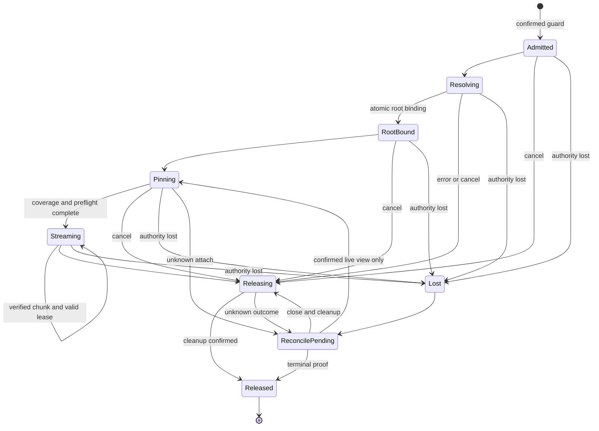
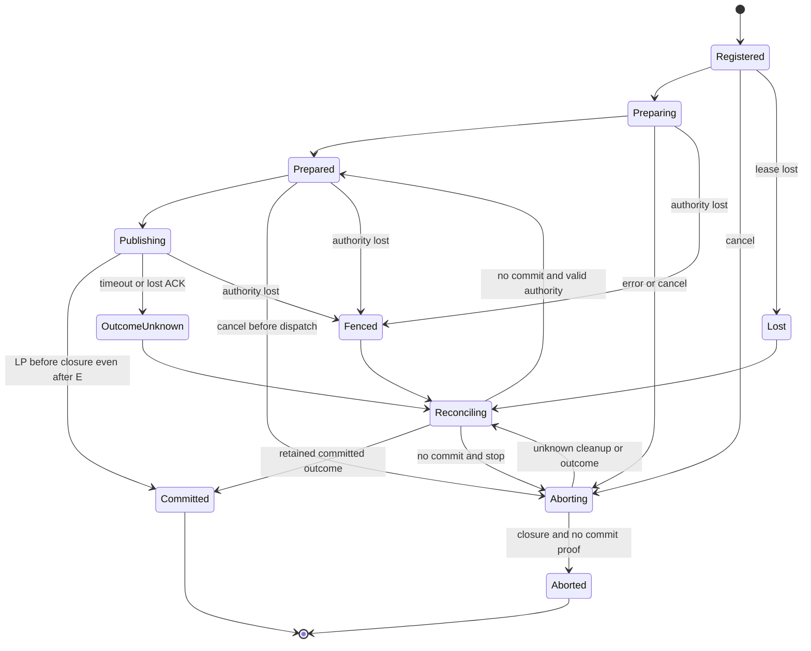
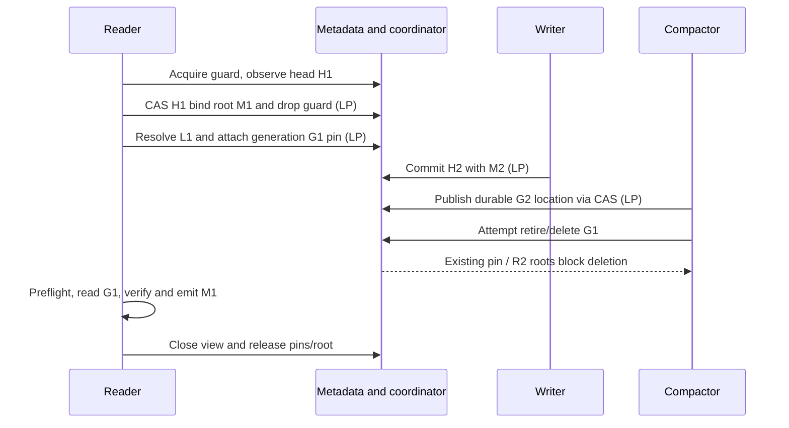
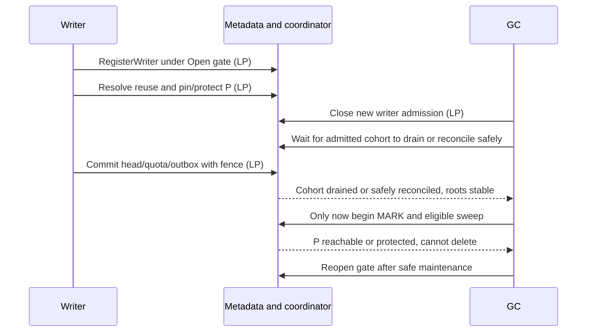
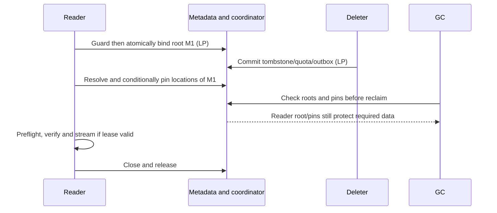
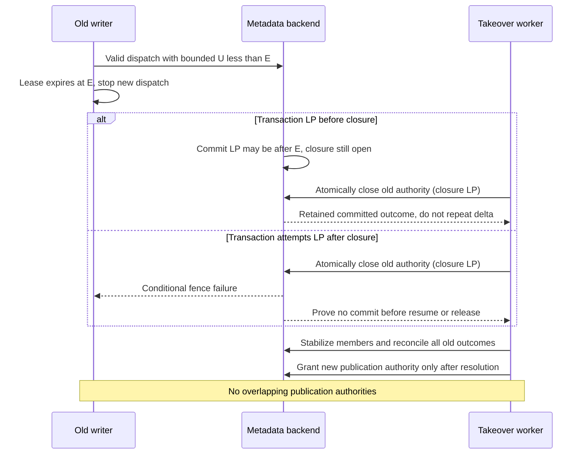
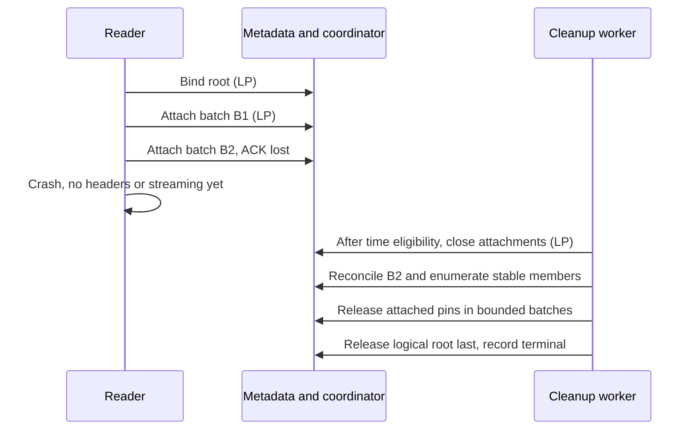
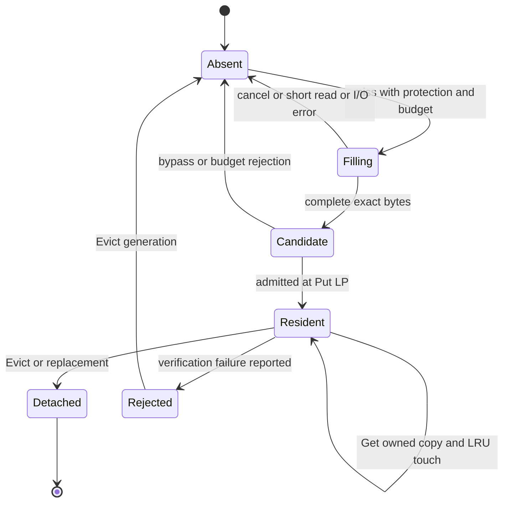

# W01-PHONG-02 — Draft R1 Read/Write View & Cache Contract

## 1. Document status, scope, source precedence và dependencies

**Status: Draft for review. Owner: Phong. Reviewer chính: Hưng. Không có approval hoặc feature-completion claim.** Tổng hợp Phase 2A/2B/2C; kết quả nghiên cứu không tự trở thành quyết định của team. Tài liệu không bổ sung implementation, shared Go types/ports, migration, PR hoặc trạng thái Miles.

Baseline: `origin/main` tại `f505f8a4cabea68aa229677845fde723b5d69785`, kiểm tra remote ngày 20/10/2026. Branch soạn thảo được tạo trực tiếp từ baseline này. Clock/policy Task 1 và shared-storage đã có trên baseline; cây tracked files của branch Task 1 khi khảo sát giống baseline, dù commit histories khác nhau. Local main phân kỳ lịch sử nên không được dùng làm điểm xuất phát.

Nhãn sử dụng:

- **FACT:** code/tài liệu đang tồn tại, không đồng nghĩa feature production đã hoàn thành.
- **DECISION:** quy tắc đã ghi ở contract nguồn; trạng thái review riêng của nguồn vẫn được giữ.
- **PROPOSAL:** thiết kế mới của tài liệu này, chờ review.
- **OPEN QUESTION:** điều chưa đủ proof hoặc chưa thống nhất; không tự chọn một expected behavior để freeze.

**Review update:** quyết định Hưng do người dùng chuyển tiếp trong vòng review này được ghi là **DECISION — Đã chọn phương án — chờ xác minh tích hợp**. Đây là lựa chọn kiến trúc, không phải approval toàn contract, Frozen hoặc evidence implementation. Không suy ra review/CI chưa đọc được.

### Nguồn và precedence

| Nguồn | Phạm vi authoritative và dependency |
|---|---|
| [Architecture v4](../dedup-storage-gateway-architecture.md), §1.2/1.4–1.6, §5–10, §16/18/19.1 | R1/R2, source durability, pack lifecycle, defaults; gọi tắt KT |
| [API v2](../dedup-storage-gateway-api.md), §2.2.3/2.6, §4.2–4.4, §6/8/9 | Observable behavior, auth admission, errors, archive preflight; gọi tắt API |
| [Clock/policy](clock-and-policy.md), §3–7/9 | Monotonic deadlines, UTC uncertainty, evaluator, immutable policy snapshot, freeze dependencies |
| [Shared-storage](shared-storage.md), Identity / Atomic mutation / PackStore and cache boundaries | Go boundary và ownership; source riêng ghi implementation for review, không production approval |
| [Models](../../internal/storage/model.go), [ports](../../internal/storage/store.go) | Shared `PackRef`, `ByteRange`, `CacheKey`, `WriterFence`, commit/reservation/outbox types; không định nghĩa bản sao tại đây |
| [Physical fake](../../internal/storage/fake/physical.go), [physical suite](../../internal/storage/contracttest/physical.go), [metadata suite](../../internal/storage/contracttest/metadata.go), [reservation suite](../../internal/storage/contracttest/reservation.go) | Executable fixture behavior và giới hạn evidence |
| [DoD](../acceptance/definition-of-done.md), D1-01..05, D2-03/05/06/09/10/12/14; [scope](../acceptance/scope-and-priorities.md), §1/3 | Truy nguyên yêu cầu/evidence; các tài liệu acceptance vẫn là draft, không approval |

API quyết định wire behavior; KT quyết định system safety; Clock/shared-storage cụ thể hóa boundary trong phạm vi được ghi. Khi các nguồn xung đột, ghi Open Question và yêu cầu đồng bộ nguồn, không tuyên bố tài liệu này override. Các dependency `SYNC-API`, `SYNC-KT`, `SYNC-R1/R2` ở Clock §9 vẫn còn hiệu lực trước consumer freeze.

**FACT:** shared store chưa có coordinator implementation. Các operation coordinator dưới đây là yêu cầu semantic, không phải các method đã tồn tại hoặc đề xuất `MetadataStore` thứ hai. R1 dùng shared gates/pins và bounded operations; không thay bằng epoch reclamation, không giữ global lock suốt GET. R2 recovery epoch là domain khác với R1 fence và policy revision.

## 2. Review Required — Hưng

Các lựa chọn dưới đây đã được Hưng quyết định theo nội dung review người dùng cung cấp. Cột lựa chọn ghi phương án đã chọn; các options còn lại chỉ giữ context. **Status: Đã chọn phương án — chờ xác minh tích hợp.** Những OQ chưa được quyết định ở §19 vẫn **Pending Review**. Lựa chọn không tự giải quyết proof obligations hoặc hoàn tất downstream tests.

| ID | Context | Options | Chosen choice — DECISION | Trade-off | Impacted shared contracts | Owner / reviewer | Status |
|---|---|---|---|---|---|---|---|
| Q1 | Acquire→resolve có thể mất manifest/location cũ | A1 short resolving guard; A2 per-object anchor protocol | A1, với all destructive paths interlock; chỉ giữ tới atomic root binding | Metadata global contention ngắn; A2 scale tốt hơn nhưng anchor/tombstone protocol phức tạp | KT §6/8; coordinator/storage integration | Phong / Hưng, metadata consumer Hải/Chiến | Đã chọn phương án — chờ xác minh tích hợp |
| Q2 | Head có thể đổi giữa observe và bind | Atomic observe+bind; hoặc observe rồi transaction CAS head revision+root+guard | CAS exact bucket/head/manifest, attach root và detach guard cùng transaction | Retry khi head đổi; bounded transaction, không bind toàn manifest pages | GetObject/GetManifest; KT §8 roots | Phong / Hưng, metadata consumer | Đã chọn phương án — chờ xác minh tích hợp |
| Q3 | Pin batches có partial/unknown result; release scan có thể thiếu members | Stable closed membership + batch IDs; hoặc bounded frozen descriptor protocol | Stable closed membership + batch IDs; mỗi batch kiểm view state/revision; pin exact PackRef/generation, không cần range-pin cho generation-level retire/delete | Thêm records/index protocol; consistent Scan đang đổi không đủ; giữ cả generation có thể giữ nhiều bytes hơn | PackRef/Chunk.LocationRevision; future coordinator encoding | Phong / Hưng, metadata consumer | Đã chọn phương án — chờ xác minh tích hợp |
| Q4 | Old transaction có thể publish sau takeover | B1 quiesce mọi in-flight trước transfer; B2 shared fence closure checked trong mutation transaction | B2: đóng old authority, ổn định membership/outcomes, reconcile rồi cấp new authority | Conditional transaction contention; không fence S3 đã gửi | WriterFence; CommitObject/DeleteObject/location CAS; R2 ledger/outbox | Phong / Hưng, metadata consumer | Đã chọn phương án — chờ xác minh tích hợp |
| Q5 | Renew/expiry/takeover cạnh tranh | Client timing only; authoritative lease/fence CAS + bounded local budget | CAS lease revision/owner/incarnation; U<E để dùng; L>=E+grace chỉ reclaim eligibility | Cần valid time bound, no-overlap proof; availability giảm khi uncertainty lớn | Clock §3.4; WriterLease; ClaimReservation | Phong / Hưng, Clock/metadata consumers | Đã chọn phương án — chờ xác minh tích hợp |
| Q6 | Transaction dispatch trước E có thể settle sau E | Strict commit-time expiry; dispatch permission + closure ordering | Bỏ strict commit-before-E; bounded U<E cho dispatch mới, publication LP trước closure có thể commit sau E; closure+incarnation kiểm cùng mutation; reconcile trước cấp new authority | Cần chứng minh không overlap publication authorities; expiry không rollback in-flight transaction | Clock §3.4; shared-storage Atomic mutation; publication contract | Phong / Hưng, backend consumer | Đã chọn phương án — chờ xác minh tích hợp |
| C-OQ02 | Read-ahead có thể chạm generation chưa pin | Generation-level protection; range-pin; restrict protected set | Exact PackRef/generation pins; cùng generation đã pin không cần range-pin bổ sung cho retire/delete; generation mới phải admit/pin trước fetch | Bảo vệ cả generation; logical authorization và byte bounds vẫn bắt buộc | PackRef/ChunkLocation; read-view pins | Phong / Hưng, engine/storage consumers | Đã chọn phương án — chờ xác minh tích hợp |
| C-OQ03 | Default 4 chunks chưa định nghĩa ahead-only/total | Ahead-only; total window | 4 chunk phía trước, không tính demand chunk; 0 tắt prefetch | Potential amplification vẫn chịu budgets | Bucket cache policy; Clock §4.3; API §6.3 | Phong / Hưng, config/engine consumers | Đã chọn phương án — chờ xác minh tích hợp |
| C-OQ04 | Cache.Put không có admitted result | nil best-effort; explicit agreed existing error; mở rộng port sau review | nil nghĩa xử lý best-effort, oversized/full có thể bypass | Consumer không được dựa retention; fixture phải đủ capacity | Shared Cache.Put và RunCache | Phong / Hưng, shared-storage/engine consumers | Đã chọn phương án — chờ xác minh tích hợp |
| C-OQ05 | Byte capacity không bound toàn RAM/I/O | Một limit; budgets tách resident/transient/metadata/decode/I/O | Budgets riêng, reservation trước allocation/fetch; chưa chọn số | Accounting phức tạp hơn, tránh memory amplification | Clock config caps; engine/cache adapters | Phong / Hưng, config/ops consumers | Đã chọn phương án — chờ xác minh tích hợp |
| C-OQ07 | Cùng immutable key nhưng bytes khác | Replace; reject/report; evict+quarantine | Detect mismatch khi entry còn resident, reject/report, evict generation; engine luôn verify | So sánh tốn CPU; chưa biết bản nào đúng; late fill còn rủi ro availability | Cache.Put/ErrConflict semantics; verification | Phong / Hưng, storage/engine consumers | Đã chọn phương án — chờ xác minh tích hợp |
| C-OQ08 | Evict có thể bị late Put refill | Resident-only removal; coordinated purge barrier | Core Evict resident-only; strong purge cần separate reviewed job protocol nếu yêu cầu | Đơn giản nhưng không hứa cache trống mãi; cluster partial failure | Cache.Evict; API cache purge/jobs | Phong / Hưng, Admin/jobs consumers | Đã chọn phương án — chờ xác minh tích hợp |

Các dòng §2 đều là lựa chọn kiến trúc đã nhận qua review, chưa xác minh tích hợp. Không ghi toàn contract Approved/Frozen. §19 liệt kê thêm OQs và freeze gates.

## 3. R1 safety invariants

**DECISION từ KT §5–9, API §2.6/4.2, Clock §3 và review Hưng Q1–Q6:**

| ID | Invariant |
|---|---|
| R1-01 | Register writer và shared gate admission nguyên tử; gate Closing không nhận writer mới |
| R1-02 | Read view tồn tại trước resolve; old manifests và physical generations không bị reclaim trong khoảng chưa có protection thay thế |
| R1-03 | RootBound bảo vệ logical root, không tự động chứng minh mọi physical generation đã pin |
| R1-04 | Publication atomically checks đúng authority/fence/incarnation cùng head/quota/reservation/outbox/optional receipt; physical durability trước publication |
| R1-05 | Lost lease dừng local read/emit và dispatch side effect mới; dispatch mới cần bounded U<E và valid lease/fence/incarnation. In-flight transaction dispatch hợp lệ có thể commit/settle sau E theo closure ordering; grace chỉ reclaim |
| R1-06 | Timeout/ErrUnavailable/absent head không chứng minh no-commit; giữ roots/ledger/gates cho unknown outcome |
| R1-07 | S3 action đã gửi không bị metadata fence thu hồi; unknown action giữ durable Deleting/Transitioning |
| R1-08 | Delete cần đủ roots/pins/protection/retention/R2 proof; thiếu proof thì skip delete |
| R1-09 | Read authorization tại admission; cache không cấp quyền. Writes kiểm quyền hiện hành trong publication transaction |
| R1-10 | R2 recovery đổi incarnation, không replay stale authority; cache không là recovery root |
| R1-11 | Không tồn tại hai publication authorities có thể publish chồng nhau: old authority được close atomically với cùng publication boundary; stabilize membership và reconcile mọi in-flight/unknown outcomes trước cấp new publication authority |

**Proof obligations — chờ xác minh tích hợp:** A1 guard interlock mọi destructive path; atomic guard→root handoff; exact-generation pin/admission và retire cùng authoritative serialization boundary; B2 closure và mọi old publication cùng boundary; closed membership enumerate đầy đủ; không overlap publication authorities. Không yêu cầu transaction LP trước E; fake mutex không chứng minh các obligations này.

## 4. Coordinator operations và atomicity/linearization points

Operation matrix cụ thể hóa các **DECISION Q1–Q6**; concrete records/encoding/backend transactions còn là **PROPOSAL chờ review và xác minh tích hợp**. Inputs/results là logical fields, không Go declarations. Reuse shared identities và fences. `operation ID` stable cho retry, gắn immutable input; lease revision, fence và takeover ownership không biến thành logical operation mới.

### 4.1 Preconditions, effects và LP

| Operation | Input → output / identity | Preconditions | Atomic effects và LP |
|---|---|---|---|
| RegisterWriter | stable admission ID, authorized bucket incarnation, request deadline, policy snapshot → admitted lease + shared WriterFence | Gate Open; valid incarnation/time bound; request chưa cancelled/expired | Kiểm gate và tạo membership/lease/fence trong một transaction; LP transaction commit |
| AcquireReadView | stable view ID, admitted read auth/bucket, deadline → resolving guard + lease | Resource/service admission hợp lệ; không dùng gate writer để khóa hết readers | A1: register unresolved guard và lease atomically với destructive admission guard; LP commit guard |
| Bind root (internal step) | view/revision, observed ObjectKey/head revision/manifest → RootBound | Guard còn hợp lệ; exact bucket/head; manifest immutable, pages cần verify completeness | Transaction CAS observed head + attach logical root + detach guard; LP commit. Conflict giữ protection cần thiết và resolve lại |
| ResolveAndPin / PinLocations | view/revision, bounded batch ID, ChunkKey/location revision, exact PackRefs; ranges dùng cho fetch plan → attached generation pins | RootBound; valid dispatch proof U<E, lease/fence/incarnation; view cho attach; resource chưa đóng admission | Validate location/resource admission + attach exact-generation batch pins trong bounded transaction; shared closure/incarnation condition cùng mutation; LP từng batch có thể sau E nếu dispatch hợp lệ trước E và closure chưa thắng. Không tuyên bố cả object atomic |
| RenewLease | lease ID/owner/revision/fence/incarnation → new expiry/revision | Old rights chưa Lost, U<E; local deadline chưa hết; authoritative owner/revision match | CAS renewal. LP commit lease revision; ACK muộn không tự chứng minh còn quyền tại client |
| ReleaseLease | view/writer ID, expected revision, stable release ID → closing/terminal status | Owner/reconcile authority hợp lệ; đóng attach/publication trước cleanup | LP closure làm membership ổn định; cleanup bounded/idempotent sau đó; terminal chỉ sau outcome và cleanup đủ proof |
| AcquireMaintenanceGate | stable job/gate ID, mode, job fence → Closing/owned gate | Valid job lease/incarnation; expected gate state | CAS Open→Closing + reject new producers; LP CAS. Drain admitted cohort; không hủy writer khỏe chỉ vì gate Closing |
| ReleaseMaintenanceGate | job/gate revision/fence → Open hoặc retained closure | Matching owner; maintenance proof hoàn tất, hoặc abort close an toàn | CAS reopen gate; không reopen resource có unknown S3 mutation |
| Takeover | old lease/fence, expected revisions, stable logical op, new worker → reconciliation/new authority | L>=E+grace chỉ time eligibility; CAS old ownership; takeover worker có authority/proof riêng | B2 atomically close old authority cùng boundary với publication; stabilize membership, reconcile mọi in-flight/unknown outcomes; chỉ sau đó transfer LP cấp new publication authority dưới new fence. Unknown giữ đóng, không transfer |
| ReconcileMutation | stable op ID + immutable digest/object/upload binding → committed / proved-not-committed / unknown | Authoritative ledger/outbox/receipt protocol; correct incarnation/history | Read/transaction consistent với closure. CAS terminal outcome/claim nếu cần; LP proof read hoặc commit outcome transition, không phải GetObject tùy ý |

**FACT:** shared storage hiện có `CommitObject`, `DeleteObject`, `ClaimReservation`, `ReleaseLogicalQuota` và các mutation ports; không có các coordinator ports trên. `WriterFence` hiện chứa LeaseID/ServiceIncarnation/Epoch; không tự nhét policy revision, history epoch hoặc state revision vào Epoch. [model.go](../../internal/storage/model.go), [store.go](../../internal/storage/store.go).

### 4.2 Validation, retry, unknown outcome và boundaries

Mọi authoritative mutation trong proposal phải kiểm owner, expected revision, fence, service incarnation và operation binding ngay trong atomic effect. Read snapshot không thay transaction condition. Kết hợp condition với Update trên cùng item; không giả định backend có thể atomically mutate toàn bộ manifest hoặc số pins không giới hạn (shared-storage Atomic mutation; API §2.2.3).

**DECISION Q6:** bounded local `U<E` là quyền dispatch side effect mới, không là commit-time predicate. Mọi authoritative metadata publication kiểm shared closure và incarnation trong cùng transaction với mutation. LP trước closure có thể sau E và vẫn là committed outcome; LP sau closure phải fail fence condition. Các điều kiện độc lập như current authorization, quota, head CAS và request/reservation deadline không bị bỏ hoặc tự kéo dài bởi quyết định này.

| Operation | Idempotency / retry | Unknown-outcome handling | Failure/boundary vectors |
|---|---|---|---|
| RegisterWriter | Cùng ID/input trả cùng admission hoặc terminal; đổi binding conflict | Lookup admission ID trước register mới | Gate close cùng register; bucket ABA; cancelled; expiry equality |
| AcquireReadView | Cùng ID không tạo guard thứ hai; terminal ID không resurrect | Reconcile guard/lease; không resolve nếu chưa biết protection tồn tại | Destructive action tranh admission; lost ACK; stale incarnation |
| Bind root | Cùng root binding idempotent; head đổi conflict | Đọc authoritative view binding; không tự drop guard | Overwrite/delete giữa observe/bind; transaction lost ACK |
| PinLocations | Same batch ID + digest; không double attach | Đọc exact batch outcome; không fetch batch unknown | Location CAS; retire race; batch partial; limit/overflow; close attachments |
| RenewLease | Không retry thành new lease; stale revision reconcile | Không kéo local budget dựa ACK chưa rõ; fail closed khi proof hết | U=E; delay ACK; suspend; grace; old owner |
| ReleaseLease | Close/cleanup retries giữ terminal markers theo retention | Giữ unknown roots/reservations; không infer từ missing head | Attach versus close; lost commit ACK; crash giữa cleanup batches |
| Acquire gate | Same job ID không tạo gate thứ hai | Reconcile gate ownership/cohort | Concurrent jobs; drain timeout; healthy long writer |
| Release gate | Same owner/revision; no blind Open | Read gate/resource closure trước reopen | Stale releaser; pending DELETE/COPY; lost ACK |
| Takeover | CAS chỉ một winner; immutable operation không đổi | Old commit known mới chọn resume/cleanup; unavailable giữ đóng | Renew race; equal E+grace; two takers; old worker return |
| ReconcileMutation | Original committed result giữ nguyên; no double quota | Unknown là kết quả hợp lệ, không cleanup | Commit-before/after-closure, missing ledger/retention, absent head sau overwrite |

## 5. Read View state machine

**PROPOSAL:** all requested-range physical pins và archive preflight phải hoàn tất trước response headers. State names là analysis vocabulary, chưa là stored enum/API.

| Transition | Trigger / preconditions | Effect / LP / checks | Failure và idempotency |
|---|---|---|---|
| Start→Admitted | Read auth, AcquireReadView thành công | Guard+lease commit; identity/fence/incarnation checks | Unknown admission→ReconcilePending; không resolve thiếu guard |
| Admitted→Resolving | Begin consistent head/pages/chunks reads | Local transition; guard còn hiệu lực; không có publication LP | Retry reads dưới cùng view; Lost thì dừng |
| Resolving→RootBound | Complete logical identity, Q2 CAS | Root attach + guard detach commit LP | Head conflict resolve lại; unknown giữ guard/root theo authoritative binding |
| RootBound→Pinning | Lập bounded requested location plan | Local start; mỗi attach có batch LP như §4 | Root chưa đủ physical protection; không fetch trước attach |
| Pinning→Streaming | Tất cả requested coverage confirmed, preflight pass | Local readiness barrier, không global snapshot LP; recheck lease/deadline | Unknown batch không được tính đủ; idempotent batch reconciliation |
| Streaming→Streaming | Next verified chunk | Check local budget/fence validity; cache hoặc backend không thay quyền | No unverified emit; Lost/cancel dừng bước tiếp theo |
| Active→Releasing | Finish/cancel/error | Close attachments LP trước stable enumeration; stop/quiesce local I/O | Không unpin khi fetch còn chạy; retry release ID |
| Releasing→Released | All cleanup/outcomes confirmed | Terminal marker commit; root bỏ cuối sau dependencies | Unknown→ReconcilePending; Released terminal |
| Active→Lost | Proof hết, lease/fence/incarnation invalid | Local stop ngay; không tự xóa durable roots | Không Lost→Streaming qua late renewal |
| Active/Releasing→ReconcilePending | Lost ACK hoặc cleanup uncertainty | Giữ durable protection chưa chứng minh bỏ được | Authoritative resolution→Releasing/Released; chỉ resume nếu chưa Lost và toàn quyền còn valid |



ReconcilePending giữ riêng cờ authority đã Lost: nhánh trở lại Pinning tuyệt đối không áp dụng cho Lost view. Renew không là quyền hồi sinh.

## 6. Write View state machine

**PROPOSAL:** outcome và execution authority là hai trục độc lập. Một operation đã Committed vẫn Committed dù worker sau đó bị Fenced. Fenced/Lost không phải bằng chứng Aborted.

| Transition | Trigger / preconditions | Atomic effects / LP / lease checks | Failure / retry |
|---|---|---|---|
| Start→Registered | RegisterWriter + reservation theo shared protocol | Admission LP; current gate/fence/incarnation | Unknown register/reserve reconcile đúng stable IDs |
| Registered→Preparing | Consume verified client input, new/reused pack admission | Bounded pins/protection trước reuse/publish; physical writes không là object LP | Cancel/lease loss dừng prepare; blobs thành orphan candidates |
| Preparing→Prepared | Pack/sidecar/pages complete và durable, requested resources protected | Local completeness barrier; side effect mới cần dispatch proof U<E; mỗi metadata attach có LP riêng | Partial pages retry/verify; cache không thay durability |
| Prepared→Publishing | Publication request với immutable input/op ID | Local dispatch với bounded U<E và valid lease/fence/incarnation; chưa phải commit LP | Proof hết thì không dispatch; timeout sau dispatch→OutcomeUnknown |
| Publishing→Committed | Authoritative transaction committed | Head/quota/ledger/outbox/receipt cùng LP; shared closure/incarnation/fence và current auth trong transaction. Valid dispatch trước E có thể commit sau E nếu LP trước closure | Lost ACK→OutcomeUnknown; expiry sau dispatch không phủ nhận committed outcome |
| Prepublish→Aborting | Cancel/error hoặc revoke | Close future publication/attachments trước cleanup | S3 request đã gửi phải quiesce/reconcile |
| Aborting→Aborted | Authoritative no-commit + closure + cleanup đủ proof | Terminal transition và quota release theo shared ledger CAS | Same cleanup idempotent; unknown không release |
| Publishing→OutcomeUnknown | Timeout/ErrUnavailable | Không thêm effects dựa suy đoán | Giữ roots/ledger, reconcile stable op |
| OutcomeUnknown→Reconciling | Authoritative lookup / takeover closure | Proof read/transaction dưới đúng incarnation | Unavailable giữ nguyên protection |
| Reconciling→Committed | Retained outcome chứng minh commit | Trả original result, không apply lại quota | Current head có thể đã overwrite/delete |
| Reconciling→Prepared | Chứng minh chưa commit + new/live authority hợp lệ | Claim CAS và revalidate resources/auth/deadline | Original deadline không được kéo dài |
| Reconciling→Aborting | Proved no-commit, hết deadline/không retry | Closed authority trước release | Idempotent cleanup |
| Active→Fenced/Lost | Closure, lease loss, incarnation change | Stop local execution/dispatch mới; outcome chưa kết luận. Expiry không rollback in-flight transaction; closure chặn LP tới sau nó | Chuyển reconciliation; không retry bằng old authority; preserve committed LP trước closure |



Diagram chỉ biểu diễn workflow; Fenced/Lost không ghi đè durable outcome. In-flight publication dispatch hợp lệ trước E vẫn có thể commit sau E, trước closure; nhận diện committed outcome không khôi phục quyền dispatch của old worker. Reconciliation dưới old fence không được mutation; takeover/reconciler cần authority riêng. Chỉ cấp new publication authority sau closure và reconcile mọi in-flight/unknown outcomes.

## 7. Resolving guard, manifest root và location pin lifecycle

**DECISION Hưng Q1/Q2/Q3 — Đã chọn phương án — chờ xác minh tích hợp:**

1. Acquire guard trước đọc head. Destructive workers phải interlock guard admission; chưa chứng minh guard/root handoff thì không reclaim candidates có thể liên quan.
2. Observe exact bucket incarnation/head revision/manifest; CAS bind root + drop guard atomically. Head đã thay thì retry, không attach observed stale head không có proof.
3. Immutable root giữ logical chunk identities, không cố định physical locations. Resolve consistent location; pin phải condition-check revision và resource admission trong cùng attach transaction.
4. Compaction thắng trước attach thì resolve lại. Reader pin thắng trước retire thì old generation tiếp tục được giữ; không bắt reader đang pin phải chuyển canonical location.
5. Attach bounded batches bằng stable batch IDs và closed membership protocol. Safety pin theo exact PackRef/generation, không cần range-pin để bảo vệ generation-level retire/delete. Byte ranges vẫn cần đúng bounds và logical read plan. Unknown/partial batches chưa được tính coverage đầy đủ; không streaming sớm. Không atomic transaction không giới hạn.
6. Release đóng attachment state trước; mỗi attach transaction condition-check state/revision nên delayed attach không thêm member sau closure. Lúc đó mới enumerate stable membership đủ pagination, cleanup idempotent, root bỏ cuối.

**A2 alternative:** per-object anchor/tombstone protocol có thể giảm global guard contention, nhưng phải chứng minh anchor admission không race delete/recreate và mọi logical roots/physical handoff tương đương. Chưa chọn encoding hoặc tạo shared anchor type.

**Clarification C-OQ02:** requested read chỉ bảo vệ các exact generations đã pin. Read-ahead thêm range trong cùng generation được pin không cần range-pin riêng cho retire/delete; sang generation khác phải có protection bổ sung trước fetch. RootBound không giữ nguyên mọi historical chunk location. Retire/delete luôn đối chiếu generation pins, không chỉ logical root/refcount (KT §6/8).

## 8. Lease, fencing, takeover và reconciliation

**DECISION — Clock §3.4–3.5:** valid khi chứng minh `U < E`; expired tại E; `L >= E + grace` chỉ đủ xét reclaim, vẫn cần CAS/roots/outcome proof. Grace không thêm quyền. Deadline dùng local monotonic Instant; Instant không serialize/chuyển node/sống qua restart. Unknown/stale UTC bound hoặc suspend cần revalidation; không lấy skew 2s làm toàn uncertainty.

Defaults nguồn: hard deadline 30 phút, lease 60s, heartbeat 15s, reclaim grace 5s. Không tự đổi defaults hoặc pin numeric local safety budget chưa được chứng minh. Renewal cần CAS owner/revision/fence/incarnation; mỗi owner tự xác nhận local use budget còn hợp lệ. Late ACK không resurrect Lost.

**DECISION Hưng Q4/Q6 — Đã chọn phương án — chờ xác minh tích hợp:** B2 closure của old authority cùng authoritative transaction boundary với mọi publication. Worker chỉ dispatch side effect mới khi bounded local proof `U<E`, lease/fence/incarnation hợp lệ. Transaction dispatch hợp lệ trước E có thể commit/settle sau E. Mọi authoritative metadata publication kiểm shared fence closure và incarnation trong cùng transaction với mutation. LP trước closure được giữ là committed outcome kể cả sau E; LP sau closure phải fail fence condition. Không yêu cầu strict commit-before-E và không dùng client timestamp như server commit clock.

Takeover atomically close old authority, stabilize membership rồi reconcile mọi in-flight/unknown outcomes trước khi cấp new publication authority. Unknown không phải no-commit, không cleanup sớm hoặc transfer khi còn outcome chưa giải quyết. Safety property là **không có hai publication authorities có thể publish chồng nhau**, không phải mọi transaction commit trước lease expiry. Gate Closing vẫn drain admitted healthy cohort theo mode; không đóng mọi fence chỉ vì bắt đầu maintenance.

| Khái niệm | Predicate / semantics |
|---|---|
| Local dispatch permission | Bounded U<E + valid lease/fence/incarnation, request chưa hết deadline/cancel; hết proof không gửi side effect mới |
| Publication ordering | Atomic shared closure/incarnation condition cùng mutation; dispatch hợp lệ trước E được settle sau E nếu LP trước closure và các điều kiện khác còn đạt |
| Reclaim eligibility | L>=E+grace chỉ mở quyền xét reclaim; cần closure, outcomes, pins/roots/retention và protection proof |
| Operation outcome | Stable op/outbox/ledger/receipt; không đổi thành Aborted chỉ vì worker Lost hoặc response timeout |

Protection theo Clock §3.5: `D_hi = U + remaining_monotonic`; durable protection ít nhất round-up `D_hi +15m`, không giảm old protection; Restored expiry lower bound ít nhất `D_hi +120s`. Expired/cancelled request không được admit dù remaining=0. Cache không thay các phép kiểm này.

Reconcile dùng stable op ID và retained outbox/ledger/receipt trong đúng history/incarnation. Head absent hoặc head khác không chứng minh chưa commit. Unknown giữ ledger/roots/closed resources. Destructive S3 unknown phải HEAD/reconcile; không reopen Warm dựa timeout. Recovery mới không kế thừa active old leases (KT §8.2/9; shared-storage Reservation lifecycle).

## 9. GET/PUT/DELETE/GC/compaction race sequences

**PROPOSAL:** diagrams là expected event order và fault design, chưa là bằng chứng thực thi. `LP` ghi đúng authoritative boundary; local steps không phải transaction LP.

### S1 — GET → overwrite → compaction



Invariant R1-02/03/08; expected old reader M1, new reader H2. Fault: pause before attach to make CAS conflict, and after attach to verify G1 retained. Missing lease proof aborts read; cache cannot supply missing pin.

### S2 — PUT reuse → GC



Invariant R1-01/04/08. GC chỉ bắt đầu MARK/sweep sau khi admitted writer cohort đã drain hoặc được reconcile an toàn và roots đã ổn định; yêu cầu chờ drain không tự chứng minh điều kiện này đã hoàn tất. Writer còn hợp lệ được hoàn tất trong thời gian drain. Unknown outcome chưa được resolve giữ protection và không được coi là drained để bỏ root. If retire wins before reuse attach, writer must retry/revive from client body as applicable, not trust old candidate. Fault: pause lookup→pin and pin→publish; enumerate GC candidates before reuse; assert no deletion solely from stale refcount.

### S3 — GET → DELETE



Invariant R1-02/03/08. Root keeps logical liveness; pin protects selected physical generations. New GET sees tombstone; admitted reader uses bound M1. Fault: pause after root bind but before first pin; delete and compact; assert logical contents reconstructible and stale location re-resolved.

### S4 — Renew → expiry → fence closure → takeover


Invariant R1-05/06/11. Successful renew that wins CAS must be observed by takeover; takeover cannot close stale revision blindly. Unknown does not transfer publication permission. Valid pre-E dispatch may already have committed after E but before closure, and must be reconciled as committed. Fault: reorder renewal commit/ACK/closure, boundary U=E and L=E+grace; two takers, suspended old worker; assert new authority not granted while any old outcome remains unknown.

### S5 — Delayed metadata publication



Invariant R1-04/06/11; Q6 chọn dispatch permission + closure ordering. Fault: pause backend between dispatch and commit; valid dispatch trước E, LP sau E nhưng trước closure là expected committed outcome nếu các điều kiện độc lập khác đạt. LP sau closure phải bị fence từ chối; dispatch mới khi U>=E phải bị chặn. Lost ACK phải reconcile original result kể cả head đã overwrite; unknown chưa resolve thì không cấp new publication authority hoặc cleanup.

### S6 — Crash giữa bounded pin batches



Invariant R1-03/06/08; root remains while physical coverage incomplete. Delayed B2 cannot attach after closure; B2 before closure must be enumerated. Fault: kill after every batch LP/ACK, race delayed attach with close, lose cleanup ACK; assert no early root release or omitted member.

## 10. Cache identity, exact-range và ownership

**FACT/DECISION:** shared `CacheKey{Pack: PackRef{ID,Generation}, Range: ByteRange{Offset,Length}}`; no new competing identity. `RangeGet` returns compressed physical bytes, SHA-256 identity is raw chunk content; class changes keep content generation. `Chunk.LocationRevision` validates pointer changes; `PackInfo.StateRevision` tracks lifecycle, neither is cache byte identity (shared-storage Identity/PackStore; KT §6/7).

**PROPOSAL:** exact key only, no implicit containing-range/overlap hit. Demand key is full compressed chunk location even for a logical subrange, allowing complete decode/hash before emitting slice. Coalesced reads split into exact chunk keys; avoid storing both whole coalesced buffer and all chunks by default. Bounds checked against authoritative pack size, overflow-safe; empty object has no zero-length physical key. Fake key validator uses MaxInt64, not actual pack size, so does not prove this check.

Owned input/output copies are DECISION in shared contract. Caller must not concurrently mutate input during Put; after return may reuse. Output belongs to caller, survives eviction as memory, not as lease permission. Physical cache may serve multiple domains only after authorized logical resolution; adding bucket/domain/incarnation to cache key would duplicate identity instead of securing access.

## 11. Byte-bounded LRU và admission

**PROPOSAL:** capacity C is validated resident payload budget; no numeric C selected here. `resident_bytes = sum(len(entry.bytes)) <= C`. Entry metadata/count, caller copies, fill/decode buffers and I/O have separate limits (§12).

| Operation | Behavior / LP |
|---|---|
| Get hit | Owned copy and MRU touch under coherent synchronization; LP selection+touch |
| Get miss | Exact key absent at LP; Cache port performs no S3 I/O |
| Put admitted | Full entry, accounting and recency publish atomically; no partial body |
| Replace | Identical bytes retry không double charge; cùng key khác bytes là integrity conflict, không silent overwrite; evict/report exact generation theo C-OQ07 |
| Evict | Remove all resident ranges of exact PackRef atomically; other generations unaffected |

Oversized entry bypasses without evicting all useful data. Capacity pressure evicts LRU before successful admission. No transient reservation means bypass before expensive clone. **DECISION C-OQ04:** Cache.Put best-effort; full/oversized/admission bypass có thể trả nil, không hứa retained. Invalid input/cancellation vẫn error theo Cache port; cancellation trước LP không publish, cancellation chạy sau LP không hứa rollback. Fixture capacity phải fit suite expectations. **DECISION C-OQ07:** same-key khác bytes là integrity conflict, không silent overwrite, evict/report exact generation. **DECISION C-OQ08:** Evict resident-only; late refill có thể xảy ra, strong purge thuộc downstream job protocol. Cache admission không thay durable PUT result.

Baseline strict local LRU; no lock held across network, auth, pin acquisition or decode. Safe owned-copy implementation needs entry backing lifetime while copying; do not unlock/use freed backing implicitly. Strict LRU has contention; sharded approximate LRU is alternative pending benchmark, not silently equivalent. Memory implementation fake has one mutex/unbounded map and replaces same-key bytes; proposed LRU/conflict semantics are not claimed implemented.

Concurrent misses may perform independent bounded fills. Equal-key identical fills leave one resident entry/accounting. Optional singleflight shares bytes only: waiters retain independent auth/view/pins/deadlines; leader cancellation/protection lifetime requires separate proof. No new public port is introduced here.

### 11.1 cache.admit_on_write

**DECISION review Hưng — chờ xác minh tích hợp:**

- `false`: writer không chủ động admit physical bytes từ write path. Read-path caching vẫn theo policy/read contract riêng; không disable read cache hay purge resident entries.
- `true`: writer có thể best-effort admit khi đã có final exact PackRef/generation/offset/length và physical bytes hoàn chỉnh đúng range. Không dùng provisional PackRef hoặc offset chưa cố định; chỉ hash/raw body chưa đủ để dựng physical cache entry.
- Sequencing: finalized complete physical bytes là điều kiện tối thiểu của local admission; admission có thể trước hoặc sau pack durability/object publication, nhưng không thay bất kỳ prerequisite durability/publication nào. Pack/sidecar/pages vẫn phải durable trước metadata publication. Cache resident trước head commit không tạo quyền đọc trước publication: reader luôn qua authoritative resolution và R1 pipeline.
- Admission không tham gia object publication LP, quota, head, outbox hoặc commit result; không chờ cache retention để kết luận write durable. Full/oversized/admission bypass không fail durable write. Invalid input/cancellation vẫn theo port error contract và không biến thành silent successful admission; request cancellation xử lý riêng, cache không đảo ngược committed outcome.
- Reused/dedup chunk không tự tạo entry nếu writer không có canonical compressed physical bytes ứng với exact canonical key. Raw input hoặc bytes từ losing/provisional location không được cache dưới winning key.
- Orphan/aborted bytes có thể còn resident tới eviction. Chúng không tạo logical reachability, quyền đọc hoặc R2 recovery root; không cần cache eviction để chứng minh abort.
- Request tương lai hit vẫn Authorize→AcquireReadView→Resolve→Pin→Archive preflight→Verify→Emit. Compaction/retire không cho phép relabel bytes sang new generation; writer/read consumer phải tuân R1 protection và location revision checks. Corruption sau write admission xử lý như mọi cached corruption.

Specific local scheduling/admission placement là implementation detail, không thêm durability guarantee hoặc shared port mới. Test vectors T17–T24 ở §18 khóa các điều kiện trên.

## 12. Read-ahead, resource budgets và pin coverage

**DECISION:** bucket cache policy defaults admit_on_write=true/readahead_chunks=4; 4 là 4 chunk phía trước, không tính demand chunk; 0 disables prefetch. Concrete caps deferred by Clock §4/9. Request uses pinned immutable policy snapshot, not new config read each chunk. Write admission theo §11.1.

**PROPOSAL:** prioritize demand; plan prefetch from bound manifest, validated locations. Same exact PackRef only for a coalesced backend request; enforce pack bounds/overflow and account gap bytes. Verify chunks separately, never treat HTTP range bytes/checksum as raw chunk verification. No arbitrary MB window or worker count selected.

**DECISION Q3/C-OQ02:** before any fetch, protection phải cover mọi exact PackRef/generation chạm tới, gồm generation của coalesced bytes. Pin generation bảo vệ retire/delete cho toàn generation: read-ahead thêm range trong cùng generation đã pin không cần range-pin bổ sung. Ngoài requested range mà chạm generation chưa pin phải confirmed extra admission/pin trước fetch. Mọi range vẫn validate bounds, logical plan/authorization và lifecycle preflight; pin không cấp quyền truy cập object khác. RootBound không thay generation pins. No global GET lock. Optional archive speculation is skipped, not silently restored or used to change requested-read error behavior.

**DECISION C-OQ05:** budgets resident/transient/decode/I/O riêng; gồm resident bytes, entry count/metadata, in-flight buffers/copies, raw decode/verify size, prefetch bytes, per-request/node concurrent I/O. Reserve before allocation/fetch; validate codec expansion/declared raw sizes. Numeric caps còn Pending Review, không tự chọn ở đây. RSS is not bounded by resident C alone; NVMe capacity does not bound staging RAM. Demand must not wait indefinitely behind speculative work. Exhausted prefetch budget skips speculation; demand still obeys its own limits.

Cancellation/Lost/deadline stops new scheduling. Cancel in-flight I/O and quiesce before releasing its protection; adapter cancellation is not proof S3 destructive request was undone. Prefetch never extends request deadline or lease. Cache pollution alternatives (probation/segmented admission) remain optional measurement-driven choices.

## 13. Cache state machine

**PROPOSAL:** states below describe orchestration/local residency, not a new shared enum. Resident bytes remain untrusted candidates; verification is consumer work, not a permanent access grant attached to entry.



Detached owned copies may still exist. They cannot bypass read-view validity. Filling is not hidden in Cache.Get. Bytes need complete length before admission; raw SHA verification still occurs before client emit regardless of whether cache admission happened earlier (KT §6).

## 14. Authorization, archive preflight và verification

**DECISION sources: API §2.2.3/4.2/4.4; KT §6; Clock §3.5; shared Cache port.**

```text
Authorize → AcquireReadView → Resolve → Pin
→ Archive preflight toàn requested range
→ Cache lookup hoặc protected RangeGet
→ Decode + verify full raw chunk
→ Check authority/deadline for next emit → Emit logical slice
```

| Event | Required behavior |
|---|---|
| Revoke/disable/grant change | New admission sees change within auth bound max5s, hits do not refresh age; admitted GET may finish under original read admission within lease/deadline, not reauthorize authoritative every chunk |
| Overwrite/delete | Existing bound reader may use protected old data; new reader resolves current head/tombstone |
| Compaction | Stale resolve before pin conflicts/re-resolves; existing pin may keep old generation readable |
| Retiring/deleting resource | Cache hit does not admit a new reader through closed resource gate; existing pin behavior must respect retirement protocol |
| GLACIER_IR | Directly readable under normal checks |
| GLACIER pending/unrestored | 403 InvalidObjectState before headers even when bytes resident; accepted restore is not completion |
| Restored | Backend expiry/proof must cover D_hi+120s; state cache/Days parameter cannot fabricate expiry |
| Lost read lease | Stop further reads/emit at safe points, abort after headers; cache loop must have same checks as miss loop |
| Recovery incarnation change | Old view/fence cannot serve; retained bytes only reusable under new full admission/resolve/pin/preflight/verify |

Already emitted network bytes cannot be retracted. Local check and socket write are not a distributed atomic transaction; maximum unchecked work and pause handling remain Q5/OQ-S1. HEAD stays metadata-only and does not fetch cache payload or trigger restore.

## 15. Cache race/failure scenarios

**PROPOSAL fault designs.** Cache LP is local; no cache LP publishes object metadata or grants rights.

| Scenario | Timeline và LP | Invariant / expected outcome | Failure handling và injection |
|---|---|---|---|
| C1 GET hit + overwrite | Bind M1, pin G1, preflight; writer head M2 commit LP; Get G1 LP; verify/emit | Old reader M1, new reader M2; R1-02/03 | Pause before hit, overwrite+GC; no G1 delete while protected; Lost before emit aborts |
| C2 Compaction location CAS | Resolve G1/r; compactor CAS G2/r+1 LP; reader pin candidate | Pin conflict re-resolves; if pin preceded retire, G1 remains usable | Barrier resolve→pin and pin→lookup; ensure hit never bypasses failed pin |
| C3 Evict + Get | Get LP copies G; Evict LP removes G; Get returns owned bytes. Reverse order gives miss | No alias/use-after-free; eviction is neither revoke nor unpin | Pause copy/return, mutate output, Evict/replacement race; no lock across I/O |
| C4 Duplicate fill | A/B independently admitted/pinned, both miss; A Put LP then B Put LP | One resident key/charge; each consumer verifies and checks own authority | Cancel A; reorder fills; partial body; same-key differing bytes subject C-OQ07 |
| C5 Cached Cold bytes | Class/state changes to GLACIER; new read admission and archive preflight reject before cache | Hit/miss nodes both 403, no cache-based restore bypass | Keep cache warm; pending restore, expiry boundary/margin; no invalid emit |
| C6 Corruption | Valid view/pins/preflight; hit returns bad bytes; decode/hash fail before emit | Never emit bad chunk; cache not repair source | Flip first/later chunk, short read, concurrent late fill. Before headers error or reviewed bounded backend retry; after headers abort+metrics; Evict generation |

Evict before delayed Put permits refill theo DECISION resident-only. Same-key mismatch là integrity conflict: reject, evict/report exact generation, không silent overwrite. Verification preserves integrity even if corruption repollutes, but repeated failures hurt availability. Strong purge thuộc downstream job protocol; quarantine/retry details còn Pending Review ở §19, không mở lại quyết định resident-only. Same-key comparison cannot identify which source is correct or detect a bad first fill; engine luôn verify trước emit.

## 16. Failure recovery và observability

**DECISION:** lost ACK/ErrUnavailable is unknown, not no-commit. Resource cleanup/release follows retained authoritative outcome and R2 windows, never immediate TTL/age alone. Cache loss restarts cold with no metadata/quota changes. S3 class/delete unknown retains durable closure (shared-storage; KT §8/9).

**PROPOSAL recovery behavior:**

- Crash while preparing: retain/reconcile registered resources; new blobs are orphan candidates, not committed heads.
- Crash between pin batches: close attachments and enumerate stable confirmed members before cleanup; root last (§9 S6).
- Lease lost while streaming: stop scheduling and next emits, quiesce outstanding reads; durable cleanup via reconciler, not blind local unpin.
- Old writer returns: reject old fence/incarnation at mutation; reconcile logical outcome independently.
- Lease E đi qua sau valid dispatch: không rollback in-flight metadata publication; LP trước closure, kể cả sau E, giữ committed outcome. LP sau closure fail fence; takeover phải stabilize/reconcile tất cả in-flight/unknown outcomes trước cấp new publication authority.
- Unknown commit during release: retain ledger/roots; only proven no-commit may release quota. A committed outcome remains committed after delete/overwrite.
- Corruption: reject chunk, evict exact generation, record integrity failure. No auto metadata/backend repair from cache.
- Recovery: stop old workers, audit roots/cuts and actual backend state, new incarnation. Cache cannot fill a missing R2 cut/chain or restore old authority.

Metrics reuse API §8 names: cache_hit_ratio, integrity_error_total, mid_stream_abort_total, s3_requests_total and byte counters. Hit reads still update logical pack access observations; batching cannot postpone required protection. Proposed diagnostic events include operation/view/batch IDs, fence/incarnation/revisions, applied policy revision, decision reason, pin coverage, outcome and ordering. Use bounded/redacted logs; no object/user high-cardinality metric labels or credentials. Budget rejection/duplicate fill/prefetch amplification counters require naming review, not new frozen API promises. Cache debug header remains preflight snapshot, not final stream hit ratio (API §5).

## 17. Quality attributes và trade-offs

| PROPOSAL | Correctness benefit | Metadata/scalability/complexity cost |
|---|---|---|
| A1 short guard | Protect unresolved handoff | Global metadata contention; must interlock all destructive paths; not held through GET |
| A2 object anchor alternative | Potentially distributes contention | More anchor/ABA/tombstone lifecycle proof; not selected |
| B2 shared closure — DECISION | Orders old publications versus transfer, không overlap authorities | All producers check shared boundary; transaction cost; valid pre-E dispatch có thể settle sau E |
| B1 full quiesce alternative | Can avoid old in-flight work after transfer when quiescence proven | Long waits/unbounded backend completion; timeout alone not proof |
| Bounded pin batches | Backend-size compatible | Multiple LPs, partial/unknown membership and cleanup complexity |
| Exact range + owned copies | Stable shared identity; simpler eviction lifetime | Overlap misses; copy RAM/CPU amplification |
| Byte LRU | Understandable capacity and deterministic victim order | Hit synchronization, scan pollution; sharding changes exact semantics |
| Independent bounded fills | Simple cancellation/authority ownership | Duplicate I/O; singleflight optimization more complex |
| Exact-generation protected prefetch — DECISION | Không fetch generation chưa pin, không cần range-pin cho generation-level retire/delete | Pin cả generation; generation thêm có metadata cost; range bounds/authorization vẫn cần |
| Verify before emit | Detects corrupt cache/backend | Decode/hash CPU and full-chunk buffering |

No latency/cost/throughput claim without measurements. Cloud cache does not reduce logical Internet output; Edge may reduce S3→Edge download. Track prefetch/gaps/retries and physical/logical bytes separately (KT §11/13).

## 18. Downstream test vectors

**FACT:** RunCache currently tests exact identity, copies, generation eviction, invalid length and pre-cancelled Put. Metadata/reservation suites exercise expired/stale fences/incarnation and unknown outcomes using fixture control. Fixed-time fake/mutex is not Clock uncertainty, DynamoDB serialization or distributed GC proof (shared-storage Reusing the suite).

**PROPOSAL test/evidence matrix:**

| ID | Vectors | Required evidence / obligations |
|---|---|---|
| T01 | Gate close vs RegisterWriter; healthy drain vs timeout | LP/event order; no admitted writer omitted; no forced healthy abort |
| T02 | A1 guard vs overwrite/delete; bind conflict/lost ACK | Atomic guard→root handoff; no unprotected gap |
| T03 | Location revision/retire vs pin; partial batches; delayed attach after close | Exact batch membership, stable enumeration, root retained |
| T04 | Renew CAS, stale ACK, two takers, U=E, L=E+grace, unknown bounds/suspend | No overlapping authority; no resurrection; grace not usage |
| T05 | Valid dispatch trước E, LP sau E trước closure; LP sau closure; dispatch mới U>=E; lost ACK, later overwrite | Trường hợp đầu commit hợp lệ nếu conditions khác đạt; sau closure fence fail; U>=E không dispatch; reconcile trước new authority, không overlap |
| T06 | Release unknown commit, cleanup crash, absent head | No double quota/release or premature roots removal |
| T07 | S3 DELETE/COPY sent then worker loss/takeover | Durable closed state until real backend reconciliation |
| T08 | Identity ID/gen/offset/length, overlaps, class/state revision, empty/overflow/out-of-pack | Exact keys/bounds, no cross-generation hit; bad input no I/O |
| T09 | Input/output mutation, concurrent Get/Put/Evict, replacement | No alias/data race; local LP semantics; owned copy survives eviction |
| T10 | Byte LRU order, size replacement, oversized/full/bypass, tiny-entry flood | Resident invariant plus separate peak RAM/metadata budgets |
| T11 | Duplicate fill equal/different bytes; cancellation at each LP | One resident charge, no partial publication; independent waiter rights |
| T12 | Read-ahead0, 4 ahead không tính demand, gaps/extra range cùng generation, extra generation, budget exhaustion | Same pinned generation không cần range-pin cho retire/delete; new generation pin trước fetch; demand priority; bounded amplification |
| T13 | Revoke with warm cache, auth age boundary, admitted GET | No hit-refresh; new admission bound; no accidental stream cut solely revoke |
| T14 | IR/archive/restoring/restored, expiry margin equality, stale state | Hit and miss same preflight; actual backend expiry proof |
| T15 | Corrupt cache/backend/decode, first/later chunk, late refill | No bad chunk emit; preheader error/postheader abort and metrics |
| T16 | Recovery new incarnation, old worker/cache surviving, missing R2 root/cut | No old authority; cache cannot replace audited recovery proof |
| T17 | admit_on_write=true/false, read cache sau false | False không write admission; true best-effort; false không disable read cache |
| T18 | Provisional vs final PackRef/generation/offset/length; incomplete physical bytes | Không cache provisional key/partial body; finalized exact key/bytes mới đủ điều kiện |
| T19 | Write cache full/oversized/transient rejection; invalid input/cancel | Bypass có thể nil, không fail durable write; invalid/cancel vẫn error đúng port; không rollback committed head |
| T20 | Dedup reuse có raw input nhưng không có canonical physical bytes | Không synthetic entry dưới canonical key; losing location bytes không relabel thành winner |
| T21 | Write admission trước/ sau durability/publication; abort/orphan | Cache không thay pack durability/head LP; orphan entry không grant/root; no prepublication object read |
| T22 | Future authorized read hit sau write admission, unauthorized read | Full view/resolve/pin/preflight/hash pipeline; unauthorized không dùng entry |
| T23 | Write admission đồng thời compaction/generation retire | Exact old/new keys độc lập; generation protection và location checks; eviction không unpin/revoke |
| T24 | Corruption sau write admission; same-key different bytes, late refill | No silent overwrite; evict/report exact generation; verify failure không emit; residency không đổi durable write outcome |

Layer evidence: unit/property + shared port suite for local semantics; deterministic scheduler traces for modeled ordering; Badger/DynamoDB adapter transaction/fault tests; controlled physical faults and actual AWS evidence where required by DoD. Each record needs revision/environment/input/expected/actual/fault point and limits. No Go/AWS tests claimed run by this docs-only deliverable. D1 document review does not satisfy D2-10 or release safety.

## 19. Open Questions và freeze criteria

§2 là decision register: các lựa chọn Hưng đã quyết định đều **Đã chọn phương án — chờ xác minh tích hợp**, không phải toàn contract Approved/Frozen. Những **OPEN QUESTIONs** sau giữ **Pending Review**:

| ID | Open item / blocker | Owner / required review |
|---|---|---|
| OQ-S1 | Bound maximum unchecked stream work, local lease-use budget, safe-point/suspend behavior; cannot atomically revoke already-sent bytes | Phong / Hưng, Clock/engine consumers |
| OQ-S2 | Concrete bounded records, indexes/pagination and transaction encoding for roots/guards/pins; stable membership proof | Phong / Hưng, metadata consumer |
| OQ-S3 | Outcome proof retention/reconstruction and unknown cleanup across R2 cut/incarnation; align W01-PHONG-03 | Phong / Hưng, recovery/metadata consumers |
| C-OQ06 | Strict LRU versus sharded approximation and NVMe/RAM staging boundary | Phong / Hưng, cache/ops consumers |
| C-OQ09 | Whether singleflight is needed; fetch lifetime/protection/cancellation ownership | Phong / Hưng, engine/coordinator consumers |
| OQ-SYNC | Clock SYNC-API/SYNC-KT/SYNC-R1/R2 source alignment before affected consumer freeze | Phong / Hưng, Hải/Chiến as relevant |
| C-OQ05-LIMITS | Numeric resident/transient/decode/I/O caps, validator supported limits và evidence peak usage; separation đã chọn | Phong / Hưng, config/ops consumers |
| OQ-CERR | Integrity conflict error mapping, quarantine và bounded backend retry details; không thay quyết định conflict/no silent overwrite | Phong / Hưng, storage/engine consumers |
| OQ-PURGE | Strong purge downstream job protocol, refill coordination, cluster partial results; core Evict vẫn resident-only | Phong / Hưng, Admin/jobs consumers |
| OQ-CONSUMER | Shared-storage sync tác động expectations các cache/metadata consumers; fake vẫn khác selected conflict behavior | Phong / Hưng, Hải/Chiến consumer review trong cùng PR |

Freeze gates (**PROPOSAL**, no gate marked passed):

1. Xác minh tích hợp các DECISION Q1–Q6/cache ở §2 với impacted consumers; resolve Pending Review §19. Không yêu cầu chọn lại phương án đã được Hưng quyết định.
2. Prove guard/root handoff, generation pin/retire atomicity, membership closure, authority/outcome separation. Q6 proof target là dispatch permission + closure ordering + reconcile mọi in-flight/unknown outcomes trước new authority, không overlap publication authorities; không còn strict commit-before-E requirement.
3. Verify selected generation-level pin/read-ahead, best-effort Put/admit_on_write, different-bytes conflict, resident-only Evict và separate budgets. Numeric caps, conflict error mapping và strong purge integration còn cần review; không duplicate shared types/ports.
4. Resolve source conflicts and relevant Clock synchronization gates. Defaults unchanged unless reviewed in authoritative sources.
5. Pin downstream contracts/test ownership and evidence requirements. Implementation enablement separately requires backend/fault/time-bound evidence; docs approval does not enable destructive paths.
6. Review Markdown/Mermaid/source links và docs-only diff gồm R1 contract cùng Clock/shared-storage synchronization tối thiểu; không production/shared Go changes. PR/CI/current-review/handoff evidence chỉ ghi theo artifacts thực tế, không automatic task Done.

**Review readiness:** cập nhật để Hưng review lại trong cùng Draft PR; chưa Frozen, chưa production implementation hoặc distributed correctness proof. Vòng này chỉ sửa tài liệu R1 và các đoạn Clock/shared-storage trực tiếp liên quan; không commit/push/tạo PR mới/đổi Ready/Miles mutation.
