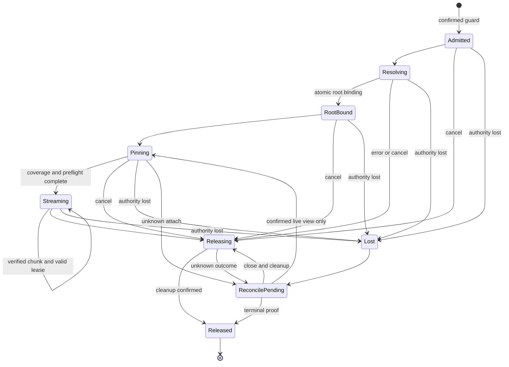
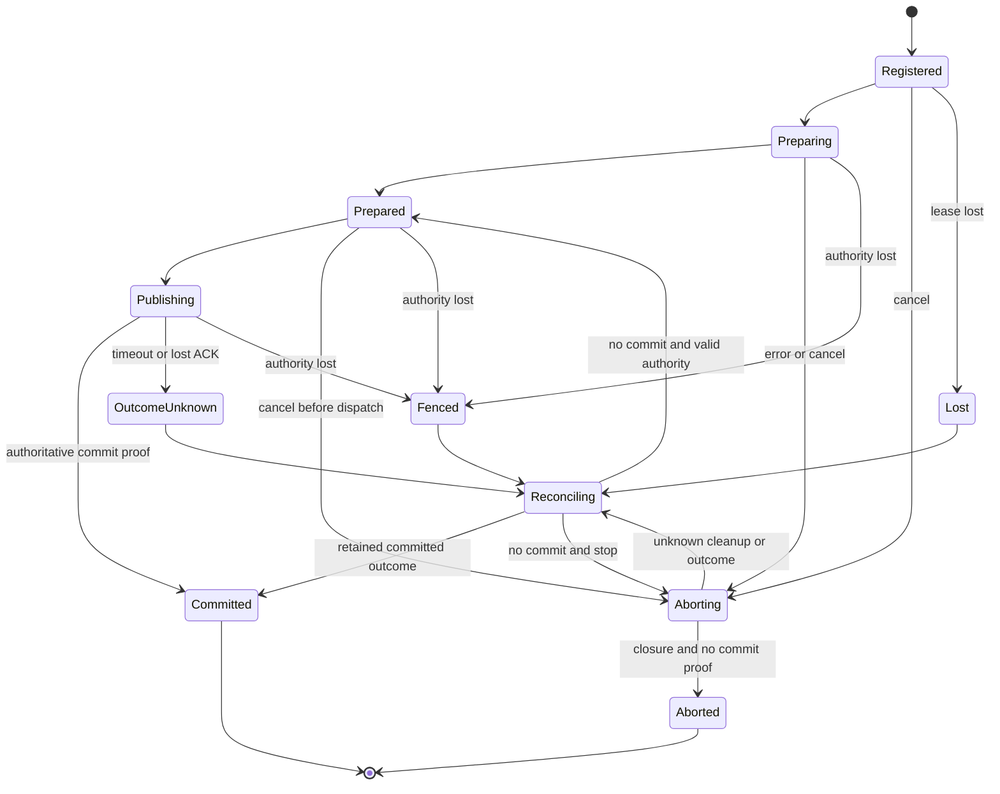
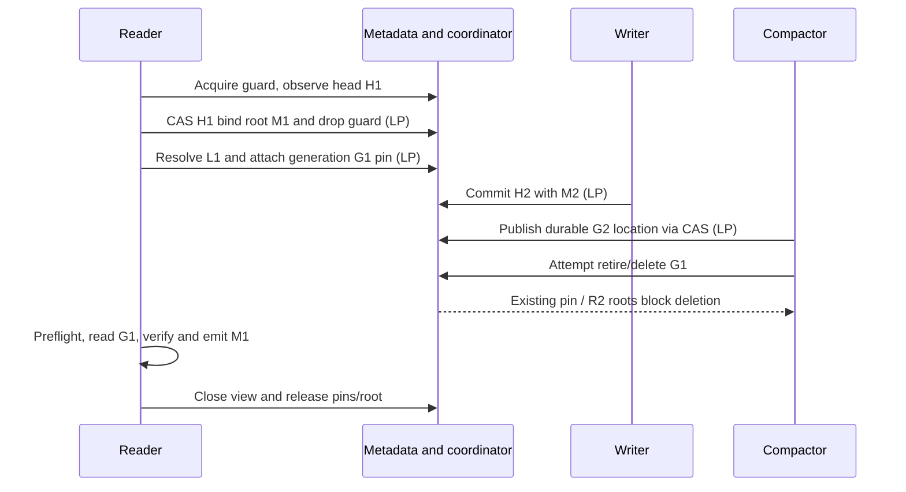
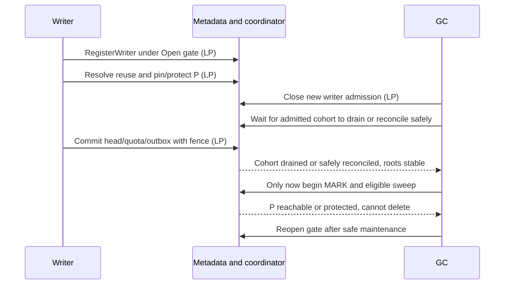
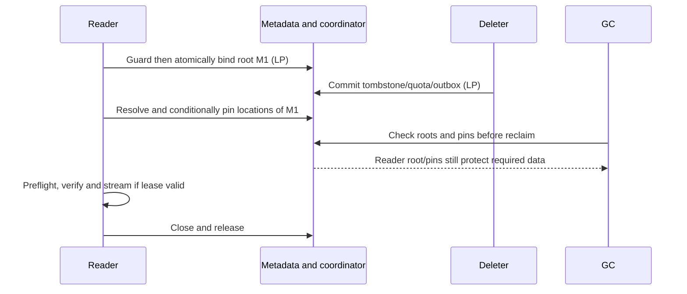
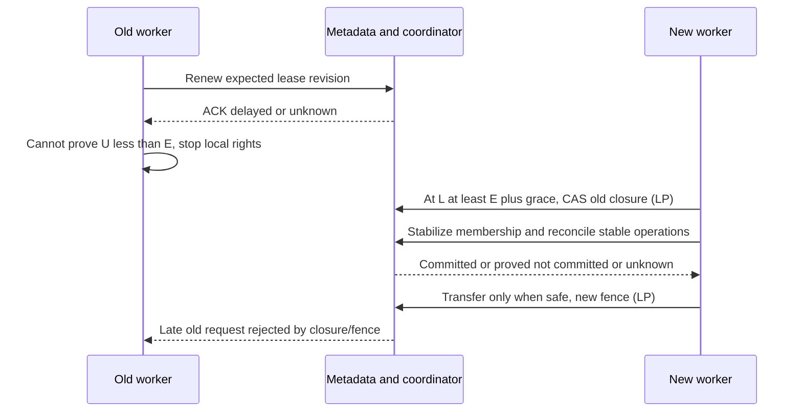
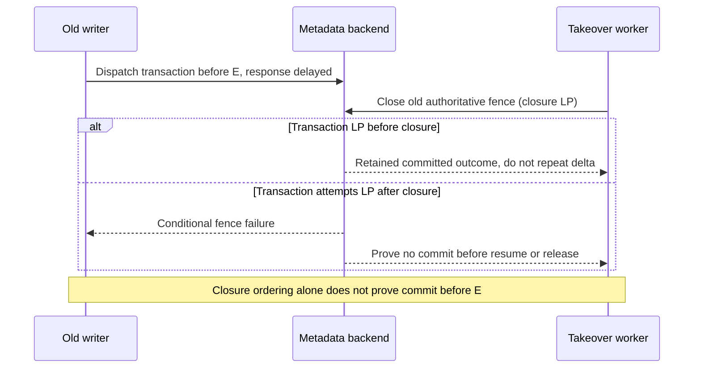
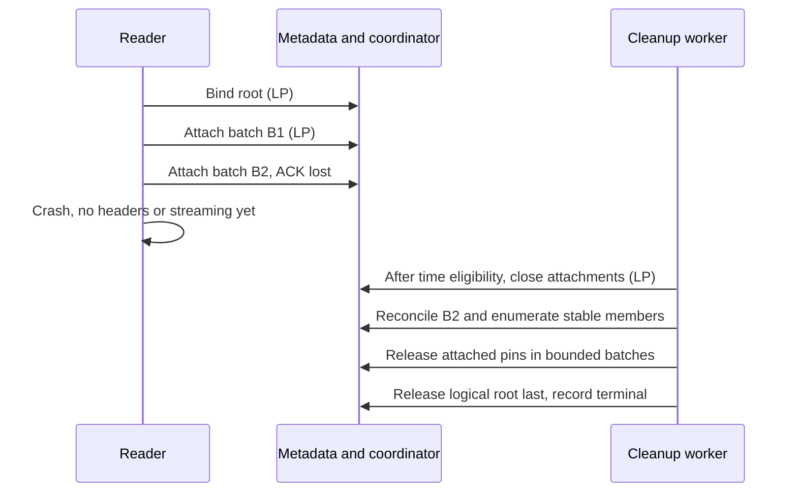
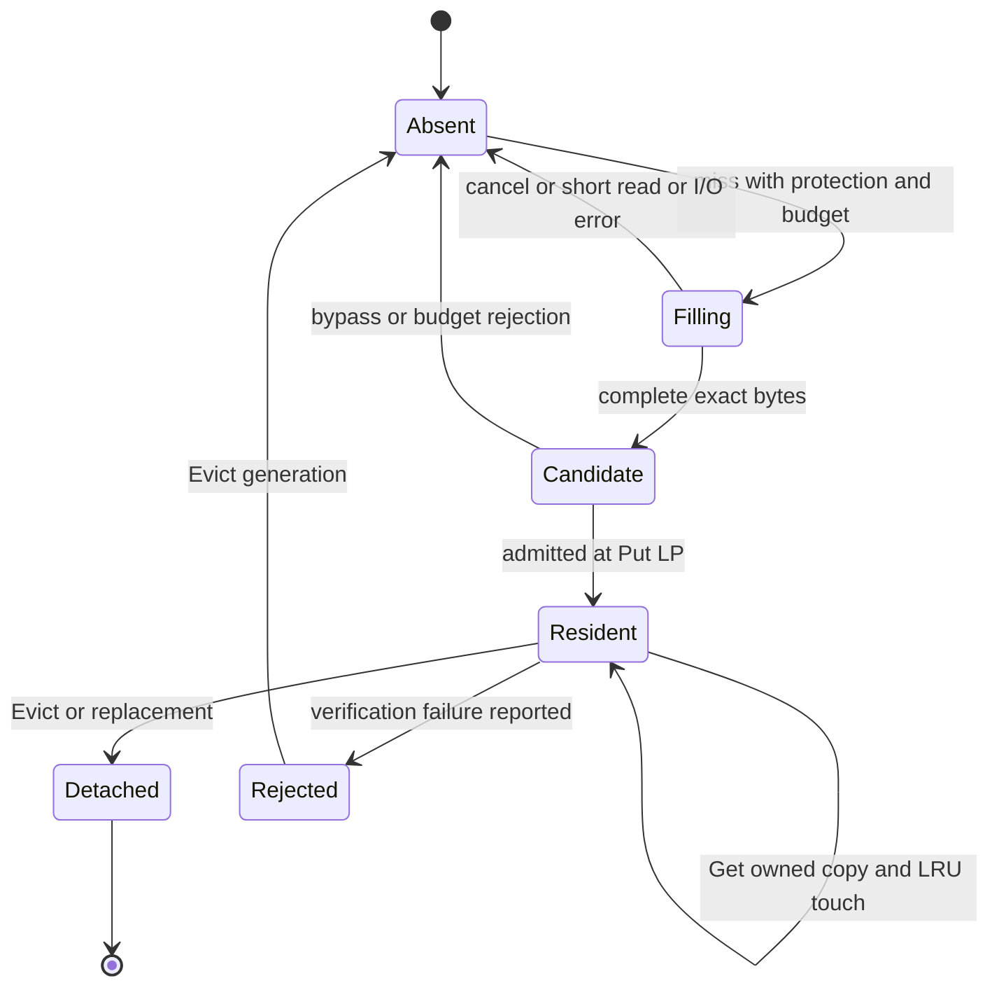

# W01-PHONG-02 — Draft R1 Read/Write View & Cache Contract

## 1. Document status, scope, source precedence và dependencies

**Status: Draft for review. Owner: Phong. Reviewer chính: Hưng. Không có approval hoặc feature-completion claim.** Tổng hợp Phase 2A/2B/2C; kết quả nghiên cứu không tự trở thành quyết định của team. Tài liệu không bổ sung implementation, shared Go types/ports, migration, PR hoặc trạng thái Miles.

Baseline: `origin/main` tại `f505f8a4cabea68aa229677845fde723b5d69785`, kiểm tra remote ngày 20/10/2026. Branch soạn thảo được tạo trực tiếp từ baseline này. Clock/policy Task 1 và shared-storage đã có trên baseline; cây tracked files của branch Task 1 khi khảo sát giống baseline, dù commit histories khác nhau. Local main phân kỳ lịch sử nên không được dùng làm điểm xuất phát.

Nhãn sử dụng:

- **FACT:** code/tài liệu đang tồn tại, không đồng nghĩa feature production đã hoàn thành.
- **DECISION:** quy tắc đã ghi ở contract nguồn; trạng thái review riêng của nguồn vẫn được giữ.
- **PROPOSAL:** thiết kế mới của tài liệu này, chờ review.
- **OPEN QUESTION:** điều chưa đủ proof hoặc chưa thống nhất; không tự chọn một expected behavior để freeze.

### Nguồn và precedence

| Nguồn | Phạm vi authoritative và dependency |
|---|---|
| [Architecture v4](../dedup-storage-gateway-architecture.md), §1.2/1.4–1.6, §5–10, §16/18/19.1 | R1/R2, source durability, pack lifecycle, defaults; gọi tắt KT |
| [API v2](../dedup-storage-gateway-api.md), §2.2.3/2.6, §4.2–4.4, §6/8/9 | Observable behavior, auth admission, errors, archive preflight; gọi tắt API |
| [Clock/policy](clock-and-policy.md), §3–7/9 | Monotonic deadlines, UTC uncertainty, evaluator, immutable policy snapshot, freeze dependencies |
| [Shared-storage](shared-storage.md), Identity / Atomic mutation / PackStore and cache boundaries | Go boundary và ownership; source riêng ghi implementation for review, không production approval |
| [Models](../../internal/storage/model.go), [ports](../../internal/storage/store.go) | Shared `PackRef`, `ByteRange`, `CacheKey`, `WriterFence`, commit/reservation/outbox types; không định nghĩa bản sao tại đây |
| [Physical fake](../../internal/storage/fake/physical.go), [physical suite](../../internal/storage/contracttest/physical.go), [metadata suite](../../internal/storage/contracttest/metadata.go), [reservation suite](../../internal/storage/contracttest/reservation.go) | Executable fixture behavior và giới hạn evidence |
| [DoD](../acceptance/definition-of-done.md), D1-01..05, D2-03/05/06/09/10/12/14; [scope](../acceptance/scope-and-priorities.md), §1/3 | Truy nguyên yêu cầu/evidence; các tài liệu acceptance vẫn là draft, không approval |

API quyết định wire behavior; KT quyết định system safety; Clock/shared-storage cụ thể hóa boundary trong phạm vi được ghi. Khi các nguồn xung đột, ghi Open Question và yêu cầu đồng bộ nguồn, không tuyên bố tài liệu này override. Các dependency `SYNC-API`, `SYNC-KT`, `SYNC-R1/R2` ở Clock §9 vẫn còn hiệu lực trước consumer freeze.

**FACT:** shared store chưa có coordinator implementation. Các operation coordinator dưới đây là yêu cầu semantic, không phải các method đã tồn tại hoặc đề xuất `MetadataStore` thứ hai. R1 dùng shared gates/pins và bounded operations; không thay bằng epoch reclamation, không giữ global lock suốt GET. R2 recovery epoch là domain khác với R1 fence và policy revision.

## 2. Review Required — Hưng

**Tất cả proposed choices dưới đây là PROPOSAL. Status của từng dòng: Pending Review.** Review choice không tự giải quyết proof obligations hoặc hoàn tất downstream tests.

| ID | Context | Options | Proposed choice | Trade-off | Impacted shared contracts | Owner / reviewer | Status |
|---|---|---|---|---|---|---|---|
| Q1 | Acquire→resolve có thể mất manifest/location cũ | A1 short resolving guard; A2 per-object anchor protocol | A1, với all destructive paths interlock; chỉ giữ tới atomic root binding | Metadata global contention ngắn; A2 scale tốt hơn nhưng anchor/tombstone protocol phức tạp | KT §6/8; coordinator/storage integration | Phong / Hưng, metadata consumer Hải/Chiến | Pending Review |
| Q2 | Head có thể đổi giữa observe và bind | Atomic observe+bind; hoặc observe rồi transaction CAS head revision+root+guard | CAS exact bucket/head/manifest, attach root và detach guard cùng transaction | Retry khi head đổi; bounded transaction, không bind toàn manifest pages | GetObject/GetManifest; KT §8 roots | Phong / Hưng, metadata consumer | Pending Review |
| Q3 | Pin batches có partial/unknown result; release scan có thể thiếu members | Stable closed membership + batch IDs; hoặc bounded frozen descriptor protocol | View admission state/revision kiểm trong mỗi batch; close attachments trước stable enumeration | Thêm records/index protocol; consistent Scan đang đổi không đủ | PackRef/Chunk.LocationRevision; future coordinator encoding | Phong / Hưng, metadata consumer | Pending Review |
| Q4 | Old transaction có thể publish sau takeover | B1 quiesce mọi in-flight trước transfer; B2 shared fence closure checked trong mutation transaction | B2: đóng old authority, ổn định membership/outcomes, reconcile rồi cấp new authority | Conditional transaction contention; không fence S3 đã gửi | WriterFence; CommitObject/DeleteObject/location CAS; R2 ledger/outbox | Phong / Hưng, metadata consumer | Pending Review |
| Q5 | Renew/expiry/takeover cạnh tranh | Client timing only; authoritative lease/fence CAS + bounded local budget | CAS lease revision/owner/incarnation; U<E để dùng; L>=E+grace chỉ reclaim eligibility | Cần valid time bound, no-overlap proof; availability giảm khi uncertainty lớn | Clock §3.4; WriterLease; ClaimReservation | Phong / Hưng, Clock/metadata consumers | Pending Review |
| Q6 | Transaction gửi trước E có thể commit sau E | Backend-enforced commit-time expiry; conservative budget với bound chứng minh được; clarify closure-based semantics qua source review | Giữ strict requirement như unresolved blocker; chưa có implementation choice đủ proof | Fence closure chỉ order với closure, không chứng minh UTC commit<E | Clock §3.4; KT §8; publication contract | Phong / Hưng, backend consumer | Pending Review |
| C-OQ02 | Requested pins chưa chắc cover speculative bytes | Full-generation pins; range pins mở rộng; restrict prefetch protected set | Baseline restrict protected set; mở rộng chỉ sau admission/pin thành công | Giảm speculation; không tự quyết pin granularity | PackRef/ChunkLocation; read-view pins | Phong / Hưng, engine/storage consumers | Pending Review |
| C-OQ03 | Default 4 chunks chưa định nghĩa ahead-only/total | Ahead-only; total window | Đề xuất ahead-only, demand riêng, nhưng không freeze khi chưa đồng bộ consumer | Tăng potential amplification; vẫn chịu budgets | Bucket cache policy; Clock §4.2; API §6.3 | Phong / Hưng, config/engine consumers | Pending Review |
| C-OQ04 | Cache.Put không có admitted result | nil best-effort; explicit agreed existing error; mở rộng port sau review | nil nghĩa xử lý best-effort, oversized/full có thể bypass | Consumer không được dựa retention; fixture phải đủ capacity | Shared Cache.Put và RunCache | Phong / Hưng, shared-storage/engine consumers | Pending Review |
| C-OQ05 | Byte capacity không bound toàn RAM/I/O | Một limit; budgets tách resident/transient/metadata/decode/I/O | Budgets riêng, reservation trước allocation/fetch; chưa chọn số | Accounting phức tạp hơn, tránh memory amplification | Clock config caps; engine/cache adapters | Phong / Hưng, config/ops consumers | Pending Review |
| C-OQ07 | Cùng immutable key nhưng bytes khác | Replace; reject/report; evict+quarantine | Detect mismatch khi entry còn resident, reject/report, evict generation; engine luôn verify | So sánh tốn CPU; chưa biết bản nào đúng; late fill còn rủi ro availability | Cache.Put/ErrConflict semantics; verification | Phong / Hưng, storage/engine consumers | Pending Review |
| C-OQ08 | Evict có thể bị late Put refill | Resident-only removal; coordinated purge barrier | Core Evict resident-only; strong purge cần separate reviewed job protocol nếu yêu cầu | Đơn giản nhưng không hứa cache trống mãi; cluster partial failure | Cache.Evict; API cache purge/jobs | Phong / Hưng, Admin/jobs consumers | Pending Review |

Không ghi Approved trước review thực tế. §19 liệt kê thêm OQs và freeze gates.

## 3. R1 safety invariants

**DECISION từ KT §5–9, API §2.6/4.2 và Clock §3:**

| ID | Invariant |
|---|---|
| R1-01 | Register writer và shared gate admission nguyên tử; gate Closing không nhận writer mới |
| R1-02 | Read view tồn tại trước resolve; old manifests và physical generations không bị reclaim trong khoảng chưa có protection thay thế |
| R1-03 | RootBound bảo vệ logical root, không tự động chứng minh mọi physical generation đã pin |
| R1-04 | Publication atomically checks đúng authority/fence/incarnation cùng head/quota/reservation/outbox/optional receipt; physical durability trước publication |
| R1-05 | Lost lease dừng local read/emit/publish tiếp theo; grace chỉ reclaim, không extension |
| R1-06 | Timeout/ErrUnavailable/absent head không chứng minh no-commit; giữ roots/ledger/gates cho unknown outcome |
| R1-07 | S3 action đã gửi không bị metadata fence thu hồi; unknown action giữ durable Deleting/Transitioning |
| R1-08 | Delete cần đủ roots/pins/protection/retention/R2 proof; thiếu proof thì skip delete |
| R1-09 | Read authorization tại admission; cache không cấp quyền. Writes kiểm quyền hiện hành trong publication transaction |
| R1-10 | R2 recovery đổi incarnation, không replay stale authority; cache không là recovery root |

**PROPOSAL proof obligations:** A1 guard interlock mọi destructive path; atomic guard→root handoff; pin/admission và retire cùng authoritative serialization boundary; B2 closure và mọi old publication cùng boundary; closed membership enumerate đầy đủ; leases không overlap. Fake mutex không chứng minh các obligations này.

## 4. Coordinator operations và atomicity/linearization points

**PROPOSAL toàn bộ operation matrix.** Inputs/results dưới đây là logical fields, không Go declarations. Reuse shared identities và fences; concrete records/encoding/backend transactions phải review riêng. `operation ID` stable cho retry, gắn immutable input; lease revision, fence và takeover ownership không biến thành logical operation mới.

### 4.1 Preconditions, effects và LP

| Operation | Input → output / identity | Preconditions | Atomic effects và LP |
|---|---|---|---|
| RegisterWriter | stable admission ID, authorized bucket incarnation, request deadline, policy snapshot → admitted lease + shared WriterFence | Gate Open; valid incarnation/time bound; request chưa cancelled/expired | Kiểm gate và tạo membership/lease/fence trong một transaction; LP transaction commit |
| AcquireReadView | stable view ID, admitted read auth/bucket, deadline → resolving guard + lease | Resource/service admission hợp lệ; không dùng gate writer để khóa hết readers | A1: register unresolved guard và lease atomically với destructive admission guard; LP commit guard |
| Bind root (internal step) | view/revision, observed ObjectKey/head revision/manifest → RootBound | Guard còn hợp lệ; exact bucket/head; manifest immutable, pages cần verify completeness | Transaction CAS observed head + attach logical root + detach guard; LP commit. Conflict giữ protection cần thiết và resolve lại |
| ResolveAndPin / PinLocations | view/revision, bounded batch ID, ChunkKey/location revision, exact PackRefs/ranges → attached pin results | RootBound; live lease/fence/incarnation; view cho attach; resource chưa đóng admission | Validate location/resource admission + attach batch pins trong bounded transaction; LP từng batch. Không tuyên bố cả object atomic |
| RenewLease | lease ID/owner/revision/fence/incarnation → new expiry/revision | Old rights chưa Lost, U<E; local deadline chưa hết; authoritative owner/revision match | CAS renewal. LP commit lease revision; ACK muộn không tự chứng minh còn quyền tại client |
| ReleaseLease | view/writer ID, expected revision, stable release ID → closing/terminal status | Owner/reconcile authority hợp lệ; đóng attach/publication trước cleanup | LP closure làm membership ổn định; cleanup bounded/idempotent sau đó; terminal chỉ sau outcome và cleanup đủ proof |
| AcquireMaintenanceGate | stable job/gate ID, mode, job fence → Closing/owned gate | Valid job lease/incarnation; expected gate state | CAS Open→Closing + reject new producers; LP CAS. Drain admitted cohort; không hủy writer khỏe chỉ vì gate Closing |
| ReleaseMaintenanceGate | job/gate revision/fence → Open hoặc retained closure | Matching owner; maintenance proof hoàn tất, hoặc abort close an toàn | CAS reopen gate; không reopen resource có unknown S3 mutation |
| Takeover | old lease/fence, expected revisions, stable logical op, new worker → reconciliation/new authority | L>=E+grace; CAS old ownership; no overlapping rights proof | B2 closure LP vô hiệu old publication; stabilize members, reconcile; transfer LP riêng dưới new fence. Không đồng nhất hai LP |
| ReconcileMutation | stable op ID + immutable digest/object/upload binding → committed / proved-not-committed / unknown | Authoritative ledger/outbox/receipt protocol; correct incarnation/history | Read/transaction consistent với closure. CAS terminal outcome/claim nếu cần; LP proof read hoặc commit outcome transition, không phải GetObject tùy ý |

**FACT:** shared storage hiện có `CommitObject`, `DeleteObject`, `ClaimReservation`, `ReleaseLogicalQuota` và các mutation ports; không có các coordinator ports trên. `WriterFence` hiện chứa LeaseID/ServiceIncarnation/Epoch; không tự nhét policy revision, history epoch hoặc state revision vào Epoch. [model.go](../../internal/storage/model.go), [store.go](../../internal/storage/store.go).

### 4.2 Validation, retry, unknown outcome và boundaries

Mọi authoritative mutation trong proposal phải kiểm owner, expected revision, fence, service incarnation và operation binding ngay trong atomic effect. Read snapshot không thay transaction condition. Kết hợp condition với Update trên cùng item; không giả định backend có thể atomically mutate toàn bộ manifest hoặc số pins không giới hạn (shared-storage Atomic mutation; API §2.2.3).

| Operation | Idempotency / retry | Unknown-outcome handling | Failure/boundary vectors |
|---|---|---|---|
| RegisterWriter | Cùng ID/input trả cùng admission hoặc terminal; đổi binding conflict | Lookup admission ID trước register mới | Gate close cùng register; bucket ABA; cancelled; expiry equality |
| AcquireReadView | Cùng ID không tạo guard thứ hai; terminal ID không resurrect | Reconcile guard/lease; không resolve nếu chưa biết protection tồn tại | Destructive action tranh admission; lost ACK; stale incarnation |
| Bind root | Cùng root binding idempotent; head đổi conflict | Đọc authoritative view binding; không tự drop guard | Overwrite/delete giữa observe/bind; transaction lost ACK |
| PinLocations | Same batch ID + digest; không double attach | Đọc exact batch outcome; không fetch batch unknown | Location CAS; retire race; batch partial; limit/overflow; close attachments |
| RenewLease | Không retry thành new lease; stale revision reconcile | Không kéo local budget dựa ACK chưa rõ; fail closed khi proof hết | U=E; delay ACK; suspend; grace; old owner |
| ReleaseLease | Close/cleanup retries giữ terminal markers theo retention | Giữ unknown roots/reservations; không infer từ missing head | Attach versus close; lost commit ACK; crash giữa cleanup batches |
| Acquire gate | Same job ID không tạo gate thứ hai | Reconcile gate ownership/cohort | Concurrent jobs; drain timeout; healthy long writer |
| Release gate | Same owner/revision; no blind Open | Read gate/resource closure trước reopen | Stale releaser; pending DELETE/COPY; lost ACK |
| Takeover | CAS chỉ một winner; immutable operation không đổi | Old commit known mới chọn resume/cleanup; unavailable giữ đóng | Renew race; equal E+grace; two takers; old worker return |
| ReconcileMutation | Original committed result giữ nguyên; no double quota | Unknown là kết quả hợp lệ, không cleanup | Commit-before/after-closure, missing ledger/retention, absent head sau overwrite |

## 5. Read View state machine

**PROPOSAL:** all requested-range physical pins và archive preflight phải hoàn tất trước response headers. State names là analysis vocabulary, chưa là stored enum/API.

| Transition | Trigger / preconditions | Effect / LP / checks | Failure và idempotency |
|---|---|---|---|
| Start→Admitted | Read auth, AcquireReadView thành công | Guard+lease commit; identity/fence/incarnation checks | Unknown admission→ReconcilePending; không resolve thiếu guard |
| Admitted→Resolving | Begin consistent head/pages/chunks reads | Local transition; guard còn hiệu lực; không có publication LP | Retry reads dưới cùng view; Lost thì dừng |
| Resolving→RootBound | Complete logical identity, Q2 CAS | Root attach + guard detach commit LP | Head conflict resolve lại; unknown giữ guard/root theo authoritative binding |
| RootBound→Pinning | Lập bounded requested location plan | Local start; mỗi attach có batch LP như §4 | Root chưa đủ physical protection; không fetch trước attach |
| Pinning→Streaming | Tất cả requested coverage confirmed, preflight pass | Local readiness barrier, không global snapshot LP; recheck lease/deadline | Unknown batch không được tính đủ; idempotent batch reconciliation |
| Streaming→Streaming | Next verified chunk | Check local budget/fence validity; cache hoặc backend không thay quyền | No unverified emit; Lost/cancel dừng bước tiếp theo |
| Active→Releasing | Finish/cancel/error | Close attachments LP trước stable enumeration; stop/quiesce local I/O | Không unpin khi fetch còn chạy; retry release ID |
| Releasing→Released | All cleanup/outcomes confirmed | Terminal marker commit; root bỏ cuối sau dependencies | Unknown→ReconcilePending; Released terminal |
| Active→Lost | Proof hết, lease/fence/incarnation invalid | Local stop ngay; không tự xóa durable roots | Không Lost→Streaming qua late renewal |
| Active/Releasing→ReconcilePending | Lost ACK hoặc cleanup uncertainty | Giữ durable protection chưa chứng minh bỏ được | Authoritative resolution→Releasing/Released; chỉ resume nếu chưa Lost và toàn quyền còn valid |



ReconcilePending giữ riêng cờ authority đã Lost: nhánh trở lại Pinning tuyệt đối không áp dụng cho Lost view. Renew không là quyền hồi sinh.

## 6. Write View state machine

**PROPOSAL:** outcome và execution authority là hai trục độc lập. Một operation đã Committed vẫn Committed dù worker sau đó bị Fenced. Fenced/Lost không phải bằng chứng Aborted.

| Transition | Trigger / preconditions | Atomic effects / LP / lease checks | Failure / retry |
|---|---|---|---|
| Start→Registered | RegisterWriter + reservation theo shared protocol | Admission LP; current gate/fence/incarnation | Unknown register/reserve reconcile đúng stable IDs |
| Registered→Preparing | Consume verified client input, new/reused pack admission | Bounded pins/protection trước reuse/publish; physical writes không là object LP | Cancel/lease loss dừng prepare; blobs thành orphan candidates |
| Preparing→Prepared | Pack/sidecar/pages complete và durable, requested resources protected | Local completeness barrier; mỗi metadata attach có LP riêng | Partial pages retry/verify; cache không thay durability |
| Prepared→Publishing | Publication request với immutable input/op ID | Local dispatch, chưa phải commit LP; validate current authority | Timeout→OutcomeUnknown, không mặc định abort |
| Publishing→Committed | Authoritative transaction committed | Head/quota/ledger/outbox/receipt cùng LP; fence và current auth trong transaction | Lost ACK→OutcomeUnknown nhưng durable outcome có thể committed |
| Prepublish→Aborting | Cancel/error hoặc revoke | Close future publication/attachments trước cleanup | S3 request đã gửi phải quiesce/reconcile |
| Aborting→Aborted | Authoritative no-commit + closure + cleanup đủ proof | Terminal transition và quota release theo shared ledger CAS | Same cleanup idempotent; unknown không release |
| Publishing→OutcomeUnknown | Timeout/ErrUnavailable | Không thêm effects dựa suy đoán | Giữ roots/ledger, reconcile stable op |
| OutcomeUnknown→Reconciling | Authoritative lookup / takeover closure | Proof read/transaction dưới đúng incarnation | Unavailable giữ nguyên protection |
| Reconciling→Committed | Retained outcome chứng minh commit | Trả original result, không apply lại quota | Current head có thể đã overwrite/delete |
| Reconciling→Prepared | Chứng minh chưa commit + new/live authority hợp lệ | Claim CAS và revalidate resources/auth/deadline | Original deadline không được kéo dài |
| Reconciling→Aborting | Proved no-commit, hết deadline/không retry | Closed authority trước release | Idempotent cleanup |
| Active→Fenced/Lost | Closure, lease loss, incarnation change | Stop local execution; outcome chưa kết luận | Chuyển reconciliation; không publish bằng old fence |



Diagram chỉ biểu diễn workflow; Fenced/Lost không ghi đè durable outcome. Reconciliation dưới old fence không được mutation; takeover/reconciler cần authority riêng.

## 7. Resolving guard, manifest root và location pin lifecycle

**PROPOSAL A1 ưu tiên, Q1/Q2/Q3 Pending Review:**

1. Acquire guard trước đọc head. Destructive workers phải interlock guard admission; chưa chứng minh guard/root handoff thì không reclaim candidates có thể liên quan.
2. Observe exact bucket incarnation/head revision/manifest; CAS bind root + drop guard atomically. Head đã thay thì retry, không attach observed stale head không có proof.
3. Immutable root giữ logical chunk identities, không cố định physical locations. Resolve consistent location; pin phải condition-check revision và resource admission trong cùng attach transaction.
4. Compaction thắng trước attach thì resolve lại. Reader pin thắng trước retire thì old generation tiếp tục được giữ; không bắt reader đang pin phải chuyển canonical location.
5. Attach bounded batches. Unknown/partial batches chưa được tính coverage đầy đủ; không streaming sớm. Không atomic transaction không giới hạn.
6. Release đóng attachment state trước; mỗi attach transaction condition-check state/revision nên delayed attach không thêm member sau closure. Lúc đó mới enumerate stable membership đủ pagination, cleanup idempotent, root bỏ cuối.

**A2 alternative:** per-object anchor/tombstone protocol có thể giảm global guard contention, nhưng phải chứng minh anchor admission không race delete/recreate và mọi logical roots/physical handoff tương đương. Chưa chọn encoding hoặc tạo shared anchor type.

**Correctness gap từ Phase 2B cần giữ khi tổng hợp:** requested-range coverage không tự bảo vệ prefetch resource. RootBound cũng không giữ nguyên mọi historical chunk location. Retire/delete luôn phải đối chiếu pins riêng, không chỉ logical root/refcount (KT §6/8).

## 8. Lease, fencing, takeover và reconciliation

**DECISION — Clock §3.4–3.5:** valid khi chứng minh `U < E`; expired tại E; `L >= E + grace` chỉ đủ xét reclaim, vẫn cần CAS/roots/outcome proof. Grace không thêm quyền. Deadline dùng local monotonic Instant; Instant không serialize/chuyển node/sống qua restart. Unknown/stale UTC bound hoặc suspend cần revalidation; không lấy skew 2s làm toàn uncertainty.

Defaults nguồn: hard deadline 30 phút, lease 60s, heartbeat 15s, reclaim grace 5s. Không tự đổi defaults hoặc pin numeric local safety budget chưa được chứng minh. Renewal cần CAS owner/revision/fence/incarnation; mỗi owner tự xác nhận local use budget còn hợp lệ. Late ACK không resurrect Lost.

**PROPOSAL B2:** closure của old authority cùng authoritative transaction boundary với mọi publication. Publication LP trước closure có thể đã committed và phải được new worker nhận diện. LP sau closure phải bị fence condition từ chối. Sau closure ổn định operation membership rồi reconcile outcomes, mới chuyển/retry/cleanup dưới valid new authority. Gate Closing vẫn drain admitted healthy cohort theo mode; không đóng mọi fence chỉ vì bắt đầu maintenance.

**OPEN QUESTION Q6 — chưa có proof strict expiry:** transaction gửi lúc t0<E, lease hết E, transaction commit t1>E nhưng trước closure t2 vẫn có thể vượt strict expiry nếu backend chỉ kiểm client timestamp cũ. B2 chỉ order commit với t2, không chứng minh t1<E. Không tuyên bố client ConditionExpression timestamp là server commit clock. Cần backend mechanism/bounds có proof hoặc source clarification được review; chưa có thì block freeze của guarantee này (Clock §3.4; shared-storage Atomic mutation).

Protection theo Clock §3.5: `D_hi = U + remaining_monotonic`; durable protection ít nhất round-up `D_hi +15m`, không giảm old protection; Restored expiry lower bound ít nhất `D_hi +120s`. Expired/cancelled request không được admit dù remaining=0. Cache không thay các phép kiểm này.

Reconcile dùng stable op ID và retained outbox/ledger/receipt trong đúng history/incarnation. Head absent hoặc head khác không chứng minh chưa commit. Unknown giữ ledger/roots/closed resources. Destructive S3 unknown phải HEAD/reconcile; không reopen Warm dựa timeout. Recovery mới không kế thừa active old leases (KT §8.2/9; shared-storage Reservation lifecycle).

## 9. GET/PUT/DELETE/GC/compaction race sequences

**PROPOSAL:** diagrams là expected event order và fault design, chưa là bằng chứng thực thi. `LP` ghi đúng authoritative boundary; local steps không phải transaction LP.

### S1 — GET → overwrite → compaction



Invariant R1-02/03/08; expected old reader M1, new reader H2. Fault: pause before attach to make CAS conflict, and after attach to verify G1 retained. Missing lease proof aborts read; cache cannot supply missing pin.

### S2 — PUT reuse → GC



Invariant R1-01/04/08. GC chỉ bắt đầu MARK/sweep sau khi admitted writer cohort đã drain hoặc được reconcile an toàn và roots đã ổn định; yêu cầu chờ drain không tự chứng minh điều kiện này đã hoàn tất. Writer còn hợp lệ được hoàn tất trong thời gian drain. Unknown outcome chưa được resolve giữ protection và không được coi là drained để bỏ root. If retire wins before reuse attach, writer must retry/revive from client body as applicable, not trust old candidate. Fault: pause lookup→pin and pin→publish; enumerate GC candidates before reuse; assert no deletion solely from stale refcount.

### S3 — GET → DELETE



Invariant R1-02/03/08. Root keeps logical liveness; pin protects selected physical generations. New GET sees tombstone; admitted reader uses bound M1. Fault: pause after root bind but before first pin; delete and compact; assert logical contents reconstructible and stale location re-resolved.

### S4 — Renew → expiry → fence closure → takeover



Invariant R1-05/06. Successful renew that wins CAS must be observed by takeover; takeover cannot close stale revision blindly. Unknown does not transfer publication permission. Fault: reorder renewal commit/ACK/closure, boundary U=E and L=E+grace; two takers, suspended old worker.

### S5 — Delayed metadata publication



Invariant R1-04/06; strict expiry remains Q6. Fault: pause backend between dispatch and commit, separately force commit before closure but after E; report unresolved strict-expiry case rather than label pass. Lost ACK must reconcile original result even if head later overwritten.

### S6 — Crash giữa bounded pin batches



Invariant R1-03/06/08; root remains while physical coverage incomplete. Delayed B2 cannot attach after closure; B2 before closure must be enumerated. Fault: kill after every batch LP/ACK, race delayed attach with close, lose cleanup ACK; assert no early root release or omitted member.

## 10. Cache identity, exact-range và ownership

**FACT/DECISION:** shared `CacheKey{Pack: PackRef{ID,Generation}, Range: ByteRange{Offset,Length}}`; no new competing identity. `RangeGet` returns compressed physical bytes, SHA-256 identity is raw chunk content; class changes keep content generation. `Chunk.LocationRevision` validates pointer changes; `PackInfo.StateRevision` tracks lifecycle, neither is cache byte identity (shared-storage Identity/PackStore; KT §6/7).

**PROPOSAL:** exact key only, no implicit containing-range/overlap hit. Demand key is full compressed chunk location even for a logical subrange, allowing complete decode/hash before emitting slice. Coalesced reads split into exact chunk keys; avoid storing both whole coalesced buffer and all chunks by default. Bounds checked against authoritative pack size, overflow-safe; empty object has no zero-length physical key. Fake key validator uses MaxInt64, not actual pack size, so does not prove this check.

Owned input/output copies are DECISION in shared contract. Caller must not concurrently mutate input during Put; after return may reuse. Output belongs to caller, survives eviction as memory, not as lease permission. Physical cache may serve multiple domains only after authorized logical resolution; adding bucket/domain/incarnation to cache key would duplicate identity instead of securing access.

## 11. Byte-bounded LRU và admission

**PROPOSAL:** capacity C is validated resident payload budget; no numeric C selected here. `resident_bytes = sum(len(entry.bytes)) <= C`. Entry metadata/count, caller copies, fill/decode buffers and I/O have separate limits (§12).

| Operation | Behavior / LP |
|---|---|
| Get hit | Owned copy and MRU touch under coherent synchronization; LP selection+touch |
| Get miss | Exact key absent at LP; Cache port performs no S3 I/O |
| Put admitted | Full entry, accounting and recency publish atomically; no partial body |
| Replace | Account net delta, no duplicate key charge; same-key differing bytes subject C-OQ07 |
| Evict | Remove all resident ranges of exact PackRef atomically; other generations unaffected |

Oversized entry bypasses without evicting all useful data. Capacity pressure evicts LRU before successful admission. No transient reservation means bypass before expensive clone. C-OQ04 proposes nil for best-effort handling even if not retained; consumers must agree, fixture capacity must fit suite expectations. Invalid key/data length remain invalid; cancellation before LP rejects; cancellation after LP does not imply rollback. Cache admission failure cannot turn durable PUT into cache-only durability.

Baseline strict local LRU; no lock held across network, auth, pin acquisition or decode. Safe owned-copy implementation needs entry backing lifetime while copying; do not unlock/use freed backing implicitly. Strict LRU has contention; sharded approximate LRU is alternative pending benchmark, not silently equivalent. Memory implementation fake has one mutex/unbounded map and replaces same-key bytes; proposed LRU/conflict semantics are not claimed implemented.

Concurrent misses may perform independent bounded fills. Equal-key identical fills leave one resident entry/accounting. Optional singleflight shares bytes only: waiters retain independent auth/view/pins/deadlines; leader cancellation/protection lifetime requires separate proof. No new public port is introduced here.

## 12. Read-ahead, resource budgets và pin coverage

**DECISION:** bucket cache policy defaults admit_on_write=true/readahead_chunks=4, 0 disables prefetch; concrete caps deferred by Clock §4/9. Request uses pinned immutable policy snapshot, not new config read each chunk.

**PROPOSAL:** prioritize demand; plan prefetch from bound manifest, validated locations. Same exact PackRef only for a coalesced backend request; enforce pack bounds/overflow and account gap bytes. Verify chunks separately, never treat HTTP range bytes/checksum as raw chunk verification. No arbitrary MB window or worker count selected.

Before any fetch, protection must cover every physical resource/range touched, including coalescing gaps where relevant to pin granularity. Baseline prefetch restricted to existing protected set. Beyond requested range requires confirmed extra admission/pins and relevant lifecycle checks first; RootBound/requested pins are insufficient by themselves. No global GET lock. Optional archive speculation is skipped, not silently restored or used to change requested-read error behavior.

Budgets: resident bytes, entry count/metadata, in-flight buffers/copies, raw decode/verify size, prefetch bytes, per-request/node concurrent I/O. Reserve before allocation/fetch; validate codec expansion/declared raw sizes. RSS is not bounded by resident C alone; NVMe capacity does not bound staging RAM. Demand must not wait indefinitely behind speculative work. Exhausted prefetch budget skips speculation; demand still obeys its own limits.

Cancellation/Lost/deadline stops new scheduling. Cancel in-flight I/O and quiesce before releasing its protection; adapter cancellation is not proof S3 destructive request was undone. Prefetch never extends request deadline or lease. Cache pollution alternatives (probation/segmented admission) remain optional measurement-driven choices.

## 13. Cache state machine

**PROPOSAL:** states below describe orchestration/local residency, not a new shared enum. Resident bytes remain untrusted candidates; verification is consumer work, not a permanent access grant attached to entry.



Detached owned copies may still exist. They cannot bypass read-view validity. Filling is not hidden in Cache.Get. Bytes need complete length before admission; raw SHA verification still occurs before client emit regardless of whether cache admission happened earlier (KT §6).

## 14. Authorization, archive preflight và verification

**DECISION sources: API §2.2.3/4.2/4.4; KT §6; Clock §3.5; shared Cache port.**

```text
Authorize → AcquireReadView → Resolve → Pin
→ Archive preflight toàn requested range
→ Cache lookup hoặc protected RangeGet
→ Decode + verify full raw chunk
→ Check authority/deadline for next emit → Emit logical slice
```

| Event | Required behavior |
|---|---|
| Revoke/disable/grant change | New admission sees change within auth bound max5s, hits do not refresh age; admitted GET may finish under original read admission within lease/deadline, not reauthorize authoritative every chunk |
| Overwrite/delete | Existing bound reader may use protected old data; new reader resolves current head/tombstone |
| Compaction | Stale resolve before pin conflicts/re-resolves; existing pin may keep old generation readable |
| Retiring/deleting resource | Cache hit does not admit a new reader through closed resource gate; existing pin behavior must respect retirement protocol |
| GLACIER_IR | Directly readable under normal checks |
| GLACIER pending/unrestored | 403 InvalidObjectState before headers even when bytes resident; accepted restore is not completion |
| Restored | Backend expiry/proof must cover D_hi+120s; state cache/Days parameter cannot fabricate expiry |
| Lost read lease | Stop further reads/emit at safe points, abort after headers; cache loop must have same checks as miss loop |
| Recovery incarnation change | Old view/fence cannot serve; retained bytes only reusable under new full admission/resolve/pin/preflight/verify |

Already emitted network bytes cannot be retracted. Local check and socket write are not a distributed atomic transaction; maximum unchecked work and pause handling remain Q5/OQ-S1. HEAD stays metadata-only and does not fetch cache payload or trigger restore.

## 15. Cache race/failure scenarios

**PROPOSAL fault designs.** Cache LP is local; no cache LP publishes object metadata or grants rights.

| Scenario | Timeline và LP | Invariant / expected outcome | Failure handling và injection |
|---|---|---|---|
| C1 GET hit + overwrite | Bind M1, pin G1, preflight; writer head M2 commit LP; Get G1 LP; verify/emit | Old reader M1, new reader M2; R1-02/03 | Pause before hit, overwrite+GC; no G1 delete while protected; Lost before emit aborts |
| C2 Compaction location CAS | Resolve G1/r; compactor CAS G2/r+1 LP; reader pin candidate | Pin conflict re-resolves; if pin preceded retire, G1 remains usable | Barrier resolve→pin and pin→lookup; ensure hit never bypasses failed pin |
| C3 Evict + Get | Get LP copies G; Evict LP removes G; Get returns owned bytes. Reverse order gives miss | No alias/use-after-free; eviction is neither revoke nor unpin | Pause copy/return, mutate output, Evict/replacement race; no lock across I/O |
| C4 Duplicate fill | A/B independently admitted/pinned, both miss; A Put LP then B Put LP | One resident key/charge; each consumer verifies and checks own authority | Cancel A; reorder fills; partial body; same-key differing bytes subject C-OQ07 |
| C5 Cached Cold bytes | Class/state changes to GLACIER; new read admission and archive preflight reject before cache | Hit/miss nodes both 403, no cache-based restore bypass | Keep cache warm; pending restore, expiry boundary/margin; no invalid emit |
| C6 Corruption | Valid view/pins/preflight; hit returns bad bytes; decode/hash fail before emit | Never emit bad chunk; cache not repair source | Flip first/later chunk, short read, concurrent late fill. Before headers error or reviewed bounded backend retry; after headers abort+metrics; Evict generation |

Evict before delayed Put permits refill under baseline semantics. Verification preserves integrity even if corruption repollutes, but repeated failures hurt availability. Strong quarantine/purge and retry policy require C-OQ07/08 review; no silent promise of permanent invalidation. Same-key mismatch detection cannot identify which source is correct, and only comparing against a resident value cannot detect a bad first fill.

## 16. Failure recovery và observability

**DECISION:** lost ACK/ErrUnavailable is unknown, not no-commit. Resource cleanup/release follows retained authoritative outcome and R2 windows, never immediate TTL/age alone. Cache loss restarts cold with no metadata/quota changes. S3 class/delete unknown retains durable closure (shared-storage; KT §8/9).

**PROPOSAL recovery behavior:**

- Crash while preparing: retain/reconcile registered resources; new blobs are orphan candidates, not committed heads.
- Crash between pin batches: close attachments and enumerate stable confirmed members before cleanup; root last (§9 S6).
- Lease lost while streaming: stop scheduling and next emits, quiesce outstanding reads; durable cleanup via reconciler, not blind local unpin.
- Old writer returns: reject old fence/incarnation at mutation; reconcile logical outcome independently.
- Unknown commit during release: retain ledger/roots; only proven no-commit may release quota. A committed outcome remains committed after delete/overwrite.
- Corruption: reject chunk, evict exact generation, record integrity failure. No auto metadata/backend repair from cache.
- Recovery: stop old workers, audit roots/cuts and actual backend state, new incarnation. Cache cannot fill a missing R2 cut/chain or restore old authority.

Metrics reuse API §8 names: cache_hit_ratio, integrity_error_total, mid_stream_abort_total, s3_requests_total and byte counters. Hit reads still update logical pack access observations; batching cannot postpone required protection. Proposed diagnostic events include operation/view/batch IDs, fence/incarnation/revisions, applied policy revision, decision reason, pin coverage, outcome and ordering. Use bounded/redacted logs; no object/user high-cardinality metric labels or credentials. Budget rejection/duplicate fill/prefetch amplification counters require naming review, not new frozen API promises. Cache debug header remains preflight snapshot, not final stream hit ratio (API §5).

## 17. Quality attributes và trade-offs

| PROPOSAL | Correctness benefit | Metadata/scalability/complexity cost |
|---|---|---|
| A1 short guard | Protect unresolved handoff | Global metadata contention; must interlock all destructive paths; not held through GET |
| A2 object anchor alternative | Potentially distributes contention | More anchor/ABA/tombstone lifecycle proof; not selected |
| B2 shared closure | Orders old publications versus transfer | All producers must check shared boundary; transaction cost; strict expiry unsolved |
| B1 full quiesce alternative | Can avoid old in-flight work after transfer when quiescence proven | Long waits/unbounded backend completion; timeout alone not proof |
| Bounded pin batches | Backend-size compatible | Multiple LPs, partial/unknown membership and cleanup complexity |
| Exact range + owned copies | Stable shared identity; simpler eviction lifetime | Overlap misses; copy RAM/CPU amplification |
| Byte LRU | Understandable capacity and deterministic victim order | Hit synchronization, scan pollution; sharding changes exact semantics |
| Independent bounded fills | Simple cancellation/authority ownership | Duplicate I/O; singleflight optimization more complex |
| Protected-only prefetch | Avoids new resource safety gap | Lower speculative throughput; additional coverage has metadata cost |
| Verify before emit | Detects corrupt cache/backend | Decode/hash CPU and full-chunk buffering |

No latency/cost/throughput claim without measurements. Cloud cache does not reduce logical Internet output; Edge may reduce S3→Edge download. Track prefetch/gaps/retries and physical/logical bytes separately (KT §11/13).

## 18. Downstream test vectors

**FACT:** RunCache currently tests exact identity, copies, generation eviction, invalid length and pre-cancelled Put. Metadata/reservation suites exercise expired/stale fences/incarnation and unknown outcomes using fixture control. Fixed-time fake/mutex is not Clock uncertainty, DynamoDB serialization or distributed GC proof (shared-storage Reusing the suite).

**PROPOSAL test/evidence matrix:**

| ID | Vectors | Required evidence / obligations |
|---|---|---|
| T01 | Gate close vs RegisterWriter; healthy drain vs timeout | LP/event order; no admitted writer omitted; no forced healthy abort |
| T02 | A1 guard vs overwrite/delete; bind conflict/lost ACK | Atomic guard→root handoff; no unprotected gap |
| T03 | Location revision/retire vs pin; partial batches; delayed attach after close | Exact batch membership, stable enumeration, root retained |
| T04 | Renew CAS, stale ACK, two takers, U=E, L=E+grace, unknown bounds/suspend | No overlapping authority; no resurrection; grace not usage |
| T05 | Delayed commit before/after closure, after E, lost ACK, later overwrite | Separate closure ordering and strict expiry verdict; original outcome retained |
| T06 | Release unknown commit, cleanup crash, absent head | No double quota/release or premature roots removal |
| T07 | S3 DELETE/COPY sent then worker loss/takeover | Durable closed state until real backend reconciliation |
| T08 | Identity ID/gen/offset/length, overlaps, class/state revision, empty/overflow/out-of-pack | Exact keys/bounds, no cross-generation hit; bad input no I/O |
| T09 | Input/output mutation, concurrent Get/Put/Evict, replacement | No alias/data race; local LP semantics; owned copy survives eviction |
| T10 | Byte LRU order, size replacement, oversized/full/bypass, tiny-entry flood | Resident invariant plus separate peak RAM/metadata budgets |
| T11 | Duplicate fill equal/different bytes; cancellation at each LP | One resident charge, no partial publication; independent waiter rights |
| T12 | Read-ahead0/default semantics, gaps/window edge/extra pack, budget exhaustion | Every physical fetch covered; demand priority; bounded amplification |
| T13 | Revoke with warm cache, auth age boundary, admitted GET | No hit-refresh; new admission bound; no accidental stream cut solely revoke |
| T14 | IR/archive/restoring/restored, expiry margin equality, stale state | Hit and miss same preflight; actual backend expiry proof |
| T15 | Corrupt cache/backend/decode, first/later chunk, late refill | No bad chunk emit; preheader error/postheader abort and metrics |
| T16 | Recovery new incarnation, old worker/cache surviving, missing R2 root/cut | No old authority; cache cannot replace audited recovery proof |

Layer evidence: unit/property + shared port suite for local semantics; deterministic scheduler traces for modeled ordering; Badger/DynamoDB adapter transaction/fault tests; controlled physical faults and actual AWS evidence where required by DoD. Each record needs revision/environment/input/expected/actual/fault point and limits. No Go/AWS tests claimed run by this docs-only deliverable. D1 document review does not satisfy D2-10 or release safety.

## 19. Open Questions và freeze criteria

§2 table is the primary decision register, all Pending Review. Additional **OPEN QUESTIONs**:

| ID | Open item / blocker | Owner / required review |
|---|---|---|
| OQ-S1 | Bound maximum unchecked stream work, local lease-use budget, safe-point/suspend behavior; cannot atomically revoke already-sent bytes | Phong / Hưng, Clock/engine consumers |
| OQ-S2 | Concrete bounded records, indexes/pagination and transaction encoding for roots/guards/pins; stable membership proof | Phong / Hưng, metadata consumer |
| OQ-S3 | Outcome proof retention/reconstruction and unknown cleanup across R2 cut/incarnation; align W01-PHONG-03 | Phong / Hưng, recovery/metadata consumers |
| C-OQ06 | Strict LRU versus sharded approximation and NVMe/RAM staging boundary | Phong / Hưng, cache/ops consumers |
| C-OQ09 | Whether singleflight is needed; fetch lifetime/protection/cancellation ownership | Phong / Hưng, engine/coordinator consumers |
| OQ-SYNC | Clock SYNC-API/SYNC-KT/SYNC-R1/R2 source alignment before affected consumer freeze | Phong / Hưng, Hải/Chiến as relevant |

Freeze gates (**PROPOSAL**, no gate marked passed):

1. Hưng and impacted consumers record decisions for Q1–Q6 and cache OQs; rejected choices update all affected diagrams/vectors, not just table status.
2. Prove guard/root handoff, conditional pin/retire, membership closure, authority/outcome separation and no-overlap assumptions. Q6 strict commit-time expiry needs actual mechanism/proof or explicit reviewed source change; B2 alone cannot close it.
3. Pin granularity/read-ahead coverage, Put admission, different-bytes conflict, refill/purge semantics and budgets have one agreed expected behavior; no new duplicate storage types/ports.
4. Resolve source conflicts and relevant Clock synchronization gates. Defaults unchanged unless reviewed in authoritative sources.
5. Pin downstream contracts/test ownership and evidence requirements. Implementation enablement separately requires backend/fault/time-bound evidence; docs approval does not enable destructive paths.
6. Review Markdown/Mermaid/source links and single-file diff. D1 PR/CI/independent approval/handoff remain Not verified until actual artifacts exist; no automatic task Done.

**Draft readiness:** this document is suitable for a single review Draft PR once the user authorizes commit/push/PR in a later step. It is not a frozen contract, production implementation or distributed correctness proof. Current work creates only this document; no commit/push/PR/Miles mutation is authorized by this phase.
