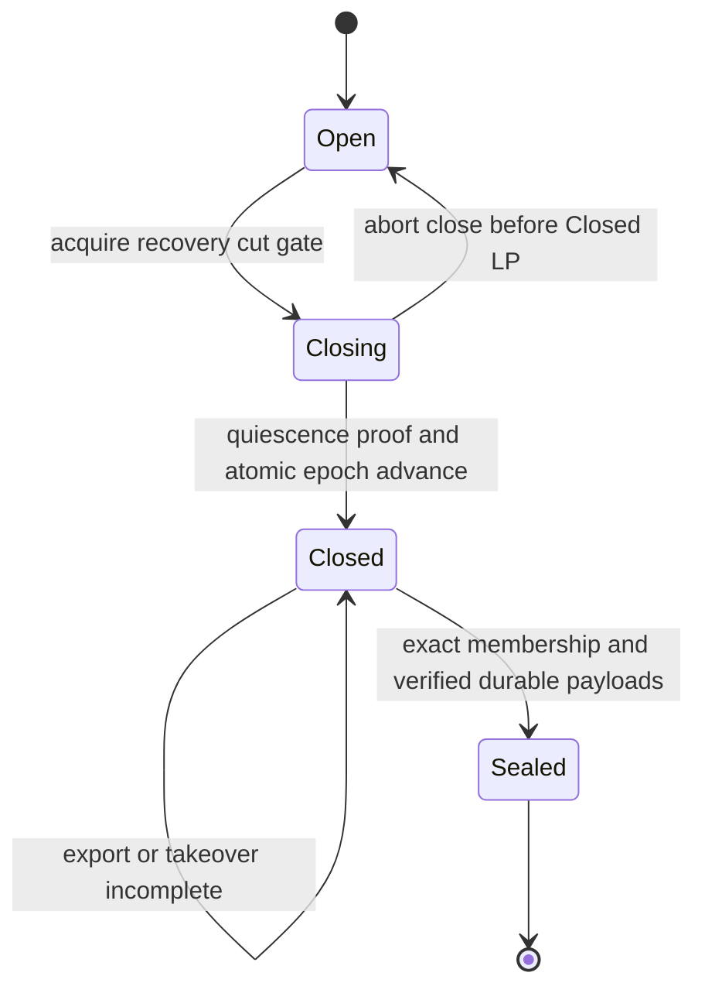
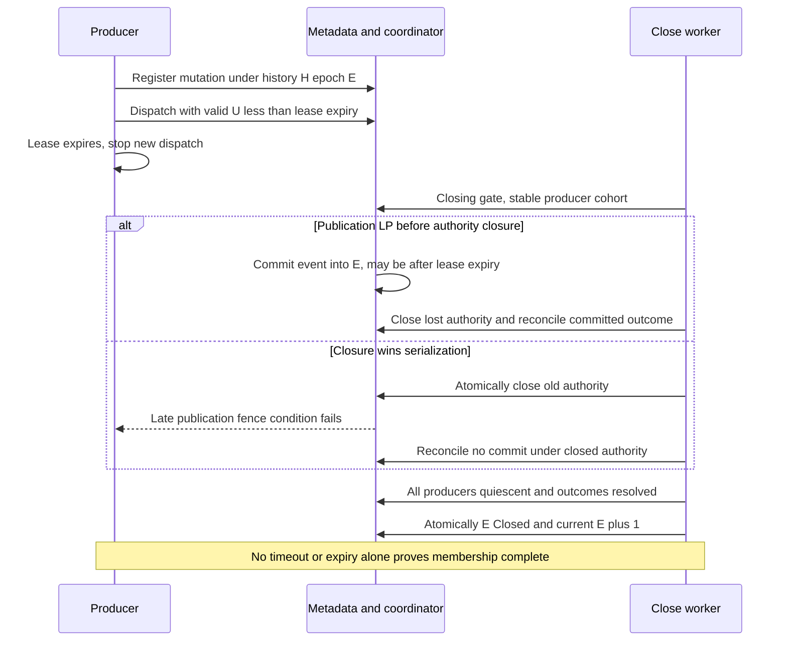
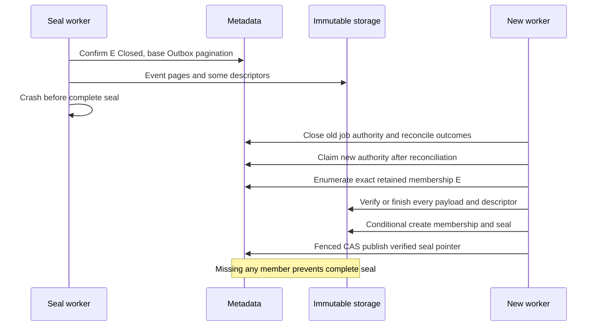
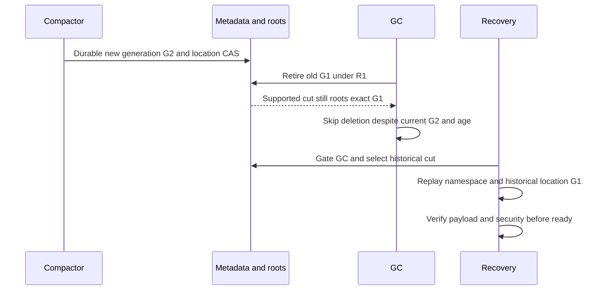

# W01-PHONG-03 — Draft R2 Recovery Epoch & Retention Roots Contract

## 1. Status, scope và checklist mapping

**Status: Contract proposal — Ready for Review. Owner: Phong. Chưa Approved/Frozen.** Ready for Review mô tả PR workflow, không phê duyệt proposals hoặc freeze gates. Baseline: `main` / `origin/main` tại `56133b00f114464a66ea18dee9c21a29e3dc0f1b`, fetch lại khi bắt đầu Phase 2. Branch tài liệu: `docs/W01-PHONG-03-r2-recovery`. Chỉ tài liệu này thay đổi; không implementation, shared Go changes hoặc Miles mutation.

Task chính thức: [W01-PHONG-03 — Thiết kế R2 recovery epoch và retention roots](https://miles.extase.dev/tasks/W01-PHONG-03). Task snapshot đọc ở Phase 1: Phong, W01, Todo/Ready, checklist0/3, chưa evidence; không suy ra trạng thái live từ snapshot. Hard prerequisites W01-CHIEN-04, W01-CHIEN-05 và W01-PHONG-02 được board ghi Done lúc đọc. Đây là contract W1, không thay thế implementation/fault evidence của downstream tasks.

| Checklist nguồn | Mapping draft |
|---|---|
| Chốt event identity, authoritative entities, history_id, epoch membership/seal và checkpoint descriptor | §4–12; OQ-01..06/09 |
| Chốt recovery catalog/chain, các cut đầy đủ24h + buffer/anchor và dữ liệu phải giữ khi GC | §11–14; OQ-06..08 |
| Chốt vô hiệu hóa bearer/SigV4 sau phục hồi; active upload abort/reset counters; sidecar không đủ namespace | §4/15/16; OQ-02/08 |
| Acceptance: có contract R2 và fault scenarios để freeze format; không hứa RPO60s | §16/18; readiness cho review không đồng nghĩa đã freeze |

Phạm vi: event/outbox boundaries, producer/epoch membership, export/seal/checkpoint/catalog, replay/security và retention roots. Không thiết kế lại R1; không tạo MetadataStore thứ hai, đổi pack/pages v1, mở API mới hoặc giả định production adapter đã có. RPO theo complete cut đã seal; export cadence60s và cut/checkpoint mục tiêu mỗi giờ không là SLA60s/1h.

## 2. Source precedence và decision register

Nhãn: **SOURCE** = yêu cầu/decision trong tài liệu hiện có (giữ trạng thái review của nguồn); **FACT** = Go/source hiện hữu; **PROPOSAL** = chi tiết mới của draft; **REVIEW REQUIRED** = chưa đủ căn cứ/proof để freeze. Các logical fields/state names dưới đây không phải Go types hoặc wire encoding đã tồn tại. Từ “phải” trong PROPOSAL mô tả điều kiện của phương án để reviewer đánh giá, không chuyển thành approval.

| Ref | Source và phạm vi |
|---|---|
| KT | [Architecture v4](../dedup-storage-gateway-architecture.md), §8/9/10/18/19.1: roots, R2 completeness, records, defaults |
| API | [API v2](../dedup-storage-gateway-api.md), §2.6/4.3/6.4/8/10/13.3: observable outcome, receipt, security, mapping, timing |
| CLOCK | [Clock/policy](clock-and-policy.md), §3/7/9: uncertainty, Q6, immutable history và source-sync gates |
| SHARED | [Shared-storage](shared-storage.md), Identity/Atomic mutation/Reservation lifecycle/PackStore boundaries |
| R1 | [R1/cache](r1-and-cache.md), §3/4/7/8/19: closure, stable membership, no-overlap, roots |
| FORMAT | [Pack/pages](pack-and-pages.md), §2.5/3/5: immutable bodies, limits và sidecar inventory |
| ENGINE | [Chunking/commit](chunking-and-commit.md), §6/8: one event per transaction, op_id/attempt, effects, refcount |
| GO | [model.go](../../internal/storage/model.go), [store.go](../../internal/storage/store.go), [validate.go](../../internal/storage/validate.go) |
| DOD | [Definition of Done](../acceptance/definition-of-done.md), D1/D2-06/10/11/12; [scope](../acceptance/scope-and-priorities.md), INV-03..06 |

API quyết định wire behavior; KT quyết định system safety. CLOCK/R1/SHARED cụ thể hóa phạm vi của mình; ENGINE/FORMAT là dependencies đang có contract/reference fixtures, không bằng chứng production. Conflict phải được resolve và đồng bộ nguồn, không tự coi draft này override nguồn. Q6 R1 đã chọn dispatch permission + closure ordering; không tái đưa strict commit-before-E. Request/reservation deadline và current authorization conditions vẫn độc lập, không tự bỏ hoặc kéo dài.

### Decision register — tất cả Pending Review

| ID | Problem | Options | Recommended PROPOSAL | Trade-offs | Owner / reviewer | Consequence khi chưa quyết định | Status |
|---|---|---|---|---|---|---|---|
| OQ-01 | Request có nhiều chunk/control mutations; op_id/event_id scope chưa đủ rõ | A event_id=request op_id; B transaction/mutation identity history-scoped; C child events nhiều records | B: stable mutation ID cho mỗi authoritative transaction, liên kết logical op; deterministic event ID, §5 | Durable identity binding và sửa handoff; tránh collision/multiple effects cùng request | Phong / Hưng, Hải/Chiến metadata/engine | Chưa freeze keys, idempotency hoặc event fixtures | Pending Review |
| OQ-02 | Entity/field inventory và transient/derived/lifecycle projections còn thiếu | A dump mọi fields; B explicit projections; Packs/intents journal hoặc external reconcile inventory | B, inventory §4; destructive intent cần durable reconciliation evidence | Nhiều schema hơn, tránh resurrect counters/leases; intent coverage cần proof | Phong / Hưng, Hải metadata/GC, Chiến auth/MP | Chưa chứng minh recovery state đầy đủ/security audit | Pending Review |
| OQ-03 | Một transaction đổi nhiều records nhưng một event | A transaction bundle; B multiple events + atomic descriptor | A: one event bundle, full effects/dependencies, §6 | Payload pages lớn; replay cần atomic visibility/completeness | Phong / Hưng, Hải/Chiến engine/metadata | Chưa freeze payload/replay causality | Pending Review |
| OQ-04 | Chưa có R2 byte schema/caps | A canonical JSON envelope; B binary riêng; C extend page kinds hiện có | A cho R2 metadata/descriptors, nhúng body FORMAT khi phù hợp, §7 | Canonicalization/size accounting cần golden; không sửa kinds1–4 ngầm | Phong / Hưng, Chiến format, Hải adapters | Chưa freeze serializer/version/checksum/limits | Pending Review |
| OQ-05 | Timeout/expiry không chứng minh in-flight quiescence | A stable registered producer cohort + bounded closure receipts; B explicit per-mutation ledger thêm | A baseline với registered mutation membership; B nếu A không đủ proof, §8–9 | Metadata writes/transaction condition contention; correctness trước throughput | Phong / Hưng, Hải metadata, coordination consumer | Chưa enable close/destructive integration hoặc claim exact membership | Pending Review |
| OQ-06 | Export/seal/checkpoint/catalog unknown publication, genesis/history change | A immutable objects+conditional create+fenced pointer CAS; B mutable latest objects | A; verified chain/explicit catalog, §10–12 | Nhiều manifests/pages; CAS/reconciliation lặp lại | Phong / Hưng jobs/ops, Hải storage | Chưa freeze publication/recovery discovery | Pending Review |
| OQ-07 | Historical namespace phải còn physical payload sau GC/compaction | A exact-generation retention; B verified replacement mapping | A baseline, B optimization sau proof, §13–14 | Storage cao hơn nhưng roots dễ audit; B phức tạp | Phong / Hưng, Hải GC/compaction | Chưa enable cleanup theo R2 hoặc công bố supported coverage thiếu proof | Pending Review |
| OQ-08 | PITR mixed tables, security projection, uploads/counters/readiness | A checkpoint+sealed replay staging reference; B audited PITR seed+reconcile | A reference semantics; B vẫn ưu tiên vận hành theo KT khi chứng minh cùng target, §15 | Rebuild tốn I/O; PITR cần proof tương đương, không silently đổi KT priority | Phong / Hưng ops, Hải metadata, Chiến auth/MP | Chưa ready recovery hoặc khẳng định RPO/RTO | Pending Review |
| OQ-09 | Models/ports/fixtures thiếu; wording lease/event khác nhau | A extend reviewed shared boundary; B recovery store trùng | A, delta handoff §17; source sync riêng | Phối hợp nhiều consumers, không bypass shared storage | Phong / Hưng, Hải/Chiến | Chưa freeze consumer contracts hoặc nhận model đã hỗ trợ đầy đủ | Pending Review |

## 3. R2 invariants

**SOURCE KT §8–9, API §2.6/4.3/6.4, CLOCK §3 và R1 §8:**

| ID | Invariant |
|---|---|
| R2-I01 | Authoritative mutation và matching outbox cùng transaction/CAS; không backfill event sau mutation |
| R2-I02 | Required immutable payload/pages đầy đủ, durable, checksum-verified trước publish pointer/descriptor tương ứng |
| R2-I03 | Stable identity/outcome qua retry; timeout hoặc absent/current head không chứng minh no-commit |
| R2-I04 | Replay theo entity identity/incarnation/revision và idempotent op; không wall/flush/object-name ordering |
| R2-I05 | Recovery-cut admission gate bao phủ mọi authoritative producer, gồm control plane/location mutation |
| R2-I06 | Closed epoch không nhận events mới; producer/event membership ổn định trước completeness enumeration |
| R2-I07 | Seal chỉ với exact membership và toàn payload/descriptor; timeout/count/max-ID không là completeness proof |
| R2-I08 | Checkpoint từ verified base + contiguous sealed replay, không Scan live tables như snapshot |
| R2-I09 | Mọi cut còn trong protected window hoặc còn retention/recovery references giữ đủ namespace/logical refs và physical payload; checkpoint mới/support-index removal không thu hẹp nghĩa vụ đó; age buffer không đủ quyền delete |
| R2-I10 | Policy revision, R1 fence, recovery epoch, entity incarnation, service incarnation và history tách domains |
| R2-I11 | Sidecar/cache không thay authoritative namespace, canonical winner hoặc recovery completeness |
| R2-I12 | Recovery không resurrect old authority/credentials/active uploads; security/counters audit trước readiness |

**PROPOSAL obligations:** mutation IDs không collision; bundle replay preserves transaction effects; registration→dispatch→closure có proof; membership/payload enumeration đủ; roots cover tất cả advertised cuts. Invariants là contract requirements, chưa là theorem/backend evidence. Fake mutex/fixed clock không chứng minh distributed correctness.

## 4. Authoritative entity/field inventory

KT §9.0/9.1/10.1 yêu cầu journal mọi authoritative change. **PROPOSAL OQ-02** phân projection để checkpoint/replay không copy nhầm runtime/derived fields:

| Entity / record group | Recovery projection cần đủ | Fields không replay như execution rights / special handling |
|---|---|---|
| Objects + immutable ManifestPages | Bucket incarnation/key/domain, head/tombstone, revision/op, manifest completeness, HTTP metadata, ETag/checksum | Tombstone ordering không bỏ theo TTL; retained old/new manifests theo consumers |
| Chunks | Domain/hash/raw bytes, canonical PackRef/range/codec, location revision và deletion semantics nếu có | Refcount derived; không chọn winner từ sidecar/hash/timestamp |
| Users | User ID/status/default domain/quota limit và authoritative revision | used recompute; reserved/staged/active_uploads reconcile/reset sau audit |
| Buckets / BucketGrants | Name+bucket_id, owner/domain/state/cache policy/revision; grant identity/read/write/revision/delete | Same name ABA không kế thừa grants/upload/receipt |
| Credentials / AdminTokens | Identity/user/scope/status/revision/expiry, KMS ciphertext hoặc bearer hash; historical checkpoint giữ status/revision tại cut | Không plaintext; recovery installation disable restored credentials/tokens trước admission, không sửa historical snapshot |
| SystemConfig policy/history | Complete immutable history revisions còn roots và current pointer, limits/config bindings cần phục hồi | Policy revision không chứa/đè recovery epoch/fence; historical job cần exact policy revision |
| Completed receipts | Upload/bucket/key/initiator/op/input binding, response/checksum, committed_at/original expiry | Receipt không giữ payload làm root; không restart7day TTL khi restore |
| Uploads/parts/completion pages/reservations | Đủ proof phân biệt committed/unknown/nonterminal và cleanup; transient roots lúc service chạy | Không phục hồi Active/old lease; reconcile Complete trước abort; counters không double-release |
| Packs lifecycle/destructive intents | Durable closed states/intents và backend observations đủ reconcile late DELETE/COPY | Actual class/restore expiry HEAD backend; old lease/state không tự cấp rights; intent journal coverage REVIEW REQUIRED |
| Outbox/outcome ledgers | Stable event/payload, history/epoch/binding/outcome proof; refcount/export progress theo retention | Progress không là immutable event body; imported old operation không tự authorize retry |
| RecoveryEpochs/seals/checkpoints/catalog | History-scoped chain, exact membership, base/target refs và checksums | Bootstrap/control metadata có protocol riêng, không recursively journal mỗi seal thành event của chính seal |
| Jobs/nodes/leases/access stats | Policy revisions còn cần và durable mutation reconciliation dependencies | Không replay active ownership; heartbeat/read/access/progress không authoritative namespace snapshot |

**FACT GO:** `OutboxEvent` có envelope fields nhưng không full event payload; Validate chỉ chấp nhận Objects và SystemConfig/global-policy. `ObjectHead`/`ManifestPage` chưa chứa đầy đủ FORMAT head fields; model comment không thay source format. `MetadataStore` chỉ có GetOutbox, không recovery enumeration/close/seal/checkpoint ports. §17 là handoff, không tuyên bố đã có những schema này.

Field-level projections, tombstone rules cho control entities, receipt-as-bundle-effect và lifecycle intent coverage là **REVIEW REQUIRED OQ-02/03**. Không bỏ intent unknown chỉ vì nó không nằm trong authoritative entity list tóm tắt của KT.

## 5. Event identity và idempotency

**SOURCE conflict:** KT §9.0 event_id theo `(history_id, op_id, entity/action)`; ENGINE §6.1 nói suy ra từ op_id và giao encoding cuối W01-PHONG-03. Cùng request có nhiều Chunks mutations nên tuple thiếu mutation discriminator có thể collision. API/current fixtures dùng op_id trong một số object outcomes. **REVIEW REQUIRED OQ-01/09**, không tự đổi wire/model field meanings.

**PROPOSAL conceptual identities (không tạo Go types):**

| Identity | Scope / retry rule |
|---|---|
| logical operation ID | ENGINE op_id của request/DELETE key/MP upload-Complete; giữ source lifetime và receipt semantics |
| authoritative transaction identity | Một logical mutation unit có thể commit tối đa một lần; nhiều chunk mutations của request có identity riêng, bundle multi-record vẫn một identity |
| mutation identity | Identifies transaction's intended logical mutation/effects, liên kết logical parent; allocated/bound durably trước first dispatch. Không sinh ID mới khi timeout/takeover |
| attempt | Bộ concrete transaction parameters có ClientRequestToken riêng; known conflict có thể recompute attempt, unknown giữ exact token/params |
| event identity | Deterministic, history-scoped từ transaction/mutation identity và domain-separated entity/action binding; không chứa mutable fence/attempt/epoch để retry không tạo event thứ hai |
| entity identity/revision | Object dùng bucket_id+key; Chunk domain/hash+location revision; control entity dùng stable ID/incarnation+revision; độc lập transaction ID |

Exact byte encoding/hash và cách map mutation identity vào shared `OpID` hiện hữu **chưa chốt**. Có thể reuse logical op_id cho sole final head transaction, còn chunk mutations cần child identity. Parent/child binding và retry after known CAS conflict phải có fixtures trước freeze. Không derive ID chỉ từ chunk hash (nhiều valid location mutations) hoặc revision mới lấy sau timeout.

Prepared attempt payload có thể khác khi known conflict đổi old manifest/base revision. Mỗi payload immutable có key/digest riêng; event ID ổn định nhưng chỉ winning transaction công bố pointer của attempt thắng. Retry unknown không rewrite payload hoặc áp candidate mới. Conflict đã committed phải trả original result; changed logical input không reuse identity. History mới không replay old in-flight logical op như được cấp authority mới.

### Protocol P1 — Prepare và publish authoritative bundle (PROPOSAL)

| Property | Contract |
|---|---|
| Preconditions | Authorized/admitted producer trong current history/epoch; complete durable prerequisites theo loại mutation; request/reservation deadline valid khi operation có chúng; bounded U<E cho dispatch; no unresolved attempt being silently replaced |
| Inputs | Logical/mutation identity, immutable attempt digest/payload refs, expected entity revisions và ledger revisions khi applicable, registered epoch, shared WriterFence/incarnation |
| Authoritative state | Head/location/control rows, ledger/receipt/outbox, producer/epoch admission state |
| Atomic boundary / LP | Matching entity mutations+one outbox Put cùng transaction; ledger/quota/receipt effects chỉ khi loại operation có chúng. Conditions include current authorization, applicable deadline/entity/ledger constraints, producer authority, shared closure/incarnation/history/registered epoch; LP backend commit |
| Success | One durable event bundle/outcome, all transaction effects hoặc none. Valid pre-E dispatch có thể LP sau E, trước closure nếu conditions khác đạt |
| Retry / unknown | Stable identity và exact unknown attempt; lookup retained authoritative ledger/outbox/receipt under serialization protocol; no current-head-only inference |
| Failure | Known no-commit after safe closure/ledger proof mới resume/release; unavailable giữ roots/ledger. LP sau closure fails fence; no double effect |
| Invariants | R2-I01/02/03/05/06/10; R1 no-overlap |

New child mutation journal/outcome binding cần bounded-item encoding/handoff; local RAM map không đủ. Registering identity trước dispatch và no-commit proof là **OQ-01/05/09**, chưa claimed implemented.

Durable prepared payload có thể nằm trong immutable shared metadata/pages theo producer contract; không bắt buộc flush journal lên S3 trước mỗi object commit. Physical pack/sidecar durability vẫn là prerequisite riêng. S3 journal materialization thuộc asynchronous P6; không thêm synchronous S3 journal round trip vào mỗi PUT (KT §9.0).

Control-plane mutation như global-policy update vẫn cần đúng quyền, producer admission/fence/history/epoch và atomic metadata+outbox, nhưng không phải tạo object quota reservation hoặc pack chỉ để đáp ứng P1. PUT/Complete và các operations có ledger giữ nguyên mọi deadline/quota/receipt constraints nguồn; clarification applicability này không bỏ hoặc kéo dài điều kiện nào.

## 6. Transaction event bundle và replay

**SOURCE ENGINE §6:** one Outbox event/authoritative transaction; Object bundle bao head/tombstone, logical quota/reservation, optional Completed state/receipt. Chunks CAS có outbox riêng. Refcount batches nằm ngoài commit; `refcount_next` mutation cùng delta transaction; old/new manifests cần giữ đến khi consumers xong.

**PROPOSAL OQ-03 payload completeness:** bundle ghi transaction/mutation identity, schema/projection version, history/epoch, effects inventory với entity identity/revision/incarnation, deterministic dependencies và immutable payload refs. Complete receipt là effect cùng bundle, không event độc lập chưa được nguồn cho phép. Objects payload mang metadata+new manifest và old manifest identity/bodies cần refcount. Không journal raw secret hoặc replay derived counter deltas thay recomputation.

Replay không công bố intermediate bundle state ra service/checkpoint. Logical ordering per entity không đủ nếu cùng transaction có nhiều records: apply all effects vào staging projection hoặc verify full bundle before checkpoint-visible commit. Duplicate cùng identity/digest là no-op; same identity khác digest là integrity conflict, stop. Older entity revisions không overwrite newer/tombstone; bucket incarnation khác không trộn. Không giả mọi revision gap đều missing event: revision domains/projections phải được inventory định nghĩa; gap expected/unknown cần fail completeness audit, không skip mù.

Causal graph: bucket identity trước object/grant; manifests và required location data trước declaring object reconstructible; receipt gắn final commit; policy history tồn tại trước job revision use. Không dùng flush order làm graph. Source và destination copy events có thể qua nhiều epochs; recovery chỉ replay tới cut, kiểm reference dependencies của toàn cut. Event orphan chunk insert không tự tạo object namespace.

### Protocol P2 — Replay sealed input (PROPOSAL)

| Property | Contract |
|---|---|
| Preconditions | Verified base checkpoint, contiguous sealed chain cùng selected history tới target, complete exact event descriptors, staging/gated namespace |
| Inputs | Base+target IDs, schemas/projections, event bundles/digests/dependencies |
| Authoritative state | Immutable source chain; staged reconstructed entity state và replay progress |
| Atomic boundary / LP | Logical bundle apply all-or-none trong staging với idempotency progress; với bundle vượt backend transaction size, build hidden shadow state rồi publish bounded completion pointer. Exact encoding REVIEW REQUIRED; không partial visible apply |
| Success | Deterministic target projection; current service chưa ready chỉ vì replay xong; checkpoint/recovery publication có LP riêng |
| Retry / unknown | Resume only from verified bundle progress; unknown local apply reconcile before repeating; immutable event equality kiểm trước dedup |
| Failure | Missing dependency/page/schema, conflicting digest/incarnation hoặc unsupported projection dừng; không choose latest timestamp |
| Invariants | R2-I03/04/08/09/11/12 |

P2 reconstructs historical authoritative projection trước khi P12 áp recovery normalization. Không disable credential, abort upload hoặc cấp new authority khi đang dựng periodic historical checkpoint; historical transient records có thể được giữ cho audit/replay theo projection đã review nhưng không được thực thi như active runtime. New-history normalized genesis là loại base khác có provenance riêng, không giả làm checkpoint của old history.

Reference replay semantics không giả DynamoDB atomic bundle kích thước tùy ý. Bundle paging/hidden state/progress retention và dependency ordering **OQ-03/04/08** trước implementation freeze.

## 7. Payload serialization, versioning và checksum

**SOURCE:** payload pointers dưới backend item limits; pages hoàn tất trước commit; unknown versions reject; event pages/descriptors checksum; immutable S3 objects conditional-create. FORMAT v1 `MILESPAG` kinds1–4 và body≤384KiB chỉ dành manifest/part/completion, không tự áp thành journal format. SHARED ModelVersion=1 không đồng nghĩa mọi binary schema version1.

**PROPOSAL OQ-04:** dedicated R2 envelope/descriptor version, canonical UTF-8 JSON metadata và exact existing binary page bodies khi nhúng. Canonicalization must pin field ordering, integer domain, strings/object keys (không tự Unicode normalize), null/absent, duplicate/unknown fields và hash coverage. Chưa chọn canonical library/spec, magic hoặc new size caps; REVIEW REQUIRED trước golden encoding. Không hash Go maps/pretty JSON hoặc arbitrary serializer output.

| Artifact | Nội dung cần bind / verify |
|---|---|
| Event payload pages | Parent event/mutation/history, page number, byte length, body checksum; complete stream digest/order |
| Event completion descriptor | Event envelope identity, effects/projection version, page count/list hoặc manifest-tree pointer, full length/digest |
| Membership pages | History/epoch, ordered unique event identities + descriptor digests, total count/checksum |
| Seal | Closed epoch/cut, exact membership descriptor, previous seal hash, version/self digest |
| Checkpoint pages/descriptor | Base/target identity, projection schemas, entity/page inventories, root coverage, full completion digest |
| Catalog | Selected history/incarnation/base and discovery bindings, version, concurrency token; no raw secret |

Deterministic paging và bounded hierarchical manifests cho large inventories; count đơn lẻ không đủ, unordered listings không phải membership. Bounds checked trước allocate; mọi bytes phải parse/validate, thiếu/truncated/trailing bytes fail. Numeric/page-count/size caps thuộc review, không chép384KiB thành new R2 S3 limit. Backend transaction≤100actions/4MB và item<400KB vẫn là constraints nguồn, serialized attribute accounting riêng.

Retry same immutable key chỉ chấp nhận exact bytes/digest; khác bytes conflict/report, không overwrite. Checksum là integrity/completeness binding, không thay auth/fence. Journal/sidecar/checkpoints/seals/catalog ở S3 Standard theo API §2.1/KT, không tự tier cùng pack bytes.

## 8. Epoch lifecycle và producer registration

**SOURCE KT §9.1:** Open/Closed/Sealed persisted record; Closing là workflow barrier trong proposal, không tự freeze stored enum. Epoch0 bao đủ bootstrap từ base rỗng; recovery history mới có audited base genesis theo §12/15. Heartbeat, readers, access stats, job progress không cần đóng như authoritative producers; mọi write làm đổi recoverable projection thì có.

### Protocol P3 — Register producer/mutation (PROPOSAL OQ-05)

| Property | Contract |
|---|---|
| Preconditions | New producer: service active, recovery gate Open, valid owner/incarnation/time proof, identity chưa terminal/reused. Existing producer: admitted vào E, attachment còn accepting, current authority/fence hợp lệ; khi Closing phải thuộc frozen admitted cohort của đúng close generation |
| Inputs | Stable producer ID, operation scope, bound history/epoch E, expected gate/close generation và producer attachment revisions, lease/fence, policy/limits binding |
| Authoritative state | Gate/current epoch, frozen admitted cohort, producer attachment/authority state, bounded mutation descriptors/lease |
| Atomic boundary / LP | New producer transaction check gate Open/current history+epoch và register producer bound E; LP commit. Existing producer registration trước dispatch atomically check exact producer/cohort/attachment revisions, bound history/E và authority/fence, rồi attach mutation membership+descriptor; LP attach commit. Closing không tự reject mutation của admitted cohort; mutation attachment closure và publication fence closure là các conditions riêng |
| Success | Producer và từng dispatched mutation truy vết được, không tồn tại unregistered authoritative dispatch |
| Retry / unknown | Cùng ID/binding lookup trả original membership; unknown registration không cấp quyền dispatch; không allocate ID khác để tránh reconcile |
| Failure | Closing reject producer mới, kể cả dùng ID/epoch của producer khác để lách gate. Existing producer không thuộc cohort, stale authority/binding, attachment closed hoặc epoch Closed: reject new mutation. Publication sau fence closure fails transaction condition; registration đã thành công không bypass fence |
| Invariants | R2-I03/05/06/10 |

Closing gate chỉ đóng new producer admission; admitted healthy cohort vẫn có thể đăng ký mutation tiếp theo trong bound epoch E để hoàn thành request, khi producer attachment/authority còn hợp lệ. Mỗi dispatch mới vẫn cần bounded U<E_lease; registration không kéo dài lease/deadline. Không cho new mutation sau attachment closure hoặc publication LP sau fence closure. Đóng attachment trước stable mutation enumeration; chưa được mark producer drained nếu còn in-flight/unknown outcome chưa settle/reconcile bằng authoritative proof. Bounded mutation descriptors, registration write cost và proof mọi engine/control paths tham gia **REVIEW REQUIRED**, không chỉ list Nodes alive hoặc Scan leases đang đổi.

## 9. Closure proof, stable membership và takeover

Tách **producer cohort membership** (ai có thể publish vào E) và **event membership** (những transactions thực sự commit vào E). Closing cố định tập producers, không tự cố định tập mutations/events: admitted producers còn được attach mutations theo P3 tới attachment closure. Producer registration ổn định chưa chứng minh all events đã nhìn thấy nếu late transaction còn có thể commit.

### Protocol P4 — Close epoch (PROPOSAL OQ-05)

| Property | Contract |
|---|---|
| Preconditions | Epoch E Open, valid recovery job owner/fence/time proof, all authoritative publishers enforce same shared closure/history/epoch boundary |
| Inputs | History/E, expected current-epoch/gate/job revisions, stable close ID, configured close budget120s |
| Authoritative state | Gate, cohort/mutation membership, producer fences/outcomes, RecoveryEpochs[E], current epoch |
| Atomic boundary / LP | Acquire Closing gate CAS fixes producer cohort; permit existing cohort mutations theo P3 trong drain. Close từng producer attachment, ổn định mutation membership và settle/reconcile mọi in-flight/unknown outcome bằng authoritative proof trước final transaction. Final transaction validates immutable quiescence proof bound gate/epoch/revisions, writes E Closed/cut and advances current E+1; LP this transaction. All publication conditions serialize with this boundary |
| Success | No additional event can commit into E; gate may reopen for E+1 after confirmed Closed/current pointer; outbox E membership retained |
| Retry / unknown | Same close ID reads E/current/gate authoritative tuple. Unknown final commit giữ admission gated cho đến resolve, không assume E Open rồi reopen |
| Failure | Before final LP, budget hết chưa quiesce: abort close, E stays Open, release global gate safely. Healthy writer không bị kill; unknown roots/resource closures vẫn giữ. Không “undo” Closed hoặc reopen destructive unknown resource |
| Invariants | R2-I03/05/06/07/10; R1 Q6 |

Quiescence proof cần: complete cohort; mỗi admitted producer đã hoàn tất hoặc authority đã close an toàn; mutation attachments closed, membership stable; mọi in-flight/unknown outcomes settle/reconcile bằng authoritative proof; actual committed outbox vẫn retained. Healthy producer còn làm việc thì chờ hoặc abort close theo budget. Lease expiry, timeout và absent event/outcome read không tự chứng minh no-commit. Lost producer chỉ reclaim-eligible khi L>=E_lease+grace; CAS close old publication authority, reconcile trước new authority. Không equate epoch number E với lease expiry E_lease.

**REVIEW REQUIRED:** concrete quiescence certificate/aggregate encoding chưa có trong shared models. Không condition-check hàng nghìn producer rows trong một transaction hoặc coi counter=0 tự đủ proof. Cần monotone, revision-bound durable completion evidence và proof không có unregistered dispatch; reviewer chọn bounded summary protocol hoặc explicit per-mutation ledger. Nếu chưa chứng minh, close feature blocked; không bỏ điều kiện này để đạt120s.

### Protocol P5 — Takeover producer/export/seal job (PROPOSAL)

| Property | Contract |
|---|---|
| Preconditions | Time eligibility và valid new worker authority; expected old fence/revisions; correct history/incarnation |
| Inputs | Stable logical job/operation IDs, old fence, new owner, retained checkpoints/outcome proofs |
| Authoritative state | Lease/fence/closure, immutable membership, operation outcome records, publication pointers |
| Atomic boundary / LP | CAS close old authority cùng serialization boundary với its metadata publication; LP closure. Stabilize and reconcile all old in-flight/unknown work; separate transfer CAS LP chỉ sau đó cấp new publication authority |
| Success | No overlapping publication authorities; already committed result preserved, unfinished safe steps resume idempotently |
| Retry / unknown | Unknown closure/transfer/pointer read retained authoritative state; no fresh logical ID; unavailable giữ gates/roots |
| Failure | Stale new/old workers rejected; lease expiry không rollback metadata/S3 requests; late immutable writes verify equality, late destructive S3 reconcile riêng |
| Invariants | R2-I03/06/07/10/12 |

Valid pre-E_lease dispatch có thể commit sau E_lease nếu LP trước shared closure. LP sau closure fail fence condition. New publication authority không cấp trước full reconciliation. Old ACK tới muộn không resurrect dispatch rights; absent event trước closure không đủ no-commit. CLOCK [§3.4](clock-and-policy.md#34-shared-utc-uncertainty-và-lease-safety) và R1 [§8](r1-and-cache.md#8-lease-fencing-takeover-và-reconciliation) là baseline.

## 10. Export, seal và unknown outcomes

### Protocol P6 — Export event (PROPOSAL cụ thể hóa KT §9.0–9.1)

| Property | Contract |
|---|---|
| Preconditions | Committed outbox event, retained immutable input đầy đủ, valid export job authority; epoch có thể còn Open |
| Inputs | Event ID/history/epoch, exact immutable payload pointer/digest, job fence/checkpoint |
| Authoritative state | Outbox immutable fields + mutable export progress/lease; S3 immutable pages/completion descriptor |
| Atomic boundary / LP | S3 pages writes không atomic cùng DDB. Conditional create immutable artifacts; sau verify full descriptor, CAS MarkExported bound exact event digest/current job fence. LP export-status commit, không object publication LP hoặc epoch seal |
| Success | Event materialization durable/verified; Open epoch exported event vẫn chưa complete recovery cut |
| Retry / unknown | Read/verify exact key/version/digest sau lost ACK; re-Put identical conditional object; unknown MarkExported reconcile before cleanup |
| Failure | Missing payload/page/descriptor giữ unexported, roots; conflicting bytes report integrity; không substitute pointer/mark success dựa upload submit |
| Invariants | R2-I01/02/03/07/09 |

### Protocol P7 — Enumerate và seal (PROPOSAL OQ-04/05/06)

| Property | Contract |
|---|---|
| Preconditions | E Closed confirmed, event membership immutable, no cleanup removes E members, valid seal job fence, verified predecessor seal/genesis |
| Inputs | History/E/cut, base-table scan cursor, exact IDs/descriptors, predecessor hash, expected epoch revision |
| Authoritative state | Closed E/current history, retained Outbox(E), immutable membership pages/event descriptors/seal, metadata seal pointer |
| Atomic boundary / LP | Full consistent base Outbox pagination over immutable E (not GSI); build sorted unique membership pages with IDs+descriptor digests and count/hash. Conditional-create verified seal after every member complete. CAS publish Sealed/pointer under epoch/job/history conditions; LP metadata publication. Durable seal exists before this LP; discovery/recovery must verify full seal chain, not rely on DB status alone |
| Success | Exact stable set matches every durable event descriptor, predecessor chain complete; E is supported only with required retained data coverage (§13–14) |
| Retry / unknown | Crash/lost ACK lookup immutable artifacts and pointer; same content idempotent, disagreement fail closed; new worker uses same E membership |
| Failure | One missing event/page, chain gap, stale fence/history, incomplete enumeration: no seal publication. Empty E still requires explicit verified empty membership and valid predecessor, not scan timeout |
| Invariants | R2-I02/03/06/07/08/09/10 |

Durable S3 seal may complete before DB ACK/pointer; recovery may only use it if catalog/history selection and full chain/artifact verification succeed. DB loss with merely Closed/incomplete payload falls back to preceding complete seal. Exactly how catalog discovers available valid seals without trusting newest filename is **OQ-06**; this draft không hứa recovery finds every unattested orphan seal.

Never delete Outbox E membership before seal; mark exported alone does not permit cleanup. Refcount progress và retained outcome proof cũng là independent blockers. Export progress, seal pointer, checkpoint pointer và current-history catalog are different publications; không một boolean “done” chung.

## 11. Checkpoint descriptor

**SOURCE KT §9.1:** checkpoint ngoài barrier từ previous checkpoint+contiguous sealed replay; contains namespace/manifests, security/config, location winners, unexpired receipts; recompute quota/refcount. Không Scan mutable tables thành snapshot.

**PROPOSAL descriptor logical fields (REVIEW REQUIRED OQ-04/06/08):** explicit projection mode/version phân biệt periodic historical checkpoint với new-history recovery genesis; schema version; checkpoint ID/history/incarnation provenance; base checkpoint ID/digest; target epoch/cut and terminal seal hash; included contiguous epoch range; bounded page inventory/tree (key/index/length/count/hash); entity inventory/counts; logical roots+physical coverage descriptor; full completion digest. Historical mode binds old history/target cut; genesis mode binds new history/incarnation và audited source-cut provenance, không claim là snapshot lịch sử của old history. Counts/checksums bind exact contents, not substitutes for namespace consistency audit. Mode labels chỉ là logical semantics; encoding/versions/caps/canonical bytes vẫn OQ-04/OQ-08, chưa freeze.

### Protocol P8 — Build/publish checkpoint (PROPOSAL)

| Property | Contract |
|---|---|
| Preconditions | Periodic historical checkpoint: verified base+target chain, P2 historical replay complete, roots coverage valid, job authority/current history; chưa áp recovery security/terminal normalization |
| Inputs | Stable checkpoint ID, historical projection mode/version, base/target IDs and digests, staged historical entity/root pages, expected pointer revision |
| Authoritative state | Immutable source graph and output snapshot pages/descriptor; checkpoint metadata pointer |
| Atomic boundary / LP | Write/verify all immutable output pages and descriptor first; fenced CAS publish exact checkpoint pointer. LP pointer commit. S3 body not atomic with pointer; no page hidden behind unverified completion |
| Success | Periodic checkpoint phản ánh chính xác authoritative state tại target cut, giữ credential status/revision như lịch sử, không tự disable/abort; consumers có thể replay later seals của đúng history/projection mà không live DB scan. Runtime rights vẫn không được cấp từ historical snapshot |
| Retry / unknown | Same ID/content retry; reconcile pointer after lost ACK, do not switch to newest named artifact; conflicting identity/digest blocks |
| Failure | Replay gap, missing roots, unavailable payload, schema mismatch or stale job: do not publish; keep source anchor/chain until valid replacement proof |
| Invariants | R2-I02/04/08/09/10/12 |

Historical checkpoint raw state và recovery installation là hai bước riêng: credential active-at-cut giữ nguyên status/revision trong periodic checkpoint. P12 rebuild historical state, rồi áp security normalization trước readiness. New-history recovery genesis materializes audited normalized state sau bước đó; ghi history/incarnation và source-cut provenance riêng, không là historical checkpoint của old history. Reuse immutable pages/descriptor publication mechanics của P8 không cho phép reuse sai projection mode hoặc mutate old checkpoint. Replay/install phải validate mode/version và compatible base/chain; unsupported/mismatched mode fail closed theo schema review OQ-04/OQ-08.

## 12. Recovery catalog và chain

**SOURCE:** S3 `recovery/active-history.json` selects history; catalog CAS If-Match ETag (first If-None-Match:*); online exporter không đổi catalog history. Chain binds predecessor seal, không trộn same epoch number across histories. Epoch0 bootstrap đầy đủ; post-recovery history/incarnation mới và base checkpoint từ audited cut (KT §9.1, API §6.4).

**PROPOSAL OQ-06:** catalog binds format version, history/service incarnation, genesis/base checkpoint descriptor+digest và verified discovery root cho seal/checkpoint chain. Current-history selection tách khỏi mutable per-job progress. How discovery root advances while online exporter cannot change history selection, exact object paths and post-recovery epoch0/base binding are REVIEW REQUIRED; không silently grant exporter provisioning role. No speculative new public endpoint.

### Protocol P9 — Select chain / publish recovery history (PROPOSAL)

| Property | Contract |
|---|---|
| Preconditions | Service/GC gated; operator/provisioning authority; explicit history selection; audited recovery output/base complete; old workers isolated |
| Inputs | Expected catalog ETag/absence, selected historical source target cut, new history/incarnation, immutable audited recovery-genesis descriptor với explicit projection mode/version, new bootstrap security binding |
| Authoritative state | Catalog, DB installed history/incarnation/recovery phase, immutable base/genesis and audit evidence |
| Atomic boundary / LP | No S3+DDB cross-system transaction. Conditional catalog Put is catalog-selection LP, DB staging/install has separate conditional phase transition. Recovery-ready LP only after verifying DB+catalog+base exact match and §15 gates |
| Success | New history authoritative for service, no old authority resurrected; predecessor history artifacts retained per supported policy |
| Retry / unknown | Lost catalog ACK read exact body/ETag; reconcile DB install phase; concurrent unexpected ETag fail, no overwrite. Mismatch keeps service gated |
| Failure | Missing/multiple/contradictory catalog/chain, base incomplete, KMS unavailable, old destructive unknown: not ready; operator explicit selection/audit needed |
| Invariants | R2-I02/08/09/10/11/12 |

Selecting chain: verify catalog-selected history → trusted base/genesis descriptor và projection mode/version → contiguous seals to explicit target → every member/descriptor/page → entity dependencies/roots. Not sort filenames/timestamps or replay later unsealed/open events. New history base is explicit audited normalized genesis, not historical snapshot/link spliced into old seal chain. Old-history cuts còn protected phải giữ addressable history/base/discovery roots; catalog đổi history không tự rút nghĩa vụ retention. Exact cross-history selection protocol vẫn **OQ-06/07**.

## 13. Supported cuts và 24h retention

**SOURCE KT §9.1/API defaults:** supported recovery points là complete cuts trong24h, thêm10m GC buffer, anchor trước biên và mọi dependency còn cần. PITR configured1day; actual Earliest/LatestRestorableDateTime vẫn constrain selection. Cadence không guarantee một cut tại mọi giờ/giây.

**PROPOSAL:** enumerate supported set S bằng verified (history,epoch,cut,seal) descriptors, with complete replay+payload coverage. Không advertise cut chỉ vì nó recent hoặc Sealed flag. S/support index là biểu diễn nghĩa vụ coverage, không là quyền tùy ý chọn subset để GC: checkpoint C2 mới không loại cut C1 còn trong protected window. Mọi cut còn trong window hoặc còn retention/recovery references tiếp tục protected dù latest checkpoint/catalog pointer đã đổi. Anchor A phải không sau oldest target cần phục hồi; retain A và all contiguous seals/pages, manifests, physical generations và payload dependencies tới every protected target. Nếu no cut trong window hoặc target ngoài support, report unsupported/stale, không quietly gọi old anchor là fresh supported cut. Wall cut timestamp phục vụ selection/age, never event ordering.

Two separate facts: sealed metadata completeness và recoverable physical coverage. Missing/corrupted payload của protected cut là integrity incident, không normal support withdrawal: báo degraded/failed coverage và giữ retention obligation/remaining roots, không xóa entry khỏi index để hợp thức hóa GC hoặc sửa seal để che lỗi. Incident không biến broken cut thành recoverable; report thực tế chưa phục hồi được trong khi giữ nghĩa vụ bảo vệ/repair. Record actual latest supported cut, export lag và cut age riêng; publication/cost/reporting không hứa RPO60s hoặc1h.

**Removal eligibility:** chỉ loại cut khi có authoritative proof đúng reviewed support policy, expiry ngoài protected window với conservative time bound, dependency closure và active recovery references đã được xét đầy đủ. Nếu còn cut/anchor/consumer khác phụ thuộc artifacts, removal một cut không giải phóng artifacts đó. No cut/support-index removal tự tạo no-root proof; root/watermark publication phải bảo toàn mọi nghĩa vụ còn sống kể cả qua history switch. Encoding/time-bound/root-summary proof vẫn OQ-06/07; chưa có proof thì giữ cut và skip cleanup. Giữ source24h+10m+anchor; elapsed time không là independent deletion authority.

### Protocol P10 — Advance retention/support watermark (PROPOSAL)

| Property | Contract |
|---|---|
| Preconditions | New checkpoint/chain/payload closure verified; valid time bound, retention job authority. Proposed set preserves every still-protected cut; each removed cut has policy/expiry/dependency/active-recovery eligibility proof, không chỉ newer checkpoint |
| Inputs | Expected support/watermark revision, previous and proposed supported/protected sets/anchors, per-removal eligibility evidence, full dependency/root digest, job fence |
| Authoritative state | Retention/support obligations và index, chain/checkpoint pointers, active recovery/R1/outcome roots; obligation không mất vì index entry bị bỏ |
| Atomic boundary / LP | Revision-bound CAS validates preservation/removal eligibility và publishes support/root snapshot before delete eligibility. GC admission serializes with obligations/root updates, không chỉ đọc proposed index; no full root-list single transaction assumption. Concrete bounded root-summary protocol REVIEW REQUIRED |
| Success | Every protected cut retains immutable namespace/manifests/physical payload/anchor/chain closure; C2 không withdraw C1 trong window. Old anchor/artifact removable only when no protected cut/consumer needs it và independent cleanup predicates đạt |
| Retry / unknown | Same expected revision reconcile; unknown watermark cannot justify cleanup; moving clock/policy không giảm granted protection |
| Failure | Missing removal proof, premature withdrawal, stale/unknown clock bound, active references hoặc CAS conflict: retain, skip cleanup. Missing/corrupted payload là integrity incident giữ remaining obligations, không normal withdrawal |
| Invariants | R2-I03/08/09/10 |

Time pruning phải conservative theo CLOCK [§3.4](clock-and-policy.md#34-shared-utc-uncertainty-và-lease-safety), không chỉ local now−24h. Exact rounding, anchor selection under uncertainty và cleanup observation horizon **OQ-07**; chưa chọn công thức wall timestamp như correctness proof.

## 14. Anchor, physical roots và GC safety

**SOURCE KT §8/9.1:** roots beyond committed heads; retirement giữ pack/pages/sidecar ít nhất24h+10m và mọi reader/writer/upload/recovery/minimum-retention dependencies. Sidecar chỉ physical inventory, không namespace/canonical winner (FORMAT §2.5). Refcount/age/TTL không là delete authority.

**PROPOSAL OQ-07 baseline:** retain exact PackRef/generation selected by each supported cut's reconstructed canonical location state. Manifest chỉ giữ domain/hash/raw length, nên root proof phải nối logical manifest refs với historical location winners, không dùng current Chunks table để đại diện mọi cut. Class change không đổi content generation; actual read eligibility/restore vẫn phải audit.

| Root owner | Logical references giữ | Physical generations/artifacts giữ |
|---|---|---|
| Current namespace + R1 reader/writer pins | Bound/current manifests, unresolved guards, preparing refs | Exact generations pinned/admitted; R1 resource gates independently enforced |
| Upload Active/Completing chưa resolve | Parts/input/snapshot/prepared manifests, outcome ledger | Referenced generations tới terminal reconciliation/protection |
| Unexported/outcome/refcount work | Event payload, both old/new manifests, immutable batch inputs, terminal outcome proof | Required data generations và pages; export complete chưa đủ nếu refcount/outcome cần |
| Supported checkpoint/cuts | Namespace/entity projections, manifests, location winners, policy history, receipt metadata | Exact generation coverage plus payload/descriptor/membership/seal pages |
| Anchor/dependency chain | Base checkpoint before window và contiguous epochs | Every dependency needed to reconstruct targets, kể cả older than24h |
| Active recovery/audit | Selected source graph và staged verified reconstruction | Keep source+destination until install/readiness/outcome confirmed |
| Completed receipt | Response/binding/original expiry | Receipt alone không payload root; historical object roots vẫn có thể giữ data riêng |

Compaction creates new durable pack/sidecar then location CAS; it cannot delete old generation simply because current head now uses new location. Alternative verified replacement requires durable cut→same-domain/hash equivalent mapping, complete decode/SHA verification and retention handoff before old delete. Không choose any same-hash candidate across domains or trust sidecar alone. Alternative not selected/implemented by draft.

### Protocol P11 — Cleanup generation/pages/outbox (PROPOSAL)

| Property | Contract |
|---|---|
| Preconditions | Support/root snapshot valid và preservation/removal eligibility confirmed theo P10, mọi protected-cut dependencies discharged cho candidate; no R1/upload/recovery/outcome dependencies; time/protection/provider minimum retention achieved; valid maintenance authority |
| Inputs | Exact resource identity, expected lifecycle/root/support revisions, fenced delete job and durable intent |
| Authoritative state | Retention roots/watermarks, resource admission/pins, lifecycle Deleting/Transitioning, outcome/refcount progress |
| Atomic boundary / LP | Under R1 serialize roots/pins/admission with retirement and durable Deleting intent; LP metadata closure. Physical S3 DELETE later, not atomically fenced; finalize deletion only after backend outcome reconciled |
| Success | No supported cut/current reader loses required data; deleted artifact no longer dependency; cleanup progress idempotent |
| Retry / unknown | Unknown delete keeps durable resource closed; new worker reconciles same action. Unknown pointer/root progress does not authorize deletion |
| Failure | Any missing proof, replacement uncertainty, active recovery, refcount unfinished or class retention unmet: skip. No reopening Warm after timeout |
| Invariants | R2-I03/07/09/11/12; R1 resource safety |

Cleanup predicate is AND: all logical/physical dependencies discharged for mọi protected cut, không chỉ index entries còn nhìn thấy; support/anchor chain still complete; R1 pins/roots and unknown operations absent; minimum retention/protected_until/time bound passed; authoritative admission closure/fence current. **24h+10m alone is never sufficient.** Checkpoint mới hoặc bỏ index entry không là discharge proof. Outbox Delete additionally respects ENGINE refcount_next completion and durable outcome retention; tombstone cleanup cannot erase necessary entity ordering.

## 15. Recovery security, uploads và counters

### Protocol P12 — Recover/install/readiness (PROPOSAL cụ thể hóa KT §9.1/API §6.4)

| Property | Contract |
|---|---|
| Preconditions | Service/admission/GC gated, old nodes/workers stopped or isolated, operator selected supported cut/history, required KMS/storage/config available |
| Inputs | Source catalog/historical base/seals/cut và compatible projection mode/version, recovery normalization projection version, new history/incarnation, install ID, expected catalog/DB phase revisions |
| Authoritative state | Source immutable graph; staging DB; credential/user/grant/receipt/upload state, counters, backend lifecycle, recovery phase/catalog |
| Atomic boundary / LP | Rebuild historical target into gated staging; apply audited security/terminal/counter normalization, build explicit new-history normalized genesis, conditional DB install phase và P9 catalog CAS. Final readiness transition only after exact DB/catalog/genesis mode+version+identity match. No cross-S3/DDB atomic install claim |
| Success | Namespace/data recoverable at target; restored secrets disabled; no active old leases/uploads; counters reconciled; new audited genesis/catalog consistent |
| Retry / unknown | Stable install ID/phase checkpoints; unknown install/catalog keeps gated; repeat audits deterministically, no reissue tokens automatically |
| Failure | Missing chain/namespace/canonical bytes, unresolved destructive action/outcome, security/counter mismatch, KMS/key access failure: not ready, retain source roots |
| Invariants | R2-I03/04/08/09/10/11/12 |

SOURCE operational priority remains PITR when usable; choose restore point not after target and reconcile all tables to same cut through complete chain. S3 checkpoint+sealed replay is reference reconstruction. PITR multi-table mixed state is not a valid snapshot automatically; adapter must prove projection equals target and does not retain later/unjustified rows. No inverse replay/rollback algorithm invented here; unavailable equivalence proof blocks that PITR install, not license to open service (OQ-08).

**Recovery installation normalization, không áp vào periodic historical checkpoint:** sau historical rebuild và trước readiness, thực hiện các bước dưới đây. New-history recovery genesis chứa audited normalized result với source history/cut provenance; không được trình bày như historical checkpoint của old history. Descriptor mode/version/encoding vẫn OQ-04/OQ-08.

1. Disable every restored bearer/SigV4 credential regardless active-at-cut; clear auth cache. Persist only ciphertext/hash, never secret plaintext; audit users/grants. Operator explicitly issues new credentials after audit via approved bootstrap path.
2. Do not restore old lease/job ownership. New history/service incarnation, DB conditions and provisioning/catalog binding prevent old metadata publication; old S3 destructive calls still require reconciliation before resource readmission.
3. Reconcile Completed receipt/outcome before abort classification. Preserve committed response and original expiry; no replay creates head again after later delete/overwrite. Receipt expiry at recovery time and provenance policy need OQ-08 fixtures, never restart7days from recovery.
4. Nonterminal uploads do not become Active. Abort controlled, reconcile unknown Complete and retire parts/input/snapshots only after roots/outcome retention allow. Do not double-release a ledger imported for audit.
5. Reconstruct used logical bytes by owner from recovered live heads; recompute refcount/live_bytes from validated references. Reserved/staged and active-upload counters reset/release after all nonterminal uploads normalized; used is **not** reset0. Pending historical refcount delta must not be reapplied on top of recomputed counts; projection/progress rebasing requires OQ-02/08 handoff.
6. Actual backend class/restore expiry via HEAD/reconcile; inventory sidecar cannot reconstruct Objects/permissions/manifests/canonical revisions. Missing canonical may use same-domain/hash verified surviving candidate only per KT; Cold verification restore impacts RTO. Cache is never audit proof.

Readiness gates: explicit supported source and complete chain; deterministic entity/reference completeness; required physical coverage/audit; destructive unknowns resolved; credential disable/auth audit; uploads/counters normalized; old authority isolated; valid clock/proof sources; new base/history/incarnation/catalog match; operator audit complete. Successful checksum on sidecars or replay progress100% alone is insufficient.

## 16. Fault timelines và test vectors

All below **PROPOSAL**, no execution evidence. Stable mutation membership/no-commit proof remains review obligation. Deterministic model tests supplement, not replace, backend transaction/fault and recovery drills.

### Timeline A — In-flight commit after lease expiry

### Timeline B — Closed before seal, crash and takeover

### Timeline C — Historical cut versus compaction/GC

| ID | Preconditions | Failure point | Expected safe behavior | Recovery action | Invariant / consumer |
|---|---|---|---|---|---|
| F01 | Payload prepared, metadata not committed | Crash before transaction LP | No partial authoritative outcome/object | Reconcile registered attempt, cleanup only after no-commit proof | I01–03; metadata/engine |
| F02 | Bundle transaction committed | Crash before export | Outbox durable, input roots retained | Other fenced exporter resumes | I01/02/09; exporter |
| F03 | Commit may win, head later overwritten | Lost ACK/timeout | No head-only failure inference or double quota | Stable outcome reconciliation, preserve original result | I03/04; metadata/API |
| F04 | Event spans pages | Missing/truncated/reordered page | No mark-exported/seal/checkpoint success | Retry exact pages and full digest verification | I02/07; serializer/exporter |
| F05 | Closing, healthy admitted producer active |120s budget without quiescence | Permit eligible cohort mutations trong drain; keep epoch Open nếu chưa đủ proof, không kill healthy request | Abort close safely/reopen global gate; retain resource/outcome protections | I05/06/07; coordinator/jobs |
| F06 | Valid pre-expiry dispatch | LP after expiry before closure / after closure | First may commit; second fenced; neither inferred from timer | Reconcile all outcomes before Closed/new authority | I03/06/10; coordinator/metadata |
| F07 | E Closed confirmed | Crash before Sealed | Membership retained, epoch not complete | Fenced takeover, exact enumeration+export+seal | I06/07; recovery/jobs |
| F08 | Seal/checkpoint/catalog Put sent | Lost ACK before pointer status known | No overwrite/reopen/cleanup based on timeout | Read/verify immutable body and authoritative CAS result | I02/03/08/10; storage/ops |
| F09 | Seals E and E+2 available | Missing E+1 or predecessor hash mismatch | No unsupported chain/replay past gap | Repair verified link or stop at earlier supported cut | I07/08; replay |
| F10 | Duplicate/out-of-order bundles | Old event after tombstone/new revision | No resurrection/double effects; digest conflict fails | Revision/incarnation replay and bundle progress reconcile | I03/04; replay/metadata |
| F11 | New owner/history published | Old worker returns/late pointer write | Stale metadata publication rejected, no old authority restored | Reconcile old S3 calls separately | I10/12; jobs/metadata |
| F12 | Compaction G1→G2, historical cut roots G1 | GC after age buffer | No delete solely by age/current pointer/refcount | Retain G1 or separately approved replacement proof | I09/11; GC/recovery |
| F13 | Sidecars all present | Namespace/checkpoint/event missing | Not ready, do not invent object names/rights/winners | Report missing authoritative graph | I08/11/12; rebuild |
| F14 | Cut precedes revocation | Credentials restored active-at-cut | All restored keys/tokens disabled | Audit and explicit reissue after new history installed | I12; auth/ops |
| F15 | Active/Completing upload, possible unknown Complete | Recovery normalization | No Active resurrection; committed receipt preserved; no early release | Reconcile outcome then abort nonterminal/recompute counters | I03/12; multipart/metadata |
| F16 | Some tables PITR restored | Mixed table points/target mismatch | Not a complete cut; no readiness | Verified chain replay/audit or reference rebuild | I04/08/12; adapters |
| F17 | Anchor or roots still used | Cleanup/watermark CAS races recovery start | No deletion under stale root/support revision | Retain, revalidate under R1/support coordination | I09/10; GC/coordination |
| F18 | New base durable, DB/catalog not both installed | Recovery crash / concurrent operator CAS | Service remains gated, no arbitrary latest selection | Resume stable install phase, verify expected ETag and exact IDs | I08/10/12; ops |
| F19 | Derived counts recomputed | Old refcount progress replay or ledger double-release | Counts remain reconstructed, used not reset0 | Projection/progress rebasing protocol, retained audit | I04/12; metadata/replay |
| F20 | Two chunk mutations same request | Event ID collision/changed digest retry | No silent dedup/overwrite of distinct mutation | Validate stable distinct identities; conflict diagnostic | I01/03/04; engine/storage |
| F21 | W admitted E trước Closing, request còn chunk tiếp theo, lease valid | Register next mutation trong Closing | Attach+dispatch được nếu W thuộc frozen cohort, attachment accepting và authority còn valid; new producer cùng lúc bị reject | W hoàn tất bình thường hoặc close abort theo budget; không đợi gate Open chỉ để admitted mutation tiến | I03/05/06/10; coordinator/engine |
| F22 | W thuộc cohort nhưng attachment hoặc fence đang close | Mutation attach/publication races closure | Attach LP sau attachment closure reject; publication LP sau fence closure reject. Registered mutation unknown không bị coi là no-commit từ expiry/absence | Stable membership+authoritative outcome reconciliation trước Closed | I03/05/06/10; metadata/coordinator |
| F23 | C1 trong24h protected window; C2 checkpoint mới đầy đủ | Watermark/index update muốn loại C1 hoặc đổi anchor chỉ phục vụ C2 | Reject premature removal; retain C1 namespace/manifests/generations/payload và chain/anchor; C2 không cấp quyền GC | Publish preserving set; retirement chỉ sau eligibility proof và references discharge | I08/09/10; retention/GC/recovery |
| F24 | Protected C1 còn nghĩa vụ nhưng thiếu/corrupt payload hoặc bị bỏ index entry | Cleanup muốn suy C1 không còn supported | Integrity/coverage incident, không normal withdrawal; no GC authorization từ index removal | Báo failure/degraded coverage; giữ remaining roots/obligations và repair/audit | I07/09/11; retention/ops |
| F25 | Credential K active@revision R tại cut C | Periodic checkpoint C được build rồi recovery từ C | Historical snapshot giữ active@R, không disable; installation mới disable trước readiness, normalize uploads/counters/authority | Audit normalized state và publish new-history genesis riêng; không sửa historical checkpoint | I04/08/10/12; checkpoint/auth/recovery |
| F26 | Historical descriptor và normalized genesis có mode/version khác | Replay/chain dùng nhầm genesis như checkpoint old history | Reject mode/provenance/history mismatch; no silent historical-state rewrite | Select compatible base/chain hoặc fail closed theo OQ-04/OQ-08 schema | I04/08/10/12; format/replay |
| F27 | Authorized global-policy producer, no object quota reservation/pack | P1 publication checks áp cho control-plane update | Không yêu cầu artificial object ledger/physical pack; vẫn atomically check policy CAS/authorization/producer closure/history/epoch và write policy/history/outbox. Mutation có reservation vẫn giữ deadline/quota constraints | Reconcile policy outcome theo stable identity; no partial metadata/outbox | I01/03/05/06/10; config/metadata |

Additional boundaries for downstream vectors: empty epoch/genesis; repeated entity revision with differing content; bucket ABA; exactly window edge/anchor older than24h; receipt original expiry equality; stale/unknown clock bound; failed page length/allocation checks; unsupported version; missing KMS key; pending destructive DELETE after recovery; more members/pages than one transaction; DB loss after partial seal upload. Expected outcomes must distinguish blocked/unknown/unverified from success.

Evidence per vector: source/build/config revision, input identities/digests, fault/LP ordering, expected vs observed, persisted outcome/root inventory, scope/limits and actual backend. Docs checks do not pass DoD D2-11/12; no AWS/runtime/recovery benchmark or test run claimed here.

## 17. Cross-team handoff

**PROPOSAL / REVIEW REQUIRED OQ-09:** extend shared boundary after decisions, not introduce duplicate stores/types. Current source has envelope/CommitRequest/GetOutbox and fakes, not coordinator/exporter/replay implementation. Names below describe existing task boundaries or source logical operations, not new methods added by this document.

| Consumer / owner | Handoff needed | Gap / validation obligation |
|---|---|---|
| Hưng — architecture/jobs/ops | OQ register, close/takeover/publication/readiness, catalog role separation | Independent decision review; bounded close proof; operator install/cancel/drain/metrics evidence |
| Hải/Chiến — shared models/metadata | Event identity/projections, bundle/outcome, history/epoch/closure conditions, R2 query/claim/mark/seal/checkpoint capabilities | Validate presently only Objects/global-policy; reviewed schema/ports delta, transaction-size/accounting and adapter tests |
| Chiến — format/API/auth/MP | R2 serializer/golden, embedded FORMAT bodies, receipt/security/counter projection | Synchronize event_id and lease wording/fixtures; no kind1–4 extension without version review |
| Engine consumer — ENGINE §8 | Distinct chunk mutation identity and outbox; new/old manifest roots; retry parameters | PutChunkIfAbsent/location CAS currently no event input; no duplicate storage interface to bypass this |
| Phong — W02-PHONG-03 coordination/recovery harness | P3/P4/P5 and deterministic fault schedules | Stable registered membership, Q6 no-overlap/time-bound proof, not fake mutex proof |
| Phong — W03-PHONG-03 and later exporter/recovery tasks | P6–P10/P12, catalog chain and receipts | Production adapters/serializer/exporter/replay implementation and restart/fault evidence |
| Hải — GC/compaction/refcount consumers | P10/P11 cut roots, exact generations, watermark and progress cleanup | Refcount_next/outcome/export/retention conjunction; historical-cut recovery after GC |
| Clock/config/simulator consumers | Time predicates, immutable policy history/limits roots | No policy revision/epoch mixing, conservative cleanup horizon, shared evaluator not authority provider |

Specific integration issues: ENGINE §6.1 event_id currently op_id-derived; KT includes history/entity/action. ENGINE crash table “no event→release” requires authoritative closed/ledger-serialized proof, not arbitrary absent read. API/KT lease/deadline wording needs alignment with R1 Q6 without changing request/reservation deadlines. SHARED logical models lack complete FORMAT head/entity schemas; R2 serializer cannot silently assume fields exist. Keep these sync deltas explicit in review; no unrelated source edits in this phase.

Observability handoff: API metrics oldest_unexported_age_seconds, recovery_cut_age_seconds, gc_gate_duration_seconds and backend request/error counters. Report sealed/supported cut vs checkpoint/export lag separately. Proposed redacted diagnostics include history/incarnation/epoch/job/op IDs, bundle/membership digests, pointer revisions, unknown reason and root proof; no secrets/object-user high-cardinality metric labels. Cost includes retained/dead/anchor bytes, journal/pages/retries/restore and KMS, not just live canonical payload (KT §13).

## 18. Open Questions và freeze criteria

OQ-01..09 giữ nguyên IDs và **Pending Review** tại §2. Recommended proposals không tự trở thành Approved. Protocol-level REVIEW REQUIRED không được bỏ qua chỉ vì task prerequisites đã Done hoặc PR đã merge.

Before format/consumer freeze:

1. Hưng và impacted consumers record choices OQ-01..09, rationale và source-sync deltas; update all tables/protocols/diagrams/vectors affected. Exact byte schema/key changes require serialization/golden review, không chỉ chấp thuận prose.
2. Prove new-producer Open admission tách existing admitted mutation registration trong Closing; attachment closure cấm mutation mới; publication conditions serialize với authority/epoch closure; mọi admitted producer và in-flight/unknown outcomes settle/reconcile bằng authoritative proof trước Closed/new authority. Concrete bounded quiescence certificate reviewed; timeout/lease expiry/absence read never substitute proof.
3. Pin inventory, mutation/event identity, one-bundle transaction semantics, causal replay, field projections, receipt policy và derived-progress rebasing. No collisions/partial visible bundle/source conflicts left unresolved.
4. Pin page/descriptor/seal/checkpoint/catalog schemas, canonicalization, versions, bounded limits và conditional publication/outcome protocols. Unknown S3/DB ACKs covered; genesis/discovery/current-history roles unambiguous.
5. Retention coverage proof cho mọi still-protected cut dù checkpoint/index/catalog đã đổi; removal eligibility binds policy/expiry/dependency/active-recovery proof. Exact generations baseline, anchor/chain và R1/policy/outbox/refcount/receipt distinctions reviewed với GC; no index-removal/age-only deletion hoặc normal withdrawal vì corrupt payload.
6. Review historical checkpoint giữ exact authoritative status/revision; recovery installation mới normalize security/uploads/counters; new-history genesis riêng với projection mode/version/provenance. Pin PITR equivalence/reference rebuild, old-worker/S3 isolation và DB/catalog/genesis readiness. Missing namespace despite sidecars remains failure.
7. Shared models/ports/fixtures handoff explicit; no duplicate types/MetadataStore. Backend implementation enablement requires actual contract/fault/recovery/time-bound evidence, not documentation/fake-only success.
8. Validate this document links/anchors/Mermaid/terminology/diff; docs-only scope. Independent review/CI/current-PR evidence and task completion recorded only when real artifacts exist. No auto freeze/Done.

**PR readiness:** tài liệu đề xuất sẵn sàng cho Pull Request thông thường (Ready for Review) theo yêu cầu người dùng. OQ-01–09 vẫn Pending Review; PR workflow không là approval hoặc freeze. Chưa đủ freeze/production enablement; chưa có proof implementation hoặc RPO/RTO claim. Thay đổi chỉ gồm `docs/contracts/r2-recovery.md`, không source/Go/models/ports hoặc Miles mutation.
