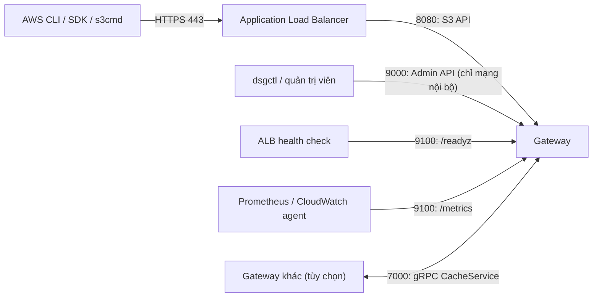
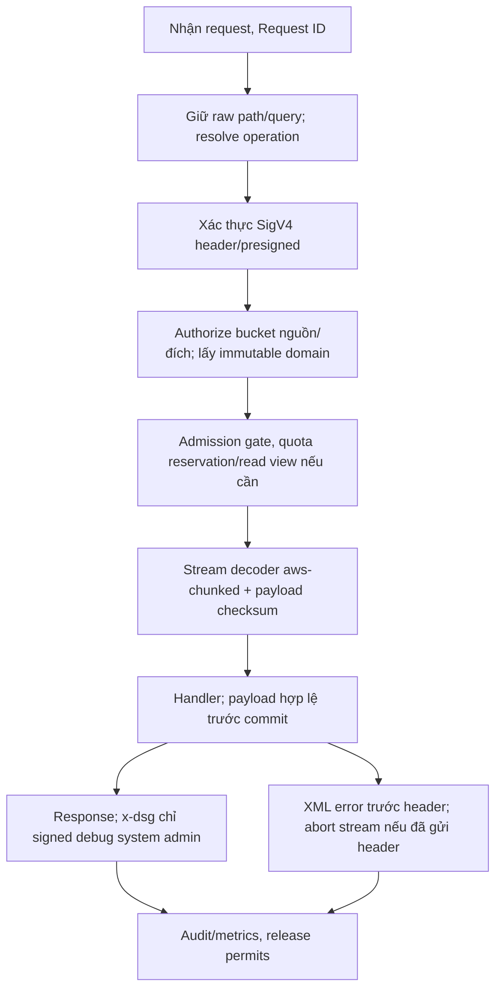
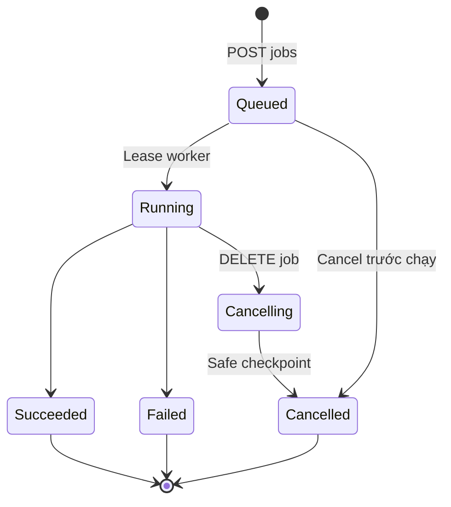

# Dedup Storage Gateway: Danh sách API (v2)

> Tài liệu đi kèm `dedup-storage-gateway-architecture.md` (v4).
> Gồm 4 nhóm giao diện: **S3 API** (cho client), **Admin API** (cho vận hành và `dsgctl`), **Health/Metrics**, **gRPC nội bộ** (tùy chọn).

**Trạng thái v2:** đồng bộ kiến trúc v4, đã chốt hướng triển khai theo quyền lựa chọn người dùng giao sau review. Giữ R1/R2 đầy đủ, multipart, GLACIER_IR/GLACIER và Cloud/Edge. R1–R4/defaults ở mục 13 và kiến trúc 19; khác biệt S3 và thông số cần đo được ghi rõ. Giữ số phiên bản v2; chưa có kết quả test hệ thống.

**Ngôn ngữ triển khai (chốt 2026-10-12):** gateway và `dsgctl` dùng Go, module `github.com/KinasTomes/miles`, toolchain ban đầu Go 1.27.2. Skeleton/CI đọc `go.mod`; chưa có implementation endpoint. Xem kiến trúc mục 1.7 và README của repository.

---

## 1. Bề mặt API



| Nhóm | Cổng | Người dùng | Định dạng | Xác thực |
|---|---|---|---|---|
| **S3 API** | Cloud: 8080 sau ALB TLS; Edge: TLS trực tiếp/proxy local theo cấu hình | Ứng dụng, AWS CLI, SDK | XML + header theo chuẩn S3 | AWS Signature V4 |
| **Admin API** | 9000 | System admin, chủ bucket được phép quản lý grants/cache, dsgctl | JSON | Bearer token gắn danh tính/quyền; mạng quản trị. Token hệ thống lưu SSM/Secrets Manager |
| **Health/Metrics** | 9100 | ALB, monitoring | Text / Prometheus | Mạng quản trị/VPC; Edge bind local/private; metrics vật lý không cấp người dùng thường |
| **gRPC nội bộ** | 7000 | Gateway với gateway | Protobuf | mTLS hoặc SG khép kín |

### 1.1 Truy cập Admin API đã chọn

Chủ bucket dùng **bastion + SSH local forwarding** cho grants/cache/logical usage. Không đưa owner routes qua ALB P1; cổng 9000 chỉ nhận sg-admin gắn bastion. Mỗi chủ bucket có SSH user/key và bearer riêng; SSH user không tự tạo quyền DSG. Private IP node khỏe lấy từ Terraform/EC2 inventory do operator cung cấp; không pin IP instance vĩnh viễn khi ASG thay node. Jobs/token dùng metadata chung nên có thể mở tunnel tới node khỏe khác.

```bash
ssh -N -L 127.0.0.1:19000:10.0.10.25:9000 owner@bastion.example
dsgctl --endpoint http://127.0.0.1:19000 grant ls demo
```

Lệnh thứ hai dùng token file permission 0600 do provisioning mục 6.4 tạo; không đặt bearer trên command line/log. SSH bảo vệ đường Internet; hop bastion → gateway đi mạng VPC được kiểm soát. Edge một node dùng tunnel tương tự hoặc loopback local, nhiều node chọn endpoint private khỏe. VPN là cấu hình tùy chọn: phải thêm client CIDR/SG phù hợp vào sg-gateway:9000, có routes và TLS riêng; VPN client không tự thuộc sg-admin.

Cloud Terraform dùng hai AZ, bảo toàn Host/path, ALB idle 120 giây; contract cụ thể ở kiến trúc 11. Kiểm thử SigV4 phải chạy qua ALB thực tế, không chỉ localhost.

---

## 2. Quy ước chung của S3 API

### 2.1 Địa chỉ và định tuyến

- Dùng **path-style**: `https://<endpoint>/<bucket>/<key>`. Không cần wildcard DNS.
- Client cấu hình `--endpoint-url` và `addressing_style = path` (xem mục 11).
- `Host` và path/query gốc nằm trong canonical request SigV4; ALB/reverse proxy phải bảo toàn. Không normalize dấu `/`, `..`, dấu `+` hoặc decode key nhiều lần trước xác thực. Key có Unicode/space/%/slash cần compatibility test.
- Cloud: HTTPS → ALB → 8080, health 9100. Edge: HTTPS trực tiếp hoặc proxy local → cùng binary, 1–2 node, S3/DynamoDB qua Internet, không yêu cầu ALB. TLS/credential backend khác nhau theo cấu hình, xem kiến trúc 11.1.
- Mỗi bucket logic chỉ là **namespace trong metadata**. Tất cả dữ liệu vật lý nằm chung một S3 bucket backend (`packs/`, `packs-index/`, `journal/`, `checkpoints/`, `recovery/`). `packs-index/`, `journal/` (gồm epoch seals), `checkpoints/` và `recovery/` catalog luôn ở S3 Standard; chỉ `packs/` chịu policy tiering.

### 2.2 Xác thực (SigV4)

| Chế độ | Biểu hiện | Hỗ trợ |
|---|---|---|
| Chữ ký trong header | `Authorization: AWS4-HMAC-SHA256 ...` | Bắt buộc |
| Presigned URL | Query `X-Amz-Algorithm`, `X-Amz-Signature`, `X-Amz-Expires`... | Ưu tiên 1 (P1) |
| Chunked streaming | `x-amz-content-sha256` là một trong các giá trị bên dưới | Bắt buộc |

Các giá trị `x-amz-content-sha256` cần xử lý:

| Giá trị | Ý nghĩa |
|---|---|
| Chuỗi hex SHA-256 | Payload đã băm sẵn |
| `UNSIGNED-PAYLOAD` | Không ký payload |
| `STREAMING-AWS4-HMAC-SHA256-PAYLOAD` | `aws-chunked`, mỗi khung có chữ ký |
| `STREAMING-UNSIGNED-PAYLOAD-TRAILER` | `aws-chunked`, không ký khung, kèm checksum trailer |
| `STREAMING-AWS4-HMAC-SHA256-PAYLOAD-TRAILER` | `aws-chunked`, có chữ ký và checksum trailer |

> **Rủi ro lớn nhất của S3 API:** CLI/SDK đời mới mặc định gửi checksum bổ sung (`x-amz-checksum-*`, `x-amz-trailer`) qua `aws-chunked`. AWS CLI 2.36.41 và boto3 1.43.114 qua HTTPS gửi mọi PutObject/UploadPart dạng `Transfer-Encoding: chunked` + `Content-Encoding: aws-chunked` + `STREAMING-UNSIGNED-PAYLOAD-TRAILER` (mục 2.2.2, 11.1). Nếu parser không xử lý đúng, `aws s3 cp` sẽ lỗi ngay từ file đầu tiên. `request_checksum_calculation = when_required` và `response_checksum_validation = when_required` (tên đúng ở CLI 2.36.41) bỏ checksum và `aws-chunked`; chỉ dùng để khoanh lỗi khi debug, không phải bằng chứng tương thích, giống `--no-verify-ssl`.

**Lưu trữ khóa truy cập:** SigV4 cần **secret key gốc** để tính lại chữ ký nên không thể băm một chiều như mật khẩu. Lưu secret **mã hóa bằng KMS** trong bảng `Credentials` (hoặc Secrets Manager). MVP có thể dùng một credential tĩnh gắn user/owner rõ ràng, không bỏ authorization. Credential IAM backend là EC2 role/Roles Anywhere/IAM user hạn chế quyền, tách khỏi bảng này.

Sai lệch đồng hồ quá 15 phút giữa client và gateway: trả `RequestTimeTooSkewed`.

### 2.2.1 Phân quyền và miền bucket — đã chốt

| Thao tác | Quyền bắt buộc |
|---|---|
| GET/HEAD/LIST, GetBucketLocation, HEAD bucket | read bucket |
| PUT/DELETE/DeleteObjects; Create/Upload/Complete/Abort multipart | write bucket; binding multipart theo quy tắc mục 4.3 |
| ListParts, RestoreObject | read bucket; kiểm tra binding upload nếu có |
| CopyObject | read nguồn **và** write đích, dù không cần đọc payload nguồn |
| CreateBucket | User đang active; owner là user tạo, domain lấy miền hiện tại của owner |
| DeleteBucket | Owner hoặc system admin; kiểm tra bucket trống và upload hoạt động |
| ListBuckets | Chỉ bucket owner/grant có thể truy cập |
| Quản lý grants/cache bucket | Owner hoặc system admin qua Admin API |
| Debug/dedup/physical stats, policy hệ thống, jobs mutation, credentials | System admin |

- Grant có `read`/`write` độc lập; write không tự cho phép GET. Owner có cả hai. S3 ACL/bucket policy vẫn ngoài phạm vi; **grants nội bộ DSG là P1 bắt buộc**.
- **System admin chỉ có quyền quản trị và debug, không có quyền đọc/ghi dữ liệu object ngầm định.** GET/PUT/Copy của system admin vẫn cần là owner hoặc có grant như người dùng thường (cấp grant cho admin được audit). Signed `x-dsg-debug` chỉ thêm header quản trị vào request đã qua authorization thông thường, không bỏ qua kiểm tra quyền.
- `dedup_domain` thuộc bucket, gán lúc tạo từ owner, bất biến. A ghi vào bucket B dùng domain B; quota/usage tính cho owner B. Đổi miền user chỉ tác động bucket tạo sau.
- Lookup Chunks nhận cặp domain/hash nhưng key DynamoDB là một partition key ghép `domain_id#hash`; không partition toàn bộ Chunks chỉ theo domain. Domain ID 1–64 ký tự `[a-z0-9_-]`, không chứa `#`; hash hex lowercase 64 ký tự; schema footer/journal lưu riêng hai thành phần.
- Authorization trước lookup Chunks, layout, cache hay restore. Bucket tồn tại nhưng không có quyền trả AccessDenied, không NoSuchKey tiết lộ key. Presigned URL giữ quyền của credential ký và vẫn kiểm tra status/grant hiện tại.
- Authorization snapshot gồm user active + credential/token active + owner/grant hiện hành, cache tối đa 5 giây tính từ dữ liệu authoritative; cache hit không refresh tuổi. Request mới bị từ chối sau bound này; GET đã nhận có thể kết thúc trong lease/deadline, writes kiểm tra lại trước head/part publish. Backend role không là quyền của user DSG; bearer không là SigV4 key.

### 2.2.2 Đặc tả SigV4, presigned và aws-chunked

Hợp đồng của parser/xác thực S3. `tests/fixtures/s3/transport.json` giữ nguyên byte request của các client đã pin ở mục 11.1 (head và body còn khung HTTP chunked/aws-chunked), canonical request client đã ký, `now` là đồng hồ server khi verify, và kết quả mong đợi: `op` của router, `error` (rỗng là chấp nhận), `payload_sha256` của byte logical. Biến thể lỗi chỉ có đúng một lỗi so với case gốc (`from`). `scripts/s3capture` sinh lại file từ client thật; credential là cặp ví dụ công khai của AWS.

**Header SigV4**

- `Authorization: AWS4-HMAC-SHA256 Credential=<access key>/<yyyymmdd>/<region>/s3/aws4_request, SignedHeaders=<tên;...>, Signature=<64 hex>`. Nhận cả `,` lẫn `, ` giữa ba phần (botocore dùng `, `, ví dụ AWS dùng `,`). Ngày của scope bằng 8 ký tự đầu `X-Amz-Date`, region bằng Region cấu hình, service `s3`.
- Bắt buộc `X-Amz-Date` (ISO 8601 basic, hậu tố `Z`) và `x-amz-content-sha256` với một giá trị ở bảng trên. `SignedHeaders` phải có `host` và mọi header `x-amz-*` có trong request; thiếu thì trả `AccessDenied`. `x-dsg-debug` không ký thì request vẫn hợp lệ nhưng bỏ debug (mục 5).
- Canonical URI là path của request-target **đúng như nhận**, không decode/encode lại, không normalize. Ví dụ AWS CLI gửi và ký `/demo/caf%C3%A9%20a%2Bb%25.txt`.
- Canonical query: decode rồi encode lại từng tên/giá trị theo RFC 3986 (giữ `A-Z a-z 0-9 - . _ ~`, còn lại `%XX` chữ hoa), sắp theo tên rồi giá trị, giá trị rỗng thành `name=`. Presigned bỏ `X-Amz-Signature`. Ví dụ `?list-type=2&prefix=&delimiter=%2F&encoding-type=url` ký thành `delimiter=%2F&encoding-type=url&list-type=2&prefix=`.
- Canonical headers: tên lowercase, giá trị trim và gộp khoảng trắng liên tiếp, sắp theo tên. `host` gồm cả port như client gửi.
- Payload hash là giá trị `x-amz-content-sha256`. AWS CLI ký SHA-256 chuỗi rỗng cho GET/HEAD/LIST/CreateMultipartUpload; presigned ký `UNSIGNED-PAYLOAD`.
- String to sign: `AWS4-HMAC-SHA256\n<X-Amz-Date>\n<scope>\n<hex SHA-256 canonical request>`. Signing key: HMAC-SHA256 lần lượt từ `"AWS4"+secret` qua ngày, region, `s3`, `aws4_request`. So chữ ký bằng constant-time compare.
- Đồng hồ: chấp nhận khi |now − X-Amz-Date| ≤ 15 phút; lệch hơn, dù client chạy trước hay sau, trả `RequestTimeTooSkewed`.

**Presigned (query)**

- Tham số `X-Amz-Algorithm=AWS4-HMAC-SHA256`, `X-Amz-Credential`, `X-Amz-Date`, `X-Amz-Expires`, `X-Amz-SignedHeaders` (có `host`), `X-Amz-Signature`. Thiếu tham số hoặc `X-Amz-Expires` ngoài 1..604800 trả `InvalidArgument` (S3 dùng `AuthorizationQueryParametersError`, ngoài bảng 2.4). URL hợp lệ khi now ≤ X-Amz-Date + X-Amz-Expires; quá hạn trả `AccessDenied`.
- Không hỗ trợ SigV2 (`AWSAccessKeyId`/`Signature`/`Expires`): router trả `NotImplemented`. boto3 1.43.114 mặc định presign bằng SigV2, client phải đặt `Config(signature_version="s3v4")`; `aws s3 presign` đã dùng SigV4.

**aws-chunked**

- Áp dụng khi `x-amz-content-sha256` là `STREAMING-*`. Cần `Content-Encoding` có token `aws-chunked` (bỏ token này khỏi Content-Encoding lưu cho object) và `x-amz-decoded-content-length`. Body HTTP dùng `Content-Length` (ví dụ AWS) hoặc `Transfer-Encoding: chunked` không kèm `Content-Length` (botocore); giải HTTP chunked trước, rồi mới giải aws-chunked.
- Khung không ký (`STREAMING-UNSIGNED-PAYLOAD-TRAILER`): các chunk `<hex>\r\n<data>\r\n`, rồi `0\r\n`, dòng trailer `x-amz-checksum-<alg>:<base64>\r\n`, kết thúc `\r\n`. Khung ký: `<hex>;chunk-signature=<64 hex>\r\n<data>\r\n`, chunk cuối `0;chunk-signature=<sig>\r\n`, sau đó `\r\n` với `STREAMING-AWS4-HMAC-SHA256-PAYLOAD`, hoặc trailer + `x-amz-trailer-signature:<sig>\r\n\r\n` với bản `-TRAILER`.
- Kích thước chunk không cố định: botocore cắt một chunk cho mỗi lần đọc file (fixture có chunk 7 byte). DSG không áp tối thiểu 8 KiB.
- Chữ ký chunk: `AWS4-HMAC-SHA256-PAYLOAD\n<X-Amz-Date>\n<scope>\n<chữ ký trước>\n<SHA-256 chuỗi rỗng>\n<SHA-256 data chunk>`; chunk đầu dùng chữ ký `Authorization` (seed). Chữ ký trailer: `AWS4-HMAC-SHA256-TRAILER\n<X-Amz-Date>\n<scope>\n<chữ ký chunk 0>\n<SHA-256 các dòng trailer dạng name:value\n>`. Sửa data, chữ ký hoặc trailer đều trả `SignatureDoesNotMatch`. Không client đã pin nào gửi khung ký; fixture dùng hai ví dụ trong tài liệu AWS, đã tính lại mọi chữ ký. Ví dụ trailer của AWS ghi `SignedHeaders` lệch canonical request (có `content-length`, thiếu `x-amz-trailer`); fixture theo canonical request vì seed signature tính từ đó.
- Trailer phải có đúng một dòng checksum, tên trùng `x-amz-trailer`; thiếu hoặc khác tên trả `InvalidRequest`. Giá trị sai trả `BadDigest`.
- Kết thúc sớm (EOF giữa chunk/trailer, tổng data nhỏ hơn `x-amz-decoded-content-length`, body ngắn hơn `Content-Length`) trả `IncompleteBody`. Dòng size không phải hex, thiếu CRLF, tổng data lớn hơn decoded length hoặc còn byte sau trailer trả `InvalidRequest`.

**Thứ tự kiểm** (lỗi đầu tiên được trả; có lỗi thì không commit):

1. Router `Resolve` (mục 4.1).
2. Xác thực: định dạng Authorization/query (`InvalidArgument`), access key không có hoặc đã revoke (`InvalidAccessKeyId`), đồng hồ hoặc hạn presigned, chữ ký (`SignatureDoesNotMatch`), header `x-amz-*` chưa ký (`AccessDenied`).
3. Quyền bucket (mục 2.2.1, thứ tự kiểm ở 2.2.3).
4. Decoder: khung và độ dài, chữ ký từng chunk/trailer khi đọc, `x-amz-content-sha256` dạng hex (`XAmzContentSHA256Mismatch`), `Content-MD5` (`BadDigest`), checksum header/trailer (`BadDigest`).

**Hiện thực (W02-CHIEN-01)**: `internal/api/s3` — `Router` (http.Handler: request ID, `Resolve`, SigV4, dispatch theo operation), `Payload` (decoder streaming bọc body, trả `io.EOF` chỉ khi mọi kiểm ở bước 4 đã qua) và interface `Credentials` (tra secret đã giải mã theo access key). `transport_test.go` chạy mọi case của `transport.json` qua `Router` bằng handler giả, không cần engine. Lỗi header của decoder (thiếu token `aws-chunked`, `x-amz-decoded-content-length` sai) trả ở lần `Read` đầu nên vẫn xếp sau bước 3. Các điểm chưa ghi ở trên, chọn khi hiện thực, cần review:

- Request không có chữ ký trả `AccessDenied` (DSG không có truy cập ẩn danh); header `Authorization: AWS ...` (SigV2) trả `NotImplemented` như presigned SigV2; thuật toán khác `AWS4-HMAC-SHA256` (gồm SigV4a), scope sai Region/ngày/service, `x-amz-content-sha256` ngoài bảng mục 2.2 trả `InvalidArgument`. Credential backend lỗi trả `InternalError`.
- Presigned có `X-Amz-Date` sau đồng hồ server quá 15 phút trả `RequestTimeTooSkewed`; payload hash là `x-amz-content-sha256` nếu có, không thì `UNSIGNED-PAYLOAD`.
- Chunk không ký mang extension trả `InvalidRequest`. Checksum header của CompleteMultipartUpload là checksum object nên decoder không so với body XML; Complete gửi `x-amz-trailer` trả `InvalidRequest` (checksum object gửi bằng header, không bằng trailer). PutObject/UploadPart không gửi algorithm thì decoder tính CRC64NVME.
- Checksum đã gửi luôn được kiểm, không phụ thuộc giá trị: header `x-amz-checksum-<alg>` hoặc trailer rỗng hay không phải Base64 của digest đúng độ dài của algorithm trả `InvalidRequest` (giá trị hợp lệ nhưng sai vẫn `BadDigest`); header `Content-MD5` có mặt, kể cả rỗng, được so và sai trả `BadDigest`.
- Body XML (`Payload.DecodeXML`) được đọc hết trước khi parse nên lỗi bước 4 xếp trước `MalformedXML`; body dài hơn giới hạn handler truyền vào trả `EntityTooLarge`. Body phải là đúng một document, kiểm trên mọi token kể cả bên trong root: một root, ngoài root chỉ có XML declaration ở đầu, comment, processing instruction và khoảng trắng; root thứ hai, text ngoài root, DOCTYPE hay directive ở bất kỳ đâu, XML declaration không ở token đầu (kể cả bên trong root) hoặc lỗi cú pháp trả `MalformedXML`.

### 2.2.3 Danh tính, snapshot quyền và binding upload — hợp đồng W1

Hợp đồng cho auth, metadata Users/Credentials/Buckets/BucketGrants/Uploads và Admin API danh tính. Test case: `tests/fixtures/s3/authorization.json` gồm ma trận S3/Admin theo vai trò, thứ tự lỗi, CopyObject, binding upload và tuổi snapshot. Dòng S3 chạy qua `s3.Router` thật trên fake metadata store (`internal/api/s3/authz_test.go`), dòng snapshot qua `internal/auth` và commit của fake store; dòng Admin chạy qua Admin server thật trên Badger (`internal/api/admin/server_test.go`). Stats/layout authorization now runs through the same production Admin server.

**Định danh**

| Thực thể | Khóa và định dạng | Trường | Quy tắc |
|---|---|---|---|
| User | `user_id`: 1–64 ký tự `[a-z0-9_-]` | `status` = `active`/`disabled`, `default_domain`, `logical_limit` (user mới 1 TiB), revision | Chỉ system admin tạo/sửa. Không xóa user, chỉ disable, nên `user_id` không tái dùng. Đổi `default_domain` chỉ áp bucket tạo sau. used/reserved/staged/active_upload_count là counter dẫn xuất (kiến trúc 9.2) |
| Credential SigV4 | `access_key_id`: 20 ký tự `[A-Z0-9]`; secret: Base64 40 ký tự của 30 byte CSPRNG | `user_id`, `status` = `active`/`revoked`, `system_admin`, `debug_allowed`, revision | Secret trả một lần lúc tạo, lưu KMS ciphertext. `revoked` không quay lại `active`. `debug_allowed` cần `system_admin`, sai trả 400. Credential không mang quyền bucket |
| Admin token | `token_id.secret`, mục 6.4 | `user_id`, `system_admin`, `status`, `expires_at` | Chỉ dùng cho Admin API. Credential SigV4 không mở Admin API, bearer không ký S3 |
| Bucket | `bucket`: tên S3, namespace chung; `bucket_id`: 1–64 ký tự `[a-z0-9_-]`, gateway sinh 32 hex từ 128 bit CSPRNG mỗi lần CreateBucket | `owner_id`, `dedup_domain`, `state` = `active`/`deleting`, revision, created_at | `owner_id` là user tạo, không chuyển. `dedup_domain` chép `default_domain` của owner lúc tạo, bất biến. `bucket_id` không tái dùng: tạo lại cùng tên ra `bucket_id` mới, không kế thừa grants, upload hay receipt |
| Grant | PK `bucket_id`, SK `user_id` | `read`, `write`, revision | Gắn `bucket_id`, không gắn tên. Không lưu read = write = false (dùng DELETE). Grant cho `owner_id` trả 400 vì quyền owner ngầm định và không giảm được; `user_id` không có trả 404 |
| Upload | `upload_id`: 32 hex từ 128 bit CSPRNG, không tái dùng | bucket, `bucket_id`, key, `initiator` (user_id), `dedup_domain`, checksum algorithm/type, `base_size`, `expires_at` = Create + 24 giờ | Binding cố định từ Create; key là byte đã decode một lần như `Route.Key` |

**Quyền hiệu lực** của user u trên bucket b, lấy từ một snapshot: `owner` = (b.owner_id = u); `read` = owner ∨ grant.read; `write` = owner ∨ grant.write; `admin` = cờ `system_admin` của credential (S3) hoặc token (Admin API). `admin` không cộng read/write; grant cấp cho admin có hiệu lực như user thường và được audit. `initiator` = caller là `Uploads.initiator`.

| Operation S3 | Cho phép khi |
|---|---|
| ListBuckets | User active; chỉ liệt kê bucket có owner ∨ read ∨ write |
| CreateBucket | User active; tên đã thuộc caller trả `BucketAlreadyOwnedByYou`, thuộc người khác trả `BucketAlreadyExists` |
| HeadBucket, GetBucketLocation, ListObjectsV2, GetObject, HeadObject, RestoreObject | read |
| PutObject, DeleteObject, DeleteObjects, CreateMultipartUpload | write |
| CopyObject | write đích ∧ read nguồn |
| DeleteBucket | owner ∨ admin |
| UploadPart, CompleteMultipartUpload | write ∧ initiator; owner/admin không dùng `upload_id` để ghi thay initiator |
| AbortMultipartUpload | (write ∧ initiator) ∨ owner ∨ admin |
| ListParts | (read ∧ initiator) ∨ owner ∨ admin |

**Thứ tự kiểm** (sau router và chữ ký mục 2.2.2; lỗi đầu tiên được trả):

1. Credential không có hoặc `revoked`: `InvalidAccessKeyId`, không phân biệt hai trường hợp.
2. User `disabled`: `AccessDenied`, trước khi tra bucket.
3. Không có bucket theo tên: `NoSuchBucket` (CreateBucket thì tạo). CopyObject kiểm bucket đích trước.
4. Điều kiện ở bảng trên, tạm bỏ `initiator` và read nguồn: `AccessDenied`. Bước này chạy trước khi tra `upload_id` hay nguồn nên không lộ upload/object tồn tại.
5. CopyObject: không có bucket nguồn `NoSuchBucket`, thiếu read nguồn `AccessDenied`, không có key nguồn `NoSuchKey`.
6. Multipart: `upload_id` không có, hoặc `bucket_id`/key của upload khác bucket hiện hành/route: `NoSuchUpload`; rồi điều kiện đủ có `initiator`: `AccessDenied`.
7. Object và state: `NoSuchKey` chỉ trả cho caller có read; DeleteObject key không có trả 204 khi đã có write. State multipart theo mục 4.3.1.

**Snapshot quyền**

- Snapshot gồm user (status), credential hoặc token (status, cờ, `expires_at`), bucket (`bucket_id`, owner, domain, state) và grant (bucket_id, user), đọc consistent từ metadata authoritative tại `read_at`.
- Tuổi đo bằng monotonic clock của node đọc. Dùng lại khi now < `valid_until` = min(`read_at` + 5 giây, `expires_at` của token); từ `valid_until` phải đọc lại. Cache hit không đổi `read_at`; không nhận snapshot của node khác.
- Hệ quả: revoke credential/token, disable user, sửa/xóa grant hoặc xóa bucket commit lúc T thì mọi admission từ T + 5 giây trên mọi node thấy thay đổi; trong [T, T + 5 giây) node còn snapshot cũ có thể vẫn admit, test không được đòi từ chối trong khoảng này. Transaction ghi commit sau T luôn thất bại, không có cửa sổ (bullet dưới).
- Read (GET/HEAD/LIST, đọc nguồn Copy) quyết định một lần lúc admit; stream đã nhận chạy tới hết trong lease/deadline 30 phút, không cắt vì revoke.
- Write không publish dựa trên snapshot. Mọi transaction ghi metadata do request S3 phát (commit head của PutObject, CopyObject, DeleteObject, từng key của DeleteObjects, Complete; publish part head của UploadPart; tạo upload; Abort; CreateBucket; DeleteBucket) mang điều kiện trên đúng các item đã cho phép request:
  - Credential đã ký: `status = active`.
  - User caller: `status = active`.
  - `Buckets[bucket]`: `bucket_id` bằng giá trị lúc admit và `state = active` (CreateBucket: item chưa tồn tại). Object không rơi vào bucket đã xóa hoặc tạo lại.
  - Khi quyền đến từ grant: `BucketGrants[bucket_id, user_id]` có `write = true`. Quyền owner (`owner_id` bất biến, đã nằm trong điều kiện bucket) và admin (cờ bất biến của credential) không cần item khác. Copy không kiểm lại nguồn vì snapshot nguồn đã pin.
- Item đã có action Update trong cùng transaction (ví dụ Users của owner mang counter quota khi owner tự ghi) thì gộp điều kiện vào ConditionExpression của Update, vì DynamoDB không nhận hai action trên một item. Đọc item lỗi bằng `ReturnValuesOnConditionCheckFailure = ALL_OLD`: credential/user/grant sai trả `AccessDenied` (request đã xác thực nên không trả `InvalidAccessKeyId`), bucket sai trả `NoSuchBucket`, head revision sai thì đọc lại và tính lại, quota sai trả `QuotaExceeded` (mục 2.6). Lỗi quyền/bucket không publish và release reservation. BadgerDB đọc các key này trong cùng transaction để conflict detection thay ConditionCheck.
- Takeover Complete không có caller: Complete lưu `access_key_id` đã ký cùng `completion_op_id`; transaction commit của takeover mang điều kiện của credential đó, initiator và grant như trên. Điều kiện sai thì Aborting (mục 4.3).

**Admin API** (bearer mục 6.1):

| Endpoint | Cho phép khi |
|---|---|
| GET /buckets/{b}, GET /buckets/{b}/grants, PUT/DELETE /buckets/{b}/grants/{user_id}, GET/PUT /buckets/{b}/policy | owner ∨ admin; grantee read/write trả 403 |
| GET /users/{id}/usage | token của chính `id` ∨ admin |
| DELETE /admin-tokens/{token_id} | chủ token ∨ admin |
| Các endpoint còn lại của mục 6.2 | admin |

Bearer thiếu, sai, revoked, hết hạn hoặc thuộc user disabled trả 401.

Lựa chọn của DSG, cần review: user disabled trả `AccessDenied` (S3 không có trạng thái này); grant cho owner bị từ chối thay vì bỏ qua; admin chỉ thao tác dữ liệu S3 ở DeleteBucket, Abort và ListParts.

**Hiện thực (W02-CHIEN-02)**:

- `internal/auth.Cache`: giữ kết quả đọc authoritative tới `valid_until` = min(read_at + 5 giây, `expires_at` loader trả), đo bằng `clock.Clock` (monotonic, theo node). read_at lấy trước khi đọc nên bound không trễ; hit không đổi read_at; đọc lỗi không cache; entry hết hạn bị dọn khi map đạt gấp đôi số entry còn sống. `auth.Snapshots` bọc `MetadataStore.Authorize` theo cặp (access key, bucket): credential, user, bucket và grant đọc cùng lần, hết hạn cùng lúc. Lookup secret SigV4 (`s3.Credentials`) nếu cache thì dùng `auth.Cache` cùng bound.
- `s3.Router` có `Access` (cùng chữ ký `Authorize`), chạy bước 2–4 sau chữ ký và trước handler, nên chưa đọc body, object, upload, nguồn copy hay cache: `storage.ErrAccessDenied` (user disabled, hoặc credential bị revoke sau khi xác thực) trả `AccessDenied`; `storage.ErrNotFound` trả `NoSuchBucket`; điều kiện bảng tạm bỏ `initiator` và read nguồn trả `AccessDenied`. ListBuckets gọi với bucket rỗng, chỉ kiểm user. CreateBucket: tên trống thì giao handler tạo, tên đã có trả `BucketAlreadyOwnedByYou`/`BucketAlreadyExists`. Lỗi backend của `Access` trả `InternalError` như `Credentials`. `Request.Access` là snapshot đã admit (bucket_id, owner, domain, quyền) để handler mang vào transaction ghi.
- Handler gọi `Request.AuthorizeCopySource(bucket)` (bước 5) trước khi tra key nguồn và `Request.CheckUpload(*UploadBinding)` (bước 6; nil là upload_id không có) trước khi đọc state hay receipt.
- Router dựa vào thứ tự của `Authorize`: credential revoked/không có hoặc user disabled trả `ErrAccessDenied` trước khi tra bucket. Contract suite `internal/storage/contracttest` ghim thứ tự này (fake và Badger đều đạt).
- Lựa chọn khi hiện thực: credential bị revoke trong cửa sổ ≤ 5 giây có thể trả `AccessDenied` thay `InvalidAccessKeyId` khi lookup secret còn cache mà `Authorize` đã thấy revoke. Dòng `stream` của snapshot thuộc GET handler (W03-PHONG-01).

### 2.3 Header chung

| Header | Hướng | Ghi chú |
|---|---|---|
| `x-amz-request-id` | Response | Sinh cho mọi request, ghi vào log và lỗi XML |
| `x-amz-id-2` | Response | Giá trị bất kỳ, một số SDK đọc |
| `Server` | Response | `DedupStorageGateway` |
| `x-dsg-*` | Response | Chỉ SigV4 system admin + signed `x-dsg-debug: 1`; xem mục 5 |

### 2.4 Định dạng lỗi

```xml
<?xml version="1.0" encoding="UTF-8"?>
<Error>
  <Code>NoSuchKey</Code>
  <Message>The specified key does not exist.</Message>
  <Key>backup.tar</Key>
  <BucketName>demo</BucketName>
  <RequestId>4442587FB7D0A2F9</RequestId>
</Error>
```

Bảng mã lỗi cần hỗ trợ:

| Mã | HTTP | Khi nào |
|---|---|---|
| `AccessDenied` | 403 | Không có quyền, user disabled, presigned URL hết hạn, hoặc header `x-amz-*` không nằm trong SignedHeaders |
| `InvalidAccessKeyId` | 403 | Không tìm thấy access key hoặc key đã revoke |
| `SignatureDoesNotMatch` | 403 | Chữ ký header/query, chunk hoặc trailer sai |
| `RequestTimeTooSkewed` | 403 | Lệch đồng hồ quá 15 phút |
| `InvalidObjectState` | 403 | GET hoặc phần Copy cần đọc có pack GLACIER/DEEP_ARCHIVE chưa restore; GLACIER_IR không thuộc nhánh này |
| `NoSuchBucket` | 404 | Bucket không tồn tại |
| `NoSuchKey` | 404 | Object không tồn tại |
| `NoSuchUpload` | 404 | `uploadId` không có, không khớp bucket_id/key, đã abort, hết hạn hoặc hết receipt (mục 4.3.1) |
| `MethodNotAllowed` | 405 | Method không hỗ trợ trên resource |
| `BucketAlreadyOwnedByYou` | 409 | Tạo bucket đã thuộc owner |
| `BucketAlreadyExists` | 409 | Tên bucket đã thuộc người khác |
| `InvalidRequest` | 400 | Operation/query/checksum mode không hợp lệ; khung `aws-chunked`/trailer sai (mục 2.2.2) |
| `RestoreAlreadyInProgress` | 409 | Restore đang chạy, không khởi tạo pack nào mới |
| `OperationAborted` | 409 | Complete/Abort cạnh tranh hoặc upload đang Completing |
| `QuotaExceeded` (DSG) | 403 | Logical quota/reservation không đủ, hoặc vượt 16 upload/staging của owner (mục 2.6); không tiết lộ physical bytes |
| `BucketNotEmpty` | 409 | Xóa bucket còn object |
| `InvalidBucketName` | 400 | Tên bucket sai quy tắc |
| `KeyTooLongError` | 400 | Key dài hơn 1024 byte |
| `InvalidArgument` | 400 | Tham số sai, kể cả Authorization/query presigned sai định dạng |
| `MalformedXML` | 400 | Body XML sai |
| `BadDigest` | 400 | `Content-MD5`, checksum header/trailer hoặc checksum part/object của Complete không khớp |
| `XAmzContentSHA256Mismatch` | 400 | Hash payload không khớp |
| `IncompleteBody` | 400 | Body ngắn hơn `Content-Length` hoặc `x-amz-decoded-content-length` |
| `InvalidPart` | 400 | Part không tồn tại, chưa publish hoặc ETag sai |
| `InvalidPartOrder` | 400 | Danh sách part không tăng dần |
| `EntityTooSmall` | 400 | Part (không phải part cuối) dưới 5 MiB |
| `EntityTooLarge` | 400 | Vượt giới hạn kích thước |
| `InvalidRange` | 416 | `Range` ngoài phạm vi |
| `PreconditionFailed` | 412 | `If-Match` / `If-None-Match` không thỏa |
| `NotImplemented` | 501 | Tính năng ngoài phạm vi |
| `InternalError` | 500 | Lỗi nội bộ, kể cả phát hiện chunk hỏng (kèm log chi tiết) |
| `SlowDown` | 503 | DynamoDB/S3 bị throttling kéo dài. Client chuẩn sẽ tự retry |
| `ServiceUnavailable` | 503 | Gateway đang drain hoặc không với tới backend |

### 2.5 Giới hạn

| Mục | Giá trị | Ghi chú |
|---|---|---|
| Độ dài key | 1024 byte | Giống S3 |
| Mã hóa key | UTF-8 hợp lệ sau khi decode path đúng một lần | S3 định nghĩa key là UTF-8; byte lỗi trả `InvalidArgument` 400 trước mọi ghi durable, không chuẩn hóa NFC/NFD |
| Part tối thiểu | 5 MiB (trừ part cuối) | Giống S3 |
| Số part tối đa | 10.000 | Giống S3 |
| Kích thước PutObject đơn | 5 GiB | Lớn hơn phải dùng multipart |
| Kích thước object tối đa | 100 GiB | Default DSG cấu hình được, không khẳng định bằng giới hạn S3 |
| Part tối đa | 5 GiB | Part references phân trang, kiểm tra cả trước Complete |
| ListParts max-parts | 1000 | Phân trang bằng part-number-marker |
| Metadata người dùng (`x-amz-meta-*`) | 2 KB | Giống S3 |
| `max-keys` của LIST | 1000 | Giống S3 |
| Số key một lần `DeleteObjects` | 1000 | Giống S3 |

### 2.6 Nhất quán, quota và commit

- Strong read-after-write: ConsistentRead cho head/pages/Chunks cần thiết, retry hết UnprocessedKeys; pages được ghi hết UnprocessedItems trước head. GSI chỉ tìm ứng viên, không quyết định quyền/tính sống.
- Head là điểm công bố; concurrent overwrite dùng revision CAS, commit thành công sau thắng. Không versioning. DELETE tombstone và cleanup pages là nội bộ, client vẫn thấy key mất.
- R2 transaction head + logical quota/reservation + outbox; Complete thêm state Completed/receipt cùng transaction. Refcount cập nhật idempotent theo op_id, không là căn cứ duy nhất xóa. Object lớn có immutable pages, outbox giữ pointer dưới item/transaction limits. Event có history_id/recovery_epoch và stable history-scoped event_id theo mutation op_id ([R2 §5](contracts/r2-recovery.md#5-event-identity-và-idempotency)); event_id không là literal op_id, child mutations có identity riêng; retry unknown outcome tra outbox/receipt consistent, không chỉ nhìn head đã có thể bị overwrite; ClientRequestToken chỉ reuse khi params giữ nguyên (kiến trúc 9.0). membership epoch được seal ngoài request (kiến trúc 9.1).
- R1 giữ writer admission + read views/location pins và mutation gate. Maintenance/drain chặn admission tương ứng trả 503; lease 60 giây/heartbeat 15 giây, deadline request 30 phút, không giữ request vô hạn. Recovery-cut gate còn chặn control-plane event producers để đóng epoch đủ.
- Quota tính committed logical theo owner bucket đích. Reserve r=max(0, candidate_size−base_head_size), streaming grow từng 64 MiB; commit dùng delta theo head hiện tại và condition used+delta+(reserved−r)≤limit. Đồng thời cap 16 active uploads và staged logical≤logical_limit+100 GiB; thay part/abort/recovery release idempotent. Overwrite cùng size có thể không cần thêm quota, nhưng reservation không bảo đảm commit nếu head/usage đã đổi. Công thức/ledger đầy đủ ở kiến trúc 9.2; physical bytes không xuất hiện trong usage user.
- **Chủ chịu quota và miền — hợp đồng W1.** Write (PutObject, CopyObject, Complete, DeleteObject/DeleteObjects) tính cho `owner_id` của bucket đích, không cho caller, initiator hay owner nguồn. Domain là `dedup_domain` của bucket đích (Complete dùng domain đã chép vào upload lúc Create), không lấy `default_domain` hiện tại của owner hay caller. Ledger theo ký hiệu kiến trúc 9.2, test case `tests/fixtures/s3/quota.json`:
  - Admit: B = size head lúc admit (0 nếu không có hoặc tombstone), r = max(0, S − B). Mọi lần tăng reservation của một writer/upload từ r_cũ lên r_mới (admit mới có r_cũ = 0) cho phép khi used + reserved + (r_mới − r_cũ) ≤ limit, vì `reserved` đã chứa r_cũ; thành công reserved += r_mới − r_cũ. Streaming giữ B + r ≥ số byte đã nhận, mỗi lần tăng r đúng 64 MiB; hết body hạ r về max(0, S − B), reserved giảm phần chênh.
  - Commit: H = size head hiện hành, D = S − H, cho phép khi used + D + (reserved − r) ≤ limit; thành công used += D, reserved −= r. Thất bại trả `QuotaExceeded`, ledger giữ nguyên; PUT/Copy release r khi kết thúc request, Complete mở lại Active và upload giữ r. Release idempotent theo op_id.
  - Multipart: Create cần số upload Active/Completing của owner nhỏ hơn 16 và chụp B. Upload giữ r = max(0, C − B), C = tổng part đã publish cộng part đang ghi; UploadPart tăng r theo điều kiện tăng ở trên và cần staged + size part ≤ logical_limit + 100 GiB. Vượt bất kỳ giới hạn nào trả `QuotaExceeded` trước body.
- PUT/Complete thành công đọc ngay được từ bản Warm hoặc GLACIER_IR được bảo vệ. Copy metadata có thể tạo object Cold hoặc phụ thuộc expiry Restored theo mục 4.5; không áp cùng bảo đảm PUT.

---

### 2.7 Checksum và ETag — hợp đồng P0/P1

Tính trên **byte logical sau decode aws-chunked**, trước nén; SHA-256 chunk không thay checksum object. P0 PUT hỗ trợ Content-MD5 và algorithm headers/trailers trong bảng; P1 multipart/GET/HEAD theo cùng bảng. Không bật checksum transport mới ở P2 khi fixture chưa hỗ trợ.

| Algorithm | PUT đơn | Multipart FULL_OBJECT | Multipart COMPOSITE | Mặc định khi Create không gửi ChecksumType |
|---|---|---|---|---|
| CRC64NVME | Có | Có | Không | FULL_OBJECT |
| CRC32 / CRC32C | Có | Có | Có | COMPOSITE |
| SHA1 / SHA256 | Có | Không | Có | COMPOSITE |

Matrix client đã pin (mục 11.1) theo `tests/fixtures/s3/transport.json`. Giá trị header/trailer là Base64 của digest big-endian.

| Algorithm | Digest | AWS CLI 2.36.41 | boto3 1.43.114 không awscrt | Case trong fixture |
|---|---|---|---|---|
| CRC64NVME | 8 byte | Mặc định của PutObject và UploadPart; `aws s3 cp` multipart gửi ở Create | Không gửi được: `MissingDependencyException` trước request | `cli-put-default`, `cli-mpu-create-crc64nvme-full-object`, `cli-mpu-part-default`, `cli-mpu-complete-full-object`, `cli-cp-multipart/*`; `cli-mpu-create-crc64nvme-composite` → InvalidRequest |
| CRC32 | 4 byte | `--checksum-algorithm CRC32` | Mặc định | `cli-put-crc32`, `cli-mpu-create-crc32`, `boto3-put-default`, `boto3-put-multichunk` |
| CRC32C | 4 byte | `--checksum-algorithm CRC32C` | Không gửi được, như CRC64NVME | `cli-put-crc32c`, `aws-docs-signed-chunked-trailer` |
| SHA1 | 20 byte | `--checksum-algorithm SHA1` | Có | `cli-put-sha1`; `cli-mpu-create-sha1-full-object` → InvalidRequest |
| SHA256 | 32 byte | `--checksum-algorithm SHA256` | Có | `cli-put-sha256`, `cli-mpu-create-sha256-composite`, `cli-mpu-part-sha256`, `cli-mpu-complete-composite` |
| Ngoài bảng trên | — | SHA512, XXHASH64 (đã thử) | SHA512 | `cli-put-sha512`, `cli-put-xxhash64` → InvalidRequest |

- CRC64NVME là CRC-64/NVME: đa thức 0xad93d23594c93659 phản chiếu, init và xorout toàn bit 1, `crc("123456789") = 0xae8b14860a799888`; trong Go là `crc64.MakeTable(0x9a6c9329ac4bc9b5)`. Giá trị Go khớp trailer do awscrt 0.36.2 của AWS CLI tính trong mọi case fixture.
- **Content-MD5 là kiểm tra riêng**, không phải một algorithm của bảng: nếu có header `Content-MD5`, MD5 Base64 của byte logical phải khớp, sai trả `BadDigest`. Client có thể gửi cùng lúc Content-MD5 và trailer checksum (`cli-put-content-md5`); `cli-put-content-md5-wrong` là request sai do chính CLI gửi.
- AWS CLI high-level multipart (`cli-cp-multipart`) chỉ gửi `x-amz-checksum-algorithm: CRC64NVME` ở Create, trailer ở từng part và Complete không có checksum part/object, nên DSG phải tự combine FULL_OBJECT như dưới đây.
- Không gửi algorithm: DSG tính/lưu CRC64NVME FULL_OBJECT mặc định (kể cả multipart). Xác thực Content-MD5 và payload SigV4 độc lập với checksum bổ sung. Algorithm/type không hỗ trợ (gồm SHA512/XXHASH/x-amz-checksum-md5 ở P2) trả 400 InvalidRequest trước body/publish, không echo checksum chưa verify; type khác Create hoặc checksum sai trả BadDigest/InvalidRequest phù hợp.
- UploadPart tính MD5 ETag và checksum algorithm đã chọn. Verify header/trailer client nếu có; server luôn giữ **binary part digest và raw length** trong part head, trả checksum Base64 và ListParts trả từng checksum. COMPOSITE bắt buộc client gửi part checksums khi Complete; chúng phải khớp part heads đã verify, PartNumber liên tiếp 1..N. DSG trả 400 InvalidPartOrder khi có gap, là khác biệt lỗi được công bố so một số đường S3 trả 500.
- FULL_OBJECT CRC combine part digests theo raw length và selected order (CRC linearization); checksum Complete nếu client gửi phải khớp. COMPOSITE dùng algorithm trên nối binary part digests, encode Base64 và suffix -N theo format AWS. Không tính SHA full object từ SHA part digests. Complete không tải lại toàn payload chỉ để checksum.
- Head object giữ algorithm/type/value/part_count. GET toàn object và HEAD với x-amz-checksum-mode=ENABLED trả checksum + x-amz-checksum-type đã lưu; absent mode không bắt buộc trả. Range GET không trả full-object checksum như checksum của range; bỏ checksum đó và ghi hạn chế này trong fixture. GET/HEAD partNumber và GetObjectAttributes là P2, unsupported trả 501 rõ trước stream.
- PUT ETag là MD5 logical quoted; Complete ETag là MD5(nối binary part MD5) + -N, độc lập với checksum mode. Copy giữ ETag và checksum descriptor nguồn như opaque metadata theo 4.5, không suy ETag luôn là whole-object MD5.
- Client và version pin ở mục 11.1. CI test từng mode, trailers, checksum sai, part gap, empty PUT, Range và download checksum validation. Default hoặc thuật toán mới của SDK khác matrix phải bị phát hiện trước benchmark (sinh lại fixture khi đổi version), không tắt verify âm thầm.

Nguồn format/types: [AWS checksum upload](https://docs.aws.amazon.com/AmazonS3/latest/userguide/checking-object-integrity-upload.html). Phạm vi hỗ trợ và default DSG trên là lựa chọn thiết kế.

---

## 3. Pipeline xử lý request



Decoder là reader streaming bọc body, không buộc tải toàn bộ object vào RAM trước router. Request không body bỏ qua decoder. Route unsupported bị từ chối trước ghi dữ liệu; CopyObject ưu tiên dispatch theo x-amz-copy-source thay vì nhầm PutObject. Checksum/trailer sai thì không commit. UploadPartCopy chưa hỗ trợ trả 501 rõ ràng.

---

## 4. S3 API

### 4.1 Tổng hợp

Ưu tiên: **P0** = MVP tuần 3 · **P1** = bắt buộc, hoàn thành tuần 4-6 · **P2** = nếu còn thời gian.

| Ưu tiên | Operation | Method và đường dẫn | Công cụ chuẩn dùng |
|---|---|---|---|
| P0 | CreateBucket | `PUT /{bucket}` | `aws s3 mb` |
| P0 | HeadBucket | `HEAD /{bucket}` | SDK, `aws s3` |
| P0 | ListBuckets | `GET /` | `aws s3 ls` |
| P0 | PutObject | `PUT /{bucket}/{key}` | `aws s3 cp` (file nhỏ) |
| P0 | GetObject (+ Range) | `GET /{bucket}/{key}` | `aws s3 cp` tải về |
| P0 | HeadObject | `HEAD /{bucket}/{key}` | `aws s3 cp`, `sync` |
| P0 | DeleteObject | `DELETE /{bucket}/{key}` | `aws s3 rm` |
| P0 | ListObjectsV2 | `GET /{bucket}?list-type=2` | `aws s3 ls`, `sync` |
| P1 | CreateMultipartUpload | `POST /{bucket}/{key}?uploads` | `aws s3 cp` (file lớn) |
| P1 | UploadPart | `PUT /{bucket}/{key}?partNumber=N&uploadId=ID` | như trên |
| P1 | CompleteMultipartUpload | `POST /{bucket}/{key}?uploadId=ID` | như trên |
| P1 | AbortMultipartUpload | `DELETE /{bucket}/{key}?uploadId=ID` | như trên |
| P1 | ListParts | `GET /{bucket}/{key}?uploadId=ID` | SDK |
| P1 | DeleteObjects | `POST /{bucket}?delete` | `aws s3api delete-objects`, SDK; AWS CLI 2.36.41 `s3 rm --recursive`/`sync --delete` gọi DeleteObject từng key |
| P1 | CopyObject | `PUT /{bucket}/{key}` + `x-amz-copy-source` | cp/mv trong giới hạn single-copy; file lớn AWS CLI gọi GetObjectTagging (ngoài phạm vi) rồi UploadPartCopy P2, cả hai trả 501 |
| P1 | RestoreObject | `POST /{bucket}/{key}?restore` | `aws s3api restore-object` |
| P1 | DeleteBucket | `DELETE /{bucket}` | `aws s3 rb` |
| P1 | GetBucketLocation | `GET /{bucket}?location` | SDK |
| P1 | Presigned GET/PUT | Query `X-Amz-*` | `aws s3 presign` |
| P1 | GetObject + `If-Match` | `GET /{bucket}/{key}` + `If-Match`; sai ETag trả 412 | `aws s3 cp` tải file lớn: mỗi Range GET gửi If-Match (AWS CLI 2.36.41) |
| P2 | ListObjects (v1) | `GET /{bucket}` | Công cụ cũ |
| P2 | ListMultipartUploads | `GET /{bucket}?uploads` | SDK |
| P2 | UploadPartCopy | `PUT ...?partNumber&uploadId` + `x-amz-copy-source` | `cp` file lớn giữa các key |
| P2 | Điều kiện còn lại | `If-Match` ngoài GetObject, `If-None-Match`, `If-Modified-Since`, `If-Unmodified-Since`, `x-amz-copy-source-if-*` | SDK; chưa hỗ trợ trả `NotImplemented`, không bỏ qua |
| P2 | GetObjectAttributes / GET/HEAD partNumber | GET với query tương ứng | Checksum/part inspection nâng cao |
| P2 | Ghi đè response | `response-content-type`, ... | Presigned URL |
| Ngoài phạm vi | Versioning, ACL, Policy, Lifecycle, Tagging, Object Lock, SelectObjectContent | | Trả `NotImplemented` |

Bảng route/operation và mã lỗi thực thi nằm ở `internal/api/s3` (`Resolve`, `WriteError`), fixture request/response ở `tests/fixtures/s3`.

**Router (`Resolve`) quyết định trước khi đọc body:**

- Chọn đúng một operation theo method, mức service/bucket/object, tập query phân biệt và có/không `x-amz-copy-source`; không có dòng fallback. Query phân biệt dạng cờ (`uploads`, `delete`, `restore`, `location`, `attributes`) không mang giá trị; `uploadId`, `partNumber`, `list-type` phải có giá trị. Tổ hợp không khớp dòng nào (ví dụ `?uploads&uploadId`, `?delete` trên object) trả `InvalidRequest`.
- Mọi query key khác phải là tham số của operation đã chọn, nếu không trả `NotImplemented` trên mọi method, kể cả GET/HEAD: ListObjectsV2 nhận `prefix`, `delimiter`, `max-keys`, `continuation-token`, `start-after`, `encoding-type`, `fetch-owner`; ListParts nhận `max-parts`, `part-number-marker`; operation P0/P1 khác không nhận tham số nào. `x-id` và `x-amz-*` (presigned SigV4) thuộc lớp auth. Key lặp lại trả `InvalidArgument`. `partNumber` của UploadPart là số nguyên 1..10000, `list-type` phải là `2`; sai trả `InvalidArgument`.
- Header ACL/grant/tagging/object lock/SSE-C/website redirect/expected bucket owner/append và điều kiện P2 trả `NotImplemented` (trừ `x-amz-acl: private`/`bucket-owner-full-control`, `x-amz-object-ownership: BucketOwnerEnforced`, `x-amz-tagging-directive: COPY`).
- Checksum trả `InvalidRequest` khi: algorithm ngoài mục 2.7; có hơn một giá trị checksum (header `x-amz-checksum-<alg>` và trailer cộng lại); `x-amz-sdk-checksum-algorithm`/`x-amz-checksum-algorithm` khác algorithm của giá trị; `x-amz-trailer` không đi với `x-amz-content-sha256` `STREAMING-UNSIGNED-PAYLOAD-TRAILER`/`STREAMING-AWS4-HMAC-SHA256-PAYLOAD-TRAILER` hoặc ngược lại; `x-amz-checksum-type` ngoài Create/Complete multipart, khác `FULL_OBJECT`/`COMPOSITE`, hoặc ở Create thiếu `x-amz-checksum-algorithm`/sai cặp algorithm-type của bảng 2.7; `x-amz-checksum-mode` ngoài GetObject/HeadObject hoặc khác `ENABLED`.

**Handler (W02-CHIEN-01, W03) kiểm tra phần cần ngữ nghĩa tham số hoặc state:** giá trị `max-keys`, `max-parts`, `part-number-marker`, `continuation-token`, `encoding-type`, `fetch-owner`, `start-after`; cú pháp Range; quy tắc tên bucket; checksum algorithm/type so với upload đã tạo; `If-Match` so với ETag hiện hành (412).

### 4.2 Chi tiết các operation P0

#### PutObject

`PUT /{bucket}/{key}`; yêu cầu write, dùng domain immutable của bucket.

| Thành phần | Chi tiết |
|---|---|
| Xác thực | Authorization SigV4 header **hoặc** presigned query (P1); presigned không bắt buộc Authorization header |
| Payload | x-amz-content-sha256 phù hợp signing mode; Content-Length hoặc decoded length aws-chunked. Presigned UNSIGNED-PAYLOAD có thể theo canonical signing mode SDK |
| HTTP metadata | Content-Type, x-amz-meta-*, Cache-Control, Content-Disposition, Content-Encoding; lưu và trả lại GET/HEAD |
| Integrity | Content-MD5 + matrix checksum/trailer mục 2.7; fallback CRC64NVME; verify trước commit, unsupported algorithm/type trả 400 trước body/publish |
| Storage headers | Backend dùng SSE-KMS, tier theo policy hệ thống; x-amz-storage-class/client encryption choice không điều khiển layout DSG, ghi rõ hạn chế hỗ trợ; không trả header giả xác nhận KMS key của client |
| Response | 200, ETag MD5 logical quoted, checksum đã verify khi hỗ trợ; x-dsg chỉ debug admin |
| Lỗi | AccessDenied, NoSuchBucket, BadDigest, XAmzContentSHA256Mismatch, IncompleteBody, EntityTooLarge, QuotaExceeded, SlowDown |

1. Authorize, register writer/quota reservation, lấy domain; chunk/hash/checksum trên byte logical đã decode.
2. Lookup domain/hash: dùng Warm/GLACIER_IR đọc được và có protection; thiếu thì ghi mới. GLACIER/DEEP_ARCHIVE không đọc được thì revive từ body client sang Warm, không restore. R3 đã chọn revive **mọi Restored** từ body client, không phân nhánh theo expiry.
3. Upload pack + sidecar trước insert/CAS location, revalidate race winner + pack state. Flush cuối request nên có pack nhỏ hơn mục tiêu. Blob race thua vẫn tính physical cost.
4. Verify toàn bộ checksum/length, ghi mọi pages, commit head/quota/outbox theo R2. Lỗi không hiện object mới hoặc phá object cũ.
5. Trả 200 khi nguồn bền vững có thể GET ngay; không phụ thuộc cache hoặc restore expiry. Pin và đặt protected_until ≥ request hard deadline + 15 phút trước publish; Active/Completing upload còn roots bảo vệ theo R1/R3.

#### GetObject

`GET /{bucket}/{key}`; yêu cầu read trước lookup/cache.

| Thành phần | Chi tiết |
|---|---|
| Range | Một khoảng bytes=a-b, bytes=a-, bytes=-n; multi-range không hỗ trợ; invalid/không giao object trả 416 |
| Điều kiện | If-Match P1, sai ETag trả 412 PreconditionFailed; If-None-Match, If-Modified-Since, If-Unmodified-Since P2, trả NotImplemented đến khi triển khai; khi đó phải phân biệt 304 và 412 theo method |
| Response | 200 hoặc 206 + Content-Range; ETag, Last-Modified, Content-Length, Content-Type, Accept-Ranges, metadata HTTP đã lưu |
| Lỗi | AccessDenied, NoSuchBucket/NoSuchKey, InvalidRange, InvalidObjectState, InternalError trước header |

Acquire read view trước resolve pages, pin location generation trước fetch, pre-flight toàn khoảng cần trước header. GET object rỗng trả 200 length 0; Range trên object rỗng trả 416. Chỉ phát bytes chunk sau SHA-256 đúng. Chunk hỏng/expiry/backend lỗi sau header: abort stream, ghi integrity_error_total/mid_stream_abort_total; không cố trả XML error trong body dữ liệu.

**Hiện thực fixture (W02-CHIEN-03)**: từng trường hợp biên của Range (unit so sánh không phân biệt hoa/thường theo RFC 9110 14.1, unit lạ bị bỏ qua, `-0`, start ≥ size, kẹp end, multi-range, tràn số), empty object, HEAD và parser XML được pin trong `tests/fixtures/s3/compat.json` và kiểm bằng hàm tham chiếu từ mục này; quyết định chi tiết ở [ADR-0001](adr/0001-s3-compat-freeze-decisions.md). Handler W03-CHIEN-02 phải pass nguyên bộ row này.

#### HeadObject

Cùng quyền/read metadata như GET, không body, kể cả lỗi HEAD không body. HEAD không tự restore. x-amz-restore chuẩn được trả cho mọi client có quyền, không phải x-dsg debug; cách tổng hợp mục 4.4. HEAD có thể đọc pack metadata nhưng không đọc payload. Checksum mode/type trả theo 2.7; partNumber P2 không âm thầm bỏ qua. HEAD nhận `Range` như HeadObject của S3: khoảng thỏa mãn trả 200 với `Content-Length` của khoảng được chọn (không 206, không body), khoảng không giao object trả 416; `If-Match` ở HEAD là P2 và trả 501 như bảng route.

#### DeleteObject

`DELETE /{bucket}/{key}` → 204, kể cả key không có **trong bucket tồn tại và caller có write**. Bucket không tồn tại hoặc không có quyền vẫn trả lỗi tương ứng. R2 commit tombstone revision + logical quota delta + outbox; retire manifest cũ sau reader/recovery protection, refcount xử lý idempotent. Không xóa pack ngay.

#### ListObjectsV2

`GET /{bucket}?list-type=2`; yêu cầu read.

| Tham số | Quy tắc |
|---|---|
| prefix, delimiter | Gộp CommonPrefixes; chúng cũng tính vào max-keys |
| max-keys | Default/cap 1000; hỗ trợ 0, giá trị âm/sai kiểu lỗi |
| continuation-token | Opaque token giữ cursor đã scan và delimiter state, bound bucket/prefix/options; invalid trả InvalidArgument |
| start-after | Key exclusive; continuation-token có ưu tiên khi cả hai có |
| encoding-type=url | Encode đúng các trường key/prefix trong XML, không double decode |
| fetch-owner | Khi true, Owner.ID là owner_id DSG của bucket cho mọi object; bỏ DisplayName; đây không là AWS canonical account ID |

XML ListBucketResult có Name/Prefix/Delimiter nếu có, KeyCount/MaxKeys/IsTruncated, ContinuationToken/NextContinuationToken/StartAfter khi có, Contents (Key, LastModified, ETag, Size, StorageClass) và CommonPrefixes. Query consistent theo bucket/prefix, tiếp tục scan đủ trang logical sau khi bỏ tombstone. Không tính item nội bộ vào KeyCount, không bỏ key khi nhảy CommonPrefix. StorageClass logical báo STANDARD là **hạn chế ánh xạ DSG**, không phản ánh pack tier/khả năng đọc; dùng HEAD restore/API admin để biết layout.

**Hiện thực (W03-CHIEN-03)**:

- `object.Service.DeleteObject` đọc head hiện hành; key không có hoặc đã là tombstone thì không publish gì (204, không trừ quota lần hai). Còn lại: admit writer, reservation `Bytes = 0`, tombstone head + event `Objects/object_commit` commit qua `WriteSession.Delete` với `ExpectedRevision` của head cũ; outcome không rõ được reconcile trước khi release, giống PutObject. Handler đọc payload tới EOF trước transaction nên `x-amz-content-sha256`/checksum sai trả lỗi mà không tạo tombstone.
- `object.Service.ListObjects` chuyển `storage.ListObjectsRequest` cho store (bỏ tombstone, gộp CommonPrefixes, kiểm read và bucket_id) và trả LastModified từ commit time của head. Handler kiểm `max-keys` (mặc định/cap 1000, 0 hợp lệ, âm/sai kiểu `InvalidArgument`), `encoding-type` chỉ nhận `url` (`url.QueryEscape` cho Key, Prefix, Delimiter, StartAfter, CommonPrefixes), `fetch-owner` kiểu bool.
- `continuation-token` = `base64url(vị trí đã scan + hạn).base64url(HMAC-SHA256)`, MAC bind principal, tên bucket, bucket_id, prefix và delimiter của request; token sai định dạng, sửa đổi, hết hạn (1 giờ) hoặc dùng với tham số khác trả `InvalidArgument` trước khi tới store. Khóa MAC sinh ngẫu nhiên mỗi process: restart làm token cũ vô hiệu và chưa chia sẻ giữa node; profile cluster (W05) cần keyring chung.
- Runtime `cmd/miles` vẫn chỉ lắp bucket handlers: lắp object service cần producer outbox (W04-HAI-02) và adapter Warm reader/gate. Bằng chứng AWS CLI của task chạy trên server smoke ghép Router với `object.Service` thật (Badger, pack store, Warm reader) và event fixture.

#### Thao tác bucket

| Operation | Hành vi |
|---|---|
| CreateBucket | Owner=user tạo, dedup_domain lấy owner lúc tạo và bất biến; bucket_id mới. LocationConstraint phải khớp Region cấu hình hoặc trả lỗi; không bỏ qua Region sai. Validation theo S3 bao gồm tên/reserved patterns |
| HeadBucket | Quyền read; 200 nếu được phép, 403 nếu bị từ chối, 404 nếu bucket không có |
| ListBuckets | Chỉ bucket có quyền read/write hoặc owner; không liệt kê namespace của người khác |
| DeleteBucket | Owner/system admin; 409 nếu object sống hoặc upload hoạt động. Gate/check revision tránh PUT sau kiểm tra trống; journal namespace/grant cleanup theo bucket_id |
| GetBucketLocation | Quyền read, XML LocationConstraint theo Region/backend logical cấu hình |

Không nhận dedup_domain tùy ý từ user qua header PUT/CreateBucket; domain khởi tạo lấy owner. Admin thay miền user chỉ ảnh hưởng bucket mới.

**Hiện thực (W03-CHIEN-01)**:

- `storage.MetadataStore.CreateBucket(BucketCreate)` là transaction của bảng trên: credential và user được kiểm lại trong cùng một write, tên còn free mới publish, và bucket_id (32 hex CSPRNG), owner, domain (chép `default_domain` của owner, rỗng thì "default") lẫn `created_at` do transaction gán. Tên đã có trả về bucket hiện hành để caller map theo owner; tạo lại cùng tên ra bucket_id mới, grant cũ gắn bucket_id cũ nên vô hiệu — contract suite `internal/storage/contracttest` chạy cho fake và Badger.
- `s3.NewBucketHandlers(store)` lắp CreateBucket/HeadBucket/ListBuckets vào Router. CreateBucket kiểm tên theo S3 (3–63 ký tự, label chữ thường/số/gạch nối ngăn bằng chấm, hai đầu chữ/số; loại hình IP, tiền tố `xn--`/`sthree-`, hậu tố `-s3alias`/`--ol-s3`), đọc CreateBucketConfiguration qua `Payload.DecodeXML`, và LocationConstraint phải rỗng hoặc bằng Region cấu hình — sai region trả `InvalidRequest` 400 (không thêm code mới vào bảng 2.4 đã freeze), body hỏng `MalformedXML`. Race sau authorize map theo owner như trên. Response 200 kèm `Location: /{bucket}`. HeadBucket 200 kèm `x-amz-bucket-region`; 403/404 không body như mọi HEAD. ListBuckets đọc một trang `ListAccessibleBuckets` (owner ∨ read ∨ write; system admin không liệt kê gì khi không có grant) và trả XML `ListAllMyBucketsResult` với `Owner.ID` là user_id DSG, `CreationDate` ISO 8601 UTC, không DisplayName.
- `tests/fixtures/s3/buckets.json` pin toàn bộ row trên (tên hợp lệ/không, create đúng/sai region, collision, HEAD theo principal, XML ListBuckets của từng hình dạng truy cập) và chạy qua Router + handler thật; row lỗi pin HTTP status đối chiếu bảng 2.4.
- Dev provisioning (`internal/app`): mode dev mint một cặp SigV4 test credential theo format 3.5 (access key 20 ký tự [A-Z0-9], secret base64 của 30 byte CSPRNG, rejection sampling không lệch modulo) gắn user dev, không có cờ admin; runtime mode không mint, secret không ghi log.

**Hiện thực DeleteBucket và GetBucketLocation**:

- DeleteBucket: `s3.NewBucketHandlers` lắp thêm DeleteBucket và GetBucketLocation. Router đã kiểm owner ∨ system admin; handler đọc payload tới EOF rồi gọi `storage.MetadataStore.DeleteBucket(BucketDelete{credential, bucket đã admit})`. Badger và DynamoDB chạy nó như control mutation `Buckets`/`entity_delete` (`operations.Multipart.DeleteBucket`) dưới mutation context tin cậy của request (local runtime admit như CreateBucket; thiếu context trả `ErrFenced` → 503): cùng transaction kiểm lại credential/user active, caller là owner hoặc credential system admin (credential thường chỉ được mutation này), bucket còn active đúng `bucket_id` đã admit (không thì `NoSuchBucket`), revision, và counter namespace `LiveObjects`/`Uploads` mà mọi commit object/upload cập nhật trong transaction của chúng — khác 0 trả `BucketNotEmpty` 409, nên write đã admit trước không commit được sau kiểm tra trống. Thành công: record bucket thành inactive (`deleting` trên Admin API) và event `entity_delete`; 204. Tên được giải phóng: CreateBucket sau đó tạo incarnation mới với `bucket_id` mới, revision = revision cũ + 1 (journal theo tên đơn điệu), không kế thừa grant (grant cũ gắn `bucket_id` cũ, chưa dọn vật lý).
- Cửa sổ snapshot 2.2.3 áp cho bucket vừa xóa: node còn snapshot ≤ 5 giây có thể vẫn trả HeadBucket 200 hoặc CreateBucket `BucketAlreadyOwnedByYou` cho tên đó; write vào incarnation cũ luôn thất bại ở transaction.
- GetBucketLocation (quyền read): `<LocationConstraint>` là Region cấu hình; `us-east-1` trả phần tử rỗng như S3.

### 4.3 Multipart upload (P1)

| Operation | Chi tiết |
|---|---|
| CreateMultipartUpload | POST ?uploads; write, lưu bucket/key/domain/initiator, HTTP metadata/checksum, state Active, business expiry, reservation; XML InitiateMultipartUploadResult |
| UploadPart | PUT ?partNumber=N&uploadId=ID; write + binding, N 1..10000, cap 5 GiB; mỗi part chunk độc lập; ETag MD5; part head atomic, refs ở UploadPartPages |
| CompleteMultipartUpload | POST ?uploadId, XML CompleteMultipartUpload; write + binding; freeze state và snapshot parts theo R2, không nhận publish part mới khi Completing |
| AbortMultipartUpload | DELETE ?uploadId; write + initiator binding hoặc owner/system admin; 204 khi Active→Aborted hoàn tất, 404 nếu ID không có; 409 OperationAborted nếu Completing/Completed |
| ListParts | GET ?uploadId; read + initiator binding hoặc owner/system admin, max-parts≤1000, part-number-marker; XML ListPartsResult đúng pagination |

Mọi upload_id phải khớp bucket/key/bucket_id và initiator, caller vẫn cần quyền hiện hành. Owner/system admin có thể ListParts/Abort để vận hành; Complete/UploadPart không dùng upload_id như quyền impersonate initiator. Kiểm tra authorize/binding trước lookup receipt. Active hết expires_at trả NoSuchUpload; Completed kiểm tra receipt_expires_at riêng trước Active expiry. Completing quá business expiry vẫn giữ roots đến khi worker/recovery xác định kết quả, không TTL mất state.

Complete validate danh sách không rỗng, PartNumber tăng nghiêm ngặt, tồn tại/ETag khớp, size mọi part trừ cuối ≥5 MiB, candidate ≤100 GiB; checksum matrix 2.7, COMPOSITE yêu cầu part 1..N và checksum từng part khớp. XML CompleteMultipartUploadResult có Location/Bucket/Key/ETag và checksum/type khi dùng. ETag là MD5(nối binary MD5 parts)+-N.

**Freeze và takeover R2:**

1. Decode/validate request, lưu immutable input pages và digest SHA-256 của canonical JSON (bucket_id/key, selected PartNumbers/ETags/client checksums, algorithm/type và expected size; order giữ nguyên). CAS Active→Completing, gắn completion_op_id, input pointer/digest, worker lease/fence; không nhận publisher part mới hoặc publish part chưa hoàn tất. Publisher đã nhận trước freeze phải hủy publish, release provisional counters/pins; bytes thừa chờ GC. Chờ chúng quiesce/hết lease trước frozen snapshot; part yêu cầu chưa publish trả InvalidPart và mở lại Active.
2. Persist frozen part head revisions/checksums/lengths và prepared manifest pointer trong CompletionPages/Uploads, kiểm tra checksum bằng metadata, pin locations hiện tại/protection và recheck initiator quyền trước commit. Snapshot digest riêng với input digest, không bắt client retry biết part revision nội bộ.
3. Transaction CAS head/quota/outbox và Uploads Completed/receipt, condition completion fence + lease/deadline; receipt digest/response tồn tại **7 ngày từ commit**. Retry cùng input trả receipt cũ, không cộng quota/refcount, không tạo lại object nếu object đã bị overwrite/delete. Input khác trả InvalidRequest. Receipt hết hạn trả NoSuchUpload; receipt không giữ payload làm GC root.
4. Nếu Completing có lease hợp lệ: 409 OperationAborted để retry. Lease 60 giây/heartbeat 15 giây; sau expiry+grace 5 giây, retry cùng input hoặc sweeper recover_uploads (mỗi 60 giây) claim fence mới. Re-read Uploads/receipt consistent: Completed trả receipt; còn Completing thì resume frozen input/prepared manifest cùng op_id, hoặc CAS về Active nếu prepare không đủ mà upload chưa hết hạn. Hết hạn/quyền bị revoke thì Aborting và release idempotent. Không đổi input khi takeover.
5. Transaction timeout chưa rõ kết quả: tra state/receipt/op_id; DDB chưa đọc được trả 503 và giữ roots/counters. Không mở lại Active hoặc release reservation chỉ vì timeout. Stale worker mất fence không được publish, kể cả response backend đến muộn. Validation lỗi trước commit mở lại Active bằng fence còn hợp lệ; Abort thắng trước thì Complete trả NoSuchUpload.

Part upload song song/sai thứ tự được hỗ trợ; cùng partNumber CAS head, last publisher wins khi Active. Candidate/staging bounds ở 2.6 và kiến trúc 9.2. Terminal cleanup giải phóng reservation/counters một lần; TTL chỉ dọn metadata sau receipt/recovery/read protection, không dọn Completing. CI kill sau freeze, sau prepare, trước/sau transaction và khi mất response; retry sau Active expiry nhưng trong receipt retention vẫn trả receipt nếu namespace incarnation còn đúng.

**Hiện thực (W04-CHIEN-02)**: handler `internal/multipart` (`NewHandlers`, wire trong `cmd/miles` cùng object service local/benchmark) cho CreateMultipartUpload, UploadPart, ListParts và AbortMultipartUpload; service trong `internal/object` (`CreateUpload`, `UploadPart`, `ListParts`, `AbortUpload`) dùng `storage.MultipartStore` của W04-HAI-02. CompleteMultipartUpload ở mục hiện thực Complete bên dưới.

- Create: không gửi algorithm thì CRC64NVME/FULL_OBJECT; gửi algorithm không gửi type thì CRC64NVME→FULL_OBJECT, còn lại COMPOSITE. Metadata HTTP/`x-amz-meta-*` (≤ 2 KiB) lưu vào upload. Backend đặt initiator, owner, domain, expiry 24 giờ, ledger và cap 16 upload.
- Thứ tự mọi op có `uploadId`: router (bước 2–4), `GetUpload` (chỉ record upload, không đọc receipt) → `Request.CheckUpload` (sai bucket_id/key/ID → `NoSuchUpload`, rồi `AccessDenied` khi thiếu quyền initiator) → chỉ khi upload Completed mới đọc receipt (`ReceiptExpiresAt`) → `Dispatch` bảng 4.3.1, tất cả trước body. Ghi thua (`ErrFenced`/`ErrConflict`) đọc lại upload và trả theo state đã thắng (Completing → `OperationAborted`, Aborting/hết hạn → `NoSuchUpload`); state vẫn Active thì 503.
- UploadPart: `Content-Length` hoặc decoded length bắt buộc, > 5 GiB trả `EntityTooLarge` trước admission. Publisher đăng ký trên revision part hiện tại (`MultipartStore.GetPart`, quyền write ∧ initiator như UploadPart) **trước body**, nên quota/staging vượt trả `QuotaExceeded` khi chưa đọc byte nào. Body đi qua pipeline chunk/dedup/nén/pack như PUT nhưng ghi page kind 2 (`WriteSession.PreparePart`). `RetainPublisherPacks` (đúng generation pack của mọi chunk) và `PublishPart` (CAS candidate/part/upload/quota) đều dispatch qua writer R1 được quản lý (`WriteSession.Do` → `Writer.Do`): registration đã đóng thì dừng trước dispatch, kết quả chưa rõ giữ unknown, pin và publisher/roots cho recovery. Part head giữ ETag MD5, raw length và checksum Base64 theo algorithm của upload. Request gửi checksum phải đúng algorithm đã chọn lúc Create (kể cả CRC64NVME mặc định), sai trả `InvalidRequest` trước body, và được verify trên body; request không gửi checksum thì server tự tính theo algorithm của upload. Cùng PartNumber: publisher thua CAS hủy candidate, đăng ký lại trên revision vừa thắng và publish lại cùng page bất biến, nên publisher xong sau thắng (tối đa 8 lần). Body lỗi hoặc thiếu byte hủy publisher và trả provisional.
- ListParts: quyền (read ∧ initiator) ∨ owner ∨ admin cả ở router và transaction của store, nên initiator chỉ có grant read vẫn liệt kê được còn initiator chỉ có grant write thì không. `max-parts` 0..1000 (mặc định 1000), `part-number-marker` ≥ 0; XML có ETag, Size, `Checksum<ALG>`, Initiator/Owner là user_id DSG, checksum algorithm/type của upload. Part head không lưu thời gian publish nên không trả `LastModified` (SDK đã pin chấp nhận thiếu phần tử).
- Abort: Active không có publisher mở → Aborted một transaction, trả ledger/reservation/staged/slot một lần. Có publisher mở → Aborting, rồi `ResolvePartPublisher` từng candidate (publish hoặc cancel thắng, không cả hai), đọc lại revision và Aborted; chỉ trả 204 khi đã Aborted, kết quả chưa rõ trả 503 và giữ Aborting cho recovery. Abort không xóa pack, chunk hay page: dedup có thể dùng chung với object/upload khác, chỉ GC thu hồi.

**Hiện thực Complete**: `Handlers.Complete` và `object.Service.CompleteUpload` (`internal/object/complete.go`) theo bước 1–5 trên Badger local/benchmark ([kiểm thử](testing/multipart-complete-validation.md)).

- Thứ tự Complete: binding → body (≤ 4 MiB, `Normalize` dòng 1–5) → `Dispatch` với `input_digest` → service. Completed cùng digest đọc receipt (`GetMultipartReceipt`) và trả lại response, kể cả sau `expires_at`; Completing trong lease + 5 giây grace trả `OperationAborted` mà không tới service.
- Active: input chuẩn hóa ghi page kind 3 rồi `FreezeCompletion` (CAS revision, thử lại khi publish part chen giữa). Lần đầu freeze sinh `completion_op_id`; mọi lần sau (sau reopen, takeover, recover) admit lại đúng op đó với fence mới, nên outcome/receipt/event chỉ có một. Publisher còn `Open` bị `CancelPartPublisher` (CAS candidate + upload chặn publish muộn, trả provisional bytes) trước snapshot. Part head hiện hành của mỗi part được chọn (`GetPart`, quyền write ∧ initiator) qua `core.Assemble` (dòng 6–11), ghi snapshot kind 4, rồi `WriteSession.PrepareCompletion` bind root manifest và dispatch `PrepareCompletion` qua writer R1.
- Lease: từ freeze/claim tới trước commit, heartbeat gọi `RenewCompletion` mỗi 15 giây (lease 60 giây, kiểm lại quyền initiator). `PrepareCompletion` điều kiện theo fence của attempt (cùng state Completing, writer, lease còn), không theo revision upload, nên renewal của chính attempt trong lúc prepare dài không làm prepare thất bại; attempt cũ (fence nhỏ hơn) vẫn bị từ chối. Renewal thua CAS vì cancel/prepare của cùng attempt đọc lại upload và thử lại khi fence chưa đổi. Trước commit heartbeat dừng, một renewal cuối chốt revision mà transaction cần.
- Commit: `WriteSession.Commit` với head đã prepare, ledger revision, `MultipartAttempt` = fence, projection Completing và receipt 7 ngày; backend ghi head/quota/outbox/Completed/full receipt một transaction. Kết quả chưa rõ (kể cả từ chối mà writer báo unknown) đối chiếu outcome theo op rồi receipt; đã commit thì trả head, không commit lại. Chỉ khi outcome chứng minh vắng mới xét lỗi đã biết: dòng 6–13 và head CAS conflict `ReopenUpload` (đóng op trước nên commit muộn không thể thắng). Reopen từ chối upload đã quá `expires_at` (Active hết hạn là `NoSuchUpload`), khi đó và khi takeover bị `AccessDenied` thì `ResolveCompletion` → Aborting/Aborted, release một lần. Lỗi khác giữ Completing cùng roots/reservation.
- Completing: Complete cùng input sau lease + grace (hoặc `object.Service.RecoverUpload`, đầu vào cho `recover_uploads`, đọc input kind 3 đã freeze) `ClaimCompletion` fence mới rồi chạy lại snapshot/prepare/commit cùng op, kể cả quá `expires_at` như bảng state 4.3.1. Không TTL nào xóa Completing; lịch chạy sweeper 60 giây chưa có.
- LastModified của object multipart là lúc CreateMultipartUpload (như S3), lưu trong metadata nội bộ của upload. Local authority cấp lease mới cho mỗi lần admit (không còn một lease cố định theo op) để admit lại completion op.

#### 4.3.1 Complete: input chuẩn hóa, receipt và lỗi — hợp đồng W1

Test case: `tests/fixtures/s3/multipart.json` gồm golden input từ request của client đã pin (XML → canonical → SHA-256 → response lưu trong receipt), ca validation và bảng state. `internal/multipart` (W02-CHIEN-02) hiện thực validation và bảng state dưới đây; test chạy mọi request của fixture (header + XML) qua package đó, so canonical, digest, mã lỗi, state sau lỗi, ETag và checksum của receipt. Handler và freeze/commit thuộc W04.

**Canonical input v1**: byte JSON UTF-8, không khoảng trắng, field theo đúng thứ tự bảng.

| Field | Giá trị |
|---|---|
| `v` | 1 |
| `bucket_id`, `key` | Của upload, đã khớp route ở bước binding |
| `checksum_algorithm`, `checksum_type` | Của upload lúc Create (mặc định `CRC64NVME`/`FULL_OBJECT`) |
| `object_checksum` | Header `x-amz-checksum-<alg>` của Complete, Base64 chuẩn có padding; `null` nếu không gửi |
| `object_size` | Header `x-amz-mp-object-size`, số nguyên; `null` nếu không gửi |
| `parts` | Theo thứ tự request; mỗi phần tử `part_number`, `etag` (bỏ một cặp `"` bao ngoài, hex lowercase), `checksum` (giá trị `Checksum<ALG>` của Part, Base64 chuẩn, hoặc `null`) |

Chuỗi escape như Go `encoding/json` với `SetEscapeHTML(false)`: không escape `<`, `>`, `&`; U+2028/U+2029 thành `\u2028`/`\u2029`. `input_digest` là SHA-256 hex lowercase của toàn bộ byte canonical, tính trước khi chia CompletionPages. `x-amz-checksum-type` chỉ được kiểm khớp upload, không vào digest. Có hay không `xmlns`, thứ tự phần tử con của Part, khoảng trắng, `&quot;` hay hoa/thường của ETag không đổi digest.

**Validation** (sau quyền/binding mục 2.2.3; lỗi đầu tiên được trả):

| # | Sai | Lỗi | Sau lỗi |
|---|---|---|---|
| 1 | XML không parse được; không có Part; Part thiếu hoặc lặp `PartNumber`/`ETag`; PartNumber không phải số nguyên; phần tử lạ không bắt đầu bằng `Checksum` | `MalformedXML` | State giữ nguyên |
| 2 | `x-amz-checksum-type` khác upload; header checksum object khác algorithm upload, gửi cho COMPOSITE hoặc không phải Base64 đúng độ dài digest; `Checksum<ALG>` trong Part khác algorithm upload, nhiều hơn một, hoặc không phải Base64 đúng độ dài digest | `InvalidRequest` | State giữ nguyên |
| 3 | PartNumber ngoài 1..10000; `x-amz-mp-object-size` không phải số nguyên không âm | `InvalidArgument` | State giữ nguyên |
| 4 | PartNumber không tăng nghiêm ngặt (kể cả trùng); COMPOSITE không đúng 1..N | `InvalidPartOrder` | State giữ nguyên |
| 5 | COMPOSITE có Part thiếu checksum | `InvalidRequest` | State giữ nguyên |
| — | Dispatch theo state ở bảng dưới; Active thì freeze theo bước 1–2 mục 4.3 | | |
| 6 | Part chưa publish hoặc ETag khác part head đã freeze | `InvalidPart` | Mở lại Active |
| 7 | Checksum Part khác checksum đã verify lúc UploadPart | `BadDigest` | Mở lại Active |
| 8 | Part không phải cuối nhỏ hơn 5 MiB | `EntityTooSmall` | Mở lại Active |
| 9 | Tổng lớn hơn 100 GiB | `EntityTooLarge` | Mở lại Active |
| 10 | `object_size` khác tổng | `InvalidRequest` | Mở lại Active |
| 11 | `object_checksum` khác checksum FULL_OBJECT combine | `BadDigest` | Mở lại Active |
| 12 | Transaction commit: điều kiện quyền của initiator (mục 2.2.3) | `AccessDenied` | Mở lại Active |
| 13 | Quota commit (mục 2.6) | `QuotaExceeded` | Mở lại Active, upload giữ reservation |

Lựa chọn của DSG, chưa đối chiếu S3 thật: PartNumber ngoài khoảng trả `InvalidArgument` như router UploadPart; checksum Part sai trả `BadDigest`; `object_size` sai trả `InvalidRequest`; header checksum object cho COMPOSITE trả `InvalidRequest`; phần tử lạ trả `MalformedXML`.

**State**: hết hạn là now ≥ `expires_at`; lease còn là now < `lease_expires_at`, grace kéo dài thêm 5 giây; receipt còn là now < `receipt_expires_at`.

| State | Complete | UploadPart | Abort | ListParts |
|---|---|---|---|---|
| Active, chưa hết hạn | Freeze rồi validate 6–13 | Publish (CAS, last publisher wins) | Active → Aborting → Aborted, 204 | 200 |
| Active, hết hạn | `NoSuchUpload` | `NoSuchUpload` | `NoSuchUpload` | `NoSuchUpload` |
| Completing | Input khác: `InvalidRequest`. Cùng input: lease còn hoặc trong grace `OperationAborted`; hết grace thì takeover cùng completion_op_id, kể cả quá `expires_at` | `OperationAborted` | `OperationAborted` | 200 |
| Completed, receipt còn | Cùng input trả receipt, kể cả quá `expires_at`; input khác `InvalidRequest` | `NoSuchUpload` | `OperationAborted` | `NoSuchUpload` |
| Completed, receipt hết | `NoSuchUpload` | `NoSuchUpload` | `NoSuchUpload` | `NoSuchUpload` |
| Aborting, Aborted | `NoSuchUpload` | `NoSuchUpload` | `NoSuchUpload` | `NoSuchUpload` |

UploadPart đã nhận khi Active nhưng freeze thắng trước publish trả `OperationAborted`, Abort thắng trả `NoSuchUpload`; part đó không được publish. Metadata không đọc được hoặc commit chưa rõ kết quả trả `ServiceUnavailable`, giữ roots/counters (bước 5 ở trên).

**Receipt**, ghi vào Uploads trong transaction Completed:

| Field | Nội dung |
|---|---|
| `completion_op_id` | Logical op_id ổn định của Complete, cũng là mutation_id của final transaction; event_id outbox suy ra history-scoped theo [R2 §5](contracts/r2-recovery.md#5-event-identity-và-idempotency), không là literal completion_op_id |
| `input_digest` | Digest canonical input |
| `snapshot_digest` | SHA-256 hex của frozen part snapshot v1 ([format CompletionPages](contracts/pack-and-pages.md#36-completionpages)), không trả client |
| `committed_at`, `receipt_expires_at` | `receipt_expires_at` = `committed_at` + 7 ngày |
| `object_revision` | Revision head đã commit |
| `response` | Location, Bucket, Key, ETag, checksum (COMPOSITE có hậu tố `-N`) và checksum type của CompleteMultipartUploadResult |

Retry cùng `input_digest` trong hạn trả lại `response` (200, XML như lần đầu trừ RequestId), không cộng quota/refcount, không tạo lại object dù head đã bị overwrite/delete. Receipt không giữ payload làm GC root.

**Hiện thực (W02-CHIEN-02)**: `internal/multipart`, dùng chung cho handler multipart và backend (W04-CHIEN-02/03, W04-HAI-02).

- `Upload` = `s3.UploadBinding` (bucket_id, key, initiator) + algorithm/type lúc Create. Handler kiểm binding bằng `s3.Request.CheckUpload` trước mọi bước dưới.
- `CompleteXML` là đích của `Payload.DecodeXML` (document sai trả `MalformedXML` ở đó); `Normalize(upload, header, doc)` là dòng 1–5, trả `Input` với `Canonical()` và `Digest()` (`input_digest`). Không đổi state trước khi thành công.
- `Assemble(input, heads)` là dòng 6–11 trên part head đã freeze; trả head theo thứ tự request và `Result` (ETag, checksum, type) cho receipt. FULL_OBJECT ghép CRC32/CRC32C/CRC64NVME bằng nhân đa thức O(log size) như zlib `crc32_combine`, không đọc lại byte; COMPOSITE băm nối digest nhị phân. Lỗi `*s3.Error` mở lại Active; lỗi khác là head lưu hỏng.
- `Dispatch(op, status, digest, now)` là bảng state: `Proceed`, `Takeover` hoặc `Replay` (trả receipt), hoặc lỗi S3. Publish UploadPart thua CAS thì gọi `Dispatch` trên state đã thắng (Completing → `OperationAborted`, Aborting → `NoSuchUpload`). Dòng `unreadable` là handler map `storage.ErrUnavailable` thành `ServiceUnavailable`.
- Dòng 12–13, freeze, lease/takeover, persist input/CompletionPages và commit là W04: backend gọi `Normalize` trước khi persist digest, `Assemble` sau freeze, `Dispatch` mỗi lần đọc state.
- Lựa chọn khi hiện thực: `x-amz-checksum-type` gửi nhiều giá trị trả `InvalidRequest`, `x-amz-mp-object-size` nhiều giá trị trả `InvalidArgument`; PartNumber có khoảng trắng trả `MalformedXML`; phần tử lạ ngay dưới `CompleteMultipartUpload` (ngoài Part) bị bỏ qua như parser W1.

### 4.4 Cold và RestoreObject

| Pack class / trạng thái | GET |
|---|---|
| Warm / GLACIER_IR | Đọc ngay; IR có retrieval fee, không RestoreObject |
| GLACIER/DEEP_ARCHIVE chưa restore | 403 InvalidObjectState trước header; auto_restore nếu policy bật |
| Archive Restoring | 403; HEAD x-amz-restore ongoing-request=true |
| Archive Restored còn hiệu lực | GET được; bản restore tạm Standard, chỉ admission khi expiry ≥ request hard deadline + 120 giây; race backend sau header vẫn có thể abort stream |

HEAD tổng hợp trên **vị trí canonical hiện tại** của cả object, bỏ pack Cold đã bị revival thay pointer:

- Không còn pack archive cần restore: không có x-amz-restore; GLACIER_IR không tạo header restore.
- Có pack archive chưa restore/đang chạy: nếu có tiến trình restore, ongoing-request="true"; nếu chưa từng request, không bịa ongoing=true. HEAD không kích hoạt restore.
- Tất cả pack archive đã Restored: ongoing-request="false", expiry-date bằng **expiry nhỏ nhất** của các pack đó. Warm/IR không làm giảm expiry.
- Nếu pack có expiry đã qua nhưng metadata cache chưa cập nhật, revalidate backend trước khẳng định đọc được; không dùng cache quyền/state stale để bảo đảm.

Auto-restore GET/Copy dùng SystemConfig auto_restore_days=1, auto_restore_tier=Standard mặc định; pack Restored còn hạn nhưng không đủ deadline/margin được yêu cầu gia hạn thay vì dùng cache để bỏ pre-flight. RestoreObject: POST /bucket/key?restore, read quyền, XML RestoreRequest(Days, GlacierJobParameters/Tier). Days phải dương; Tier hợp lệ với class mục tiêu. Pre-flight unique archive packs của object, kiểm tra request trước gọi backend.

| HTTP | Quy tắc tổng hợp DSG |
|---|---|
| 202 | Khởi tạo ít nhất một restore pack mới, kể cả pack khác đang restoring |
| 409 RestoreAlreadyInProgress | Không khởi tạo mới và vẫn có pack restoring |
| 200 | Mọi archive pack cần đều restored và gia hạn thành công nếu cần |
| 400 InvalidRequest | Object chỉ Warm/IR, hoặc tham số restore không hợp lệ; khác biệt cần ghi rõ nếu so S3 |

Backend restore nhiều pack không nguyên tử. Nếu một pack lỗi, giữ tiến trình đã khởi tạo, trả mapped error và cho phép retry idempotent; không rollback restore đang chạy. GET auto-restore lỗi khởi tạo vẫn trả InvalidObjectState khi nguyên nhân không đọc được là archive, ghi audit lỗi backend; debug không được báo in-progress khi chưa khởi tạo.

Restore amplification tính backend bytes toàn pack / logical range bytes yêu cầu, loại duplicate packs; phí gồm request/retrieval và lưu bản restore tạm. x-dsg-restore chỉ trả theo debug gate mục 5; client thường dùng XML error và x-amz-restore.

### 4.5 CopyObject (P1)

PUT /bucket/key + x-amz-copy-source (URL-encoded bucket/key); **read nguồn + write đích** trước mọi lookup, quota logical chủ bucket đích. R1 pin snapshot nguồn và locations, source overwrite không làm copy ghép hai phiên bản.

| Trường hợp | Cách xử lý |
|---|---|
| Cùng domain | Manifest_id đích mới với references cùng miền, không đọc payload; Cold nguồn vẫn copy được, object đích có thể cần restore |
| Khác domain, chunk đích Warm/GLACIER_IR | Reuse references **miền đích**, không đọc nguồn |
| Khác domain, chunk đích Restored | Reuse nếu expiry ≥ request hard deadline + 120 giây; object mới vẫn phụ thuộc expiry của đích, không gọi là Warm |
| Khác domain, chunk đích thiếu/archive không đọc được | Đọc chunk nguồn, verify SHA-256, ghi Warm trong miền đích, insert/CAS có coordination |
| Pack nguồn cần đọc là archive chưa restore | 403 InvalidObjectState trước response thành công; auto_restore chỉ pack nguồn cần; client retry sau restore |

Nếu miền đích đủ chunks, không restore nguồn Cold. Không giữ bất kỳ ref tới miền nguồn trong manifest đích; cùng hash khác domain vẫn là identity khác. Errors trước commit giữ nguyên object đích cũ, bytes mới thừa chờ GC. R2 commit quota/outbox/ref deltas như PUT; refcount không cộng lặp khi retry nội bộ.

HTTP metadata: x-amz-metadata-directive=COPY mặc định giữ HTTP metadata nguồn; REPLACE dùng headers request (Content-Type mặc định application/octet-stream nếu không có, x-amz-meta-* thiếu là rỗng). Giữ Content-Type/Content-Language/x-amz-meta-*/Cache-Control/Content-Disposition/Content-Encoding/Expires khi COPY; LastModified lấy commit time đích. Response 200 XML CopyObjectResult(ETag, LastModified).

**R4 đã chọn:** giữ ETag và checksum descriptor nguồn như opaque metadata, kể cả multipart ETag/COMPOSITE; không đọc toàn file để tính MD5/checksum khi metadata copy đủ. Đây là khác biệt với S3 single-copy (S3 biến multipart source thành single-part checksum). Copy không gửi algorithm hoặc gửi đúng algorithm nguồn được hỗ trợ; yêu cầu đổi algorithm/type là P2, trả 400 InvalidRequest trước mutation. Self-copy cùng bucket_id/key với COPY không đổi gì trả 400 InvalidRequest; REPLACE hợp lệ tạo revision/manifest mới, giữ nội dung/ETag/checksum, quota delta 0. Metadata cũ không mất nếu commit lỗi.

CopyObject đơn cap **5 GiB**. Client high-level chuyển multipart khi **size ≥ multipart_threshold**; default AWS CLI theo tài liệu 8 MB (parser dùng đơn vị binary), kiểm chứng executable đã pin. UploadPartCopy P2 trả 501, vì vậy cp/mv giữa key có file từ ngưỡng đó sẽ lỗi P1 dù metadata-copy DSG rẻ. Cần test cả threshold−1, threshold và threshold+1. [AWS CLI S3 config](https://docs.aws.amazon.com/cli/latest/topic/s3-config.html), [s3transfer copy dispatch](https://github.com/boto/s3transfer/blob/develop/s3transfer/copies.py).

Cách né cho file **không vượt 5 GiB**, chỉ áp profile/fixture copy riêng để không đổi multipart upload benchmark:

- Set threshold **lớn hơn** size lớn nhất cần copy. Ví dụ profile dsg-copy có credential DSG/Region/path-style: `aws configure set s3.multipart_threshold 5GB --profile dsg-copy` chỉ single-copy khi file **nhỏ hơn** 5 GiB; đúng 5 GiB vẫn multipart. Đây là cấu hình đã có trong AWS docs, executable đã pin vẫn phải chạy boundary test.
- Với file đúng 5 GiB hoặc muốn bypass dispatch, dùng `aws --endpoint-url "$ENDPOINT" s3api copy-object --bucket demo --key b --copy-source demo/a` (copy-source encode đúng). Lệnh này chỉ copy; move phải xác nhận response thành công rồi mới delete nguồn. Nếu nguồn có thể bị ghi đồng thời, cần workflow khóa ở ứng dụng hoặc conditional delete P2; P1 không hứa move nguyên tử.
- File >5 GiB không có workaround server-side single-copy P1. Có thể download rồi upload multipart để chuyển dữ liệu (phải restore nếu nguồn Cold), tính bandwidth/chi phí; UploadPartCopy vẫn P2.

Nếu sau này làm UploadPartCopy: khoảng byte của part nguồn không khớp ranh giới chunk, nên phải đọc và cắt lại chunk ở hai đầu mỗi part. Đây là lý do việc này giữ ở P2.

**Khác biệt có chủ đích:** S3 yêu cầu restore nguồn GLACIER/DEEP_ARCHIVE trước CopyObject; DSG chỉ yêu cầu khi cần đọc pack nguồn. Copy nguồn Cold cùng domain hoặc khi đích đủ chunks vẫn thành công. Auto-restore là tiện ích DSG. [AWS CopyObject](https://docs.aws.amazon.com/AmazonS3/latest/API/API_CopyObject.html).

Edge copy chunk thiếu chạy S3 → Edge → S3, đo network bytes hai chiều theo dữ liệu thực, gồm read-ahead/nén/race.

**Hiện thực CopyObject cùng miền**:

- Handler (`internal/api/s3/copy.go`): `x-amz-copy-source` = `[/]bucket/key` decode một lần; thiếu bucket/key hoặc encode sai `InvalidArgument`, `?versionId=` `NotImplemented`. `x-amz-metadata-directive` rỗng/`COPY`/`REPLACE`, giá trị khác `InvalidArgument`. Payload đọc tới EOF (kiểm SHA-256/checksum) rồi `AuthorizeCopySource` (bước 5 mục 2.2.3) trước mọi lookup nguồn. Response 200 `CopyObjectResult` (ETag nguồn, LastModified = commit time đích).
- Service `object.Service.CopyObject`: mở read view nguồn (`readpath.WarmReader.BindSource`: acquire view của WarmGate trước khi tra head, bind head, không đọc payload, không tốn read budget) nên retirement bị chặn từ trước lookup head nguồn; head nguồn đọc đúng một lần (không có/tombstone → `NoSuchKey` với key nguồn; bucket nguồn mất → `NoSuchBucket`). Trước admission: nguồn > 5 GiB (`MaxCopyBytes`, đúng 5 GiB vẫn qua) `InvalidRequest`; miền nguồn ≠ miền đích `NotImplemented` vì chưa có đường đọc/verify chunk nguồn và ghi lại trong miền đích; `x-amz-checksum-algorithm` khác algorithm nguồn `InvalidRequest`; self-copy (cùng bucket_id/key) với COPY `InvalidRequest`. Metadata COPY = metadata HTTP nguồn; REPLACE = header request (Content-Type, Content-Language, Cache-Control, Content-Disposition, Content-Encoding, Expires, x-amz-meta-*), thiếu Content-Type lưu `application/octet-stream`; GET/HEAD trả lại đủ các header này. Giới hạn 2 KiB user metadata như PUT.
- Ghi như PUT: admit writer cho key đích, reservation quota của **owner bucket đích** (`max(0, size − size head đích)`, staged = size), `WriteSession.PrepareCopy` ghi manifest mới (`manifest_id` mới) lặp lại đúng refs nguồn theo thứ tự, không đọc payload: mỗi chunk khác nhau trong lô ≤ 100 được writer đích pin generation và gia hạn protection qua `Reuse` như dedup hit của PUT. Read view nguồn chỉ được nhả sau khi mọi generation đã do writer đích pin; view mất giữa chừng thì copy thất bại trước commit. Chunk ở pack không Warm/IR → `InvalidObjectState` (copy metadata cần nguồn đọc được ngay, chưa hỗ trợ nguồn Cold). Head đích giữ ETag/ETagKind/checksum nguồn (R4), commit + outbox `Objects/object_commit` + quota trong một transaction như PUT; lỗi trước commit giữ head đích cũ và release reservation. Self-copy REPLACE ra revision/manifest mới, quota delta 0.
- Không có ngưỡng ở server: mọi copy ≤ 5 GiB qua `s3api copy-object`; `aws s3 cp/mv` giữa key từ `multipart_threshold` (8 MiB) dừng ở GetObjectTagging 501 (AWS CLI 2.36.41), UploadPartCopy trả 501. Bằng chứng: [copy/delete validation](testing/copy-delete-bucket-validation.md).

### 4.6 DeleteObjects (P1)

POST /bucket?delete; write bucket. XML Delete gồm tối đa 1000 Object/Key và Quiet. Validate XML, keys, Content-MD5 hoặc checksum header được SDK mục tiêu hỗ trợ **trước mutation**. VersionId ngoài phạm vi trả lỗi rõ.

- Response 200 XML DeleteResult: Deleted cho key thành công (kể cả key đã không tồn tại), Error(Code/Message/Key) cho lỗi riêng; Quiet=true bỏ Deleted, vẫn trả Error.
- Không hứa atomic toàn batch. Mỗi key commit tombstone/quota/outbox riêng, retry idempotent; lỗi giữa batch trả kết quả per-key khi có thể. Bucket không có/quyền thiếu trả top-level error, không tiết lộ keys.
- Head/pages/pack cũ vẫn chịu reader/recovery protection như DELETE thường. Không giảm refcount/quota lần nữa cho tombstone đã tồn tại.

**Hiện thực DeleteObjects**: handler `internal/api/s3/delete_objects.go`. Trước mutation: thiếu cả Content-MD5, header `x-amz-checksum-*` lẫn trailer trả `InvalidRequest`; payload (≤ 8 MiB) đọc qua `Payload.DecodeXML` nên Content-MD5/checksum sai là `BadDigest`, XML hỏng `MalformedXML`; 0 hoặc > 1000 Object, Key rỗng `MalformedXML`; key > 1024 byte `KeyTooLongError`; `VersionId` hoặc điều kiện `ETag`/`LastModifiedTime`/`Size` trong Object `NotImplemented` — không bỏ qua. Sau đó từng key gọi `object.Service.DeleteObject` theo thứ tự request (tombstone/quota/outbox riêng; key không có hoặc đã là tombstone không publish gì); lỗi của một key thành `<Error>` (Key/Code/Message theo bảng 2.4), các key khác vẫn chạy. Quiet bỏ `<Deleted>`.

### 4.7 Presigned và điều kiện (P1/P2)

Presigned GET/PUT dùng query SigV4, expiry/credential scope được kiểm tra; query URL không cấp thêm quyền. Credential/grant revoked từ chối request mới. Presigned PUT vẫn kiểm tra body/checksum/length theo mode SDK; không buộc Authorization header. Debug chỉ khi header x-dsg-debug được ký và credential system admin; không cho query debug của user thường mở số liệu vật lý. Response overrides và conditionals trừ If-Match của GetObject là P2, trả NotImplemented đến khi bật và được test riêng.

---

## 5. Header mở rộng x-dsg-* — chỉ debug quản trị

**Gate cho mọi x-dsg-*:** request S3 có x-dsg-debug: 1 trong SignedHeaders và credential SigV4 có cả system_admin=true, debug_allowed=true. Nếu thiếu một điều kiện, bỏ toàn bộ headers này; bearer Admin API không mở debug S3. Không trả byte vật lý/dedup cho user thường dù họ có read/write bucket. Client thường vẫn nhận header S3 chuẩn như x-amz-restore/checksum/ETag.

| Header | Operation | Định nghĩa |
|---|---|---|
| x-dsg-chunks-total | PUT/UploadPart | Số lần xuất hiện chunk trong body logical |
| x-dsg-chunks-dup | PUT/UploadPart | Số chunk occurrences được reuse mà request không cần ghi blob mới; định nghĩa race/winner báo theo kết quả xử lý request |
| x-dsg-chunks-revived | PUT/UploadPart | Số distinct domain/hash đã có, nhưng request ghi bản Warm thay archive/Restored; không cộng lặp hash cùng request |
| x-dsg-bytes-logical | PUT/UploadPart | Byte logical client gửi sau aws-chunked decode |
| x-dsg-bytes-stored | PUT/UploadPart | Tổng bytes pack + sidecar request thực PUT thành công, gồm footer/header và blob race thua; journal/checkpoint async tính metrics riêng. Đây là số request phát sinh, không là billable user usage |
| x-dsg-restore | Lỗi InvalidObjectState | requested khi mới khởi tạo, in-progress khi đang restore; bỏ khi auto_restore tắt/khởi tạo thất bại |
| x-dsg-cache | GET | **R4:** trạng thái cache kế hoạch tại pre-flight hit/miss/partial; không coi là tổng kết cuối stream vì header gửi trước đọc body |

Không yêu cầu total=dup+revived+unique vì dup đếm occurrences còn revival đếm distinct; benchmark phải dùng metric bytes hoặc các counter cùng đơn vị. Header debug là phụ trợ, metrics kết quả thực ở Admin API là nguồn đo chính. Timing/resource leakage vẫn còn trong default domain và pack chung; không hứa che hết bằng việc ẩn header.

---

## 6. Admin API

### 6.1 Quy ước và vai trò

- Prefix /admin/v1, port 9000, JSON, `Authorization: Bearer <token_id>.<secret>`. Token opaque riêng gắn user_id/system_admin scope, DB chỉ lưu SHA-256 secret, không log bearer; lifetime mặc định 24 giờ, cap 7 ngày. Định dạng/verify/bootstrap/thu hồi ở mục 6.4. Owner dùng SSH tunnel mục 1.1 và endpoint được cho phép.
- `system_admin`: policy toàn hệ thống, users/credential provisioning, stats/layout/physical cost, jobs/pack/node/fault. `bucket_owner`: grants và cache của bucket sở hữu, logical usage bản thân; owner không được cấp system_admin qua grants.
- Route và JSON schema là hợp đồng R4 đã chọn, chi tiết từng endpoint ở mục 6.5.4. Mã lỗi, HTTP status và thứ tự kiểm (401 → 404 bucket → 403 → 400 → 409) ở mục 6.5.1; lỗi JSON giữ code/message/request_id.
- Pagination `limit` 1..1000 default 100, `cursor` opaque MAC bound principal/resource/bucket_id/filter, hạn 1 giờ, `next_cursor` chỉ khi còn item: mục 6.5.3. PUT config/grants và PATCH user dùng expected_revision hoặc If-Match (thiếu trả 400), bucket routes thêm expected_bucket_id để tránh áp request cũ vào bucket tái tạo: mục 6.5.2. Unknown fields/privilege elevation trả 400; không bật role qua grants. State JSON dùng lowercase (queued/running/completing/cold), chữ viết hoa trong sơ đồ là tên trạng thái minh họa.
- Long operation trả 202 + job_id/Location; Jobs metadata chung, lease/fence/checkpoint, GET bất kỳ node. DELETE job là yêu cầu cancel, 202 khi nhận, safe point mới Cancelled; terminal job không bị rollback.

```json
{ "error": { "code": "pack_not_found", "message": "pack does not exist", "request_id": "..." } }
```

### 6.2 Danh sách endpoint (đường dẫn dưới /admin/v1)

| P | Method | Path | Quyền / hành vi |
|---|---|---|---|
| P1 | POST / GET | /users | System admin tạo/list user; user default domain, logical quota |
| P1 | GET / PATCH | /users/{id} | System admin xem/đổi status, miền cho bucket mới, quota; không đổi domain bucket cũ |
| P1 | GET | /users/{id}/usage | User đó hoặc system admin; **chỉ logical** used/reserved/limit |
| P1 | GET | /buckets/{b} | Owner/admin: owner, bucket_id, immutable domain, cache revision; không physical bytes |
| P1 | GET | /buckets/{b}/grants | Owner/admin, grants read/write |
| P1 | PUT / DELETE | /buckets/{b}/grants/{user_id} | Owner/admin cấp/thu hồi; không cấp ownership/system_admin, không đổi domain |
| P1 | GET / PUT | /policy | System admin; tiering/compression/chunking toàn hệ thống, revision |
| P1 | GET / PUT | /buckets/{b}/policy | Owner/admin; **chỉ cache**, tiering/compression/domain update bị từ chối |
| P1 | GET | /stats | System admin; snapshot toàn hệ thống, công thức mục 6.3 |
| P1 | GET | /buckets/{b}/stats | System admin; physical allocation phải ghi methodology, không là bill người dùng |
| P1 | GET | /objects/layout?bucket={b}&key={key} | System admin; key query encode một lần, tránh ambiguity slash trong path |
| P1 | GET | /packs | System admin, lọc state/storage_class/live_ratio_lt; mỗi phần tử là một generation `(pack_id, generation)`; pack có thể nhiều domain |
| P1 | GET | /packs/{id} | System admin: mọi generation của pack_id, mỗi generation state/class/restore expiry/retention/live bytes |
| P1 | POST | /packs/{id}/{generation}/restore | System admin; đúng một generation (`PackRef`), không tự chọn generation; generation không tồn tại 404 `pack_not_found`; archive mới restore, trả job hoặc backend error; IR không cần |
| P1 | POST | /packs/{id}/{generation}/promote | System admin; đọc chunk canonical sống của đúng generation nguồn, viết generation Warm mới và trả `PackRef` mới; generation không tồn tại 404 `pack_not_found`; gate/fence R1 |
| P1 | POST / GET | /jobs | System admin; type tiering/gc/compaction/scrub/purge_uploads/recover_uploads/journal_flush/recovery_checkpoint/cache_purge/drain |
| P1 | GET / DELETE | /jobs/{id} | System admin; status hoặc yêu cầu cancellation |
| P1 | GET | /cache/stats | System admin, scope=node/cluster, số liệu từng node và tổng có định nghĩa |
| P1 | POST | /cache/purge | System admin, body scope/node_id; cluster fan-out job, kết quả từng node |
| P1 | GET | /cost/report | System admin; profile/workload, baseline và DSG; không user billing |
| P1 | POST / GET | /credentials | System admin tạo/list DSG SigV4 keys gắn user; list không trả secret |
| P1 | DELETE | /credentials/{access_key_id} | System admin thu hồi; audit, request mới bị từ chối trong 5 giây |
| P1 | POST / GET | /admin-tokens | System admin cấp/list bearer gắn user_id/scope/lifetime; list không trả secret/hash |
| P1 | DELETE | /admin-tokens/{token_id} | System admin hoặc chủ token revoke; audit, effective bound 5 giây |
| P1 | GET | /cluster/nodes | System admin; profile/heartbeat/readiness/draining/active requests |
| P1 | POST | /cluster/nodes/{id}/drain | System admin; node gate ngay + job drain theo Cloud/Edge |
| P1 | POST / GET | /faults | System admin; flag enable-fault-injection, scope node/cluster rõ ràng |
| P1 | DELETE | /faults/{id} | System admin gỡ fault cụ thể; không xóa lỗi người khác qua unscoped endpoint |

**Hợp đồng job `scrub` P1:** Cho phép system admin gọi `POST /admin/v1/jobs` với `type=scrub` (hoặc `dsgctl job run scrub`) để chạy scrub thủ công có phạm vi hữu hạn. Kết quả job ở `GET /admin/v1/jobs/{id}` phải ghi nhận phạm vi/mẫu, số candidate/checked/corrupt/skipped, lý do bỏ qua và trạng thái/lỗi; kiểm pack/sidecar/index checksum, byte chunk đã giải nén với SHA-256 cho dữ liệu có thể đọc (Warm/GLACIER_IR/GLACIER Restored hợp lệ). Không tự restore GLACIER chưa được restore, không tính skipped là verified, không dùng stub/no-op để báo thành công. Giữ quyền, lease/fence, R1 read pins và quy tắc cancel an toàn; báo lỗi toàn vẹn qua logs/metrics, không auto-repair/xóa dữ liệu. Full automated/periodic scrub là hạng mục hệ thống tùy chọn (kiến trúc §11.2, §15.1), không thuộc P1; auto-repair không được tự bật và cần duyệt phạm vi riêng. Các field/schema chi tiết của job tuân hợp đồng jobs chung khi triển khai; không giả định AWS/test đã chạy.

### 6.3 Ví dụ và định nghĩa

**PUT /admin/v1/buckets/demo/grants/user-a** (owner demo hoặc system admin):

```json
{ "read": true, "write": true, "expected_revision": 0, "expected_bucket_id": "bucket-demo-001" }
```

Response 200 `{bucket, bucket_id, user_id, read, write, revision}` kèm `ETag: "<revision>"`, cả khi tạo mới. Create dùng expected_revision=0 khi chưa có grant; update CAS revision hiện tại (mục 6.5.2). DELETE `?expected_bucket_id=` thu hồi. Không thay miền bucket, không làm user-a thành admin; read=false và write=false trả 400, thu hồi bằng DELETE.

**POST /admin/v1/credentials** (system admin):

```json
{ "user_id": "user-a", "system_admin": false, "debug_allowed": false }
```

Response 201: access_key_id, secret_access_key **chỉ lần tạo**, user_id/status; secret lưu KMS ciphertext. Chỉ system admin được tạo privileged credential. Bearer provisioning theo mục 6.4; không dùng token này thay SigV4 khi gọi S3. Privileged credential không tự thêm read/write grant cho user.

**GET /admin/v1/users/user-b/usage**:

```json
{
  "user_id": "user-b",
  "bytes_logical_used": 1073741824,
  "bytes_logical_reserved": 268435456,
  "bytes_logical_limit": 107374182400
}
```

Không trả dedup/physical bytes, dù user-b là chủ bucket. Ví dụ user-b được admin đặt limit 100 GiB; default user mới là 1 TiB (mục 13.3). Usage có bytes_logical_staged và active_upload_count khi được yêu cầu, cùng semantics logical ở kiến trúc 9.2.

**GET /admin/v1/stats** (system admin; số liệu minh họa):

```json
{
  "bytes_logical": 3221225472000,
  "bytes_unique_raw": 214748364800,
  "bytes_unique_stored": 128849018880,
  "bytes_stored": 161061273600,
  "dedup_ratio": 15.0,
  "compression_ratio": 1.6666666667,
  "total_reduction": 20.0,
  "revived_chunks_total": 1200,
  "revived_bytes_stored_total": 805306368,
  "objects": 1520,
  "chunks": 204800,
  "packs": { "warm": 3100, "cold": 450, "restored": 3, "retired": 12 },
  "cache": { "hit_ratio": 0.83, "used_bytes": 53687091200 }
}
```

- Snapshot bytes_logical là tổng object sống, không cumulative upload traffic. Unique raw/stored tính mỗi domain/hash sống một lần. Refcount đếm occurrences, không đếm số object.
- bytes_stored gồm physical backend giữ: dead/retired/orphan và overhead pack/sidecar/journal/checkpoint; phần tính tiền có temporary restored bytes riêng. Breakdown phải tách listed S3 bytes và billed restored bytes, không đếm hai lần. Local cache/DDB là infrastructure.
- dedup_ratio=logical/unique_raw; compression_ratio=unique_raw/unique_stored; total_reduction=logical/physical. Không hứa total_reduction=dedup_ratio×compression_ratio khi có rác/overhead. Mẫu số 0 trả null. Revival tăng physical, không tự giảm dedup_ratio.
- revived_*_total là counters tích lũy có khoảng đo, khác snapshot. Bucket physical allocation admin-only phải ghi phương pháp chia sẻ, không cộng bucket unique totals như total hệ thống.

### Storage statistics implementation observation contract

See [storage statistics](contracts/storage-statistics.md) for the measured scope.
`bytes_stored` is retained listed durable bytes (including noncurrent versions).
Temporary restored billed bytes and revival counters without verified sources
are null, not zero. Cached observations include timestamps, version scope,
allocation methodology and consistency=approximate. Layout is metadata-only,
not an integrity certification. Physical allocation never changes user quota.

**PUT /admin/v1/policy** (system admin; ví dụ đổi default GLACIER_IR sang GLACIER):

```json
{
  "expected_revision": 3,
  "tiering": {
    "enabled": true,
    "cold_after_days": 30,
    "min_pack_live_ratio": 0.8,
    "cold_storage_class": "GLACIER",
    "auto_restore": true
  },
  "compression": { "enabled": true, "codec": "zstd", "level": 3, "min_saving_ratio": 0.1 },
  "chunking": { "min_bytes": 262144, "avg_bytes": 1048576, "max_bytes": 4194304 }
}
```

cold_storage_class hỗ trợ GLACIER_IR và GLACIER; DEEP_ARCHIVE P2. Đổi policy không sửa codec/domain dữ liệu cũ. Chunking min≤avg≤max và compression threshold hợp lệ; thay chunking ảnh hưởng dedup sau này, phải audit revision. Schema còn nhận warm_storage_class (STANDARD hoặc STANDARD_IA), auto_restore_days và auto_restore_tier; default ở 13.3. R3 protection/Restored rules và R4 defaults theo bảng đó, ví dụ này là override Cold class.

**PUT /admin/v1/buckets/demo/policy** (owner/admin):

```json
{ "expected_revision": 1, "expected_bucket_id": "bucket-demo-001", "cache": { "admit_on_write": false, "readahead_chunks": 4 } }
```

Reject tiering/compression/chunking/dedup_domain fields tại endpoint bucket; không silently ignore.

**POST /admin/v1/jobs**:

```json
{ "type": "tiering", "dry_run": true, "params": {}, "policy_revision": 4 }
```

→ 202, Location /admin/v1/jobs/job_example:

```json
{ "job_id": "job_example", "type": "tiering", "state": "queued" }
```

**GET /admin/v1/jobs/job_example**:

```json
{
  "job_id": "job_example",
  "type": "tiering",
  "state": "running",
  "dry_run": true,
  "policy_revision": 4,
  "worker_node_id": "cloud-1",
  "progress": { "packs_scanned": 1200, "packs_selected": 45 },
  "started_at": "2026-10-10T09:15:02Z",
  "finished_at": null,
  "result": null,
  "error": null
}
```



Lease hết hạn: worker mới resume checkpoint với fence mới hoặc báo Failed có lý do; không chạy lại destructive action mù quáng. Job cancel không xóa pack đã có references. dry_run không mutation S3/namespace; status job metadata vẫn được ghi. Policy đổi trong lúc chạy không âm thầm đổi quyết định: job dùng revision chụp lúc tạo hoặc fail revision unavailable.

**GET /admin/v1/objects/layout?bucket=demo&key=backup-day2.tar**:

```json
{
  "bucket": "demo",
  "domain_id": "default",
  "key": "backup-day2.tar",
  "size": 1073741824,
  "chunk_occurrences": 1024,
  "chunk_occurrences_shared_with_other_objects": 987,
  "packs": [
    { "pack_id": "7f3a...", "generation": "0b41...", "state": "warm", "storage_class": "STANDARD", "chunks": 512 },
    { "pack_id": "c91b...", "generation": "e27d...", "state": "cold", "storage_class": "GLACIER", "chunks": 512 }
  ]
}
```

Shared được xác định bằng refcount occurrences đã đối soát trừ occurrences của chính object, hoặc quét references khi cần; refcount>1 riêng lẻ không đủ vì một object có thể lặp hash. Response có as_of/consistency; khi snapshot đang thay đổi ghi consistency=approximate, không hứa transaction snapshot cho stats/layout. System admin-only vì layout/shared count tiết lộ người khác.

**GET /admin/v1/cost/report**: from/to, scenario=A|B, profile=cloud|edge, optional bucket/domain. Đối chứng cloud-client-Internet phải khai báo riêng; không suy từ scenario mà bỏ topology.

| Nhóm | Fields |
|---|---|
| Inputs | pricing.region/as_of/source, profile/network paths, workload, allocation_methodology khi lọc bucket/domain |
| Baseline | direct_s3.storage/requests/retrieval/restore/network/total; chunk_per_object là baseline phụ riêng |
| DSG storage | storage_by_class, dead_retired_storage, sidecar_journal_checkpoint_storage, temporary_restored_storage |
| DSG requests/network | requests_by_type (gồm retries/sidecar/journal), retrieval_fees, transition_fees, restore_fees, early_deletion_fees, bytes/cost từng đường |
| Infrastructure | compute hoặc Edge VM, disk/EBS, ALB/LCU, DynamoDB/transactions/PITR/backup, KMS/CloudWatch, NAT/interface endpoints |
| Revival/copy | revived_chunks/bytes_stored, copy_source_download_bytes, copy_destination_upload_bytes; breakdown đã nằm tổng, không double charge |
| Results | net_saving, break_even với assumptions, restore_amplification, journal_watermark/export_lag |

Đây là mô hình chi phí quản trị, không quota/hóa đơn người dùng. Giá nhân byte-thời-gian, không chỉ dung lượng cuối kỳ. Cloud cache không làm giảm logical Internet bytes; Edge cache có thể giảm S3 → Edge download theo đo thực.

**POST /admin/v1/cache/purge**:

```json
{ "scope": "cluster" }
```

Scope=node cần node_id. Cluster job kết quả từng node/partial failure, không giả định gọi node bất kỳ đã xóa cache toàn cluster.

**POST /admin/v1/faults** (chỉ enabled + system admin):

```json
{ "scope": "node", "node_id": "edge-1", "type": "fail_s3_put", "match": { "operation": "PutPack" }, "probability": 0.2, "duration_s": 60 }
```

Fault types: fail_s3_put/get, ddb_throttle, delay, kill_after_n_chunks, corrupt_byte, kill_after_head_commit, pause_before_chunk_publish, pause_reader_after_resolve. Phải audit scope/duration và TTL business; faults không tồn tại vĩnh viễn chỉ vì TTL vật lý chậm.

---

### 6.4 Bearer provisioning, bootstrap và thu hồi

- Token `<token_id>.<secret>`: token_id = 32 hex chữ thường từ 16 byte CSPRNG, không tái dùng; secret = base64url không padding (43 ký tự) của 32 byte CSPRNG. DB AdminTokens giữ token_id/user_id/secret_hash/system_admin/status (`active`/`revoked`)/revision/issued_at/expires_at; `secret_hash` = hex chữ thường SHA-256 của 43 ký tự ASCII secret. Owner quyền hiện hành lấy từ Buckets/Grants, không encode quyền bucket vĩnh viễn vào token. Admin token không vượt authorization của S3 API.
- Header `Authorization: Bearer <token>`: đúng một header Authorization, scheme `Bearer` không phân biệt hoa/thường, đúng một dấu cách, không khoảng trắng khác. Parse strict: token_id khớp `^[0-9a-f]{32}$`, secret strict-decode `RawURLEncoding` ra đúng 32 byte (43 ký tự, bit thừa bằng 0). Rồi tra token_id, so `secret_hash` constant-time, kiểm status `active`, now < expires_at, user `active`; mọi sai trả 401 `unauthorized` + `WWW-Authenticate: Bearer`, một message, không phân biệt lý do. Scope = cờ `system_admin` của token. Authorization dùng snapshot mục 2.2.3 với valid_until = min(read_at + 5 giây, expires_at): revoke token/disable user thấy được trong ≤ 5 giây. Code: `internal/api/admin` (`ParseBearer`, `SecretHash`, `VerifySecret`, `NewToken`), vector `tests/fixtures/admin/wire.json`.
- Lần đầu, `dsgctl admin-token bootstrap --user <user_id> --ttl <dur> --token-file <path>` là lệnh offline dùng AWS provisioning role; ttl 5m..168h, default 24h. Một conditional transaction chỉ khi item installation marker chưa có: marker + user (`active`, tạo nếu chưa có) + system token (`system_admin=true`) + outbox epoch 0/config. Marker đã có thì exit khác 0, không ghi gì. Token file tạo `O_CREATE|O_EXCL` mode 0600 (file đã tồn tại thì từ chối, trước transaction); stdout chỉ in token_id và expires_at, không in token; distribution qua tunnel/operator. Sau bootstrap, cấp thêm bằng POST /admin/v1/admin-tokens dưới system admin; không để chủ bucket tự mint system scope.

```json
{ "user_id": "user-b", "system_admin": false, "expires_in_seconds": 86400 }
```

- POST trả 201 `{token_id, token, user_id, system_admin, expires_at, request_id}`, token **chỉ lần tạo**; expires_in_seconds 300..604800, default 86400. GET chỉ metadata (không token/hash). DELETE /admin-tokens/{token_id}: chủ token hoặc system admin, khác trả 403; 204 khi revoke và khi token đã revoked (idempotent, `revoked` là terminal); token_id không có trả 404 `token_not_found`. Mọi action audit. System token trong SSM/Secrets Manager; owner token file riêng, không chia sẻ token hệ thống.
- Offline `dsgctl admin-token bootstrap --recover --user <user_id> --ttl <dur> --token-file <path>` chỉ chạy khi recovery gate R2 §15 còn đóng (service/GC gated), với provisioning role: vô hiệu hóa mọi bearer còn `active` (kể cả token được phục hồi), mint một system token mới, ghi recovery audit; token file như trên. Không endpoint online nào bỏ qua bearer để bootstrap lần hai. Sau PITR/S3 recovery tạo service incarnation/history mới (không reuse epoch/fence cũ), publish base checkpoint + catalog CAS trước readiness và vô hiệu hóa mọi bearer/SigV4 credential đã phục hồi để tránh resurrect revocation sau cut; operator cấp token/keys mới sau audit grants/user status. Dữ liệu/namespace phục hồi theo cut, quyền cũ không tự kích hoạt truy cập.
- Không có refresh token P1; operator reissue/revoke qua endpoint. Bootstrap/recovery là đường khởi tạo hữu hạn, không thêm IdP/OAuth. Chỉ hop local/SSH tunnel HTTP được chấp nhận mặc định; direct remote Admin API phải TLS và private routing.

### 6.5 Hợp đồng wire Admin (W02-CHIEN-02)

Áp cho mọi endpoint mục 6.2; W04 cài route theo đúng mục này. Code dùng chung (không có handler): `internal/api/admin` — bearer (`token.go`), cursor (`cursor.go`), precondition revision (`revision.go`); vector `tests/fixtures/admin/wire.json`. Quyền theo bảng Admin mục 2.2.3 và `tests/fixtures/s3/authorization.json`.

#### 6.5.1 Lỗi và thứ tự kiểm

Body lỗi `{"error":{"code","message","request_id"}}`; message nêu tên field/param sai, không lộ secret/hash.

| Code | HTTP | Khi |
|---|---|---|
| `invalid_request` | 400 | Body không là JSON object hoặc lỗi cú pháp; member trùng; giá trị null; member không biết (kể cả privilege elevation: `owner`, `system_admin` ở grants; tiering/compression/chunking/dedup_domain ở bucket policy); sai kiểu (integer phải là JSON number không phần thập phân/số mũ); ngoài miền/pattern; thiếu field bắt buộc; thiếu hoặc lệch precondition (mục 6.5.2); query param sai hoặc không biết (ví dụ `limit`) |
| `invalid_cursor` | 400 | Mọi lỗi cursor: format, kid không biết, MAC, hết hạn, binding; một code, không oracle |
| `unauthorized` | 401 | Bearer thiếu/sai format/không biết/secret sai/revoked/hết hạn hoặc user disabled; kèm `WWW-Authenticate: Bearer`, một message |
| `forbidden` | 403 | Thiếu vai trò theo bảng Admin mục 2.2.3 |
| `bucket_not_found`, `user_not_found`, `grant_not_found`, `credential_not_found`, `token_not_found` | 404 | Resource không có (cùng kiểu `pack_not_found`) |
| `revision_conflict` | 409 | Revision hiện tại khác precondition (kể cả 0 khi đã tồn tại, N > 0 khi chưa có) |
| `bucket_id_mismatch` | 409 | expected_bucket_id khác `bucket_id` hiện tại của tên bucket |
| `revision_exhausted` | 409 | Cần đổi nội dung khi revision đã là 2^53−1 |
| `user_exists` | 409 | POST /users với user_id đã có |
| `unavailable` | 503 | Metadata không đọc được hoặc outcome không biết; không nhả gì đã giữ |
| `internal_error` | 500 | Lỗi khác |

Thứ tự (lỗi đầu tiên được trả); auth trước khi lộ resource/revision:

1. Bearer (mục 6.4): 401.
2. Route có `{b}`: không có bucket theo tên trả 404 `bucket_not_found` (tồn tại bucket không bí mật, như S3 mục 2.2.3 bước 3).
3. Vai trò: 403. DELETE /admin-tokens/{token_id} tra token để biết chủ: caller không là system admin và token không có hoặc của user khác trả 403; system admin nhận 404 `token_not_found` khi không có.
4. Schema body/query/precondition: 400.
5. Resource khác (user, grant, credential, token): 404.
6. `expected_bucket_id`: 409 `bucket_id_mismatch`.
7. Revision: 409 `revision_conflict`, rồi no-op/`revision_exhausted` (mục 6.5.2).

#### 6.5.2 Revision, If-Match và expected_bucket_id

Đồng bộ clock-and-policy §6 (đóng SYNC-API/OQ-06 phần wire). Áp cho PUT /policy, PUT /buckets/{b}/policy, PUT /buckets/{b}/grants/{user_id}, PATCH /users/{id}.

- `expected_revision` (body): JSON integer 1..2^53−1 như clock §6.3; riêng PUT grant nhận thêm 0, nghĩa "grant chưa tồn tại" (tạo mới). 0 ở PUT /policy, PUT /buckets/{b}/policy, PATCH /users/{id} (resource luôn tồn tại) trả 400.
- `If-Match`: đúng một header, một strong ETag `"<decimal>"` 1..2^53−1, decimal canonical (không dấu, không số 0 đầu); `*`, `W/`, list, nhiều header, `"0"` trả 400.
- Có cả hai phải bằng nhau, khác trả 400; thiếu cả hai trả 400. Code: `Precondition(expected, ifMatch, create)`, `create` chỉ bật ở PUT grant.
- Update chỉ field được gửi, kể cả nested; field bỏ qua giữ nguyên; merge vào current rồi validate toàn candidate (clock §4.4, §6.1). Default chỉ materialize lúc tạo.
- Revision hiện tại khác precondition: 409 `revision_conflict`, kiểm trước khi quyết định no-op.
- CAS đúng và nội dung canonical không đổi: 200, revision giữ nguyên, không event/history.
- CAS đúng và nội dung đổi: revision+1 đúng một lần, nguyên tử cùng current/history/outbox; cần đổi khi revision = 2^53−1 trả 409 `revision_exhausted` (no-op ở max vẫn 200).
- Response thành công (GET và ghi) mang `revision` trong body và `ETag: "<revision>"`.
- Mất response: retry đúng body/precondition; nhận 409 thì đọc lại và reconcile, không lấy revision mới áp lại như cùng operation (clock §6.8).
- `expected_bucket_id` bắt buộc ở PUT /buckets/{b}/grants/{user_id} và PUT /buckets/{b}/policy (body), DELETE /buckets/{b}/grants/{user_id} (query `?expected_bucket_id=`); khác `bucket_id` hiện tại của tên đó trả 409 `bucket_id_mismatch`. Điều kiện bucket_id/state `active` nằm trong cùng transaction ghi, kể cả no-op.

#### 6.5.3 Pagination và cursor

- Query `limit` integer 1..1000, default 100, sai trả 400 `invalid_request`; `cursor` từ `next_cursor` trước. Response list `{"items":[...],"next_cursor":"..."}`, `next_cursor` chỉ có khi còn item. Thứ tự: users theo user_id, grants theo user_id, credentials theo access_key_id, admin-tokens theo token_id (so byte tăng dần).
- Wire `<kid>.<payload>.<tag>`: kid `[a-z0-9-]{1,32}`; payload = base64url không padding của JSON UTF-8 không escape HTML, field đúng thứ tự `{"v":1,"principal":<user_id caller>,"resource":<path request đã decode, ví dụ /admin/v1/buckets/demo/grants>,"bucket_id":<bucket_id hoặc "">,"filter":<filter canonical>,"pos":<vị trí nội bộ opaque>,"exp":<unix giây = lúc cấp + 3600>}`; tag = base64url không padding của HMAC-SHA256(key[kid], `"dsg-admin-cursor-v1." + kid + "." + payload`).
- Filter canonical: mọi query param trừ `cursor` và `limit`, name/value percent-encode RFC 3986 (giữ `A-Z a-z 0-9 - . _ ~`, còn lại `%XX` hex hoa), sort theo name rồi value đã encode, nối `name=value` bằng `&`. Đổi filter giữa các trang làm cursor sai.
- Mở: đúng 3 phần; kid hợp lệ và có key; tag strict-decode ra 32 byte và `hmac.Equal`; payload strict-decode; JSON từ chối field lạ/dữ liệu thừa; `v` = 1; now < exp; principal/resource/bucket_id/filter bằng request hiện tại; lấy `pos`. Mọi lỗi trả 400 `invalid_cursor`.
- Key ≥ 32 byte, dùng chung cluster từ SSM/Secrets Manager. Rotate: key mới thành current để cấp; key cũ chỉ verify, giữ tới thời điểm rotate + 1 giờ rồi bỏ.
- Code: `Keyring.Seal/Open`, `CanonicalFilter`; vector cố định key/time/binding → cursor chính xác ở `tests/fixtures/admin/wire.json` (`cursor`).

#### 6.5.4 Schema từng endpoint

Kiểu: `string`, `bool`, `int` (JSON integer 0..2^53−1); thời gian RFC 3339 UTC. Pattern id `[a-z0-9_-]{1,64}`. Mọi body chỉ nhận field liệt kê; field không có default là bắt buộc. Lỗi chung mục 6.5.1 không nhắc lại; quyền theo mục 2.2.3. List nhận `limit`/`cursor` (mục 6.5.3).

Đối tượng trả về:

| Đối tượng | Fields |
|---|---|
| User | user_id, status (`active`/`disabled`), default_domain, logical_limit, revision; không có system_admin |
| Bucket | bucket, bucket_id, owner_id, dedup_domain, state (`active`/`deleting`), revision, cache_policy_revision, created_at; không physical bytes |
| Grant | bucket, bucket_id, user_id, read, write, revision |
| Credential | access_key_id, user_id, status (`active`/`revoked`), system_admin, debug_allowed, created_at; không secret |
| AdminToken | token_id, user_id, system_admin, status (`active`/`revoked`), issued_at, expires_at; không token/hash |

| Method path | Request | Response | Lỗi riêng |
|---|---|---|---|
| POST /users | user_id (pattern id); default_domain (pattern id, default `default`); logical_limit (int bytes, default 1099511627776) | 201 User, status `active`, revision 1 | 409 `user_exists` |
| GET /users | — | 200 list User | — |
| GET /users/{id} | — | 200 User + ETag | 404 `user_not_found` |
| PATCH /users/{id} | ít nhất một trong status, default_domain, logical_limit; expected_revision hoặc If-Match | 200 User + ETag; default_domain chỉ áp bucket tạo sau | 404 `user_not_found`, 409 revision |
| GET /users/{id}/usage | `?detail=true` hoặc `false` (default false) | 200 {user_id, bytes_logical_used, bytes_logical_reserved, bytes_logical_limit}; detail thêm bytes_logical_staged, active_upload_count; chỉ logical | 404 `user_not_found` |
| GET /buckets/{b} | — | 200 Bucket + ETag (revision bucket) | — |
| GET /buckets/{b}/grants | — | 200 list Grant | — |
| PUT /buckets/{b}/grants/{user_id} | read, write (bool; tạo mới thiếu = false, update thiếu = giữ); expected_revision hoặc If-Match; expected_bucket_id | 200 Grant + ETag (tạo, đổi, no-op) | 400 read=write=false hoặc user_id là owner; 404 `user_not_found`; 409 mismatch/revision |
| DELETE /buckets/{b}/grants/{user_id} | query expected_bucket_id; không revision | 204 | 404 `grant_not_found`, 409 `bucket_id_mismatch` |
| GET /policy | — | 200 {revision, tiering, compression, chunking} theo clock-and-policy §4 + ETag | — |
| PUT /policy | field clock-and-policy §4.2 (nested, omitted giữ); expected_revision hoặc If-Match | 200 document đầy đủ + ETag | 409 revision |
| GET /buckets/{b}/policy | — | 200 {bucket, bucket_id, revision, cache: {admit_on_write, readahead_chunks}} + ETag | — |
| PUT /buckets/{b}/policy | cache.admit_on_write (bool), cache.readahead_chunks (int 0..64) theo clock-and-policy §4.3; expected_revision hoặc If-Match; expected_bucket_id | 200 như GET + ETag | 409 mismatch/revision |
| POST /credentials | user_id; system_admin (bool, default false); debug_allowed (bool, default false, true cần system_admin=true) | 201 Credential + secret_access_key (chỉ lần này) | 400 debug_allowed thiếu system_admin; 404 `user_not_found` |
| GET /credentials | `?user_id=` lọc tùy chọn | 200 list Credential | — |
| DELETE /credentials/{access_key_id} | — | 204, kể cả đã revoked | 404 `credential_not_found` |
| POST /admin-tokens | user_id; system_admin (bool, default false); expires_in_seconds (int 300..604800, default 86400) | 201 {token_id, token, user_id, system_admin, expires_at, request_id}, token chỉ lần này | 404 `user_not_found` |
| GET /admin-tokens | `?user_id=` lọc tùy chọn | 200 list AdminToken | — |
| DELETE /admin-tokens/{token_id} | — | 204, kể cả đã revoked | 404 `token_not_found` (mục 6.5.1 bước 3) |

#### 6.5.5 Hiện thực (W04-CHIEN-01)

- `admin.NewServer` (`internal/api/admin`) phục vụ đúng các route ở bảng 6.5.4; path khác trả 404 không envelope, sai method trên route có thật trả 405. Store là Badger hoặc DynamoDB qua `storage.IdentityStore` (Get/List user, grant, credential, token; `GetCredentialSecurity`; `BootstrapAdmin`) cùng `MutateControl`, `PutPolicy`, `PutBucketPolicy` với `AdminTokenID` là actor; transaction ghi kiểm lại token (active, chưa hết hạn), user active và quyền: token không phải system chỉ được grant trên bucket mình sở hữu và thu hồi token của chính mình; grant cho owner bị từ chối trong transaction.
- Bearer: snapshot token+user qua `auth.Cache` (≤ 5 giây, không quá `expires_at`), secret so constant-time mỗi request. Grant bị DELETE giữ tombstone `read=write=false` để revision không lặp; với API, tombstone là "chưa có grant" (PUT `expected_revision` 0 tạo lại, DELETE trả 404, list bỏ qua).
- Credential secret niêm phong bằng `Sealer` (AES-256-GCM, AAD = access_key_id). Local/benchmark dùng key 32 byte `<local_data_path>/credential-key`; adapter KMS cho runtime thuộc phần compose runtime (W05-HUNG-01). S3 local tra secret dev trước, rồi secret đã niêm phong.
- Bucket chưa có cache policy: GET materialize revision 1 = default cache (ghi có event dưới token caller); PUT kiểm schema/bucket_id/revision trên default trong bộ nhớ trước, request bị 400/409 không ghi gì.
- PATCH `logical_limit` nhỏ hơn `used + reserved` hiện tại trả 400 `invalid_request`, kiểm trong cùng transaction với user/quota/outbox (giữ bất biến ledger mà mọi reservation, kể cả reservation 0 byte của DELETE, đòi hỏi). Quyết định no-op của PATCH user dùng snapshot user+quota nhất quán (đọc lại user sau quota, cùng revision). Mọi route có body không nhận query parameter: có bất kỳ thì 400 ở bước 4, trước khi ghi.
- `dsgctl admin-token bootstrap` gọi `BootstrapAdmin`: một transaction điều kiện marker chưa có ghi marker, user (tạo hoặc kích hoạt lại, quota 1 TiB), system token và global policy revision 1 nếu chưa có. Chưa ghi outbox epoch 0 (export R2 thuộc W04-PHONG-04); `--recover` báo lỗi vì recovery gate R2 §15 chưa có.
- DynamoDB không có GSI: list users/credentials/admin-tokens quét cả bảng rồi sắp xếp mỗi trang (quy mô vận hành); grants dùng Query theo `bucket_id`. Record Credentials/AdminTokens ghi trước khi thêm `debug_allowed/created_at/issued_at` không đọc được trên DynamoDB (chưa có dữ liệu runtime).
- Stats/layout: `/stats`, `/buckets/{b}/stats`, `/objects/layout` use system-admin-only handlers. Local/benchmark collects bounded background observations; absent/stale providers return unavailable. Other operational routes follow their respective modules.

---

## 7. dsgctl

| Lệnh trong hợp đồng CLI | API |
|---|---|
| stats [--bucket b] | /stats hoặc /buckets/b/stats (system admin) |
| user create/ls/set, usage | /users và logical usage |
| grant ls/set/rm <bucket> <user> | /buckets/b/grants/user (owner/admin) |
| policy get/set | /policy toàn hệ thống (system admin) |
| bucket-policy get/set <bucket> | /buckets/b/policy, cache only |
| layout <bucket> <key> | /objects/layout với query encode đúng |
| pack ls, show <pack_id>, restore/promote <pack_id> <generation> | /packs, /packs/{id}, /packs/{id}/{generation}/restore\|promote |
| job run <type> [--dry-run], ls/show/cancel | /jobs/... |
| cache stats/purge --scope node\|cluster [--node id] | /cache/... có scope rõ |
| cost report --scenario B --profile edge | /cost/report |
| credentials create/ls/rm | /credentials/... |
| admin-token create/ls/revoke | /admin-tokens/... (system admin cấp; owner revoke của mình) |
| admin-token bootstrap [--recover] | Offline provisioning role, không bypass bearer trên HTTP |
| node ls/drain | /cluster/nodes/... |
| fault inject/ls/clear --scope ... | /faults/... |
| rebuild-index [--dry-run] | Offline với S3/DDB/KMS; không qua gateway khi metadata mất |
| sim run --trace ... --policies A,B,C,D | Offline, package policy/Clock/pricing chung |

dsgctl phân biệt bearer Admin API và SigV4 key để debug S3; không chuyển bearer thành header Authorization S3. Token/log không in secret. CLI đã nối bearer transport cho `stats`, `pack ls`, `user create/ls/show/set`, `usage`, `bucket show`, `grant ls/set/rm`, `policy get/set`, `bucket-policy get/set`, `credentials create/ls/rm`, `admin-token create/ls/revoke`, `job ls/show/run/cancel`, `node ls/drain`; secret/token của create chỉ ghi vào file `--out` mới (O_EXCL, 0600) và bị che trên stdout. `admin-token bootstrap` chạy offline trên Badger (`--local-data-path`, gateway phải dừng) hoặc DynamoDB (`--ddb-table-prefix --region`, credential provisioning từ env `AWS_*`), ghi token vào `--token-file` mới, chạy lần hai bị từ chối; `--recover` báo lỗi (R2 chưa có). Command còn lại chưa hiện thực thì báo lỗi/unsupported, không giả success. Schema endpoint vẫn theo hợp đồng R4. Token file đọc cục bộ permission 0600; không nhận raw bearer làm argument in history. [Jobs/Nodes backend và handoff](contracts/jobs-and-nodes.md).

---

## 8. Health và Metrics (cổng 9100)

| Endpoint | Hợp đồng |
|---|---|
| GET /healthz | 200 process còn sống; không chạy truy vấn backend đắt mỗi lần |
| GET /readyz | 200 khi metadata/backend/cache path cần thiết usable và không draining/recovery; 503 khi không sẵn sàng. Probe backend cache tối đa 5 giây; clock skew >2 giây fail readiness |
| GET /metrics | Prometheus; chỉ monitoring/admin network, không public endpoint của người dùng |

Cloud ALB override health port 9100. Edge probe local/private. Readiness là tín hiệu routing; S3 request handler vẫn kiểm tra admission/backend, không giả định ALB bảo vệ mọi trạng thái.

Drain: set node admission/draining ngay, trả 503 request mới + readyz=503; Cloud deregister ALB target và chờ deregistration delay, active requests, flush pack và outbox export checkpoint, heartbeat ASG lifecycle hook; báo incomplete nếu timeout. Edge cùng gate/drain, không gọi ALB. Health check có độ trễ và ALB fail-open khi tất cả target unhealthy, nên readyz=503 riêng lẻ không đủ. [AWS ALB health checks](https://docs.aws.amazon.com/elasticloadbalancing/latest/application/target-group-health-checks.html).

Metric đồng nhất kiến trúc: dedup_ratio, compression_ratio, total_reduction, cache_hit_ratio, s3_requests_total{type}, bytes_logical, bytes_physical, revived_chunks_total, revived_bytes_stored_total, gateway_s3_upload_bytes_total, s3_gateway_download_bytes_total, gateway_client_bytes_total, restore_count, pack_state_count{state}, ddb_throttle_count, integrity_error_total, mid_stream_abort_total, oldest_unexported_age_seconds, recovery_cut_age_seconds, gc_gate_duration_seconds, completion_takeover_total, s3_api_requests_total{op,code}, s3_api_latency_seconds{op}. Metrics vật lý chỉ quản trị; không key/user label cardinality cao. CloudWatch export theo batch/agent, không bắt buộc mỗi scrape gọi PutMetricData.

---

## 9. gRPC nội bộ (tùy chọn, chỉ khi làm consistent-hashing cache)

```protobuf
syntax = "proto3";
package dsg.v1;

service CacheService {
  // Lấy một khoảng byte của pack từ cache của node chủ. Miss thì node chủ tự đọc S3 rồi giữ cache.
  rpc GetRange(GetRangeRequest) returns (stream GetRangeResponse);
  rpc Ping(PingRequest) returns (PingResponse);
}

message GetRangeRequest {
  string pack_id = 1;
  uint64 offset  = 2;
  uint32 length  = 3;
  string generation = 4;
}

message GetRangeResponse {
  bytes data       = 1;
  bool  from_cache = 2;
}

message PingRequest  { string node_id = 1; }
message PingResponse { string node_id = 1; uint64 ring_epoch = 2; }
```

Thành viên ring lưu trong DynamoDB kèm heartbeat, nên không cần RPC riêng cho membership.

RPC chỉ phục vụ gateway đã được xác thực trong mạng nội bộ; gateway nhận request client phải authorize bucket và giữ read view/location pin trước gọi RPC. Peer không nhận pack_id/range trực tiếp từ client không có quyền. generation là định danh nội dung pack, không thay khi đổi class; state_revision quản lý lifecycle riêng. Peer miss archive chưa restore trả lỗi có kiểu để gateway xử lý trước header; không treo RPC chờ restore. Proto/error codes chỉ chốt khi bật ring P2; không là dependency P0/P1.

---

## 10. Ánh xạ API sang interface nội bộ

Các interface và tính nguyên tử R1/R2 theo kiến trúc mục 18; không coi nhiều lời gọi rời nhau là transaction.

| Operation | Metadata | PackStore / thành phần |
|---|---|---|
| PUT | Authorize/GetBucket/RegisterWriter/ReserveLogicalQuota/GetChunks/PutChunkIfAbsent/CASLocation/WriteManifestPages/CommitObject | PutPack/PutSidecar, chunker/compressor; Warm revival từ client |
| GET | Authorize/AcquireReadView/GetManifest/GetChunks/GetPacks/PinLocations | Cache/RangeGet/verify, ReleaseLease |
| HEAD | Authorize/GetManifest/GetChunks/GetPacks | Metadata restore tổng hợp; không payload |
| DELETE/DeleteObjects | Authorize/RegisterWriter/DeleteObject (tombstone/quota/outbox) | Retire references; không xóa pack ngay |
| LIST | Authorize/ListObjects | Query consistent, logical pagination/delimiter/tombstone |
| Create MPU | Authorize/CreateUpload/ReserveLogicalQuota | Header metadata và domain immutable |
| UploadPart | BeginPartWrite/GetChunks/PutChunkIfAbsent/CASLocation/PublishPart | PutPack/PutSidecar + paged refs, protection |
| Complete | PersistCompletionInput/FreezeUpload/ClaimCompletion/ListUploadParts/GetCompletionReceipt/CompleteUpload | Lease/fence takeover, checksum metadata, head/outbox/quota/receipt nguyên tử |
| Abort | AbortUpload/ReleaseLogicalQuota | State/fence + retire pages/roots |
| Copy | Authorize cả nguồn/đích/AcquireReadView/GetChunks(domain đích)/CommitObject | Cùng miền metadata; khác miền RangeGet/verify/PutPack khi cần |
| Restore | GetManifest/GetChunks/GetPacks, update restore metadata | HeadPack/Restore archive, no IR restore |
| Grants/policy | Authorize/Get/Put/DeleteGrant/Get/PutPolicy | Owner/admin scope; global/bucket cache tách |
| Tier/GC/compaction | ClaimJob/AcquireMaintenanceGate/roots/pins/CASLocation | ChangeStorageClass/HeadPack/PutPack/DeletePack dưới fence |
| Journal/rebuild | ListOutbox/MarkExported/CloseRecoveryEpoch/SealEpoch/CreateRecoveryCheckpoint | history-scoped immutable membership + chain/catalog, replay sealed epochs, sidecar domain, retention roots |
| Cluster operations | HeartbeatNode/SetDraining/CreateJob | Scope fan-out, ALB deregistration Cloud only |

---

## 11. Kiểm thử tương thích

Cấu hình client (`~/.aws/config`):

```ini
[default]
s3 =
  addressing_style = path
```

Ví dụ lệnh:

```bash
export ENDPOINT=http://localhost:8080
aws --endpoint-url $ENDPOINT s3 mb s3://demo
aws --endpoint-url $ENDPOINT s3 cp backup-day1.tar s3://demo/
aws --endpoint-url $ENDPOINT s3 cp backup-day2.tar s3://demo/
```

`aws --debug` chỉ ghi log, **không tự bật x-dsg-debug**. Ví dụ debug opt-in qua boto3 (credential môi trường phải là DSG system admin; endpoint HTTP chỉ dùng local dev):

```python
import boto3
from botocore.config import Config

client = boto3.client("s3", endpoint_url="http://localhost:8080",
                      config=Config(s3={"addressing_style": "path"}))
def add_debug(request, **kwargs):
    request.headers["x-dsg-debug"] = "1"
client.meta.events.register("before-sign.s3.PutObject", add_debug)
response = client.put_object(Bucket="demo", Key="debug.bin", Body=b"demo")
print(response["ResponseMetadata"]["HTTPHeaders"])
```

CI xác nhận header đã nằm SignedHeaders và user thường không nhận debug dù tự thêm header. Không log secret/token trong bài test.

| Lệnh | Operation được dùng | Ưu tiên |
|---|---|---|
| `aws s3 mb s3://demo` | CreateBucket | P0 |
| `aws s3 cp small.bin s3://demo/` (dưới 8 MiB) | PutObject (aws-chunked, checksum) | P0 |
| `aws s3 cp s3://demo/small.bin .` | HeadObject, GetObject | P0 |
| `aws s3 ls s3://demo --recursive` | ListObjectsV2 | P0 |
| `aws s3 rm s3://demo/small.bin` | DeleteObject | P0 |
| `aws s3 cp big.tar s3://demo/` (file lớn) | CreateMPU, UploadPart nhiều lần, Complete | P1 |
| `aws s3 cp s3://demo/big.tar .` | HeadObject, nhiều GetObject có Range | P1 |
| `aws s3 sync dir/ s3://demo/dir/` | ListObjectsV2, PutObject; `--delete` thêm DeleteObject từng key | P1 |
| `aws s3 rm s3://demo --recursive` | ListObjectsV2, DeleteObject từng key (AWS CLI 2.36.41) | P1 |
| `aws s3 mv s3://demo/a s3://demo/b` (file size < threshold, ≤5 GiB) | CopyObject, DeleteObject | P1 |
| `aws s3 cp/mv` giữa key file lớn | GetObjectTagging rồi UploadPartCopy; cả hai trả 501, AWS CLI 2.36.41 dừng ở GetObjectTagging | P2; ở P1 dùng cách né ở mục 4.5 (nâng multipart_threshold hoặc `s3api copy-object`) |
| `aws s3api get-object --range bytes=0-1023 ...` | GetObject có Range | P0 |
| `aws s3api restore-object ...` | RestoreObject | P1 |
| `aws s3 presign s3://demo/f` rồi `curl` | Presigned GET | P1 |
| `aws s3 rb s3://demo` | DeleteBucket | P1 |

Client, version và cấu hình đã pin ở mục 11.1; không suy rằng mọi SDK có cùng transport. Chạy CI bảng trên, thêm các contract sau:

| Nhóm | Kịch bản bắt buộc |
|---|---|
| Quyền | Owner cấp/revoke read/write qua Admin API; write-only không GET; cache hit không vượt quyền; copy cần read nguồn + write đích; presigned revoked bị từ chối |
| Domain | A ghi bucket B dùng domain B; owner đổi miền không đổi bucket cũ; cùng hash hai miền có hai identities/footer entries; cross-domain copy không giữ source refs |
| Debug/quota | admin không grant bị từ chối GET/PUT dù debug; usage chỉ logical; overwrite cùng size khi quota đầy, head đổi giữa reserve/commit, part replacement và staging cap; retry/abort/unknown outcome không double charge |
| Cold | GLACIER_IR đọc ngay; GLACIER cần restore; PUT trùng archive revive không restore, GET ngay; PUT/part mọi Restored revive, GET/Copy deadline+120 giây, protection commit ≥15 phút |
| Copy | Cùng miền Cold metadata; khác miền đủ chunk đích không đọc nguồn; thiếu một phần chỉ restore pack cần; logical metadata COPY/REPLACE và ETag đã chốt |
| Multipart | Part overwrite/song song/freeze-cancel, order/gap/size/checksum modes, uploadId binding; kill sau freeze/prepare/commit/unknown outcome; takeover fence; retry sau Active expiry trong receipt retention; receipt không tạo lại object |
| GC/read | PUT reuse chunk cũ khi MARK; GET/copy đang giữ manifest lúc overwrite/delete/compaction; worker lease hết hạn không publish/xóa; TTL không xóa roots hoạt động |
| Journal/recovery | Kill sau head và sau close trước seal; membership thiếu/trễ một event, duplicate/out-of-order, stale seal worker và history mới sau rollback; checkpoint từ replay, tombstone/bucket tái tạo, GC/compaction rồi PITR cut 24 giờ không thiếu dữ liệu; token/keys phục hồi bị vô hiệu hóa |
| HTTP | Empty object, Range open/suffix/416, Unicode/space/%/+// keys, HEAD error không body, malformed XML, payload/trailer corruption, checksum mode pinned |
| Profiles/jobs | ALB hai AZ/Host :443/path-preserve và idle >60 giây; SSH owner token/revoke/ASG node đổi; Cloud fail-open/drain + Edge gate; cluster/job partial failure; không suy giảm egress từ Cloud cache hit |
| Copy boundary | size threshold−1/threshold/threshold+1, đúng 5 GiB dùng s3api, >5 GiB ngoài single-copy; self-copy COPY/REPLACE và opaque ETag/checksum của multipart source |

Đây là kế hoạch kiểm thử, chưa phải kết quả test hệ thống.

### 11.1 Client đã pin

| Client | Phiên bản thật | Ghi chú |
|---|---|---|
| AWS CLI | 2.36.41 Windows `script-exe` (Python 3.14.6, awscrt 0.36.2) | botocore/s3transfer là bản vendored trong bundle (`awscli.botocore` 2.0.0dev155, `awscli.s3transfer` 0.5.1), không so được với số version PyPI |
| boto3 | boto3 1.43.114, botocore 1.43.114, s3transfer 0.19.2, urllib3 2.8.0, không awscrt, Python 3.13.13 | Pin đủ dependency ở `scripts/s3capture/requirements.txt`; `pip install boto3` mặc định không có awscrt |
| curl | 8.21.0 (Schannel) | Chỉ để gọi URL presigned |

Cấu hình: Region `us-east-1`; `addressing_style = path`; `request_checksum_calculation` và `response_checksum_validation` để mặc định `when_supported`; `multipart_threshold`/`multipart_chunksize` mặc định 8MB (case multipart dùng profile 5MB để part nhỏ). TLS luôn verify bằng CA riêng qua `AWS_CA_BUNDLE`/`curl --cacert`, không dùng `--no-verify-ssl`. Fixture `tests/fixtures/s3/transport.json` ghi lại version, file config và lệnh của từng case. Hàng HTTP của bảng kịch bản trên (empty object, Range open/suffix/416, Unicode/space/%/+/ keys, HEAD error không body, malformed XML, payload/trailer corruption) được pin thêm trong `tests/fixtures/s3/compat.json` (W02-CHIEN-03, [suite và fuzz](testing/s3-compat-suite.md)), với fuzz SigV4/aws-chunked/trailer seeded từ request của client đã pin.

Hành vi transport quan sát được (chi tiết checksum ở mục 2.7):

| Request | AWS CLI 2.36.41 | boto3 1.43.114 |
|---|---|---|
| PutObject/UploadPart qua HTTPS | `Transfer-Encoding: chunked` + `aws-chunked`, `STREAMING-UNSIGNED-PAYLOAD-TRAILER`, trailer CRC64NVME, `Expect: 100-continue` | Như CLI, trailer CRC32 |
| PutObject qua HTTP | Payload SHA-256 hex + header `x-amz-checksum-crc64nvme`, `Content-Length` | Chưa thu |
| `when_required` | Payload SHA-256 hex, không checksum, không `aws-chunked` | Chưa thu |
| GET/HEAD/LIST/Create | Ký SHA-256 chuỗi rỗng; GET gửi `x-amz-checksum-mode: ENABLED` | Chưa thu |
| Presigned | `aws s3 presign`: SigV4, `UNSIGNED-PAYLOAD` | SigV2 nếu không đặt `signature_version="s3v4"` (DSG trả 501) |

Sinh lại fixture khi đổi version client hoặc cần thêm case (cần AWS CLI và curl trong PATH; script tự kiểm chữ ký, checksum, Content-MD5 và lỗi router trước khi ghi):

```bash
uv run --no-project --python 3.13 --with-requirements scripts/s3capture/requirements.txt -- go run ./scripts/s3capture
```


---

## 12. Ưu tiên, cột mốc và phân công

| Tuần | Phạm vi API |
|---|---|
| 1-2 | Ghi ADR R1–R4/schema domain/rights/outbox/checksum/token; pin SDK, router/SigV4/aws-chunked, health/metrics, Cloud/Edge config |
| 3 (MVP) | Toàn bộ P0 S3 + owner authorization/default domain/checksum; dev một node |
| 4 | Multipart state/receipt/pages, Copy/DeleteObjects; Admin users/credentials/grants/logical quota/global policy/cache policy/stats/layout; transaction outbox |
| 5 | Cloud cluster + Edge, R1 coordination/GC/compaction; jobs/nodes/drain, cache scope, presigned, epoch seal/checkpoint/rebuild + 24 giờ retention; đo DynamoDB R1/R2 |
| 6 | GLACIER_IR/GLACIER, Restore/promote/revival/cross-domain copy, cost/profile/domain benchmark, faults/simulator/dsgctl; chốt ngưỡng nghiệm thu sau đo thiết kế đủ |
| 7 | Đóng băng API, chạy bộ kiểm thử tương thích và benchmark |
| 8 | Hoàn thiện tài liệu API cho báo cáo |

| Thành viên | API phụ trách |
|---|---|
| 1 | S3 API/SigV4/aws-chunked, users/credentials/grants/quota API, multipart/copy, compatibility |
| 2 | Domain-aware chunk/dedup/revival/compression, MetadataStore transaction/outbox, debug headers, layout/stats |
| 3 | Packs/tiering/GC/compaction/read leases/cache, restore/promote/revival, journal/checkpoint/rebuild, global policy |
| 4 | Cost/faults/jobs/nodes/drain/metrics, Cloud Terraform + Edge TLS/credentials, simulator/domain benchmark |

---

## 13. Quyết định triển khai và default cấu hình

### 13.1 Đã chốt qua review

- Owner + grants read/write nội bộ qua Admin API; S3 ACL/bucket policy APIs vẫn NotImplemented.
- Immutable dedup_domain của bucket, lấy owner lúc tạo; default toàn cục, miền tách tùy nhu cầu; quota chủ bucket logical.
- Tiering/compression/chunking global; bucket cache only; debug có signed opt-in + system-admin credential; physical stats admin-only.
- Cloud profile chính cho A, Edge/on-prem cho B, cùng binary; cả GLACIER_IR và GLACIER.
- PUT/UploadPart chunk archive hoặc mọi Restored revive từ client body theo R3; IR vẫn dedup; đo revival/cost vật lý.
- Copy cùng miền metadata dù Cold; khác miền tra đích trước, reuse chunk đọc được rồi chỉ đọc/restore nguồn còn cần; commit manifest đích đúng miền.

### 13.2 Quyết định triển khai R1–R4

Đã chọn theo yêu cầu người dùng giữ phạm vi và giao tối ưu các điểm còn mở; không cắt R1/R2, multipart, hai Glacier hoặc profile.

| Mã | Lựa chọn triển khai | Đánh đổi |
|---|---|---|
| R1 | Giữ shared gate + fencing lease + writer registration + read view/location pins; GC pause mutation roots | Có ghi metadata và cửa sổ 503; đo chi phí, thời gian gate và fault races trên DynamoDB thật |
| R2 | Giữ transaction head/quota/outbox/Completed receipt; async export, recovery epochs có seal đủ, checkpoint từ replay | Không thêm S3 round trip vào mỗi commit; RPO S3 theo cut đã seal, không cam kết 60 giây; phục hồi đủ dữ liệu tại các cut trong 24 giờ |
| R3 | PUT/UploadPart revive mọi Restored; protection ít nhất 15 phút sau commit; Copy vẫn reuse Restored đủ deadline + margin | Tăng PUT/physical bytes khi upload lại dữ liệu Restored; đổi lại PUT không phụ thuộc bản restore tạm, cần đo riêng Edge |
| R4 | Object cap 100 GiB; reservation delta có overwrite credit và staging cap; token riêng qua bastion; ETag/checksum Copy giữ nguồn như opaque | Một số khác biệt S3 được công bố; các default ở bảng dưới là cấu hình ban đầu, phải đo trước nghiệm thu |

### 13.3 Default triển khai ban đầu

| Tham số | Mặc định triển khai | Hợp đồng |
|---|---|---|
| Object tối đa | 100 GiB | PUT đơn/part tối đa 5 GiB; kiểm tra candidate multipart trước publish/Complete |
| Deadline request dữ liệu | 30 phút | Từ admission đến kết thúc stream/commit; request dài hơn dùng multipart/Range hoặc tăng cấu hình đồng bộ |
| Lease / heartbeat / grace | 60 giây / 15 giây / 5 giây | Gia hạn trước hạn; mất lease dừng stream/publish; grace chỉ cho reclamation, không gia hạn quyền worker |
| Clock skew giữa node | Tối đa 2 giây | NTP/chrony, fail readiness nếu vượt bound; deadline local dùng monotonic clock |
| Protection sau ghi | Ít nhất 15 phút | Admission đặt protected_until ≥ hard deadline request + 15 phút; pin/roots vẫn bảo vệ riêng |
| Restore safety margin | Deadline request còn lại + 120 giây | Áp cho GET/Copy đọc hoặc reuse Restored; PUT/UploadPart revive mọi Restored |
| ALB idle / ứng dụng idle / drain | 120 / 150 / 1800 giây | Idle khác hard deadline; Cloud deregistration delay và ASG hook bao phủ drain, có heartbeat hook |
| Cache authorization | Tối đa 5 giây | Valid-until không vượt hạn của bất kỳ user/credential/token/grant trong snapshot; writes kiểm tra lại trước publish |
| Upload Active / receipt Completed | 24 giờ từ Create / 7 ngày từ commit | Hai đồng hồ riêng; Completing do lease/recovery xử lý, không TTL mù quáng |
| Reservation streaming | Từng 64 MiB logical | Biết length thì reserve delta trước body; phần dư release ở publish/abort |
| Upload hoạt động / staging mỗi owner | 16 / logical_limit + 100 GiB | Staging logical gồm body đang ghi và parts chưa terminal; không lộ byte vật lý, không cấp quota vô hạn nhờ overwrite credit |
| Export / đóng recovery epoch + checkpoint | 60 giây / mỗi giờ | Async; chỉ cut có seal đủ được công bố là điểm phục hồi hoàn chỉnh |
| Ngân sách chờ đóng epoch | 120 giây | Nếu writer chưa quiesce thì bỏ lần đóng này và nhả gate; không hủy request khỏe chỉ để có checkpoint |
| Cửa sổ phục hồi dữ liệu | 24 giờ + 10 phút đệm GC | PITR cấu hình 1 ngày; giữ thêm checkpoint neo trước biên và mọi journal/roots còn cần |
| Bearer token | 24 giờ, tối đa 7 ngày | Opaque 256 bit; chỉ trả secret lần tạo, DB/journal chỉ lưu SHA-256 token secret |
| Admin pagination / cursor | Default 100, cap 1000 / 1 giờ | Cursor opaque có MAC, bound principal/resource/filter/bucket_id; cursor hết hạn trả 400 |
| Presigned URL | Tối đa 7 ngày | Đồng thời chịu status/revocation credential và quyền hiện hành |
| Tombstone / outbox / journal retention | Theo recovery watermark | Không TTL chỉ theo tuổi; chỉ dọn khi checkpoint/epochs/PITR và reader/writer không còn cần |
| Policy tiering | Enabled, Warm STANDARD, Cold GLACIER_IR; age 30 ngày, live ratio ≥0.8; auto_restore=true, Days=1/Tier=Standard | GLACIER vẫn hỗ trợ P1 và test riêng bằng đổi policy toàn hệ thống; protection/retention luôn ưu tiên |
| Nén / chunking | zstd level 3, saving ≥10%; FastCDC min/avg/max 256 KiB / 1 MiB / 4 MiB | Áp chunk mới/revived; chunk cũ đọc codec lưu sẵn |
| User quota mới / bucket cache | 1 TiB logical / admit_on_write=true, read-ahead 4 chunks | Admin đổi quota theo owner; owner đổi cache theo bucket, không đổi chunk/domain |

Bảng này chốt defaults; JSON ở 6.3 minh họa override policy/quota/cache cụ thể, không có lựa chọn mặc định còn bỏ trống. RPO S3 là tuổi recovery cut đã seal, không là chu kỳ export 60 giây; checkpoint/membership/retention theo kiến trúc 9.1. Tuần 3 benchmark sơ bộ BadgerDB, tuần 5–6 chốt ngưỡng trên DynamoDB R1/R2/Cloud/Edge trước tuần 7. SDK version và giá AWS pin theo executable/Region/ngày đo, không tự công bố kết quả chưa chạy.

### 13.4 Lịch sử sửa sau review (2026-10-10; giữ v2)

Sửa quyền admin, bastion/token bootstrap, multipart completion takeover/receipt expiry/checksums, exact recovery membership/PITR data retention, overwrite reservation/staging, ALB cấu hình cụ thể, copy threshold boundary/opaque ETag và mốc benchmark. Kiến trúc v4 có lịch sử đầy đủ tại phụ lục.

Nguồn đối chiếu: [AWS checksum](https://docs.aws.amazon.com/AmazonS3/latest/userguide/checking-object-integrity-upload.html), [CopyObject](https://docs.aws.amazon.com/AmazonS3/latest/API/API_CopyObject.html), [PITR](https://docs.aws.amazon.com/amazondynamodb/latest/developerguide/Point-in-time-recovery.html), [ALB attributes](https://docs.aws.amazon.com/elasticloadbalancing/latest/application/edit-load-balancer-attributes.html).


---

*Tài liệu tiếp theo: backlog 8 tuần theo thành viên, gồm các đầu việc nhỏ có tiêu chí nghiệm thu gắn với bảng ở mục 11.*
