# Dedup Storage Gateway: Tài liệu kiến trúc (v4)

> Gateway/proxy tương thích S3, đặt trước Amazon S3, tự động **chống trùng lặp dữ liệu (deduplication)**, **nén**, **phân tầng lưu trữ (hot / warm / cold)** và **giảm số request so với chunk-per-object; giảm băng thông AWS → Edge nhờ cache khi phù hợp topology**.
> Nhóm 4 người, thời gian 8 tuần, môn học Cloud Computing (AWS).

**Trạng thái v4:** plan đã cập nhật theo review và quyền lựa chọn được người dùng giao. R1/R2, multipart, hai lớp Glacier và Cloud/Edge giữ trong phạm vi; lựa chọn R1–R4 cùng default triển khai được chốt ở mục 19. Đây là hợp đồng thiết kế, chưa phải kết quả triển khai/benchmark. Giữ số phiên bản v4; lịch sử sửa nằm cuối file.

---

## 1. Tổng quan

### 1.1 Bài toán

Amazon S3 tính tiền theo dung lượng lưu, số request và băng thông ra ngoài. S3 không tự chống trùng lặp: 30 bản backup hằng ngày giống nhau phần lớn vẫn bị tính tiền gần đủ 30 bản. Các giải pháp có sẵn (S3 Lifecycle Rules, S3 Intelligent-Tiering, AWS Storage Gateway) chỉ giải quyết một phần.

**Dedup Storage Gateway (DSG)** là một tiến trình đứng giữa ứng dụng và S3, làm bốn việc:

| Chức năng | Mô tả | Chi phí được giảm |
|---|---|---|
| **Deduplication** | Cắt file thành chunk, băm SHA-256, chỉ lưu chunk chưa từng thấy | Dung lượng lưu trữ |
| **Nén** | Nén zstd từng chunk mới (bỏ qua nếu không hiệu quả) | Dung lượng lưu trữ |
| **Auto-tiering** | Đẩy pack ít truy cập xuống lớp rẻ hơn, có tính phí chuyển tầng, phí xóa sớm, phí restore | Đơn giá lưu trữ |
| **Cache + gộp request** | Cache local, pack mục tiêu 32–64 MiB | Giảm request so với chunk-per-object; Edge cache giảm tải AWS → on-prem, Cloud cache không giảm byte gửi tới client ngoài AWS |

### 1.2 Nguyên tắc thiết kế

1. **Không lưu mỗi chunk thành một S3 object.** Gom chunk vào pack mục tiêu 32–64 MiB; pack cuối PUT/part có thể nhỏ hơn. Chưa cam kết ít request hơn ghi trực tiếp S3, vì thêm sidecar/journal/checkpoint.
2. **Gateway không giữ trạng thái quan trọng chỉ trên local.** Head, manifest, quyền, job và sự kiện commit ở metadata chung; cache chỉ là bản sao. BadgerDB chỉ dùng dev một node.
3. **Head là điểm công bố object.** Chỉ công bố sau khi pack, sidecar và mọi manifest page đã bền vững. R2 ghép head với revision, quota và outbox trong transaction nhỏ.
4. **Pack Cold bất biến.** Không compaction/xóa trước `min_retention_until`; Instant Retrieval cũng tuân thủ hạn lưu tối thiểu.
5. **Miền là một phần danh tính chunk.** Lookup theo `(domain_id, SHA-256 dữ liệu gốc)`; không dùng hash đơn lẻ để dedup qua miền.
6. **Quyền kiểm tra trước lookup và đọc cache.** Có dữ liệu trong cache không tạo quyền truy cập.
7. **PUT thành công phải đọc lại được ngay.** Không phụ thuộc restore tạm; tránh tiering ngay sau ghi bằng protection window theo R3/mục 19.1. Copy metadata có ngoại lệ Cold được nêu ở mục 5.3.
8. **Toàn vẹn kiểm tra được.** Chỉ phát byte của chunk sau khi giải nén và kiểm tra SHA-256.
9. **Khôi phục phải nêu nguồn và giới hạn.** Sidecar không chứa namespace; journal và bản sao cấu hình/quyền cần được lưu bền vững. Không khẳng định RPO chỉ bằng chu kỳ flush.

### 1.3 Ngoài phạm vi

S3 Versioning, S3 ACL, S3 bucket policy, event notification, replication đa vùng và client-side dedup. Dữ liệu đã nén/mã hóa vẫn dedup được khi byte giống nhau; không cam kết dedup cho nội dung tương tự có byte khác nhau. **Phân quyền nội bộ của DSG qua Admin API nằm trong phạm vi**, dù các API S3 ACL/bucket policy trả `NotImplemented`.

### 1.4 Người dùng, bucket và phân quyền — đã chốt

- `Users` đại diện người dùng/tài khoản DSG; `Credentials.user_id` xác định người gọi SigV4. Credential backend AWS (EC2 role, Roles Anywhere, IAM user hạn chế quyền) là lớp khác.
- Bucket có `owner_id`, `bucket_id` định danh lần tạo và `dedup_domain`. Chủ sở hữu cấp/thu hồi quyền `read`/`write` cho người dùng khác qua Admin API. Token Admin API gắn với danh tính để kiểm tra quyền; token quản trị hệ thống là trường hợp riêng.
- `read`: GET/HEAD/LIST, đọc nguồn copy, xem parts và yêu cầu restore dữ liệu được phép. `write`: PUT/DELETE/DeleteObjects, ghi đích copy, Create/Upload/Complete/Abort multipart. Chủ sở hữu có cả hai và quyền quản lý grants/xóa bucket; quản trị hệ thống có thể thực hiện quản lý được ghi audit. **System admin chỉ có quyền quản trị và debug, không có quyền đọc/ghi dữ liệu object ngầm định**: muốn GET/PUT/Copy vẫn phải là owner hoặc được cấp grant như người dùng thường, nên cơ chế debug opt-in mới có ý nghĩa kiểm soát.
- `ListBuckets` chỉ liệt kê bucket được phép truy cập. Mọi thao tác multipart kiểm tra binding bucket/key/người khởi tạo và quyền hiện hành; chủ bucket/quản trị có thể hủy upload để vận hành.
- Quota và hóa đơn người dùng tính **byte logical của object đã commit**, thuộc chủ bucket. Cập nhật overwrite dùng chênh lệch kích thước; upload dở có reservation riêng, không được lợi nhờ dedup. Reservation theo delta logical và staging cap, transaction commit theo R2/mục 9.2.
- Thu hồi credential/grant phải có hiệu lực với request mới trên mọi node; không dùng cache quyền vô hạn. Cache authorization tối đa 5 giây; read đang chạy có thể kết thúc trong deadline/lease, writes kiểm tra lại trước publish. User status, credential/token và grant đều thuộc snapshot quyền; xem mục 19.1.

### 1.5 Miền dedup và giảm rò rỉ — đã chốt

- `dedup_domain` là thuộc tính **bất biến của bucket**, lấy từ miền của chủ sở hữu lúc tạo. Mặc định mọi người dùng miền `default`, tạo dedup toàn cục. Đổi miền tài khoản chỉ ảnh hưởng bucket tạo sau; không đổi miền dữ liệu đã ghi.
- A ghi vào bucket B dùng miền của bucket B. Manifest của một object chỉ tham chiếu chunk trong miền bucket đó. Chunk giống nhau ở hai miền được lưu hai bản.
- Pack có thể chứa nhiều miền, nhưng mỗi footer/sidecar entry có `domain_id`; manifest, journal, Bloom và LRU lookup giữ danh tính `(domain_id, hash)`. Pack cache dùng `(pack_id, generation, range)` và luôn đi sau kiểm tra quyền.
- Mọi response `x-dsg-*` chỉ được trả khi request có signed `x-dsg-debug: 1` **và** credential SigV4 có cả `system_admin=true` và `debug_allowed=true`. Chủ bucket không có quyền debug ngầm định. Bearer token Admin API không thay thế SigV4 trên S3 API.
- Thống kê dedup, layout, byte vật lý và phân bổ chi phí vật lý chỉ ở Admin API cho quản trị hệ thống. Chủ bucket không được suy ra byte vật lý qua quota/hóa đơn.
- Miền tách loại bỏ tái sử dụng chunk chéo miền; **không bảo đảm hết mọi kênh rò rỉ**. Timing, tải hệ thống và restore/tiering pack dùng chung vẫn có ảnh hưởng chung. Không hứa multi-tenant isolation đầy đủ.
- Thí nghiệm bắt buộc: cùng bộ dữ liệu đa người dùng, so `default` với miền tách; đo dedup, byte vật lý và request. Client luôn gửi đủ body; lợi ích băng thông upload nằm ở gateway → S3.

### 1.6 Policy toàn hệ thống — đã chốt

Tiering, nén và tham số chunking thuộc `SystemConfig`; không đặt theo bucket. Bucket chỉ giữ cấu hình không thay đổi chunk, ví dụ cache admission/read-ahead. Policy có revision và được đọc qua API `/admin/v1/policy`; đổi nén áp dụng chunk mới/revived, đọc chunk cũ theo `codec` lưu trong index. Không âm thầm ghi lại toàn bộ kho khi đổi policy. Cache vật lý có thể dùng chung giữa bucket; policy admission của bucket không tạo một miền bảo mật riêng. Default đầy đủ ở 19.1; tiering.warm_storage_class=STANDARD, auto_restore_days=1 và auto_restore_tier=Standard thuộc global schema. Admin có thể override để test GLACIER; bucket không có các field này.


### 1.7 Ngôn ngữ và cấu trúc triển khai — đã chốt ngày 2026-10-12

- Gateway và `dsgctl` triển khai bằng **Go**, cùng Go module `github.com/KinasTomes/miles`; toolchain ban đầu pin **Go 1.27.2** trong `go.mod` và CI.
- Chọn Go phù hợp xử lý request/stream đồng thời, triển khai binary Cloud/Edge và BadgerDB đã có trong thiết kế. Backend AWS dự kiến dùng AWS SDK for Go v2; dependency cụ thể được pin khi hiện thực module, không giả định đã cài trong skeleton.
- Entry point ở `cmd/miles`, `cmd/dsgctl`; module nghiệp vụ/adapter ở `internal/`; Terraform Cloud ở `infra/terraform/cloud`, deployment Edge ở `deploy/edge`, kiểm thử ở `tests/` và harness ở `benchmarks/`.
- Đây là quyết định triển khai, không thay đổi hợp đồng API, R1/R2 hoặc phạm vi đã chốt. Skeleton hiện chưa có S3/dedup/tiering/recovery implementation. Báo cáo `report/` là artifact local, không đưa vào Git.

---

## 2. Kiến trúc tổng thể

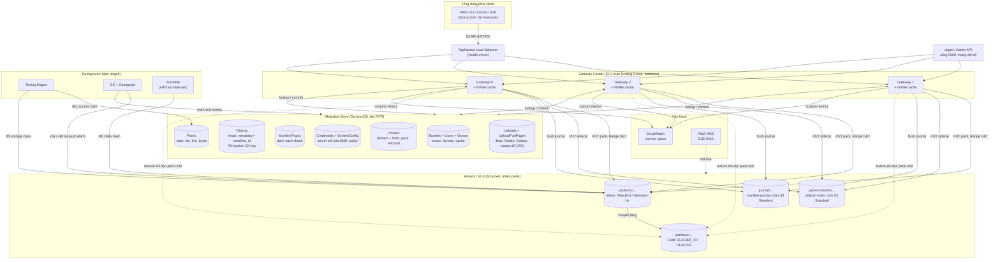

Sơ đồ trên là **Cloud profile**. **Edge profile** dùng cùng binary trên VM/máy local 1–2 node, không cần ALB/ASG; client nối endpoint HTTPS của node hoặc reverse proxy local. S3/DynamoDB/KMS và dịch vụ cấu hình cần thiết được truy cập qua Internet. Chi tiết mục 11.1.

**Ba tầng lưu trữ**

| Tầng | Vị trí | Vai trò | Độ trễ đọc |
|---|---|---|---|
| **Hot** | NVMe local của gateway | Cache pack segment vừa đọc/ghi (LRU) | Mục tiêu dưới 5 ms, cần đo |
| **Warm** | S3 Standard hoặc Standard-IA | Nguồn dữ liệu chính | Phụ thuộc Region/network; đo riêng Cloud và Edge |
| **Cold** | S3 Glacier (Instant hoặc Flexible Retrieval) | Dữ liệu lâu không truy cập, bất biến | Từ mili-giây đến hàng giờ tùy loại |

---

## 3. Thành phần bên trong Gateway

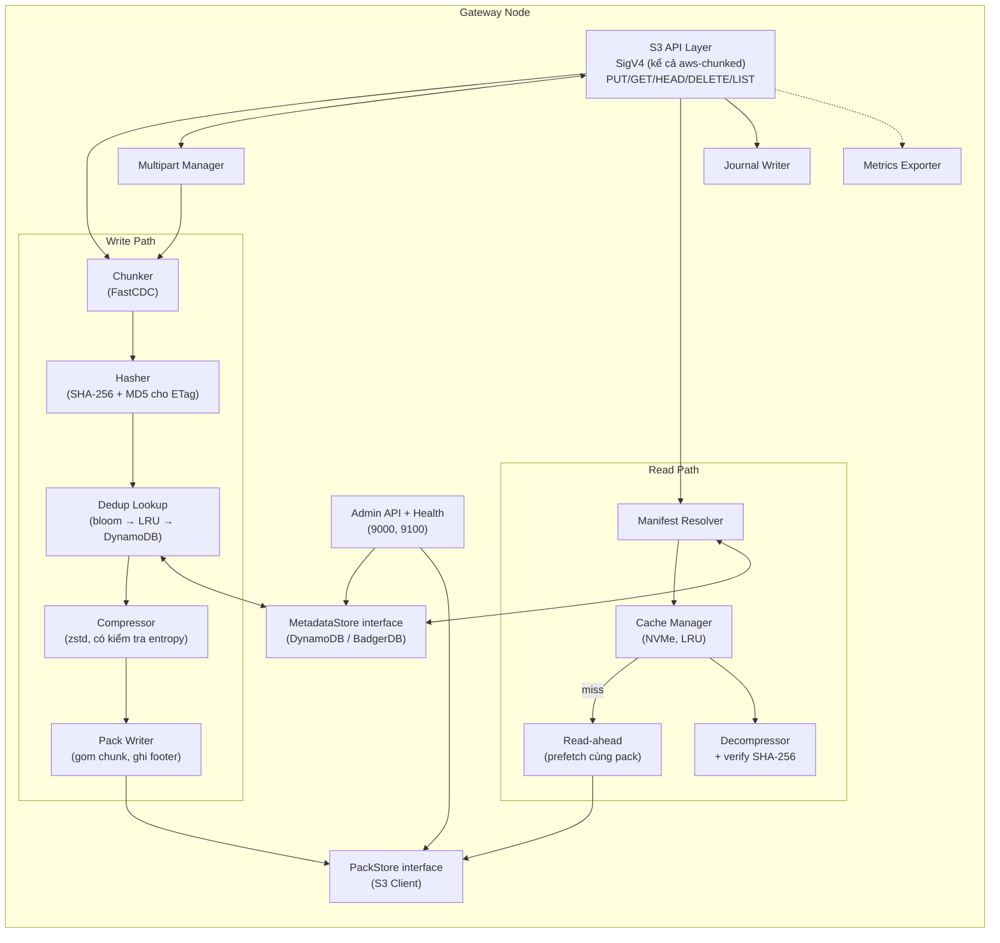

| Thành phần | Trách nhiệm | Ghi chú thiết kế |
|---|---|---|
| **S3 API Layer** | `PUT/GET/HEAD/DELETE/ListObjectsV2` + multipart, xác thực SigV4 | Phải xử lý được **payload streaming (`aws-chunked`)** mà CLI/SDK mới thường dùng khi upload. Kiểm tra sớm với đúng phiên bản CLI của nhóm |
| **Multipart Manager** | Quản lý `CreateMultipartUpload`, `UploadPart`, `Complete`, `Abort`, `ListParts` | Xem mục 5.2 |
| **Chunker** | Content-defined chunking | FastCDC: min 256 KB, trung bình 1 MB, max 4 MB. Cắt theo nội dung nên chèn/xóa vài byte không làm lệch các chunk phía sau |
| **Hasher** | SHA-256 nội dung + domain tạo danh tính dedup; MD5 logical cho ETag DSG | ETag DSG là MD5 cho PUT, MD5 ghép cho multipart; không khẳng định mọi ETag S3 đều là MD5 |
| **Dedup Lookup** | Kiểm tra chunk đã tồn tại | Ba lớp theo `(domain_id, hash)`: Bloom, LRU, DynamoDB; revalidate vị trí/tầng trước commit. Bloom local có thể thiếu chunk do node khác ghi, nên conditional write vẫn là trọng tài |
| **Compressor** | Nén zstd chunk mới hoặc revived, sau lookup theo miền | Nén nếu `stored_len <= raw_len × (1 - min_saving_ratio)`; với ngưỡng 10%, còn trên 90% thì lưu `codec=raw` |
| **Pack Writer** | Gom chunk vào pack 32-64 MB, ghi footer, đẩy lên S3 kèm sidecar index | Giảm PUT so với chunk-per-object; đo riêng so với direct S3 |
| **Manifest Resolver** | Từ `bucket/key` tra danh sách chunk | |
| **Cache Manager** | Cache NVMe theo LRU/ARC theo pack segment | |
| **Read-ahead** | Một Range GET lấy luôn vài chunk liền kề trong pack | Giảm số GET khi đọc tuần tự |
| **Decompressor + verify** | Giải nén, tính lại SHA-256 trên dữ liệu gốc, so với hash | Phát hiện hỏng dữ liệu |
| **Journal Writer** | Đề xuất R2: xuất sự kiện từ outbox chung lên journal S3; không dựa vào buffer RAM | Phục vụ khôi phục metadata (mục 9.1) |
| **MetadataStore / PackStore** | Interface trừu tượng | Bản cài đặt BadgerDB (dev, single node) và DynamoDB (cluster). `MetadataStore` có `ListObjects` (prefix, phân trang) và commit manifest bằng head pointer |
| **Admin/Health Server** | Admin API (cổng 9000), `/healthz`, `/readyz`, `/metrics` (cổng 9100), điều khiển drain | Danh sách endpoint xem tài liệu API |

---

## 4. Bố cục dữ liệu trên S3 và định dạng pack

### 4.1 Bố cục prefix

```
s3://<bucket>/
├── packs/{xx}/{pack_id}            # dữ liệu chunk. xx = 2 ký tự hex đầu của pack_id ngẫu nhiên
├── packs-index/{xx}/{pack_id}.idx  # sidecar: bản sao footer index, luôn S3 Standard
├── journal/{yyyy}/{mm}/{dd}/{segment_id}  # immutable event pages/descriptor; luôn S3 Standard
├── journal/epochs/{history_id}/{epoch_id}/seal-{sha256}.json  # immutable seal/chain; S3 Standard
├── recovery/active-history.json        # catalog chỉ bootstrap/recovery cập nhật CAS; S3 Standard
└── checkpoints/{history_id}/{checkpoint_id}/...  # snapshot/descriptor immutable; S3 Standard
```

- `pack_id` là **chuỗi ngẫu nhiên** (UUIDv4 hoặc hash), không dùng ULID/thời gian ở đầu vì làm mất tác dụng chia prefix.
- Chia 256 prefix để không chạm giới hạn request theo prefix của S3 (khoảng 3.500 PUT và 5.500 GET mỗi giây mỗi prefix). Với quy mô đồ án hiếm khi chạm, nhưng chi phí áp dụng gần như bằng 0.
- Sidecar nhỏ và journal/checkpoint/catalog metadata nên **luôn ở S3 Standard**, không đặt Standard-IA hay Glacier Instant Retrieval vì các lớp này tính phí kích thước tối thiểu 128 KB mỗi object. Chỉ pack mới chịu policy tiering.

### 4.2 Định dạng pack (tự mô tả)

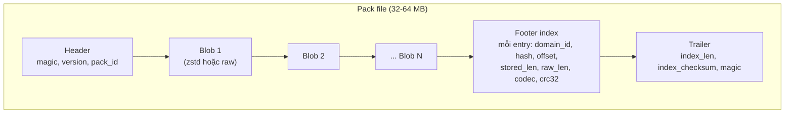

- **Đọc footer chỉ cần vài Range GET nhỏ** (đọc trailer ở cuối file để biết độ dài footer, rồi đọc footer).
- **Sidecar index** là bản sao của footer, lưu thành object nhỏ riêng ở S3 Standard (mục 4.1). Pack đã xuống Glacier Flexible Retrieval không thể đọc footer nếu chưa restore, nên cần sidecar để dựng lại index mà không phải restore hàng loạt.
- Footer/sidecar ghi `domain_id`, hash gốc, location generation và version định dạng. Hai miền có cùng hash vẫn là hai entry riêng. Sidecar không phải nguồn đáng tin duy nhất cho state/storage class; rebuild phải đối chiếu S3 và journal vị trí.
- **Đóng băng định dạng này vào cuối tuần 2**: đổi sau sẽ ảnh hưởng mọi module (GC, tiering, rebuild, scrub).

---

## 5. Luồng ghi (PUT), multipart và CopyObject

### 5.1 PUT thường và revival — quy tắc đã chốt

```mermaid
sequenceDiagram
    autonumber
    actor C as Client
    participant G as Gateway
    participant DB as Metadata chung
    participant S3 as S3 backend
    C->>G: PUT bucket/key (đủ body)
    G->>DB: Xác thực quyền, lấy bucket domain, đăng ký writer (R1)
    loop Mỗi chunk
        G->>G: FastCDC, hash nội dung, MD5/checksum
        G->>DB: Lookup (domain, hash), revalidate location và pack
        alt Đã có bản Warm hoặc GLACIER_IR được bảo vệ
            G->>G: Tái sử dụng tham chiếu
        else Chưa có hoặc Cold cần restore / Restored cần revival
            G->>G: Nén/raw từ body client; không restore nguồn
            G->>S3: PUT pack mới + sidecar
            G->>DB: Conditional insert hoặc CAS location sau khi S3 thành công
        end
    end
    G->>G: Kiểm tra toàn bộ payload checksum, flush pack cuối
    G->>DB: Ghi tất cả ManifestPages, retry phần chưa xử lý
    G->>DB: Commit head + revision + quota + outbox (R2)
    DB-->>G: Commit thành công
    G-->>C: 200 + ETag; debug headers nếu đủ quyền
```

- Lookup cùng miền: Warm và `GLACIER_IR` có thể dedup. Chunk chỉ có bản `GLACIER`/`DEEP_ARCHIVE` thì **ghi lại từ body client sang pack Warm**, sau đó CAS `Chunks` sang vị trí mới. Không restore, không giữ pointer tạm chỉ trong cache local.
- **R3 đã chọn:** PUT/UploadPart xử lý mọi bản Restored như Cold, revive từ body client sang Warm. Client đã gửi đủ byte nên không cần tải nguồn; chi phí thêm PUT/storage được đo. GET/Copy vẫn có thể đọc/reuse Restored đủ deadline + 120 giây margin. Quy tắc này đơn giản hơn phân nhánh PUT theo expiry và không phụ thuộc bản restore tạm.
- CAS kiểm tra vị trí/revision cũ, đồng thời phối hợp pack transition (R1); CAS Chunks đơn lẻ không ngăn được tiering pack. Nếu thua race, dùng vị trí thắng đã xác minh đọc được; blob dư là rác vật lý phải đo.
- Chuyển vị trí giữ refcount cũ; tham chiếu mới chỉ tính một lần khi object/part được công bố. Manifest cũ cùng miền cũng đọc qua vị trí Warm mới. Giảm `live_bytes` pack cũ chỉ theo vị trí canonical đã chuyển, không sửa nội dung pack Cold. Chỉ `Retired` khi hết chunk sống.
- PUT/Complete mới phải đọc ngay được từ nguồn bền vững sau commit. Mỗi pack mới/reuse được admission pin và đặt `protected_until >= request_hard_deadline + 15 phút`, nên commit trước deadline còn ít nhất 15 phút protection; không cần cập nhật hàng nghìn pack trong transaction head. Tiering kiểm tra protection/pins nhất quán, không chờ batch access stats. Upload Active/Completing bảo vệ mọi location nó dùng; Complete revalidate/pin location canonical hiện tại trước commit. Sau protection, tiering áp policy thông thường.
- Write-through bắt buộc trong phạm vi nghiệm thu; write-back không nằm trong phạm vi vì không đáp ứng durability này.
- Không tăng refcount mỗi lần retry một bước nội bộ; dùng delta gắn `op_id` hoặc đối soát trong R1/R2. Refcount là gợi ý, không là căn cứ duy nhất để xóa.
- `x-dsg-chunks-revived` chỉ dành debug admin. Revival không đổi số hash unique trong miền; tăng byte vật lý do bản Cold chết còn lưu, chi phí PUT và gateway → S3.

### 5.2 Multipart — cơ chế đồng thời và phục hồi R2

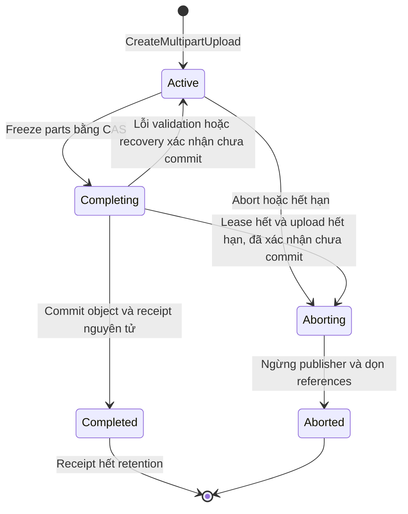

- `Uploads` giữ bucket/bucket_id, key, domain, initiator, HTTP metadata, checksum algorithm/type, revision, reservation/staged bytes, `expires_at`, completion lease/fence, immutable completion-input pointer/digest, prepared manifest và `completion_op_id`. `UploadParts` giữ part head/revision/size, MD5 ETag và checksum binary đã verify; refs ở `UploadPartPages` dưới 400 KB. `receipt_expires_at` chỉ đặt sau commit, không dùng `expires_at` của Active.
- Mỗi part chunk độc lập; boundary có thể thay đổi dedup quanh ranh giới, cần đo, không khẳng định chỉ mất tối đa một chunk nhỏ. Part đến song song/sai thứ tự được chấp nhận. Part ETag là MD5; giới hạn part 5 GiB.
- BeginPartWrite chỉ nhận khi Active. Freeze chuyển Completing và chặn mọi publish part chưa hoàn tất; các writer đã nhận phải hủy publish, giải phóng provisional reservation/pins (bytes mới là orphan). Complete chờ các publisher đó dừng/hết lease trước snapshot; nếu part client yêu cầu chưa được publish thì InvalidPart và mở lại Active. Không vừa yêu cầu publish khi Active vừa chờ publisher thành công sau freeze. Hai writer cùng part khi Active: CAS revision, last publisher wins; pages cũ retire an toàn.
- Complete kiểm tra part order/ETag/size/checksum theo API 2.7 và 4.3; composite checksum yêu cầu PartNumber liên tiếp 1..N. CRC full-object combine bằng checksum + length từng part; SHA composite combine part digests, không đọc lại payload. Freeze input và prepared manifest có checksum/digest bền vững để takeover không chọn parts khác. Upload còn Active hoặc Completing có lease/recovery chưa kết thúc là GC/tiering root, kể cả business expiry vừa qua.
- Commit head/quota/outbox, Uploads state Completed và receipt trong cùng transaction, có condition completion fence và deadline/lease. Receipt giữ digest canonical JSON của input client (bucket_id/key, selected PartNumbers/ETags/client checksums, algorithm/type và expected size); frozen part-head revision snapshot có digest riêng và response, tồn tại 7 ngày từ commit. Sau authorize/binding, retry kiểm tra Completed receipt trước Active expiry; input giống trả response cũ dù object đã bị overwrite/delete, không tạo lại object. Receipt giữ metadata phản hồi, không giữ payload làm GC root.
- Abort và Complete cạnh tranh bằng state CAS; Abort không xóa head upload đang Completing/Completed. Khi Complete đang chạy trả conflict DSG thay vì giả vờ hủy thành công; API nêu khác biệt cụ thể. Chủ sở hữu/quản trị được abort upload người khác để vận hành.
- Worker Complete heartbeat lease 15 giây, lease 60 giây. Khi node chết, retry cùng input hoặc sweeper `recover_uploads` lấy fence mới sau lease + grace; đọc consistent Uploads/receipt trước hành động. Nếu Completed thì trả receipt; nếu chưa commit thì revalidate frozen input/manifest và quyền initiator để resume cùng completion_op_id, hoặc CAS về Active khi không thể resume nhưng upload chưa hết hạn; hết hạn/đã bị thu hồi quyền thì Aborting và release reservation. Transaction timeout chưa rõ kết quả phải đọc trạng thái; DB không đọc được thì giữ roots, trả 503, không tự suy ra chưa commit. Stale worker không publish với fence cũ.
- TTL chỉ dọn terminal metadata sau receipt/recovery protection, không xử lý Completing. Upload Active hết 24 giờ trả NoSuchUpload; Completed theo receipt expiry riêng. Sweeper chạy mỗi 60 giây, takeover thường đủ điều kiện sau tối đa 65 giây từ heartbeat cuối (không là SLA khi backend lỗi). Tests bắt buộc kill sau freeze, sau prepare và sau transaction mất response.

### 5.3 CopyObject cùng miền / khác miền — đã chốt

1. Kiểm tra quyền đọc bucket nguồn và ghi bucket đích, quota chủ bucket đích; snapshot + pin manifest nguồn. Mỗi copy dùng manifest_id đích mới.
2. **Cùng miền:** copy danh sách references, không đọc payload, tăng tham chiếu khi commit. Nguồn Cold vẫn copy được; object đích có thể Cold và GET cần restore. Không áp bảo đảm PUT đọc ngay cho metadata copy này.
3. **Khác miền:** với từng hash nguồn, lookup `(domain_đích, hash)`. Warm, `GLACIER_IR` hoặc Restored còn đọc được trong thời gian thao tác thì tái sử dụng ở đích, không đọc nguồn. Restored reuse chỉ bảo đảm tạm thời đến expiry; không gọi đó là bản Warm.
4. Chunk chưa có/không đọc được ở đích: đọc nguồn, giải nén và verify SHA-256, ghi pack Warm + sidecar của miền đích; insert/CAS như PUT. Đích có Cold cần restore vẫn được thay bằng bản Warm từ nguồn nếu nguồn đọc được.
5. Pre-flight **chỉ các pack nguồn cần đọc**. Nếu có `GLACIER`/`DEEP_ARCHIVE` chưa restore: trả `403 InvalidObjectState` trước response thành công, khởi tạo restore các pack đó khi `auto_restore` bật. Không giữ request chờ hàng giờ. Nếu đích đủ chunk, không cần restore nguồn.
6. Mọi reference đích thuộc miền đích, không giữ pointer/hash lookup miền nguồn. Commit head, quota, outbox như PUT; lỗi trước commit không hiện object đích, dữ liệu mới thừa chờ GC.

Metadata copy nguồn Cold và copy bỏ đọc nguồn khi đích đủ chunk là **tối ưu DSG có chủ đích, khác S3**: S3 yêu cầu restore nguồn GLACIER/DEEP_ARCHIVE trước CopyObject. Tự restore cũng là tiện ích DSG. ETag/HTTP metadata và giới hạn copy xem API mục 4.5; R4 bảo toàn ETag/checksum nguồn như metadata opaque, kể cả multipart, để không đọc toàn file chỉ tính MD5. Đây là khác biệt được công bố với S3 single-copy.

Edge cross-domain copy có thể tải chunk thiếu từ AWS về gateway rồi upload pack mới qua Internet. Đo bytes download/upload riêng, kể cả read-ahead/nén/race; không dùng kích thước object làm proxy cho cả hai.

---

## 6. Luồng đọc (GET) theo tầng

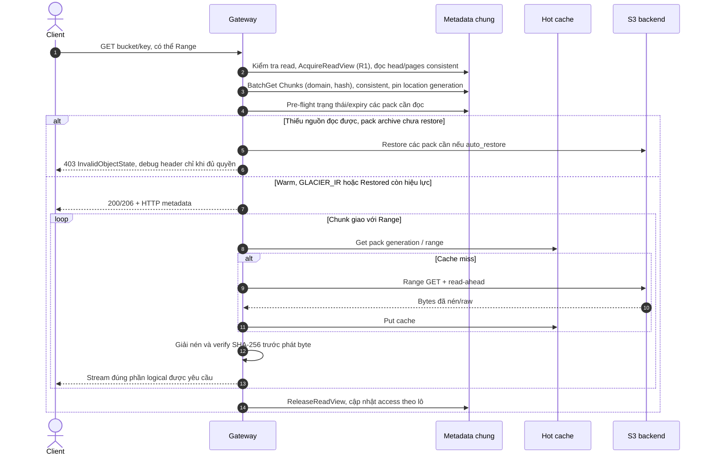

- ConsistentRead trên head, pages và Chunks cần cho read-after-write; BatchGet tối đa 100 keys, xử lý `UnprocessedKeys`, ánh xạ theo khóa vì response không giữ thứ tự. GSI chỉ dùng tìm ứng viên, không quyết định an toàn.
- Pre-flight trước header cho toàn khoảng yêu cầu. Range một khoảng hỗ trợ `a-b`, `a-`, `-n`; object rỗng và Unicode/URL-encoded key cần test. Đọc HTTP metadata `Cache-Control`, `Content-Disposition`, `Content-Encoding` gốc; bỏ lớp transport `aws-chunked` khỏi metadata logical.
- R1 acquire read view trước resolve để bảo vệ manifest cũ và location cũ khỏi overwrite/compaction. Không chỉ đọc head rồi đăng ký pin muộn. Cache location có revision, revalidate khi bắt đầu; cache byte pack dùng generation.
- `GLACIER_IR` đọc trực tiếp. Archive chưa restore trả 403. GET không coi cache local là nguồn đảm bảo cho archive: quy tắc pre-flight nhất quán giữa node; cache mất không đổi durability.
- Restored phải còn hiệu lực đến hard deadline request + 120 giây theo R4; không đủ thì pre-flight trả InvalidObjectState và yêu cầu gia hạn restore khi auto_restore bật. Lease metadata không kéo dài restore trên S3; nếu expiry/network race xảy ra sau header, ngắt stream và tăng `mid_stream_abort_total`.
- Chunk hỏng trước header có thể trả 500; sau header đóng stream để client thấy body thiếu, tăng `integrity_error_total`. Không phát dữ liệu chunk chưa verify.
- HEAD chỉ đọc metadata/quyền và trạng thái liên quan; không đọc payload/restore tự động. `x-amz-restore` tổng hợp theo các pack archive của object, API mục 4.4.
- Access stats gộp (ví dụ 60 giây là giá trị minh họa), nhưng protection cho PUT/part không phụ thuộc chờ batch stats. Cache admission on-write tùy bucket; phục vụ byte luôn cần quyền.

---

## 7. Vòng đời pack và tiering

### 7.1 State và storage class là hai thuộc tính riêng

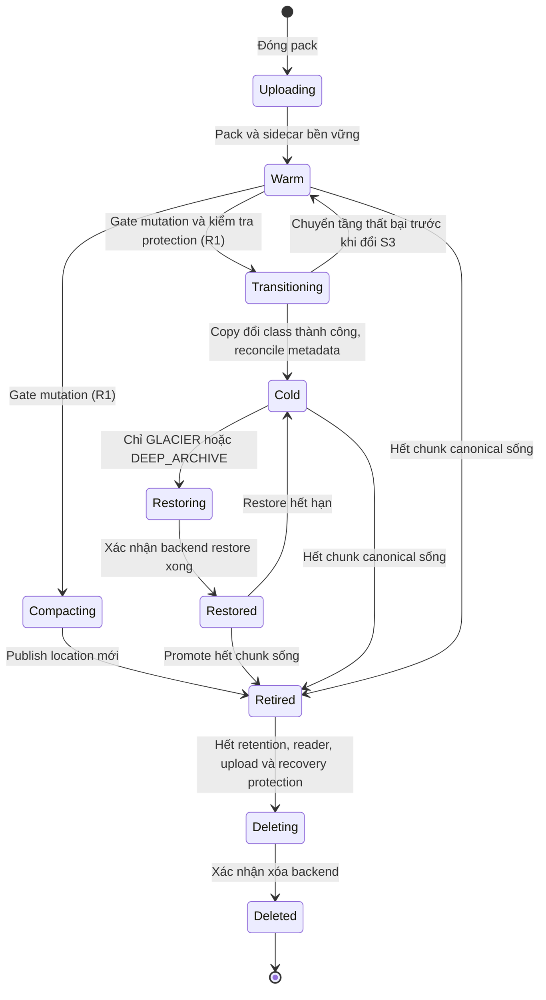

- `state=Cold, storage_class=GLACIER_IR` luôn đọc trực tiếp; không đi Restoring/Restored. Promote IR đọc thẳng; promote archive đọc bản Restored.
- Cold không sửa/compaction/xóa sớm. `GLACIER_IR` và `GLACIER`: tối thiểu 90 ngày; `DEEP_ARCHIVE`: 180 ngày. Standard-IA có hạn 30 ngày và phí retrieval nên pack Warm IA cũng phải xét retention khi compaction/xóa.
- Retired chỉ khi không còn vị trí canonical/roots dùng pack; giữ pack và sidecar cho reader cũ, retention và checkpoint recovery. Một chunk revived không retire cả pack còn chunk sống.
- Promote: đọc chunk canonical sống, viết pack Warm mới; CAS location từng `(domain, hash)` cùng coordination R1. Race loser không đổi lại location đã được request khác cập nhật.
- S3 class và metadata state không cập nhật nguyên tử: `Transitioning` giữ pack khỏi admission writer mới; worker lỗi phải HEAD/reconcile S3 trước mở gate. Khi lệnh S3 vẫn chưa rõ kết quả, giữ gate, không mở lại Warm. `generation` định danh nội dung pack bất biến; đổi class không đổi generation/footer. `state_revision` và mutation fence dùng cho thay đổi lifecycle; location revision dùng cho pointer chunk.

### 7.2 Tiering Engine toàn hệ thống

1. Đọc policy revision từ `SystemConfig`, tìm ứng viên qua GSI `state + last_access`.
2. Re-read pack consistent; chỉ xét không có reader/writer/pending upload bảo vệ, đã qua `protected_until`, live ratio đủ cao và đủ tuổi ổn định.
3. Ước tính storage theo thời gian, COPY/transition, retrieval/restore, bản restore tạm, minimum size/duration, bytes chết và chi phí infrastructure. Không giả định mọi transition đều tiết kiệm.
4. Dùng gate/fence R1 để chuyển Warm → Transitioning; self-copy đổi class, đối chiếu kết quả kể cả body lỗi trong HTTP 200 từ backend, ghi state/storage_class/retention/state_revision trước nhả gate; content generation giữ nguyên.
5. Ưu tiên pack ổn định ít rác. Policy và codec toàn hệ thống; không có lựa chọn class theo bucket. Pack dùng chung miền có cùng quyết định vật lý.

S3 Lifecycle không biết canonical live_bytes và logical reuse của DSG; chỉ dùng lifecycle backend nếu tránh xung đột với engine. Không đặt lifecycle tự tier sidecar/journal/checkpoint; chúng cùng catalog luôn ở S3 Standard (mục 4.1). Cache hit vẫn cập nhật logical access của pack.

Nguồn: [storage classes AWS](https://docs.aws.amazon.com/AmazonS3/latest/userguide/storage-class-intro.html), [S3 pricing](https://aws.amazon.com/s3/pricing/). Giá và retention lấy từ `pricing.json` có Region/ngày, không hard-code đơn giá.

---

## 8. Garbage Collection và Compaction

### 8.1 Bất biến bắt buộc

- Root gồm Objects head sống, manifest reader đang pin, writer/copy đang chuẩn bị, parts/input/snapshot của upload Active chưa hết hạn hoặc Completing còn lease/recovery chưa xác định kết quả và manifest còn cần cho outbox/checkpoint recovery.
- Refcount đếm **số lần tham chiếu chunk trong các object đã commit**, kể cả một object lặp hash nhiều lần; upload dở/pin là roots riêng, không trộn vào refcount object. Refcount chỉ giúp chọn ứng viên. `live_bytes` tính mỗi blob canonical sống một lần, không nhân refcount.
- Khoảng đệm theo tuổi là bảo vệ bổ sung, **không đủ**: PUT mới có thể tái sử dụng chunk cũ sau MARK. Scan consistent của DynamoDB cũng không tạo snapshot toàn bảng.
- Không xóa pages/pack cũ ngay sau overwrite hoặc chuyển location. Reader đã nhận read view phải còn truy cập được dữ liệu đến khi kết thúc/hết lease hợp lệ.

### 8.2 R1 — GC bảo thủ với mutation barrier

R1 giữ barrier bảo thủ để ổn định roots/location trong GC. Đây là lựa chọn triển khai đã chốt, có chi phí lease và cửa sổ 503 cần đo:

1. Lấy maintenance lease chung với fencing epoch; chặn writer mới (PUT, DELETE, copy publisher, upload-part publisher, complete/abort, thay đổi namespace ảnh hưởng roots), chặn job mutation pack mới; request mới trả 503 để retry. Job dry-run không xóa và không cần barrier độc quyền.
2. Chờ writer đã đăng ký hoàn tất/hủy; đăng ký writer và kiểm tra gate phải nguyên tử trong metadata chung. Node mất lease không được publish. Upload dở đã bền vững vẫn là roots, không cần chờ client hoàn tất cả upload.
3. Quét roots ổn định, reconcile refcounts/live_bytes, chọn ứng viên. Reader mới vẫn có thể được nhận, nhưng acquire view/pin và retire/delete phải đồng bộ trên gate resource; reader cũ bảo vệ generation cũ.
4. Mark chunk/pack/pages ứng viên `retiring`; chặn admission vào resource đó, kiểm tra roots/pins dưới fence trước sweep. Nếu không chứng minh hết protection thì bỏ qua, không xóa.
5. Compaction viết pack mới + sidecar trước, CAS locations dưới fence; retire pack cũ, chỉ xóa khi hết reader/recovery protection và minimum retention. Dọn orphan S3 bằng inventory packs, không chỉ quét bảng Packs.
6. Nhả barrier; nếu worker chết, worker tiếp quản phải reconcile `retiring`/`transitioning` bằng epoch mới trước mở lại writes. Lease expiry không là lý do để stale worker được xóa/publish.

Read lease cần deadline và heartbeat chung; node ngừng/GC pause phải kiểm tra fence trước bước publish/xóa, reader mất lease phải dừng trước tiếp tục đọc. Lease 60 giây, heartbeat 15 giây, reclamation grace 5 giây và request deadline 30 phút ở mục 19.1. Gia hạn/commit phải condition-check fence; đã mất lease không được tự dùng grace để tiếp tục. Nếu sau này cần GC online không chặn writes, phải thiết kế pin/chunk admission hoặc epoch snapshot riêng và có test race; không mặc định đã giải quyết.

S3 không kiểm tra fencing epoch của metadata. Trước gửi DELETE phải ghi state `Deleting` bền vững; không tái cho phép dùng pack này khi worker timeout hoặc mất lease. Worker tiếp quản reconcile/retry cùng thao tác xóa, không mở lại resource đang có lệnh S3 chưa rõ kết quả. Fencing chỉ trên DynamoDB chưa đủ để ngăn một lệnh S3 đã được gửi hoàn tất muộn. Transition chưa rõ kết quả cũng giữ resource đóng admission đến khi HEAD/reconcile xác định được backend; worker mới không phục hồi Warm chỉ dựa hết lease. Các lệnh destructive đã gửi muộn được kiểm thử cùng durable Deleting/Transitioning.

### 8.3 Cleanup và phục hồi

- Job purge upload xử lý business expiry/state, giải phóng logical reservation và retire part pages; TTL chỉ dọn item terminal sau retention.
- Manifest orphan chỉ xóa khi không head/read/upload/outbox/checkpoint nào cần, hết writer lease và khoảng đệm.
- Mỗi bước delete/compaction checkpoint idempotent; retry không giảm live_bytes/refcount nhiều lần. Pack không có row DB nhưng có trên S3 vẫn cần scan dọn theo tuổi/protection.
- Retained pack, sidecar và manifest tối thiểu phải bao phủ journal/checkpoint phục hồi còn được hỗ trợ (mục 9.1). Không replay head cũ về một pack đã GC xóa.

Nguồn: [Scan không có snapshot isolation](https://docs.aws.amazon.com/amazondynamodb/latest/APIReference/API_Scan.html), [TTL dọn từng item và có độ trễ](https://docs.aws.amazon.com/amazondynamodb/latest/developerguide/TTL.html).

---

## 9. Nhất quán, xử lý lỗi và khôi phục

### 9.0 R2 — transaction head + outbox

R2 giữ transaction nhỏ sau khi mọi page đã ghi, ghép head với quota/outbox/receipt. Export bất đồng bộ để không thêm S3 round trip vào mỗi PUT; chỉ recovery cut có membership seal hoàn chỉnh mới được công bố:

- Re-read revision hiện tại, CAS head (bao gồm tombstone cho DELETE) với `revision + 1`, cập nhật logical quota/reservation, ghi `Outbox` event pointer và receipt Complete khi có. Concurrent commit conflict retry với revision mới; thứ tự commit thành công là last-writer-wins.
- Head tombstone giữ revision khi xóa, GET trả 404, LIST ẩn tombstone. Bucket có `bucket_id` bất biến theo lần tạo để journal/grants cũ không áp vào bucket tái tạo cùng tên. Dọn tombstone chỉ sau checkpoint/recovery watermark an toàn; không mất revision giữa DELETE rồi PUT.
- Event chỉ giữ pointer tới manifest/op metadata dưới 400 KB. Không đưa manifest lớn vào transaction/outbox item; chuẩn bị immutable pages trước. Transaction giới hạn 100 actions/4 MB, không đưa hàng nghìn refcount update vào commit.
- Exporter đọc Outbox chung với lease, xây journal record đầy đủ manifest/HTTP metadata/domain/owner/entity revision; object lớn chia event pages có checksum và completion descriptor. S3 segment ID duy nhất. Mark exported chỉ sau mọi segment/descriptor bền vững; manifest được giữ cho đến lúc đó.
- Event replay theo `(bucket_id, key, revision)`/revision entity khác, không theo thời gian node hay thứ tự flush. `op_id` chống lặp; tombstone revision mới hơn thắng commit cũ. CAS location events có revision riêng để rebuild không chọn bản Cold retired thay bản Warm revived.
- Mỗi commit có event_id cố định theo `(history_id, op_id, entity/action)`, Put outbox condition attribute_not_exists; dù head đã bị request khác overwrite vẫn tra được outcome của op cũ. TransactWriteItems dùng ClientRequestToken riêng cho mỗi bộ parameters: retry outcome chưa rõ giữ nguyên token/params, conflict đã xác định mới recompute và tạo attempt token mới. Không giả định token DynamoDB bảo vệ quá 10 phút; outbox/op_id và receipt là nguồn đối chiếu bền vững. [AWS transaction idempotency](https://docs.aws.amazon.com/amazondynamodb/latest/developerguide/transaction-apis.html).
- Refcount delta là công việc có `op_id`/progress idempotent, đối soát dưới R1; không coi refcount lệch trong khoảng cập nhật nền là quyền xóa.
- Mọi thay đổi authoritative (head/tombstone, chunk location, Users/Buckets/Grants/SystemConfig/Credentials/AdminTokens và Completed receipt) ghi outbox cùng transaction/CAS tương ứng. Event có history_id/recovery_epoch, entity identity/incarnation, revision, op_id, immutable payload pointer/checksum. Khác với fencing epoch R1, recovery_epoch chỉ phục vụ completeness và chỉ tăng lúc đóng cut, không có counter sequence chung ghi trên mỗi PUT. Secret SigV4 chỉ là ciphertext KMS, bearer chỉ là hash; KMS key/quyền giải mã phải còn để phục hồi.

| Sự cố | Hành vi |
|---|---|
| PUT lỗi trước head commit | Không có object mới; giữ object cũ nếu overwrite; orphan chờ GC |
| Node chết sau commit, trước journal export | Outbox còn trong DB, node khác export; không mất vì RAM node |
| Mất response Complete | Retry digest giống trả receipt, không cộng quota/refcount lại |
| Chunk hỏng sau header GET | Ngắt stream, metric; không phát chunk sai |
| Location chuyển/pack tier giữa lookup | Revalidate admission dưới gate/fence; không commit pointer chưa bảo vệ |
| DDB/S3 throttle kéo dài | Backoff, 503 SlowDown; không coi UnprocessedItems/Keys là thành công đầy đủ |
| Mất metadata | PITR ưu tiên; fallback S3 checkpoint + journal, kiểm tra completeness trước mở service |

### 9.1 Khôi phục metadata (`dsgctl rebuild-index`)

**Đóng epoch và dựng checkpoint — hợp đồng completeness R2**

1. Exporter cứ 60 giây xuất event pages + completion descriptor lên S3 Standard, chỉ mark exported sau verify toàn bộ payload. Event đang ở epoch mở có thể đã bền vững, nhưng chưa đủ chứng minh namespace hoàn chỉnh.
2. Mỗi giờ, một job lease owner đóng recovery epoch E trong history_id hiện hành: lấy barrier R1 ở mode recovery-cut (chặn mọi authoritative event producer, gồm control plane và location mutation), chờ writer/job đã nhận quiesce. Heartbeat, reader, access stats và job progress vẫn được phép; chúng không là snapshot authoritative. Đăng ký producer và nhận recovery_epoch phải nguyên tử với gate; publish kiểm tra service_incarnation + lease/fence/history_id/epoch. Mỗi bootstrap/disaster recovery tạo UUID history_id và service_incarnation mới; không tái dùng epoch prefix hoặc số fence cũ sau PITR rollback.
3. Nếu quá 120 giây còn writer hợp lệ, bỏ lần đóng và nhả barrier; giữ E mở, ghi metric lý do. Không hủy PUT khỏe chỉ để đóng cut. Khi quiescent, transaction ghi RecoveryEpochs[E]=Closed/cut_at và đổi epoch hiện hành E+1 trước nhả gate. Không còn event mới vào E; outbox của E không bị TTL/xóa khi chưa seal.
4. Sau nhả gate, quét base Outbox consistent hết pagination cho (history_id, E) (membership đã bất biến; không dùng GSI eventual làm căn cứ đủ), xuất nốt mọi event. Seal gồm exact event IDs hoặc membership pages có count/checksum, history_id/cut_at/epoch_id và hash seal trước. Seal/pages/descriptor dùng key UUID/content hash và S3 If-None-Match:*; nếu đã có phải verify cùng content, không overwrite. Catalog chọn history hiện hành; recovery đọc chain/seal hash của history đó, không trộn epoch cùng số giữa các history. Publish metadata seal pointer CAS dưới job fence chỉ sau mọi event descriptor bền vững; retry idempotent, thiếu một event thì E chưa Sealed. Node chết sau đóng E được worker mới tiếp quản; mất DB trước seal chỉ được phục hồi tới seal trước đó.
5. Checkpoint dựng ngoài barrier từ checkpoint trước + chuỗi epoch liên tiếp đã seal; replay entity revision/op_id/incarnation, không sort theo tên segment hay clock node. Epoch 0 chứa đầy đủ bootstrap records từ base rỗng. Checkpoint có namespace/manifest, quyền/cấu hình, credential ciphertext/token hashes, location winners và Completed receipt chưa hết hạn; quota/refcount được tính lại. Upload dở không được phục hồi Active: abort có kiểm soát, reserved/staged=0. Dùng snapshot pages + completion descriptor có checksum; publish checkpoint pointer CAS dưới job fence sau verify mọi page. Không dùng Scan nhiều bảng đang thay đổi làm snapshot.
6. Chỉ chain không gap và checkpoint có descriptor hoàn chỉnh mới tạo recovery cut được hỗ trợ. Không lấy timestamp/event_id lớn nhất làm watermark. `last_sealed_epoch`, `last_sealed_cut_at`, `checkpoint_cut_at`, `recovery_cut_age_seconds` và export lag được báo riêng.

**Phục hồi và giữ dữ liệu tương ứng**

1. Dừng/gate service writes/jobs mutation và GC. Chọn cut đã seal trong 24 giờ gần nhất; PITR ưu tiên metadata ở điểm không sau target cut và nằm trong Earliest/LatestRestorableDateTime; nếu cut mới hơn backup available thì dùng checkpoint/journal để tiến tới cut. Restore nhiều bảng không nguyên tử, phải reconcile về cùng cut bằng chain hoàn chỉnh, không replay epochs sau target. Hợp đồng DSG là các cut đầy đủ, không hứa phục hồi đủ dữ liệu tại mọi giây của PITR. Nếu chưa có cut hoặc target ngoài cửa sổ thì báo unsupported/missing, không mở readiness giả.
2. S3 fallback lấy checkpoint neo không sau target + mọi epoch liên tiếp tới target; phục hồi Users/Buckets/Grants/SystemConfig/Credentials/AdminTokens và Completed receipts. Mọi bearer/SigV4 credential phục hồi bị vô hiệu hóa (tránh resurrect revocation sau cut), auth cache xóa; operator bootstrap token và cấp keys mới sau audit grants/status; môi trường/S3/KMS/SSM/TLS lấy từ Terraform/config. Job/node/lease active reconcile lại, không replay stale fence. Trước mở service, dừng mọi node/worker cũ, reconcile S3 destructive actions chưa rõ kết quả, tạo history/service incarnation mới và base checkpoint từ cut đã audit (các credential/token đều disabled). Offline provisioning cập nhật recovery/active-history.json bằng S3 If-Match trên ETag cũ (lần đầu If-None-Match:*); chỉ mở gate sau DB incarnation và catalog/base checkpoint khớp. Online exporter không đổi catalog history. Catalog thiếu/mâu thuẫn thì dừng recovery hoặc yêu cầu operator chọn history_id rõ, không tự lấy file mới nhất theo timestamp. History/anchor cũ vẫn giữ theo retention; old worker không publish vào service mới.
3. Liệt kê sidecar, HEAD class/restore state; dựng inventory domain/hash/pack/generation, replay location winners. Bản canonical thiếu chỉ được thay bằng cùng domain/hash còn tồn tại và verify; Cold candidate có thể cần restore để verify, tính vào RTO/chi phí. Không tự chọn bản bất kỳ hoặc tuyên bố đủ dữ liệu chỉ vì sidecar có hash.
4. Mark recovered heads và tính lại logical usage/refcount/live_bytes; abort upload dở, release reservation/staging. Audit completeness và scrub mẫu trước readiness; pack archive còn Cold vẫn cần restore khi GET như bình thường.
5. PITR cấu hình RecoveryPeriodInDays=1. GC giữ pack/pages/sidecar retired ít nhất 24 giờ + 10 phút, đồng thời bảo vệ checkpoint/epoch roots của mọi cut được hỗ trợ và checkpoint neo ngay trước biên 24 giờ. Khi compaction đổi location, giữ dữ liệu để reconstruct cùng domain/hash cho cuts cũ; thiếu proof thì không xóa. DDB Outbox, tombstone và journal chỉ cleanup sau seal/checkpoint watermark và mọi retention/pins, không TTL theo tuổi đơn thuần. Restore giữ gate cho đến audit xong để GC không xóa giữa phục hồi.

**RPO/RTO**

- Node chết khi DB còn: committed head/outbox/receipt vẫn bền vững; exporter/Complete worker khác takeover. Mất cả DB/outbox: fallback chỉ bảo đảm đến recovery cut đã seal bền vững; open/unsealed epochs không được replay như một recovery hoàn chỉnh.
- Mục tiêu vận hành là tạo một cut/checkpoint mỗi giờ khi backend và writer quiescence cho phép. Đây không là SLA RPO một giờ hay 60 giây: backlog, PUT dài hoặc exporter lỗi làm cut cũ hơn; report RPO quan sát bằng now − last_sealed_cut_at và các commits chưa được bảo vệ, alarm khi quá 1 giờ. Checkpoint chậm vẫn replay từ anchor + sealed epochs nếu chain đủ.
- Một cut/checkpoint có ít nhất 24 giờ dữ liệu hỗ trợ; thêm anchor có thể giữ bytes lâu hơn. PITR 1 ngày đồng bộ hợp đồng, không làm giảm đơn giá PITR; chi phí recovery retention phải nằm cost/report. RTO gồm replay/index/verify và restore archive khi cần.

Nguồn: [AWS PITR và RecoveryPeriodInDays](https://docs.aws.amazon.com/amazondynamodb/latest/developerguide/Point-in-time-recovery.html). Epoch/seal, cửa sổ dữ liệu và defaults trên là lựa chọn DSG, cần kiểm thử/đo.

### 9.2 Quota logical, overwrite credit và staging

- Giữ hard quota trên committed logical bytes. Mỗi writer/upload chụp base head size B (0 nếu thiếu), reservation r=max(0, candidate logical bytes − B). Nhờ credit này, overwrite cùng size khi quota đã đầy không cần thêm quota. Credit không phải lời hứa commit: head có thể thay đổi trong lúc upload.
- Length đã biết: reserve trước body. Streaming: grow reservation từng 64 MiB logical trước khi nhận/ghi phần đó; cuối request release slack. Multipart giữ reservation theo published parts + provisional writers; thay part chỉ trừ phần cũ khi publisher mới thắng CAS. Candidate assembled size ≤100 GiB; part cũ còn giữ cho reader/recovery không tính committed usage lần hai.
- Account `logical_reserved` là tổng reservations. Reserve condition used+reserved≤limit; khi commit đọc head hiện tại, delta D=S−old_size và transaction kiểm tra used+D+(reserved−r)≤limit, consume đúng reservation, CAS head + outbox/receipt cùng lúc. Conflict re-read/recompute, timeout chưa rõ kết quả đối chiếu op_id/receipt trước retry. Không dùng base size cũ để trừ quota khi head đã đổi.
- Để overwrite credit không tạo staging vô hạn, giới hạn 16 Active/Completing uploads mỗi owner và tổng staged logical bytes (body/parts chưa terminal, kể cả provisional part overwrite) ≤logical_limit+100 GiB. Track bằng reservation ledger + counters transaction, batch grow 64 MiB; size cap hiện hữu vẫn áp. Terminal upload release counters idempotent theo op_id sau publisher quiesce; recovery rebuild used từ heads, abort upload dở và reset staged/reserved.
- Reservation ledger của PUT/Copy cũng gắn writer lease/deadline; sweeper tra outbox/op_id consistent sau lease mất rồi mới release nếu chưa commit, backend chưa rõ giữ reservation. Multipart dùng state/receipt fence tương ứng. Counter used/reserved/staged/active_upload_count được sửa cùng ledger/state transaction; không ghép ConditionCheck và Update cùng một item trong một DynamoDB transaction.
- Allocation có thể từ chối ở final commit khi head/quota đã đổi; trả QuotaExceeded, object cũ còn nguyên, orphan chờ GC. Hóa đơn/usage user chỉ gồm used/reserved/staged/limit logical; byte vật lý và phí counter/transaction thuộc metrics/cost admin.


Nguồn: [DynamoDB transaction limits và propagation khi backup](https://docs.aws.amazon.com/amazondynamodb/latest/developerguide/transaction-apis.html). RPO/ràng buộc trên là thiết kế DSG, chưa phải kết quả đo.

---

## 10. Mô hình dữ liệu

Mô hình dưới đây là hợp đồng v4 đã chốt cho triển khai R1–R4; chưa là tính năng đã cài đặt. Derived counters phải đối soát được từ authoritative heads/roots.

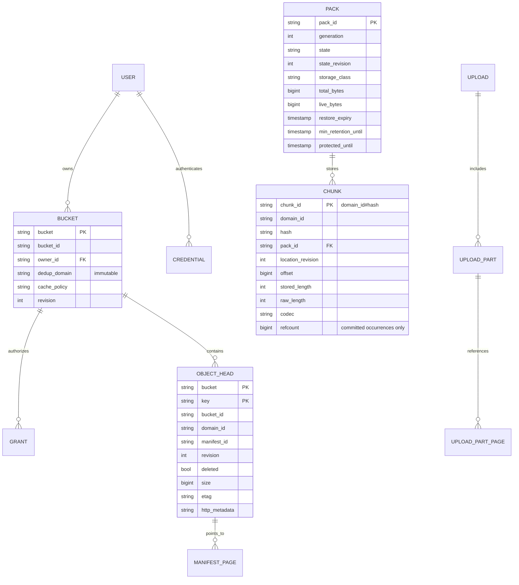

### 10.1 Ánh xạ DynamoDB

| Bảng | Partition key | Sort key | Nội dung/ràng buộc |
|---|---|---|---|
| `Users` | `user_id` | — | Miền mặc định cho bucket mới, status, logical quota/usage/reservation/staging, active_upload_count; revision cho status/domain/limit, counters là derived; không chứa byte vật lý cho người dùng |
| `Buckets` | `bucket` | — | `bucket_id`, owner_id, immutable dedup_domain, cache policy, state/revision, created_at |
| `BucketGrants` | `bucket_id` | `user_id` | read/write, revision; chỉ owner có read/write ngầm định, system admin quản lý grants nhưng cần grant để đọc/ghi |
| `AdminTokens` | `token_id` | — | user_id, secret_hash, system_admin scope, status, issued_at/expires_at, revision; không lưu bearer plaintext |
| `Credentials` | `access_key_id` | — | user_id, secret_encrypted, status, system_admin/debug flag, revision; không phải IAM backend key |
| `SystemConfig` | `config_id` | — | policy/default limits đã chốt, revision; recovery history/epoch hiện hành và service incarnation |
| `Objects` | `bucket` | `key` | Head/tombstone: bucket_id, domain_id, manifest_id, size, ETag/checksum, chunk/page counts, HTTP metadata, checksum algorithm/type/value/part_count, etag_kind, revision, op_id |
| `ManifestPages` | `manifest_id` | `page_no` | domain_id và ordered hash/raw_length, cumulative logical offset hỗ trợ Range; immutable, pages <400 KB |
| `Chunks` | `domain_id#hash` | — | Khóa ghép đầy đủ cho mỗi identity, phân bố hash trên DynamoDB; lưu domain_id/hash riêng, canonical pack/offset/length/codec, location_revision, refcount, created_at |
| `Packs` | `pack_id` | — | S3 key/content generation, state/state_revision, class, live/total bytes, last_access, protected_until, restore state/expiry, retention, retired_at/recovery protection, mutation fence |
| `Uploads` | `upload_id` | — | Bucket/key/domain/initiator, HTTP metadata/checksum algorithm/type, expiry Active, state/revision, completion lease/fence/op_id/input pointer/prepared manifest, receipt expiry riêng, reservation/staged bytes |
| `UploadParts` | `upload_id` | `part_number` | Part head: part_manifest_id, revision, MD5 ETag, raw size, algorithm + verified part checksum binary, page_count |
| `UploadPartPages` | `part_manifest_id` | `page_no` | Ordered domain/hash/raw_length refs, phân trang như manifest |
| `CompletionPages` | `completion_id` | `page_no` | Immutable normalized input và frozen part snapshot, pages <400 KB; Active/Completing lease bảo vệ |
| `Outbox` (R2) | `event_id` | — | history_id/recovery_epoch, entity/incarnation/revision/op_id, immutable payload/page pointer/checksum, export state/lease; không xóa membership chưa seal |
| `RecoveryEpochs` (R2) | `history_id#epoch_id` | — | Open/Closed/Sealed, cut_at, previous seal hash, membership descriptor/count/checksum; lease/fence cho seal/checkpoint |
| `QuotaReservations` (R2) | `reservation_id` | — | owner/upload/op binding, base head revision/size, reserved/staged logical bytes, state/revision; consume/release idempotent |
| `Leases` (R1) | `resource_id` | `lease_id` | service_incarnation + gate/fencing epoch, writer/read/resource pins, expiry và owner |
| `Jobs` | `job_id` | — | Type/params/policy revision, state, progress, worker lease/fence, result/error/cancel request |
| `Nodes` | `node_id` | — | Profile, address, heartbeat, active requests, draining; TTL phụ trợ, heartbeat xác định liveness |

`Chunks` dùng **một partition key chứa cả domain và hash**, không dùng domain làm partition key riêng vì miền default sẽ tập trung mọi chunk vào cùng item collection. Domain ID dài 1–64 ký tự `[a-z0-9_-]`, không chứa `#`; hash SHA-256 hex lowercase 64 ký tự; lưu hai thuộc tính riêng để index/rebuild không phải suy đoán khi parse. Encoding/validation là hợp đồng định dạng R4 đã chọn. Chunk SHA-256 vẫn tính trên dữ liệu gốc; footer/journal lưu cặp domain/hash riêng theo version.

Page target nên theo **kích thước serialization thực tế**, không chỉ `5000 × 36 bytes`: attribute names, domain, hex/binary và overhead DynamoDB cũng tính vào 400 KB. Số chunk/page là giới hạn mềm cần đo. Index logical offset là trang/head nhỏ, không nhét toàn offset list vào head vượt item size.

### 10.2 Commit, quota và LIST

- Chuẩn bị pack/index/pages trước, retry hết UnprocessedItems. R2 transaction gồm head revision, logical quota/reservation, outbox pointer; Complete luôn thêm state Completed/receipt. Không yêu cầu ALL_OLD của PutItem như cơ chế commit chính nữa; đọc head cũ consistent, CAS revision rồi lưu cleanup delta theo op_id.
- DELETE viết tombstone revision; LIST/GET/HEAD xử lý `deleted` là không tồn tại. Quota chỉ thay đổi trên commit thành công; overwrite trừ size cũ, cộng size mới. Concurrency owner/bucket delete phải được condition-check/gate để không tạo object trong bucket đã xóa.
- `ListObjects`: Query consistent theo bucket/prefix; bỏ tombstone, gộp delimiter, tiếp tục query cho đủ trang logical hoặc hết dữ liệu. `CommonPrefixes` tính vào max-keys, continuation token giữ vị trí đã quét và trạng thái delimiter, ràng buộc bucket/prefix/options. Không giả định token chỉ là key cuối trả về; không dùng mẹo successor prefix chưa kiểm chứng làm mất key.
- Hot partition bucket và counter quota chủ sở hữu là rủi ro đo được; shard chỉ khi có dữ liệu tải. GSI không phục vụ authorization/commit/read-after-write.
- Bật PITR 1 ngày cho metadata authoritative, đồng bộ recovery window ở 9.1; BadgerDB một node phải có transaction/atomic batch tương đương và cùng contract test. TTL chỉ đặt cho dữ liệu terminal đã hết bảo vệ.

Nguồn: [BatchGetItem](https://docs.aws.amazon.com/amazondynamodb/latest/APIReference/API_BatchGetItem.html), [BatchWriteItem](https://docs.aws.amazon.com/amazondynamodb/latest/APIReference/API_BatchWriteItem.html).

---

## 11. Triển khai trên AWS

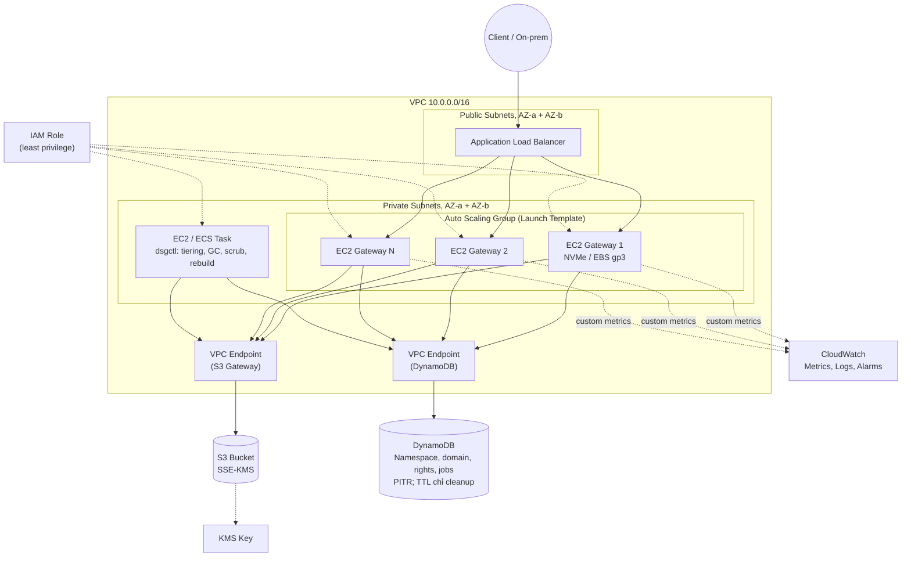

| Dịch vụ | Vai trò |
|---|---|
| **S3** (Standard, Standard-IA, Glacier) | Kho pack, sidecar, journal |
| **EC2** + **Auto Scaling Group** + Launch Template | Gateway, scale theo CPU/băng thông |
| **Application Load Balancer** | Phân tải, health check qua cổng 9100 `/readyz` |
| **DynamoDB** (PITR 1 ngày, TTL, GSI) | Metadata dùng chung; data recovery tại sealed cuts trong 24 giờ |
| **VPC, Security Group, VPC Endpoint** | Cô lập mạng, tránh phí NAT Gateway cho lưu lượng S3/DynamoDB |
| **KMS** | SSE-KMS |
| **IAM** | Quyền tối thiểu, role riêng cho gateway và job |
| **SSM Parameter Store / Secrets Manager** | Token Admin API, cấu hình `pricing.json`, khóa mã hóa secret |
| **CloudWatch** | Metric tùy chỉnh, log, alarm |
| **Terraform** | Dựng và xóa toàn bộ hạ tầng bằng một lệnh |
| **Cost Explorer, S3 Storage Lens, AWS Budgets** | Đo chi phí thực, cảnh báo ngân sách |

**Metric tùy chỉnh:** đồng nhất tên với API mục 8: `dedup_ratio`, `compression_ratio`, `total_reduction`, `cache_hit_ratio`, `s3_requests_total{type}`, `bytes_logical`, `bytes_physical`, `revived_chunks_total`, `revived_bytes_stored_total`, `gateway_s3_upload_bytes_total`, `s3_gateway_download_bytes_total`, `gateway_client_bytes_total`, `restore_count`, `pack_state_count{state}`, `ddb_throttle_count`, `integrity_error_total`, `mid_stream_abort_total`, `oldest_unexported_age_seconds`, `recovery_cut_age_seconds`, `gc_gate_duration_seconds`, `completion_takeover_total`. Metrics vật lý chỉ cho quản trị; không gắn object key/user ID thành label cardinality cao.

**Security Group tối thiểu**

| Nhóm | Inbound | Nguồn |
|---|---|---|
| `sg-alb` | 443 | Dải IP client |
| `sg-gateway` | 8080 (S3 API) | `sg-alb` |
| `sg-gateway` | 9100 (health check, metrics) | `sg-alb`, `sg-monitor` |
| `sg-gateway` | 9000 (Admin API) | `sg-admin` chỉ gắn bastion EC2; truy cập qua SSH local forwarding |
| `sg-gateway` | 7000 (gRPC cache, chỉ khi bật ring) | `sg-gateway` (chính nó) |

R4 chọn **bastion + SSH local forwarding** làm đường quản trị bắt buộc: bastion có sg-admin và SSH chỉ nhận CIDR máy quản trị/chủ bucket đã được cấp SSH user/key; gateway private IP lấy từ inventory Nodes/EC2, có thể đổi sang node khỏe vì token/jobs dùng metadata chung. `dsgctl --endpoint http://127.0.0.1:19000` đi qua tunnel tới private gateway:9000, mang bearer riêng gắn user. Chọn SSH tunnel nên không truyền bearer plaintext trên Internet; từ bastion tới gateway chỉ mạng VPC được kiểm soát. Direct VPN không là đường mặc định; nếu bật phải có rule sg-gateway:9000 nhận đúng client CIDR/SG do VPN hỗ trợ, TLS riêng và route, không coi client VPN tự có sg-admin. API mục 1.1 mô tả lệnh và mục 6.4 mô tả cấp/revoke token. Self-service qua ALB không thuộc P1.

Terraform phải dựng public/private subnets trên ít nhất hai AZ cho Cloud ALB, ACM certificate + listener 443, health port override 9100, `routing.http.preserve_host_header.enabled=true`, không rewrite URL/Host và `idle_timeout.timeout_seconds=120`. Ứng dụng idle 150 giây, hard deadline 1800 giây; deregistration delay 1800 giây và lifecycle hook được heartbeat đủ drain. SDK fixture read timeout 150 giây khi cần; vẫn kiểm tra gate, không dùng timeout để tuyên bố flush xong. Tests SigV4 qua ALB gồm Host có explicit :443, Unicode/%/+// và pre-flight/Complete lâu hơn 60 giây. [AWS ALB subnets](https://docs.aws.amazon.com/elasticloadbalancing/latest/application/application-load-balancers.html), [Host preservation và idle timeout](https://docs.aws.amazon.com/elasticloadbalancing/latest/application/edit-load-balancer-attributes.html).

### 11.1 Hai deployment profile — đã chốt

| Profile | Hạ tầng / kết nối | Credential backend | Đánh giá |
|---|---|---|---|
| **Cloud (chính)** | EC2 + ASG + ALB + S3/DynamoDB VPC Gateway Endpoint; cache NVMe/EBS | EC2 IAM role | Kịch bản A: client cùng Region; thể hiện hạ tầng AWS |
| **Edge/on-prem** | Cùng binary trên VM/máy local 1–2 node; không yêu cầu ALB/ASG; S3/DynamoDB qua HTTPS Internet | IAM Roles Anywhere + credential helper, hoặc IAM user hạn chế quyền | Kịch bản B: client local đọc qua gateway local, cache giảm AWS → Edge |

- Khác nhau ở cấu hình endpoint, network/TLS, credential provider và deployment; không fork logic dedup/metadata. Cloud/Edge đều dùng DynamoDB khi chạy nhiều node; BadgerDB chỉ dev một node.
- Edge phải truy cập được KMS để giải mã DSG secrets và SSE-KMS backend, SSM/Secrets Manager/CloudWatch nếu bật. Cloud private subnet cần NAT hoặc interface endpoints cho các dịch vụ ngoài S3/DynamoDB, cộng chi phí này; hai Gateway Endpoint không tự cấp đường mạng cho mọi API AWS.
- Edge endpoint S3-facing dùng TLS trực tiếp hoặc reverse proxy giữ nguyên Host/path ký SigV4. Admin/metrics chỉ bind mạng quản trị/local, không mở Internet. gRPC khi bật ring ở Edge dùng mTLS hoặc mạng riêng có kiểm soát.
- Client vẫn gửi đủ dữ liệu tới gateway. Cloud cache không giảm byte gateway → Internet client; Edge cache hit phục vụ local, giảm lượt tải AWS → Edge. Replica cache giữa hai Edge node chỉ là tối ưu tùy chọn.
- Data/machine overhead của Edge (VM, điện, disk/network) phải có giả định định lượng trong báo cáo; không coi infrastructure local miễn phí.
- Provider phải refresh credential tạm; không lưu IAM backend secret vào bảng Credentials của người dùng DSG.

### 11.2 Jobs, node và drain

- `POST /jobs` tạo item chung, mọi gateway đọc được kết quả; worker nhận bằng conditional lease/fence, heartbeat, progress/checkpoint và retry idempotent. Type mutation dùng R1. Cancellation dừng ở safe point, không rollback chunk đã công bố bằng cách xóa pack đang được dùng.
- Scheduling toàn cluster có một owner lease cho mỗi job định kỳ; không để mỗi gateway tự chạy cùng GC/tiering. Chết worker thì takeover theo fence mới và reconcile bước S3 không nguyên tử.
- Cache purge/fault injection có `scope=node|cluster` rõ ràng, fan-out qua Nodes và job có kết quả từng node. Heartbeat node quyết định alive/draining; DynamoDB TTL chỉ cleanup.
- Drain đặt flag nhận request tại gateway **ngay lập tức**, trả 503 request mới; `/readyz` trả 503. Cloud đồng thời deregister ALB target, chờ deregistration delay và active requests/pack/journal export checkpoint trước kết thúc ASG lifecycle action. Có timeout/heartbeat lifecycle và báo incomplete khi quá hạn, không khẳng định flush hoàn tất khi chưa xong.
- Không dựa riêng health check: có độ trễ và ALB có thể fail-open khi mọi target unhealthy. Edge áp gateway admission gate, không cần gọi ALB. Flush journal dùng outbox nên node mất vẫn có thể export từ node khác.

Nguồn: [Roles Anywhere credential helper](https://docs.aws.amazon.com/rolesanywhere/latest/userguide/credential-helper.html), [ALB health checks/fail-open](https://docs.aws.amazon.com/elasticloadbalancing/latest/application/target-group-health-checks.html).

> **Tiết kiệm chi phí khi làm đồ án:** instance nhỏ, dữ liệu thử vài chục GB, `terraform destroy` mỗi khi ngừng làm, AWS Budgets có cảnh báo. EBS gp3 đủ để đo tương đối, không nhất thiết dùng instance NVMe.

---

## 12. Mở rộng phân tán: cache theo Consistent Hashing (không bắt buộc)

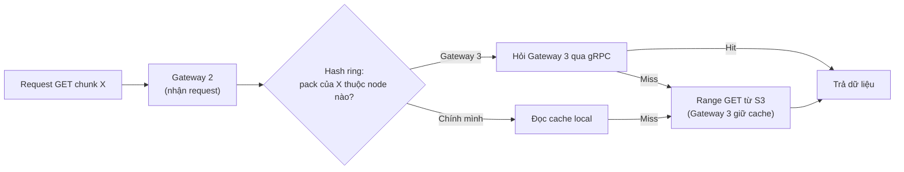

- Thành viên ring lưu trong DynamoDB kèm heartbeat, node mất heartbeat bị loại khỏi ring. Dùng virtual node để cân bằng.
- Thêm/bớt node chỉ xáo trộn khoảng 1/N số pack.
- **Chỉ làm nếu các phần bắt buộc đã xong và ổn định.** Nếu không làm, mỗi gateway giữ cache riêng vẫn đạt mục tiêu chính.

---

## 13. Mô hình chi phí, mô phỏng tiering và đánh giá

### 13.1 Mô hình chi phí và chỉ số

`pricing.json` lưu Region, ngày, nguồn giá và đơn giá storage/request/retrieval/transition/restore/egress/minimum duration; cùng thư viện dùng cho simulator, engine và cost/report. Đây là mô hình, không phải hóa đơn AWS hay billing người dùng.

```text
Baseline direct S3 = tích phân dung lượng logical theo thời gian × đơn giá class
                  + request theo loại + retrieval/restore/egress thực tế của baseline

DSG = tích phân byte vật lý theo class và thời gian (kể cả Cold chết/Retired)
    + requests theo loại (pack + sidecar + journal/checkpoint + retries + recovery)
    + retrieval GLACIER_IR/Standard-IA, restore archive và lưu bản restore Standard
    + COPY/transition + early deletion/minimum billable size/archival metadata
    + network từng đường S3 ↔ gateway, gateway ↔ client và liên node
    + EC2 hoặc VM Edge + disk/EBS + ALB/LCU + DynamoDB read/write/transactions
    + PITR/backups + KMS + CloudWatch + NAT/interface endpoints nếu có

net_saving = baseline.total - dsg.total
break_even = điều kiện net_saving > 0 theo workload/profile/giá, không là một ngưỡng chung
restore_amplification = backend_pack_bytes_restored / logical_range_bytes_requested
```

- Baseline chính là direct S3 cùng workload/Region/tier assumptions. Baseline phụ chunk-per-object chỉ chứng minh ích lợi packing; không dùng giảm PUT 90% so baseline phụ để khẳng định hơn direct S3.
- File mới nhỏ có thể cần 1 PUT pack + 1 PUT sidecar, hơn direct S3 1 PUT. Pack cuối/part nhỏ, DDB lookup và journal phải tính đúng. Không coi tổng S3 requests chắc chắn giảm.
- Revival đo `revived_chunks_total` và byte thực upload, kể cả duplicate race thua. Byte Cold cũ còn giữ đến retention tính vào physical storage; không cộng “phí revival” lần hai khi đã tính PUT/storage/network.
- Restore tính toàn pack, loại trùng pack trong cùng yêu cầu; nhiều object cùng dùng một restore không tính tải pack lần nữa. `restore_amplification` có denominator Range logical, định nghĩa khoảng đo/cộng gộp; denominator 0 trả null. Include phí bản restore tạm Standard và request update expiry.
- `bytes_logical`: tổng size object head đang sống, không phải cộng dồn mọi upload. `bytes_unique_raw`: tổng raw_length mỗi `(domain, hash)` đang được object sống tham chiếu một lần. Domain tách có cùng hash vẫn là hai unique identities.
- `bytes_unique_stored`: stored_length vị trí canonical của những identities sống. `bytes_stored`/`bytes_physical`: tổng bytes S3 backend thực giữ (pack/header/footer, dead/retired/orphan, sidecar, journal/checkpoint và temporary restored copy trong phần tính phí); có breakdown để không đếm nhầm object listing với billed restored bytes. Cache local/DDB là nhóm infrastructure riêng.
- `dedup_ratio = bytes_logical / bytes_unique_raw`; `compression_ratio = bytes_unique_raw / bytes_unique_stored`; `total_reduction = bytes_logical / bytes_stored`. **Revival không giảm dedup_ratio nếu unique identities không đổi**, nhưng có thể giảm total_reduction. Các tỷ lệ không nhất thiết nhân ra nhau vì physical overhead. Mẫu số 0 trả null.
- Thống kê bucket physical không cộng thẳng thành total vì chunk/pack chia sẻ; bucket breakdown admin phải ghi phương pháp phân bổ, không dùng để tính quota/hóa đơn người dùng.

### 13.2 Kịch bản đánh giá

| Kịch bản | Deployment và đường truyền | Cách diễn giải |
|---|---|---|
| **A** | Cloud profile, client EC2 cùng Region → ALB → gateway → S3 qua endpoint | Internet egress không là lợi ích cache; tính ALB, liên AZ/đường mạng phát sinh nếu có |
| **B** | Edge profile, client local → gateway local → S3/DynamoDB Internet | Cache hit giảm download AWS → Edge. Dedup giảm upload Edge → S3, client vẫn gửi đủ body |
| **Đối chứng Cloud + client ngoài AWS** | Client Internet → Cloud gateway | Vẫn phải trả đủ logical bytes ra AWS; không áp `egress × (1-hit_ratio)` |

Đo riêng `client_to_gateway_bytes`, `gateway_to_client_bytes`, `gateway_to_s3_upload_bytes`, `s3_to_gateway_download_bytes`, metadata/network control plane và traffic giữa node. Download có thể lớn hơn chunk yêu cầu do read-ahead; upload có thể nhỏ hơn raw bytes do nén. Đừng chuyển cache hit ratio thành tiền tiết kiệm nếu chưa biết đường byte bị tính phí.

| Bộ dữ liệu | Ví dụ | Kỳ vọng cần kiểm chứng |
|---|---|---|
| Entropy thấp/vừa | DB dump chưa nén, log, source/VM nhiều phiên bản | Nén và dedup có thể tốt |
| Entropy cao, byte giống nhau | Các bản sao cùng zip/video/encrypted blob | Nén kém nhưng dedup vẫn tốt nếu ranh giới chunk giống |
| Entropy cao, byte khác nhau | Nén lại/mã hóa lại, random | Nén kém, dedup thường thấp; đo CPU/hash |

Thí nghiệm miền: cùng dữ liệu/workload/quyền, chạy `default` và miền tách theo chủ sở hữu bucket; reset backend/cache hoặc dùng namespace thí nghiệm độc lập. Báo cả hiệu quả storage, transfer, restore amplification và timing; không tuyên bố loại bỏ timing leakage từ một benchmark.

### 13.3 Bộ mô phỏng chính sách tiering (time-warp)

Không thể chờ 90 ngày trong 8 tuần để quan sát phí Glacier, nên nhóm dựng bộ mô phỏng chạy trên **thời gian ảo**.

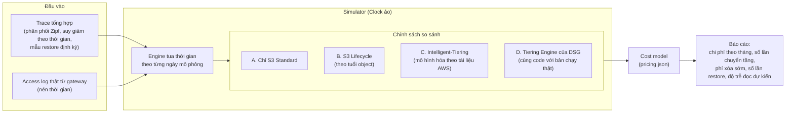

**Điểm thiết kế quan trọng**

- Tiering Engine dùng **interface `Clock`** thay vì gọi `time.Now()`, nên cùng một code chạy được ở chế độ thật và chế độ tua nhanh.
- Chính sách (`policy`) là một package tách biệt, nhận vào trạng thái pack và access stats, trả về quyết định. Simulator và Tiering Engine dùng chung package này, nên kết quả mô phỏng phản ánh đúng cách hệ thống quyết định.
- Đầu ra cho phép trả lời câu hỏi giảng viên hay hỏi: "tiering của nhóm tốt hơn Lifecycle và Intelligent-Tiering ở điều kiện nào, và tệ hơn ở điều kiện nào". Nên trình bày cả trường hợp chính sách của nhóm thua (ví dụ trace truy cập ngẫu nhiên đều), vì đó là kết quả trung thực.
- Mô hình Intelligent-Tiering cần đọc kỹ tài liệu AWS hiện hành (phí giám sát theo object, ngưỡng kích thước, các bậc tiering) và ghi rõ giả định.

### 13.4 Kế hoạch benchmark

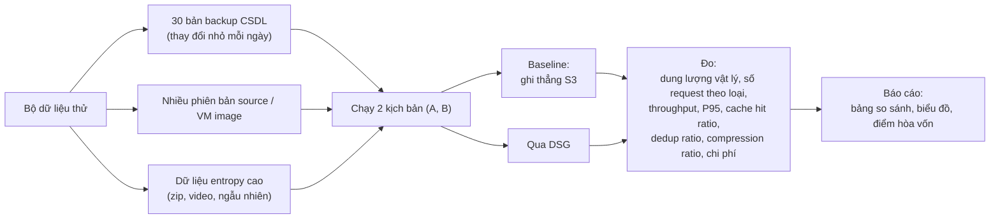

**Tiêu chí nghiệm thu gợi ý**

| Chỉ số | Mục tiêu |
|---|---|
| Dedup ratio trên bộ backup tăng dần | Từ 5 lần trở lên |
| Số PUT request so với chunk-per-object | Giảm từ 90% trở lên |
| Cache hit ratio khi đọc lặp | Từ 80% trở lên |
| Throughput PUT một luồng | Không thấp hơn 50% so với ghi thẳng S3 |
| Tương thích công cụ | `aws s3 cp/sync` (kể cả multipart, file lớn) hoạt động đúng |
| Toàn vẹn | 100% object đọc lại khớp hash sau các bài test lỗi |
| Chịu lỗi | Kill 1 gateway giữa lúc PUT: không object hỏng, retry thành công |
| Khôi phục | Xóa metadata, chạy `rebuild-index`, dữ liệu đọc lại đúng (nêu rõ RPO) |
| Đọc Cold | GLACIER_IR đọc ngay; GLACIER trả InvalidObjectState trước header, restore theo auto_restore và đọc sau hoàn tất; báo amplification |
| PUT trùng Cold | Revive từ body, GET ngay thành công, không restore; thống kê vật lý không che byte Cold chết |
| Phân quyền/miền | Grant/revoke read/write hoạt động mọi node; không giữ references chéo domain; debug chỉ system admin có opt-in |
| Copy khác miền | Tái sử dụng đích trước; restore chỉ phần nguồn cần đọc; copy source Cold đủ chunk đích vẫn thành công theo DSG |
| Race GC/reader/journal | Existing old chunk reuse, GET khi overwrite/compaction, kill sau head và trước export không mất outbox |
| Mô phỏng tiering | Có so sánh 4 chính sách trên ít nhất 3 loại trace |

> Các ngưỡng là giả thuyết chưa đo. Tuần 3 lấy số sơ bộ trên BadgerDB/Warm; tuần 5–6 đo lại trên DynamoDB với R1/R2, nén/cache và cả Cloud/Edge để chốt ngưỡng trước benchmark tuần 7. Không dùng throughput MVP tuần 3 để kết luận chi phí/độ trễ transaction và lease của thiết kế cuối. Luôn báo sample size, concurrency, warm/cold cache, dataset và client version/config; kết quả không đạt ngưỡng vẫn được báo trung thực.

---

## 14. So sánh với giải pháp có sẵn (dùng cho slide)

| Tiêu chí | S3 Lifecycle Rules | S3 Intelligent-Tiering | AWS Storage Gateway | **Dedup Storage Gateway** |
|---|---|---|---|---|
| Chống trùng lặp dữ liệu | Không | Không | Cần kiểm chứng theo tài liệu AWS hiện hành | Có (chunk + SHA-256) |
| Nén | Không | Không | Cần kiểm chứng | Có (zstd, có kiểm tra entropy) |
| Phân tầng theo | Tuổi object, prefix | Hành vi truy cập từng object | Không phải mục đích chính | Access stats, live ratio, chi phí ước tính từng pack |
| Cache local | Không | Không | Có | Có (NVMe, LRU) |
| Giảm số request | Không | Không | Có phần nào | Gom chunk thành pack |
| Độ chín muồi | Sản phẩm AWS | Sản phẩm AWS | Sản phẩm AWS | Bản dựng lại phục vụ học tập, có đánh giá định lượng |

> Đọc tài liệu chính thức của AWS Storage Gateway trước khi khẳng định nó thiếu tính năng nào. Chỉ nêu điều đã kiểm chứng. Tránh dùng cụm "production-ready" trong báo cáo.

---

## 15. Phạm vi theo mức ưu tiên và cột mốc

### 15.1 Phạm vi

| Mức | Nội dung |
|---|---|
| **Bắt buộc** | Users/owner + grants read/write qua Admin API, immutable bucket dedup_domain/default, logical quota và debug admin · Policy nén/tiering toàn hệ thống · Cloud + Edge profile · S3 API (`PUT/GET/HEAD/DELETE/LIST` + **multipart**, SigV4 kể cả aws-chunked, CopyObject, DeleteObjects, RestoreObject, presigned URL) · **Admin API + `dsgctl`, health/metrics, header `x-dsg-*`** · FastCDC + SHA-256 dedup · **nén zstd** · pack tự mô tả + sidecar index + prefix shard · MetadataStore BadgerDB và **DynamoDB** · **nhiều gateway sau ALB** · hot cache NVMe/LRU · **tiering GLACIER_IR và GLACIER** + restore + promote + revival · **GC mark-and-sweep** + compaction Warm theo R1 · **outbox/journal/checkpoint + `rebuild-index`** theo R2 · **Terraform** · CloudWatch metrics · mô hình chi phí và **bộ mô phỏng tiering** · benchmark 2 kịch bản |
| **Nếu còn thời gian** | Consistent hashing cache giữa các gateway · mã hóa phía client · scrubber tự động đầy đủ · so sánh chi tiết với Storage Gateway · Glacier Deep Archive |
| **Không làm** | Compaction pack Cold · versioning · S3 ACL/bucket policy APIs (khác grants nội bộ) · replication đa vùng · write-back |

R1–R4 đã được chọn để triển khai theo quyền người dùng giao; tuần 1-2 viết ADR và contract tests, không mở lại nhóm cắt giảm đã loại trừ. Mọi điều chỉnh default sau đo phải cập nhật đồng thời API và kiến trúc, giữ các bất biến durability/quota/recovery.

### 15.2 Cột mốc

| Tuần | Cột mốc |
|---|---|
| 1-2 | Ghi ADR R1–R4, chốt serialization domain/quyền/outbox/checksum/token và fixture CLI/SDK cho Cloud/Edge; chốt interface (`MetadataStore`, `PackStore`, `Cache`, `Clock`), đặc tả API (xem `dedup-storage-gateway-api.md`) và **đóng băng định dạng pack/manifest/journal cuối tuần 2**. Skeleton, Terraform nền, `pricing.json`, ADR đầu tiên |
| 3 | MVP một node: toàn bộ S3 P0, owner authorization/default domain, checksum, dedup/pack/BadgerDB/S3 Warm và benchmark harness |
| 4 | Multipart state/receipt/pages, nén/sidecar/cache, DynamoDB transaction/outbox, grants/quota, CopyObject/DeleteObjects, global policy |
| 5 | Cloud cluster/ALB + Edge chạy thật, reader/writer coordination + GC/compaction, journal/seal/checkpoint/rebuild và recovery retention, Jobs/Nodes/drain/metrics; đo sơ bộ DynamoDB R1/R2 |
| 6 | GLACIER_IR/GLACIER + restore/promote/revival/copy cross-domain, simulator, cost report và fault injection; chốt ngưỡng nghiệm thu từ thiết kế đủ |
| 7 | **Đóng băng tính năng**, benchmark chính thức, kiểm thử lỗi, phân tích chi phí |
| 8 | Báo cáo, slide, demo, tuần đệm |

**Quy tắc cắt phạm vi nếu trễ:** cắt từ mục "Nếu còn thời gian" trước, sau đó rút gọn benchmark hybrid, tuyệt đối không cắt kiểm thử toàn vẹn và multipart.

---

## 16. Chiến lược kiểm thử

| Loại | Áp dụng cho | Ví dụ |
|---|---|---|
| **Property-based test** | Chunker, refcount, định dạng pack | Ghép lại các chunk luôn ra đúng dữ liệu gốc. Chèn/xóa vài byte chỉ làm đổi một số ít chunk. Với mọi chuỗi PUT/DELETE, refcount khớp với kết quả mark-and-sweep. Đọc footer luôn khớp nội dung pack |
| **Fuzz test** | S3 API parser | XML request, header, chữ ký SigV4, khung `aws-chunked`, query multipart bất thường |
| **Contract test** | Mọi cài đặt của `MetadataStore`, `PackStore`, `Cache` | Cùng bộ test chạy trên BadgerDB và DynamoDB (dùng DynamoDB Local), trên S3 thật và bản giả lập |
| **Fault injection** | Toàn hệ thống | Kill gateway giữa PUT và giữa CompleteMultipart, S3 trả lỗi 5xx, DynamoDB throttling, mất cache, hỏng một byte trong pack |
| **Kiểm thử tương thích** | Công cụ chuẩn | `aws s3 cp`, `sync`, file lớn nhiều part, `--range`, phiên bản CLI nhóm dùng |
| **Kiểm thử khôi phục** | Journal, sidecar | Xóa bảng, chạy `rebuild-index`, so sánh với snapshot trước đó |
| **Mô phỏng** | Chính sách tiering | Kiểm tra bất biến: không có pack Cold bị xóa trước `min_retention_until` |
| **Phân quyền và miền** | Users, grants, debug, quota | Grant/revoke trên nhiều node; write-only không GET; A ghi bucket B dùng domain B; cùng hash hai miền không chia sẻ identity; user thường không thấy physical bytes |
| **Race dữ liệu** | R1/R2, reader, multipart, revival | PUT reuse chunk cũ khi MARK; GET giữ pages/location cũ trong overwrite/compaction; Complete/Abort/UploadPart cạnh tranh; kill sau freeze/prepare/commit mất response; stale completion fence; receipt còn hạn khi Active expiry qua; stale worker và S3 DELETE hoàn tất muộn |
| **Journal và checkpoint** | Outbox/epoch seal, namespace/grants/PITR | Kill sau head và sau đóng epoch trước seal; event trễ/lặp/sai thứ tự, membership thiếu một event; checkpoint từ replay; tombstone/bucket tái tạo; GC/compaction rồi restore cut 24 giờ vẫn có dữ liệu; target ngoài cửa sổ báo unsupported |
| **Cloud / Edge và chi phí** | Hai profile, domains, network | Đo riêng download/upload; Cloud cache không giảm Internet logical bytes; Edge cache và copy thiếu chunk có bytes thực; compare default domain với miền tách |

---

## 17. Rủi ro chính

| Rủi ro | Tác động | Cách giảm thiểu |
|---|---|---|
| CLI/SDK mới gửi payload `aws-chunked` hoặc checksum bổ sung | API không nhận được upload từ công cụ chuẩn | Thử với đúng phiên bản CLI ngay tuần 1-2, làm parser streaming SigV4 sớm |
| **Hot key trên `Chunks`** (chunk phổ biến như khối toàn số 0) | DynamoDB throttling khi refcount cập nhật dồn dập | Gộp cập nhật refcount theo lô cho mỗi PUT, cân nhắc chỉ dựa vào mark-and-sweep cho chunk cực phổ biến |
| Item manifest vượt 400 KB | Không lưu được object lớn | Tách manifest thành nhiều item, phân trang |
| Dedup kém trên dữ liệu thật | Không đạt mục tiêu tiết kiệm | Báo cáo trung thực theo nhóm entropy, nêu điểm hòa vốn |
| Ranh giới part multipart làm giảm dedup | Mất một phần hiệu quả | Đo mức mất mát, nêu trong báo cáo |
| Giá AWS thay đổi hoặc khác Region | Kết quả chi phí sai lệch | `pricing.json` có ngày và Region, lấy từ bảng giá chính thức |
| Code sinh bởi AI không thống nhất giữa các module | Lỗi tích hợp, khó bảo vệ | Contract test, đóng băng định dạng sớm, review bắt buộc, mỗi thành viên phải giải thích được module mình sở hữu |
| Trễ tiến độ | Không kịp benchmark | Cột mốc cứng tuần 3, 5, 7 và quy tắc cắt phạm vi ở mục 15.2 |
| Hot partition khi mọi object của bucket dùng chung partition key | DynamoDB throttling ở tải rất cao | Chấp nhận ở quy mô đồ án, shard bucket thành nhiều partition nếu benchmark cho thấy cần |
| Dedup toàn cục giữa các bucket có side-channel | Đoán được sự tồn tại của dữ liệu qua `x-dsg-chunks-dup` hoặc thời gian phản hồi | Debug opt-in có chữ ký + credential system admin; quota logical; stats vật lý admin-only; miền tách vẫn không bảo đảm hết timing/resource side-channel |
| Restore theo pack gây khuếch đại chi phí | Hóa đơn restore lớn hơn dự kiến | Đo `restore_amplification`, ưu tiên đẩy xuống Cold các pack ít chunk dùng chung, cân nhắc khi chọn lớp Glacier |
| GC tuổi chunk không bảo vệ reuse mới / reader cũ | Xóa dữ liệu còn cần | R1 gate/read view/pins; không xóa chỉ dựa refcount/tuổi; giữ Deleting không readmit khi S3 chưa rõ kết quả |
| Journal async hoặc checkpoint thiếu namespace/quyền | Mất commit hoặc khôi phục sai quyền/Cold location | R2 outbox + entity revision + epoch membership seal + checkpoint completeness; export lag không phải RPO cố định |
| Pack dùng chung nhiều miền | Restore/tiering ảnh hưởng chung và timing leakage | Ghi rõ giới hạn cô lập; không hứa hết mọi side-channel; physical stats admin-only |
| Quota owner hot key và transaction tăng phí | Throttling/chi phí che lợi ích dedup | Đo contention và DDB transaction/PITR/backup trong baseline DSG |

**Quy tắc làm việc đề xuất:** ghi mỗi quyết định thiết kế quan trọng thành một ADR ngắn (bối cảnh, lựa chọn, lý do, đánh đổi). Đây là tư liệu tốt cho báo cáo và vấn đáp.

---

## 18. Phân công module (tham chiếu)

| Thành viên | Module | Thành phần trong sơ đồ |
|---|---|---|
| 1 | **S3 API và Multipart** | S3 API Layer (SigV4, aws-chunked), Users/Credentials/grants/quota API, Multipart state/receipt, Copy/Delete/LIST, compatibility/fuzz tests |
| 2 | **Dedup Engine và định dạng dữ liệu** | Domain-aware Chunker/Hasher/Lookup, Compressor, Pack Writer/sidecar, MetadataStore transaction/quota/outbox (Badger + DynamoDB), property/contract test |
| 3 | **Tiering, Cache, GC, khôi phục** | Cache/Read-ahead, reader/writer gate + GC/Compaction, GLACIER_IR/GLACIER, revival/promote, outbox exporter/checkpoint/rebuild, Clock/global policy |
| 4 | **Hạ tầng, đo lường, mô phỏng, benchmark** | Terraform Cloud + Edge deployment/TLS/credential provider, Jobs/Nodes/drain/metrics, pricing/cost, simulator/domain benchmark, fault injection |

**Giao diện cần chốt ở tuần 1** — chữ ký dưới đây là hợp đồng triển khai, cùng hợp đồng cho BadgerDB/DynamoDB:

- `MetadataStore`: `GetBucket`, `Authorize`, `GetCredential`, `ListAccessibleBuckets`, `GetPolicy`, `PutPolicy`, `GetChunks(domain, hashes, consistent)`, `PutChunkIfAbsent`, `CompareAndSwapChunkLocation`, `GetPacks`, `WriteManifestPages`, `CommitObject(expectedRevision, quotaDelta, outboxPointer, receipt?)`, `DeleteObject`, `GetManifest`, `ListObjects`, `UpdateAccessStats`, `ListPacksByState`.
- Multipart: `CreateUpload`, `PersistCompletionInput`, `ClaimCompletion`, `RecoverCompletingUploads`, `BeginPartWrite`, `PublishPart`, `ListUploadParts`, `FreezeUpload`, `GetCompletionReceipt`, `CompleteUpload`, `AbortUpload`, `PurgeExpiredUploads`.
- Coordination R1: `RegisterWriter`, `AcquireReadView`, `PinLocations`, `RenewLease`, `ReleaseLease`, `AcquireMaintenanceGate`, `ReconcileMutation`; acquisition/publish/delete phải kiểm tra gate/fence, không chỉ gọi các hàm rời rạc rồi giả định nguyên tử.
- Control plane: `Get/Put/DeleteGrant`, `Reserve/ReleaseLogicalQuota`, `Create/Claim/Checkpoint/CancelJob`, `HeartbeatNode`, `SetDraining`, `ListOutbox`, `MarkExported`, `CloseRecoveryEpoch`, `SealEpoch`, `CreateRecoveryCheckpoint`, `Issue/RevokeAdminToken`.
- `PackStore`: `PutPack`, `PutSidecar`, `HeadPack`, `RangeGet(pack, generation, offset, len)`, `ChangeStorageClass`, `Restore`, `DeletePack`.
- `Cache`: `Get(pack, generation, range)`, `Put`, `Evict`; `Clock`: `Now`, `Sleep` bản thật/mô phỏng.
- Định dạng versioned: footer/sidecar có domain + generation, manifest/part pages, event pages/completion descriptor và checkpoint watermark. Không trộn schema v3 hash-only với v4 mà không migration.

---

## 19. Quyết định triển khai và default cấu hình

Người dùng yêu cầu giữ phạm vi và giao chọn hướng tối ưu cho các điểm còn mở. Các lựa chọn dưới đây ưu tiên tính đúng đắn và hạn chế I/O trên mỗi request; không là kết quả benchmark. R1/R2 giữ đầy đủ, UploadPartCopy vẫn P2, hai lớp Glacier và Cloud/Edge 1–2 node giữ nguyên.

| Mã | Lựa chọn triển khai | Đánh đổi |
|---|---|---|
| R1 | Giữ shared gate + fencing lease + writer registration + read view/location pins; GC pause mutation roots | Có ghi metadata và cửa sổ 503; đo chi phí, thời gian gate và fault races trên DynamoDB thật |
| R2 | Giữ transaction head/quota/outbox/Completed receipt; async export, recovery epochs có seal đủ, checkpoint từ replay | Không thêm S3 round trip vào mỗi commit; RPO S3 theo cut đã seal, không cam kết 60 giây; phục hồi đủ dữ liệu tại các cut trong 24 giờ |
| R3 | PUT/UploadPart revive mọi Restored; protection ít nhất 15 phút sau commit; Copy vẫn reuse Restored đủ deadline + margin | Tăng PUT/physical bytes khi upload lại dữ liệu Restored; đổi lại PUT không phụ thuộc bản restore tạm, cần đo riêng Edge |
| R4 | Object cap 100 GiB; reservation delta có overwrite credit và staging cap; token riêng qua bastion; ETag/checksum Copy giữ nguồn như opaque | Một số khác biệt S3 được công bố; các default ở bảng dưới là cấu hình ban đầu, phải đo trước nghiệm thu |

### 19.1 Default triển khai ban đầu

| Tham số | Mặc định triển khai | Hợp đồng |
|---|---|---|
| Object tối đa | 100 GiB | PUT đơn/part tối đa 5 GiB; kiểm tra candidate multipart trước publish/Complete |
| Deadline request dữ liệu | 30 phút | Từ admission đến kết thúc stream/commit; request dài hơn dùng multipart/Range hoặc tăng cấu hình đồng bộ |
| Lease / heartbeat / grace | 60 giây / 15 giây / 5 giây | Gia hạn trước hạn; mất lease dừng stream/publish; grace chỉ cho reclamation, không gia hạn quyền worker |
| Clock skew giữa node | Tối đa 2 giây | NTP/chrony, fail readiness nếu vượt bound; deadline local dùng monotonic clock |
| Protection sau ghi | Ít nhất 15 phút | Admission đặt protected_until ≥ hard deadline request + 15 phút; pin/roots vẫn bảo vệ riêng |
| Restore safety margin | Deadline request còn lại + 120 giây | Áp cho GET/Copy đọc hoặc reuse Restored; PUT/UploadPart revive mọi Restored |
| ALB idle / ứng dụng idle / drain | 120 / 150 / 1800 giây | Idle khác hard deadline; Cloud deregistration delay và ASG hook bao phủ drain, có heartbeat hook |
| Cache authorization | Tối đa 5 giây | Valid-until không vượt hạn của bất kỳ user/credential/token/grant trong snapshot; writes kiểm tra lại trước publish |
| Upload Active / receipt Completed | 24 giờ từ Create / 7 ngày từ commit | Hai đồng hồ riêng; Completing do lease/recovery xử lý, không TTL mù quáng |
| Reservation streaming | Từng 64 MiB logical | Biết length thì reserve delta trước body; phần dư release ở publish/abort |
| Upload hoạt động / staging mỗi owner | 16 / logical_limit + 100 GiB | Staging logical gồm body đang ghi và parts chưa terminal; không lộ byte vật lý, không cấp quota vô hạn nhờ overwrite credit |
| Export / đóng recovery epoch + checkpoint | 60 giây / mỗi giờ | Async; chỉ cut có seal đủ được công bố là điểm phục hồi hoàn chỉnh |
| Ngân sách chờ đóng epoch | 120 giây | Nếu writer chưa quiesce thì bỏ lần đóng này và nhả gate; không hủy request khỏe chỉ để có checkpoint |
| Cửa sổ phục hồi dữ liệu | 24 giờ + 10 phút đệm GC | PITR cấu hình 1 ngày; giữ thêm checkpoint neo trước biên và mọi journal/roots còn cần |
| Bearer token | 24 giờ, tối đa 7 ngày | Opaque 256 bit; chỉ trả secret lần tạo, DB/journal chỉ lưu SHA-256 token secret |
| Admin pagination / cursor | Default 100, cap 1000 / 1 giờ | Cursor opaque có MAC, bound principal/resource/filter/bucket_id; cursor hết hạn trả 400 |
| Presigned URL | Tối đa 7 ngày | Đồng thời chịu status/revocation credential và quyền hiện hành |
| Tombstone / outbox / journal retention | Theo recovery watermark | Không TTL chỉ theo tuổi; chỉ dọn khi checkpoint/epochs/PITR và reader/writer không còn cần |
| Policy tiering | Enabled, Warm STANDARD, Cold GLACIER_IR; age 30 ngày, live ratio ≥0.8; auto_restore=true, Days=1/Tier=Standard | GLACIER vẫn hỗ trợ P1 và test riêng bằng đổi policy toàn hệ thống; protection/retention luôn ưu tiên |
| Nén / chunking | zstd level 3, saving ≥10%; FastCDC min/avg/max 256 KiB / 1 MiB / 4 MiB | Áp chunk mới/revived; chunk cũ đọc codec lưu sẵn |
| User quota mới / bucket cache | 1 TiB logical / admit_on_write=true, read-ahead 4 chunks | Admin đổi quota theo owner; owner đổi cache theo bucket, không đổi chunk/domain |

Defaults là lựa chọn kỹ thuật có thể cấu hình lại sau tuần 5–6. Đổi deadline phải đồng bộ restore margin, protection, drain và SDK/ALB timeout; giảm retention không được làm mất cuts còn được công bố. Giá/minimum duration AWS tách khỏi các default DSG này.

### 19.2 Hợp đồng API đã chọn

- JSON `/admin/v1`, CLI và error schemas theo API v2; unknown privilege/policy fields bị từ chối. Revision CAS bắt buộc khi đổi grants/policy, kèm expected_bucket_id cho route bucket để không áp request cũ vào bucket tái tạo.
- Cache debug header là snapshot pre-flight hit/miss/partial. ETag là quoted MD5 cho PUT, MD5-of-part-MD5 cho Complete, opaque giữ nguồn khi Copy; self-copy COPY không đổi metadata trả InvalidRequest, REPLACE hợp lệ và quota delta 0. Copy đổi checksum algorithm khác nguồn là P2, reject trước mutation.
- Admin token opaque, provisioning/bootstrap/offline recovery và bearer/SigV4 tách biệt theo API 6.4; system admin quản lý/audit, không có read/write object ngầm định.
- Chạy contract/property/fault tests trước đóng băng serialization cuối tuần 2; chương trình/SDK chưa có trong project nên chưa công bố số version/client benchmark giả. Pin actual executable + dependency versions trong fixture ở tuần 1, trước kiểm thử transport.

### Nguồn đối chiếu

Các giới hạn/lớp lưu trữ đối chiếu tài liệu chính thức AWS ngày 2026-10-10; đơn giá phải lấy lại theo Region và ngày benchmark:

- [S3 multipart limits](https://docs.aws.amazon.com/AmazonS3/latest/userguide/qfacts.html), [CopyObject](https://docs.aws.amazon.com/AmazonS3/latest/API/API_CopyObject.html).
- [Storage classes](https://docs.aws.amazon.com/AmazonS3/latest/userguide/storage-class-intro.html), [S3 pricing](https://aws.amazon.com/s3/pricing/), [EC2 pricing](https://aws.amazon.com/ec2/pricing/on-demand/).
- [DynamoDB transaction APIs](https://docs.aws.amazon.com/amazondynamodb/latest/developerguide/transaction-apis.html), [Scan](https://docs.aws.amazon.com/amazondynamodb/latest/APIReference/API_Scan.html), [TTL](https://docs.aws.amazon.com/amazondynamodb/latest/developerguide/TTL.html).

*Tài liệu liên quan: `dedup-storage-gateway-api.md` (danh sách API). Tài liệu tiếp theo: backlog 8 tuần theo thành viên.*

---

## Phụ lục: Lịch sử thay đổi

**Thay đổi ở v4 so với v3**

| Nhóm | Thay đổi |
|---|---|
| Người dùng và miền | Chủ sở hữu + quyền đọc/ghi qua Admin API; miền dedup bất biến của bucket, mặc định `default`; quota logical |
| Policy và debug | Tiering/nén/chunking toàn hệ thống; bucket chỉ cấu hình cache; mọi `x-dsg-*` chỉ dành cho SigV4 admin với debug bật |
| Ghi và copy | PUT phục hồi chunk Cold từ body client; CopyObject cùng/khác miền, tra đích trước, không giữ tham chiếu chéo miền |
| Cloud / Edge | Cùng binary, Cloud cho kịch bản A; Edge/on-prem cho B; sửa đường truyền và chi phí cache/egress |
| An toàn dữ liệu | Đề xuất barrier + lease chống race GC/reader, commit head + outbox, multipart có trạng thái và receipt |
| Vận hành và đo lường | Jobs/Nodes dùng metadata chung, drain tại gateway + ALB deregistration; định nghĩa chỉ số, chi phí revival và restore |

**Lịch sử: thay đổi ở v3 so với v2** (phát sinh khi viết đặc tả API, xem `dedup-storage-gateway-api.md`)

| # | Thay đổi | Phần |
|---|---|---|
| 1 | `Objects` đổi khóa thành (`bucket`, `key`) để **LIST theo prefix**. Manifest tách sang bảng `ManifestPages`. **Commit nguyên tử bằng item head** trỏ tới `manifest_id` | 1.2, 5, 8, 9, 10 |
| 2 | Đọc dữ liệu Cold: **pre-flight** trước khi gửi header, trả **`403 InvalidObjectState`** (giống S3) thay cho `503 + Retry-After`, tự restore nếu bật `auto_restore` | 6, 9 |
| 3 | Restore diễn ra **theo pack** nên gây khuếch đại chi phí, thêm chỉ số `restore_amplification` | 6, 13.1 |
| 4 | Thêm **Admin API / Health Server** (cổng 9000, 9100), gRPC nội bộ 7000, cập nhật Security Group và SSM | 3, 11 |
| 5 | Thêm bảng `Buckets` và `Credentials` (secret mã hóa bằng KMS) | 10 |
| 6 | Bổ sung interface `MetadataStore`: `ListObjects`, `DeleteManifest`, `CreateUpload`, `DeleteUpload`, `GetCredential` | 18 |
| 7 | Bổ sung rủi ro: hot partition theo bucket, side-channel của dedup toàn cục, khuếch đại restore | 17 |
| 8 | Liên kết sang tài liệu API | 15 và cuối file |

**Thay đổi ở v2 so với v1**

| # | Thay đổi | Phần |
|---|---|---|
| 1 | Sửa vòng đời pack: pack Cold là bất biến, "promote" tạo pack Warm mới thay vì chuyển ngược | 7 |
| 2 | Đưa **multipart upload** vào phạm vi chính | 5 |
| 3 | **Pack tự mô tả** (footer index) + sidecar index + journal manifest + công cụ `rebuild-index` | 4, 11 |
| 4 | Thêm **nén zstd** từng chunk (sau dedup, bỏ qua dữ liệu entropy cao) | 3, 5 |
| 5 | **Shard prefix** cho pack trên S3 | 4 |
| 6 | Thêm **bộ mô phỏng chính sách tiering** theo thời gian ảo | 13 |
| 7 | Nâng các mục "Nên có" thành bắt buộc, thêm chiến lược kiểm thử, rủi ro, cột mốc | 15, 16, 17 |

**Chỉnh sửa sau review (chưa đổi số phiên bản; R1–R4 và các mục cắt giảm phạm vi giữ nguyên)**

| # | Thay đổi | Phần |
|---|---|---|
| 1 | Sidecar, journal, checkpoint ghi rõ luôn ở S3 Standard (tránh phí tối thiểu 128 KB mỗi object của Standard-IA/Glacier IR) | 2, 4.1, 4.2, 7.2; API 2.1 |
| 2 | System admin chỉ có quyền quản trị/debug, không đọc dữ liệu ngầm định | 1.4; API 2.2.1 |
| 3 | Ghi rõ chủ bucket gọi Admin API qua mạng quản trị; self-service qua ALB là mục R4 chưa chốt | 11; API 1 |
| 4 | Ghi rõ hạn chế `aws s3 cp/mv` file lớn do chưa có UploadPartCopy và cách né | API 4.5, 11 |
| 5 | Ngưỡng nghiệm thu là số gợi ý, chốt lại sau khi đo MVP; ghi chú phụ thuộc R ở 15.1 | 13.4, 15.1 |
| 6 | Đổi node ID `TB` thành `TBK` trong sơ đồ Mermaid; gộp lịch sử thay đổi xuống phụ lục | 2, phụ lục |


**Chốt plan sau review theo quyền lựa chọn người dùng giao (2026-10-10; giữ v4/API v2)**

| Nhóm | Thay đổi |
|---|---|
| Phân quyền/vận hành | Sửa BucketGrants không cấp read/write ngầm cho admin; bearer opaque riêng, cấp/revoke qua Admin API, bootstrap offline; bastion SSH tunnel và ALB hai AZ/Host/timeout |
| Multipart/checksum | Completion lease/takeover/unknown outcome; expiry Active và receipt riêng; checksum FULL_OBJECT/COMPOSITE, verified part digests và shape; thêm tests kill từng giai đoạn |
| Recovery | Giữ R2 đầy đủ, export async; epoch closure + exact membership seal, checkpoint từ replay; cut đầy đủ trong 24 giờ/PITR 1 ngày và GC protection cùng anchor |
| Quota/R3/R4 | Delta reservation với overwrite credit + staging cap; revive mọi Restored khi PUT/part; default lease/protection/restore margin/limits; opaque ETag copy/self-copy rõ |
| Compatibility/benchmark | Threshold phải lớn hơn size, boundary fixture và giới hạn CopyObject; tuần 3 sơ bộ, chốt ngưỡng trên thiết kế đủ ở tuần 5–6 |
