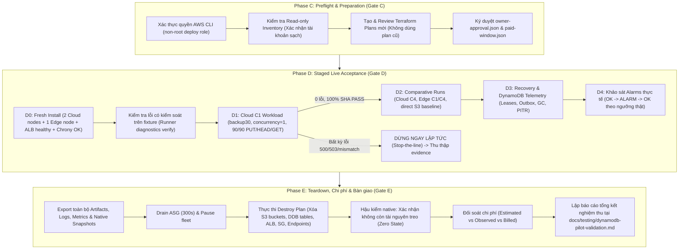

# Kế hoạch chạy nghiệm thu AWS thực tế (AWS Live Acceptance Run Plan)

**Mã văn kiện:** `aws-live-acceptance-run-plan`
**Ngày lập:** 08/11/2026
**Trạng thái:** Pre-execution Plan (Đã được phê duyệt tại run live 2026-11-08 03:45; đã thực hiện Phase C, D1, D2, D3, E; teardown sạch 41/41 absence checks — xem kết quả tại [`docs/testing/live-acceptance-20261108-report.md`](../testing/live-acceptance-20261108-report.md))
**Căn cứ:** `docs/planning/aws-live-acceptance-follow-up.md` §2 (Phase C, D, E) và §4.

---

## 1. Thông số phê duyệt và giới hạn an toàn (Envelope & Preflight)

Theo quy định bắt buộc tại Gate C, việc triển khai trên AWS chỉ được kích hoạt sau khi chủ tài khoản phê duyệt bằng văn bản với các giới hạn cứng dưới đây:

| Hạng mục | Giá trị phê duyệt đề xuất | Ghi chú an toàn & Ràng buộc |
| :--- | :--- | :--- |
| **Tài khoản AWS** | `499388132734` | Chỉ sử dụng tài khoản dev/pilot được chỉ định; tuyệt đối không dùng account khác. |
| **Commercial Region** | `ap-southeast-1` (Singapore) | Cố định cùng Region cho mọi tài nguyên và benchmark. |
| **Source Commit SHA** | `0ef5aece2e2eca50bf7334db4e325860096b4e9b` | Commit HEAD của PR #71 (đã pass 70 offline tests & CI 5/5). |
| **Release Binary SHA-256** | `87ac098b1549f0bc73632f086b09b38d4410bfce47ee6e278ece87f8e4238d63` | Build sạch linux/arm64 qua `deploy/build-release.py` (32,258,636 bytes). |
| **Dataset chuẩn** | `backup30` (90 files, 754,994,670 bytes) | Sinh bằng `datasetgen` với seed `miles-w02-v1`; manifest sha256 `04014dd767e799d9f70081536d01c988fa6a02c0b7653c34db11a48c9abc1556`. |
| **IAM Deployer Role** | `arn:aws:sts::499388132734:assumed-role/miles-dev-deploy/hung-deploy` | Bắt buộc dùng IAM Role có permission boundary; **tuyệt đối không dùng root** cho Terraform, workload hoặc runner. |
| **Giới hạn Compute** | Tối đa **4 EC2 instances** (`t4g.small`) | Gồm: 2 Cloud gateways (2 AZs), 1 Edge gateway, 1 Client runner. Toàn bộ EBS 20GB encrypted, `delete_on_termination=true`. |
| **Giới hạn Network** | **0 NAT Gateway**, dùng Gateway Endpoints | Gateway Endpoints cho S3 và DynamoDB (0 USD phí data transfer nội vùng). `client_cidrs` khóa chặt theo IP operator `/32`. Không mở cổng SSH/Admin/Metrics ra Internet; Admin forward qua SSM loopback. |
| **Ngân sách mềm (Soft Budget)** | **10.00 USD** | Giới hạn chi tiêu dự kiến: 5.00 – 10.00 USD. Nếu chi phí vượt 8.00 USD: dừng test mới; chạm 10.00 USD: lập tức kích hoạt Teardown. |
| **Thời hạn phiên chạy** | **Tối đa 3.0 giờ** (gồm 30 phút Teardown) | Bắt đầu từ lúc apply foundation đến khi kết thúc teardown và xác minh zero-resource. |
| **Cấu hình Telemetry** | `monitored_profiles = ["cloud", "edge"]`<br>`deep_observation = false` | Shallow mode: 4 alarms/profile = **8 alarms tổng cộng**. Không phát metric 0 giả cho deep metrics (`miles_stuck_completing_uploads`, `journal_export_lag`). |

---

## 2. Quy trình thực hiện chi tiết



---

### Phase C — AWS Preflight (Điều kiện tiên quyết)

1. **Khắc phục trạng thái phiên CLI**:
   - Operator thực hiện `aws login` hoặc cấu hình profile `miles-dev` cho role `miles-dev-deploy`.
   - Kiểm tra định danh: `aws sts get-caller-identity` xác nhận ARN `arn:aws:sts::499388132734:assumed-role/miles-dev-deploy/...`.
2. **Read-only Inventory Baseline**:
   - Chạy script rà soát độc lập kiểm tra: không có EC2 instance, ALB, NAT Gateway, DynamoDB table, S3 synthetic bucket cũ còn tồn đọng ngoài bootstrap state backend.
3. **Phê chuẩn kế hoạch và cửa sổ thanh toán**:
   - Tạo file `owner-approval.json` và `paid-window.json` xác lập mốc thời gian bắt đầu, deadline teardown cứng, và chữ ký duyệt.
   - Tạo các saved plan mới (`fleet-foundation.tfplan`, `runtime-permissions.tfplan`, `client-edge.tfplan`, `active.tfplan`).

---

### Phase D — Staged Live Acceptance (Thực thi từng chặng)

- **Chặng D0 (Fresh Install & Kiểm tra chẩn đoán)**:
  - Apply foundation và fleet.
  - Xác nhận 2 Cloud instances ở 2 AZ (subnet private), 1 Edge instance, ALB HTTPS và target group gắn healthy.
  - Kiểm tra chrony tracking: offset và dispersion đạt ngưỡng (`uncertainty_exceeded=False`).
  - Kiểm tra R1 leases, DynamoDB partition bounds, sẵn sàng cut/export.
  - Thực hiện một kiểm tra lỗi có kiểm soát trên fixture nội bộ để xác nhận module `scripts/runner_orchestrator.py` thu thập chính xác failed-window payload và không rò rỉ secret.
- **Chặng D1 (Cloud C1 Workload — Hard gate đầu tiên)**:
  - Chạy `warmbench` với `concurrency=1`, profile `backup30` (90 objects).
  - Yêu cầu: **90/90 PUT PASS, 90/90 HEAD PASS, 90/90 GET full-file SHA-256 PASS**.
  - Không có bất kỳ lỗi HTTP 500 hoặc 503 nào.
  - Thu thập đầy đủ per-node telemetry `before`/`after` và refresh physical statistics hoàn tất.
  - *Quy tắc dừng khẩn cấp:* Nếu xảy ra bất kỳ lỗi nào, hệ thống kích hoạt `execute_workload_and_capture_on_failure`, lưu failed-window JSON nguyên tử, dừng toàn bộ bài test tiếp theo.
- **Chặng D2 (Cloud C4, Edge, Direct S3)**:
  - Chỉ tiến hành khi D1 đạt 100% PASS.
  - Chạy `concurrency=4` trên Cloud gateway, Edge gateway, và direct S3 baseline cùng tập dữ liệu `backup30`.
  - Giữ lại prefix để đối chiếu tỷ lệ deduplication, request counts, DDB units, và băng thông gateway ↔ S3.
- **Chặng D3 (Recovery, Leases & DynamoDB PITR)**:
  - Xác thực cơ chế lease R1, writer fence, closed writer handling.
  - Khảo sát R2 outbox export, checkpoint, GC cycles.
  - Đo lường DynamoDB read/write capacity units tiêu thụ, conflicts, và kiểm tra tính toàn vẹn PITR native.
- **Chặng D4 (Alarms Validation)**:
  - Kiểm tra chu trình chuyển trạng thái `OK -> ALARM -> OK` bằng ngưỡng metric thật.
  - Đảm bảo 8 CloudWatch alarms hoạt động đúng logic shallow, không có false alarm do missing metric.

---

### Phase E — Teardown & Reconcile (Hạ tầng sạch 100%)

1. **Thu thập chứng cứ trước teardown**:
   - Xuất toàn bộ log, failed/passed artifacts, metrics snapshot, CloudWatch alarms state, và DynamoDB summary.
   - Toàn bộ bằng chứng được sanitize tự động bằng `scripts/runner_diagnostics.py` trước khi lưu trữ.
2. **Quy trình hạ giải (Graceful Teardown)**:
   - Kích hoạt drain gateway qua ALB với `deregistration_delay = 300s`.
   - Chạy lệnh hủy Terraform: xóa toàn bộ compute instances, ALB, target groups, security groups, endpoints.
   - Chạy script dọn dẹp bucket synthetic (xóa cả versions, delete markers, và incomplete multipart uploads).
   - Xóa các bảng DynamoDB tạm của phiên chạy.
3. **Xác minh Zero State (Native Audit)**:
   - Chạy `verify-final-aws-cleanup.py` kiểm tra AWS native API, bảo đảm không còn resource nào chạy ngoài bootstrap/state S3 backend.
4. **Đối soát chi phí & Lập báo cáo**:
   - Thu thập báo cáo Cost Explorer / Cost and Usage metrics cho phiên chạy, phân biệt estimated vs billed.
   - Lập báo cáo nghiệm thu tổng kết `docs/testing/dynamodb-pilot-validation.md`.

---

## 3. Mẫu phê duyệt văn bản (Owner Approval Template)

Chủ tài khoản kích hoạt Phase C bằng cách tạo hoặc cập nhật file `/home/ubuntu/.local/state/miles/dynamodb-pilot/recheck/live-run-<timestamp>/owner-approval.json`:

```json
{
  "scope": "AWS Live Acceptance Follow-Up (Phase C, D, E)",
  "status": "approved_authenticated_preflight",
  "approval_received_at_utc": "2026-11-08T03:30:00+00:00",
  "approved_soft_spend_usd_min": 5.0,
  "approved_soft_spend_usd_max": 10.0,
  "max_window_hours": 3.0,
  "region": "ap-southeast-1",
  "account_id": "499388132734",
  "source_commit": "0ef5aece2e2eca50bf7334db4e325860096b4e9b",
  "release_sha256": "87ac098b1549f0bc73632f086b09b38d4410bfce47ee6e278ece87f8e4238d63",
  "client_cidrs": ["<OPERATOR_IP>/32"],
  "cleanup_scope": "owned test resources only; preserve bootstrap/state",
  "approved": true
}
```
