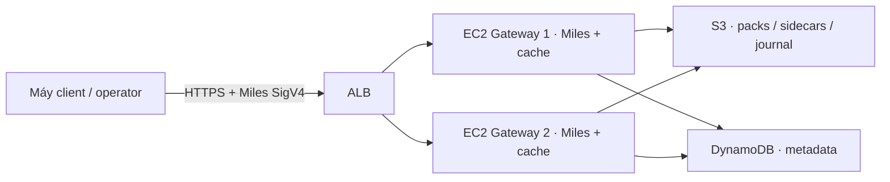

# Chạy Miles thuần Cloud

Chọn **`deployment.profile: "cloud"`** trong một JSON private. Bộ dựng tạo ALB
và hai EC2 chạy Miles Gateway trong ASG, cùng backend S3/DynamoDB. Không tạo
Edge EC2 hoặc EC2 client benchmark. Đây là hướng dẫn dev/demo với dữ liệu
synthetic và CA riêng; chưa phải cấu hình certificate công khai cho production.



**Cache nằm trên các EC2 Gateway**, không nằm trên máy cá nhân: shared runtime
hiện dùng RAM LRU tối đa 64 MiB và disk cache tối đa 1 GiB/node tại
`/var/lib/miles/cache`. Mỗi node có cache riêng. ALB không chứa cache; không
cần dựng thêm Edge để Cloud đọc qua cache. Node bị thay thế sẽ làm lạnh cache,
không mất dữ liệu bền vững trong S3/DynamoDB.

Máy thao tác chỉ cần source, công cụ, release/plan/state private và file nhỏ để
upload/download; không chạy service Miles hoặc chứa gateway cache/dataset
benchmark. `provision` vẫn build Go và release, nên cần chỗ cho Go build cache
và artifacts; có thể chạy operator từ máy dev qua SSH thay vì laptop ít dung
lượng. Bootstrap metadata gọi `dsgctl` ngắn hạn, không khởi chạy gateway phục vụ
request trên máy này.

## 1. Chuẩn bị một file config

Dùng source commit sạch chứa hỗ trợ profile selection. Công cụ và chrony theo
[mục 1 của installation guide](../testing/aws-personal-account-guide.md#1-chuẩn-bị).
Chạy các lệnh từ repository root; nếu dùng agent, truyền đường dẫn repo qua
`workdir`. Không dùng private deployment state của một lượt đã destroy.

```bash
umask 077
export MILES_REPO="$PWD"
export MILES_PRIVATE="$HOME/.local/state/miles/cloud-demo"
mkdir -p "$MILES_PRIVATE"
chmod 700 "$MILES_PRIVATE"
# Chỉ copy khi bắt đầu installation mới; không ghi đè config của lượt đang resume.
cp infra/terraform/cloud/environments/dev/cloud-demo.example.json \
  "$MILES_PRIVATE/installation.json"
deploy() {
  python3 -B "$MILES_REPO/infra/terraform/cloud/scripts/deploy-installation.py" \
    --config "$MILES_PRIVATE/installation.json" --private "$MILES_PRIVATE" "$@"
}
```

Điền `installation.json` trước `prepare`. Account/ARN/AMI/IP và các số ngân sách
trong [example](../../infra/terraform/cloud/environments/dev/cloud-demo.example.json)
là fixture, phải thay theo quyền đã được cấp:

| Nhóm | Giá trị cần điền |
|---|---|
| Profile | Giữ `deployment.profile="cloud"`, `enable_compute=false`, `enable_acceptance_nodes=false`; bộ dựng tự sinh active với ASG/ALB bật và Edge tắt |
| Ownership | Account, Region/AZ, `installation_name`, `environment`, `owner` riêng; không đổi tên rồi dùng role/state của installation khác |
| Compute | AMI Amazon Linux 2023 đã pin, `release_architecture`, instance types tương thích |
| IAM/backend | `bootstrap_mode="existing"`, runtime IAM path/boundary, user/MFA/deploy role và state bucket/key đúng bàn giao; bỏ `state_bucket` nếu theo quy ước trong installation guide |
| Operator | `login_profile`, `terraform_profile`, `utc_reference` khớp nguồn chrony IPv4; `admin_profile` không dùng khi `existing` |
| Network | `client_cidrs` chứa IP egress thực của máy chạy curl/probe; giữ `egress_mode="interface"`, ALB public cho ví dụ này |
| Vòng đời | `max_cost_usd` và `max_active_minutes` theo lượt được giao; đây không phải hard billing cap hoặc timer tự tắt AWS |

Nếu **chưa có IAM và state backend**, chọn `bootstrap_mode="new"` ngay từ đầu
và làm bootstrap operator/state theo [installation guide §2–5](../testing/aws-personal-account-guide.md#2-đăng-nhập-quản-trị-iam-bằng-link-và-code).
Không dùng `existing` để tự nhận tài nguyên của người khác. Không đổi profile
trong một private directory đã chuẩn bị; config hash sẽ chặn thay đổi đó.
`edge` là lựa chọn thay thế để dựng một Edge EC2, còn `both` giữ luồng hai Cloud
và một Edge. Bỏ `deployment.profile` cũng giữ hành vi cũ `both`.

## 2. Prepare offline và đăng nhập deploy role

```bash
deploy prepare
export MILES_REGION="$(python3 -c 'import json,os; print(json.load(open(os.environ["MILES_PRIVATE"]+"/installation.json"))["region"])')"
export MILES_AWS_PROFILE="$(python3 -c 'import json,os; print(json.load(open(os.environ["MILES_PRIVATE"]+"/installation.json"))["operator"]["login_profile"])')"
aws login --profile "$MILES_AWS_PROFILE" --region "$MILES_REGION" --remote
aws sts get-caller-identity --profile "$MILES_AWS_PROFILE"
```

`prepare` chưa gọi AWS. Trên SSH, copy **URL đầy đủ** CLI vừa in và mở trên máy
có trình duyệt, dùng đúng deploy role trong Console. Nếu agent đăng nhập hộ,
lưu code vào file private `cli-login-code.txt` rồi báo xong; không gửi code qua
chat. `iam-login-code.txt` chỉ dành cho phiên IAM/bootstrap, không lẫn hai phiên.
Chi tiết theo [installation guide §4](../testing/aws-personal-account-guide.md#4-đăng-nhập-deploy-role).

Account/assumed-role ARN phải khớp JSON. Một phiên IAM user hoặc root không qua
gate workload. CLI login này cấp quyền thao tác AWS, **khác** Miles credential
để client gọi S3 API và **khác** Admin bearer token của Miles.

## 3. Foundation, release và bật Cloud

Với IAM/backend đã cấp (`existing`):

```bash
deploy verify-bootstrap
deploy plan foundation
# Đọc foundation-plan-details.json và descriptor trong MILES_PRIVATE trước apply.
deploy apply foundation --plan-sha256 REPLACE_WITH_FOUNDATION_PLAN_SHA256
deploy provision
deploy plan active
# Đọc active-plan-details.json, kiểm đúng graph Cloud-only trước apply.
deploy apply active --plan-sha256 REPLACE_WITH_ACTIVE_PLAN_SHA256
```

Mỗi hash là SHA-256 trong descriptor của **saved plan vừa review**, không lấy
hash plan khác. `foundation` tạo storage/network nhưng chưa có serving node;
datastore/key/secret đã có thể tính phí. `provision` bootstrap backend mới khi
runtime dừng, build release pin source/hash/S3 VersionId và nhập certificate
Cloud vào ACM. Không tải Roles Anywhere helper hoặc provision secret Edge.

**ACM là nơi AWS quản lý certificate TLS cho ALB.** Đường demo này tự tạo CA và
certificate `cloud.<installation_name>.test`, rồi import vào ACM, nên không
cần mua domain. Client phải tin đúng CA private này và giữ Host/SNI như mẫu
curl bên dưới. Không dùng `--insecure` hoặc `--no-verify-ssl`.

Kiểm plan active có hai EC2 qua ASG/launch template, ALB HTTPS, đường private
S3/DynamoDB, các endpoints/IAM/EBS cần thiết; không có `module.edge[0]`, Roles
Anywhere identity của Edge hoặc acceptance nodes. Metadata dùng chung gồm
20 bảng DynamoDB. Gateway lấy AWS credential qua instance profile, không
copy access key của operator lên EC2. Admin chỉ bind loopback, không public
cổng 9000/9100.

Nếu bootstrap có kết quả chưa xác định, giữ token/intent/state để reconcile;
không xóa token và bootstrap lại backend đã có dữ liệu. Thiếu quyền thì đối
chiếu action/resource với chủ account; không chuyển sang root để chạy workload.

## 4. Kiểm tra ứng dụng

Sau khi EC2 bootstrap xong, hai ALB targets healthy và SSM hoạt động:

```bash
deploy verify
```

Lệnh kiểm readiness cả hai Cloud node, đúng hai instance healthy trong target
group và PUT→GET SHA-256 qua ALB/TLS bằng credential Miles. Nó tạo riêng một
user/bucket synthetic, lưu credential `0600` tại `test-credential.json` và bằng
chứng tại `readiness-evidence.json`, `signed-data-evidence.json`. Cloud-only
chỉ ghi evidence `cloud-to-cloud`; một probe qua ALB không chứng minh data
request đã chạy trên cả hai node hoặc profile Edge đã được test.

Có thể sử dụng chính user synthetic này cho demo nhỏ. Tạo curl config private
để không đưa secret vào command line, dùng hostname đúng certificate và nối
tới ALB DNS mà không sửa `/etc/hosts`:

```bash
python3 - <<'PY'
import json, os
from pathlib import Path
p = Path(os.environ['MILES_PRIVATE'])
c = json.loads((p/'installation.json').read_text())
i = json.loads((p/'runtime-inventory.json').read_text())
k = json.loads((p/'test-credential.json').read_text())
host = 'cloud.' + c['installation_name'] + '.test'
options = {'cacert':str(p/'pki/tls-ca.pem'), 'noproxy':'*',
           'connect-to':host+':443:'+i['alb_dns']+':443',
           'aws-sigv4':'aws:amz:'+c['region']+':s3',
           'user':k['access_key_id']+':'+k['secret_access_key']}
with open(p/'client.curl', 'w', opener=lambda path, flags: os.open(path, flags, 0o600)) as f:
    f.write('silent\nshow-error\nfail-with-body\n' +
            '\n'.join(key+' = '+json.dumps(value) for key,value in options.items())+'\n')
(p/'demo-input.txt').write_text('Miles Cloud demo: upload, download and verify.\n')
PY
export MILES_DEMO_HOST="$(python3 -c 'import json,os; print("cloud."+json.load(open(os.environ["MILES_PRIVATE"]+"/installation.json"))["installation_name"]+".test")')"
export MILES_DEMO_BUCKET="$(python3 -c 'import json,os; print(json.load(open(os.environ["MILES_PRIVATE"]+"/deployment.json"))["test_bucket"])')"
export MILES_DEMO_URL="https://$MILES_DEMO_HOST/$MILES_DEMO_BUCKET"
curl --config "$MILES_PRIVATE/client.curl" --request PUT \
  --data-binary "@$MILES_PRIVATE/demo-input.txt" "$MILES_DEMO_URL/demo.txt"
curl --config "$MILES_PRIVATE/client.curl" --head "$MILES_DEMO_URL/demo.txt"
curl --config "$MILES_PRIVATE/client.curl" "$MILES_DEMO_URL?list-type=2"
curl --config "$MILES_PRIVATE/client.curl" "$MILES_DEMO_URL/demo.txt" \
  --output "$MILES_PRIVATE/demo-output.txt"
sha256sum "$MILES_PRIVATE/demo-input.txt" "$MILES_PRIVATE/demo-output.txt"
cmp "$MILES_PRIVATE/demo-input.txt" "$MILES_PRIVATE/demo-output.txt"
# Ghi cùng nội dung sang key thứ hai để sử dụng đường dedup.
curl --config "$MILES_PRIVATE/client.curl" --request PUT \
  --data-binary "@$MILES_PRIVATE/demo-input.txt" "$MILES_DEMO_URL/demo-copy.txt"
```

Hai SHA-256 phải khớp và `cmp` exit 0. User synthetic sở hữu bucket demo;
`system_admin` không có quyền đọc/ghi object ngầm định. Admin token bootstrap
nằm riêng ở `system-admin-token`, chỉ dùng qua SSH/SSM đã pin host key. Muốn
quản lý user/grant, xem [API usage guide](../api-usage-guide.md), không public
Admin endpoint hoặc dùng token quản trị thay Miles SigV4 key.

## 5. Xem backend trên S3 Console

Mở đúng account/Region và bucket `data_bucket_name` trong `runtime-inventory.json`.
S3 chứa pack, sidecar và journal; tên object client `demo.txt` là namespace
logical, không nhất thiết xuất hiện như một file riêng trong bucket AWS.
Dùng `dsgctl layout <bucket> <key>` qua Admin tunnel để đối chiếu chunk/pack,
và stats/cache stats để xem dữ liệu vật lý/cache theo quyền quản trị.

Upload trùng không đảm bảo tổng byte bucket đứng yên: journal, sidecar và dữ
liệu retained vẫn có thể tăng. Ảnh S3 Console minh họa backend; PUT→GET hash
match mới là kiểm tra nội dung. Không nới bucket thành public để xem, không
đưa token/secret/presigned URL vào ảnh và không tắt checksum/protection/fencing
hoặc periodic recovery để demo PASS.

## 6. Dừng sau khi dùng

Dừng client/request mới, giữ phiên deploy còn hiệu lực cho cleanup:

```bash
deploy plan paused
deploy apply paused --plan-sha256 REPLACE_WITH_PAUSE_PLAN_SHA256
```

Cloud vẫn chạy tới khi ASG termination hook bắt đầu drain đúng invocation;
không tự stop/kill gateway trước hook. Pause xóa serving EC2/ALB/interface
endpoints, giữ backend/data/key/state và các phần này vẫn có thể tính phí.

Muốn xóa toàn bộ dữ liệu synthetic, làm tiếp [installation guide §8](../testing/aws-personal-account-guide.md#8-pause-hoặc-full-cleanup):
điền `operator.cleanup_expires_at` theo cửa sổ được cấp, xác nhận cleanup rights,
review/apply `unprotect`, review/apply `destroy --delete-data`, rồi `closeout`.
Không chạy destroy của installation khác. KMS/secrets có thời gian chờ xóa;
bootstrap IAM và state backend được giữ. Giữ private state/evidence cho tới
khi đối soát xong; không xóa directory chỉ để bỏ qua lỗi cleanup.

Hướng dẫn này đã được kiểm tra offline; việc có code/tests/plan mẫu không phải
bằng chứng môi trường Cloud mới đã được triển khai. Chạy các lệnh AWS sau khi
source/config/saved plans và phạm vi sử dụng thực tế đã được duyệt.
