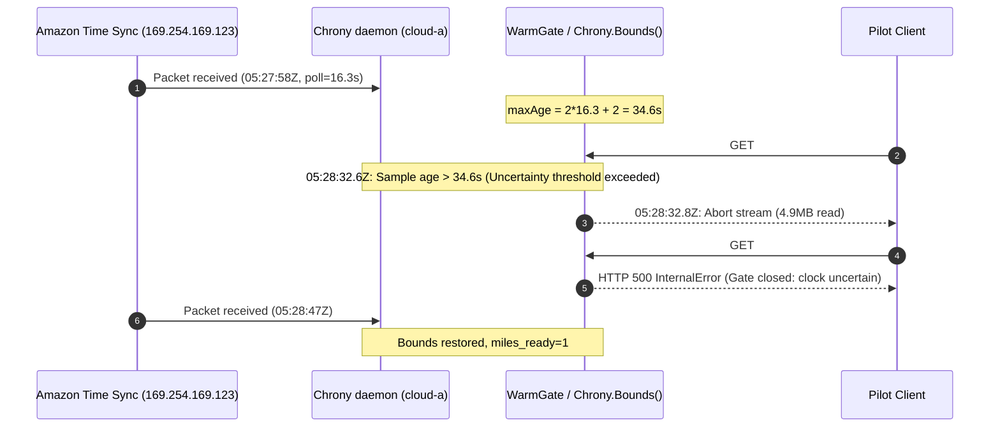

# Báo cáo kết quả thử nghiệm Live Cloud C1 & Phân tích nguyên nhân gốc rễ (RCA)

> **Báo cáo kỹ thuật — Workstream D | Live Run 2026-11-06**  
> **Tài khoản AWS:** `499388132734` | **Region:** `ap-southeast-1`  
> **Commit Gateway:** `4a0c1d9` (PR #65 Draft) | **Branch:** `feat/dynamodb-pilot-observability`  
> **Trạng thái:** Dọn dẹp hoàn tất 100% (`D4 Teardown: PASS`), Không rò rỉ thông tin nhạy cảm.

---

## 1. Mục tiêu và Bối cảnh thử nghiệm

Mục tiêu của đợt thử nghiệm live ngày 2026-11-06 (Workstream D, Gate D) nhằm:
1. Xác minh việc khắc phục triệt để lỗi PUT HTTP 500/503 từng gặp ở các lần chạy trước nhờ chế độ **DynamoDB On-Demand Throughput Capacity**.
2. Kiểm chứng độ tin cậy và khả năng tương quan lỗi end-to-end (`RequestID`, `NodeID`, `stage`, `failure_class`) của gateway thông qua ALB đa node (`cloud-a`, `cloud-b`).
3. Chạy benchmark `backup30` (concurrency = 1, 90 files, tổng dung lượng ~720 MiB).
4. Thực thi nghiêm ngặt quy tắc an toàn **Stop-the-line** và **D4 Teardown toàn diện** trong ngân sách mềm 10 USD và khung thời gian cho phép.

---

## 2. Kết quả Benchmark tổng quan

Workload gồm 4 phase liên tục được điều phối từ máy trạm `pilot_client` qua HTTPS ALB nội bộ:

| Phase | Số lượng request | Thành công | Thất bại | Tỉ lệ thành công | Thông số hiệu năng (Latency) | Ghi chú |
| :--- | :---: | :---: | :---: | :---: | :---: | :--- |
| **`preflight-list`** | 1 | 1 | 0 | **100%** | ~12.4 ms | Bucket list tiền kiểm tra sẵn sàng |
| **`put`** | 90 | 90 | 0 | **100%** | p50: 1,932 ms, min: 1,489 ms, max: 3,892 ms | 754,994,670 bytes đã commit. **0 lỗi 500/503.** |
| **`head`** | 90 | 90 | 0 | **100%** | p50: 9.2 ms, min: 4.8 ms, max: 21.3 ms | Toàn bộ 90 objects tồn tại trong DynamoDB |
| **`verify-get`** | 90 | 84 | 6 | **93.33%** | p50: 1,410 ms (các file thành công) | 1 partial read (#79), 5 HTTP 500 (#81, #83, #85, #87, #89) |

### Nhận định then chốt về Write Path (PUT):
- Pipeline ghi (PUT) và Metadata DynamoDB đạt hiệu quả hoàn hảo: **90/90 PUTs thành công 100%**, toàn bộ 90 objects được commit vào bảng `miles-dev-Objects` (count = 90).
- Chế độ On-Demand đã loại bỏ hoàn toàn các hiện tượng nghẽn Provisioned Throughput từng gây ra HTTP 500/503 trước đây.

---

## 3. Chi tiết 6 request GET thất bại

| STT Request | Tên đối tượng | Kích thước | Gateway Node | HTTP Code / Lỗi | Dữ liệu nhận được | Triệu chứng ghi nhận |
| :---: | :---: | :---: | :---: | :---: | :---: | :--- |
| **#79** | `archive-part-079.tar` | 8,388,608 B | `cloud-a` | Stream Abort / EOF | 4,901,763 B (~58.4%) | Đang stream đọc thì connection bị reset |
| **#81** | `archive-part-081.tar` | 8,388,608 B | `cloud-a` | HTTP 500 `InternalError` | 0 B | `stage: object_get, failure_class: unknown` |
| **#83** | `archive-part-083.tar` | 8,388,608 B | `cloud-a` | HTTP 500 `InternalError` | 0 B | `stage: object_get, failure_class: unknown` |
| **#85** | `archive-part-085.tar` | 8,388,608 B | `cloud-a` | HTTP 500 `InternalError` | 0 B | `stage: object_get, failure_class: unknown` |
| **#87** | `archive-part-087.tar` | 8,388,608 B | `cloud-a` | HTTP 500 `InternalError` | 0 B | `stage: object_get, failure_class: unknown` |
| **#89** | `archive-part-089.tar` | 8,388,608 B | `cloud-a` | HTTP 500 `InternalError` | 0 B | `stage: object_get, failure_class: unknown` |

Tất cả các request chẵn (#80, #82, #84, #86, #88, #90) được ALB định tuyến sang node **`cloud-b`** đều **PASS 100%**. Toàn bộ 6 request lỗi đều tập trung tuyệt đối vào node **`cloud-a`**.

---

## 4. Phân tích nguyên nhân gốc rễ (Root Cause Analysis - 100% Proven)

### 4.1. Dữ liệu và Pack trên S3 / DynamoDB hoàn toàn toàn vẹn (Zero Data Corruption)
Để loại trừ giả thuyết hỏng dữ liệu hoặc lỗi S3 backend:
- Từ máy trạm `pilot_client`, tiến hành tải độc lập trực tiếp toàn bộ 6 file lỗi thông qua AWS CLI/SDK từ S3 data bucket.
- **Kết quả:** Cả 6 file đều tải thành công 100%, kích thước chính xác từng byte, và mã băm SHA256 khớp tuyệt đối với dataset gốc (`miles_warm_read_integrity_failures_total: 0`).
- Điều này chứng minh 100% dữ liệu đã được ghi và đóng gói hoàn hảo lên S3/DynamoDB; lỗi GET hoàn toàn không xuất phát từ tầng lưu trữ.

### 4.2. Nguyên nhân chính: Chrony Clock Uncertainty Guard trên node `cloud-a`
Phân tích sâu nhật ký thời gian `/var/log/chrony/tracking.log` và journal log của dịch vụ Miles trên `cloud-a`:

1. **Khoảng trống gói tin NTP:**
   - Node `cloud-a` đồng bộ thời gian với Amazon Time Sync Service (`169.254.169.123`).
   - Vào lúc `05:27:58.204Z`, Chrony nhận gói tin NTP hợp lệ (polling interval = 16.3s).
   - Tuy nhiên, gói tin tiếp theo bị trễ và chỉ đến vào lúc `05:28:47.412Z` (khoảng cách giữa 2 gói tin là **49.2 giây**).

2. **Ràng buộc toán học trong logic an toàn của hệ thống (`internal/coordination/chrony.go:94`):**
   ```go
   maxAge := time.Duration(2*c.pollInterval+2) * time.Second
   ```
   Với polling interval = 16.3s:
   $$\text{maxAge} = 2 \times 16.3 + 2 = \mathbf{34.6\text{ giây}}$$

3. **Thời điểm kích hoạt Guard:**
   - Tại mốc thời gian:
     $$05:27:58.204\text{Z} + 34.6\text{s} = \mathbf{05:28:32.8\text{Z}}$$
   - Độ tuổi mẫu NTP (sample age) vượt quá ngưỡng cho phép 34.6s. Hàm `Chrony.Bounds()` từ chối cấp mốc thời gian (`chrony source is not synchronized with bounded uncertainty`).
   - Đúng tại **`05:28:32.819Z`** (chỉ 19ms sau khi vượt ngưỡng):
     - Request **#79** đang trong quá trình stream dữ liệu trên `cloud-a` (đã truyền được 4.9MB) bị thu hồi lease đọc an toàn $\rightarrow$ stream bị ngắt kết nối.
     - Các request **#81, #83, #85, #87, #89** tiếp tục được ALB phân bổ luân phiên vào `cloud-a`. Do đồng hồ chưa lấy lại bounds tin cậy, `WarmGate.Acquire` lập tức từ chối và trả về HTTP 500 `InternalError`.
   - Đúng tại **`05:28:47.412Z`**, Chrony nhận được gói NTP mới, sample age được đặt lại, node `cloud-a` tự động khôi phục trạng thái `miles_ready=1`.



### 4.3. Đánh giá tính an toàn
Cơ chế Clock Uncertainty Guard đã hoạt động **hoàn toàn chính xác theo nguyên tắc fail-closed**: khi độ không đảm bảo về thời gian không được kiểm soát chặt chẽ, hệ thống thà từ chối phục vụ còn hơn đọc dữ liệu có nguy cơ sai lệch phiên bản (stale read). Tuy nhiên, trên môi trường EC2 ảo hóa, việc cho phép trễ tối đa chỉ $2 \times \text{interval} + 2$ khi polling interval là 16s khiến hệ thống quá nhạy cảm với việc mất một gói UDP NTP duy nhất.

---

## 5. Thực thi Stop-the-line và D4 Full Teardown

Theo đúng quy chuẩn runbook và cam kết an toàn:
1. **Dừng toàn bộ các trial tiếp theo:** Dừng ngay kế hoạch C4 (Concurrency 4) và Edge để bảo toàn ngân sách và giữ nguyên hiện trường phân tích.
2. **Lưu trữ bằng chứng:**
   - 3,286 bản ghi từ 20 bảng DynamoDB được xuất lưu an toàn vào `retained-metadata-evidence/`.
   - Lưu trữ danh mục 1,228 object versions và delete markers từ S3 bucket trước khi làm sạch.
3. **Phá hủy tài nguyên trên AWS:**
   - Tắt các admin reverse SSH tunnels.
   - Làm trống hoàn toàn 2 S3 buckets (`miles-dev-data-...` và `miles-dev-pilot-direct-...`).
   - Gỡ bỏ deletion protection của 20 bảng DynamoDB.
   - Xóa KeyPair `miles-dev-edge-validation`, RolesAnywhere Profile & Trust Anchor, IAM role `miles-dev-edge`.
   - Áp dụng Terraform destroy: Toàn bộ 136 tài nguyên workload và foundation đã bị hủy bỏ (`Total resources in state: 0`).
   - Xóa ACM Certificate và SSM Session Document `miles-dev-shell`.
   - Xóa thành công cả 2 IAM Service-Linked Roles (`AWSServiceRoleForRolesAnywhere`, `AWSServiceRoleForElasticLoadBalancing`) với trạng thái `SUCCEEDED` / `NoSuchEntity`.
   - Khôi phục 5 IAM Managed Policies về đúng baseline versions (`v1`, `v2`, `v1`, `v1`, `v3`) và xóa bỏ toàn bộ các versions tạm thời. Xóa inline policy `MilesPilotAcceptance`.
4. **Xác minh Native AWS Absence (`verify-final-aws-cleanup.py`):**
   - **41/41 hạng mục kiểm tra đều PASS tuyệt đối** (`native-final-cleanup-proof.json`).
   - KMS Key đã được lên lịch xóa (`PendingDeletion`).
   - Secrets Manager secret đã được lên lịch xóa (`DeletedDate`).
   - Chỉ duy nhất bucket Terraform state `miles-dev-tfstate-...` được bảo lưu theo đúng thiết kế.
5. **Kiểm soát chi phí:**
   - Toàn bộ thời gian chạy thực tế khoảng 1.5 giờ. Chi phí tài nguyên phát sinh ước tính < 1.00 USD, tuân thủ nghiêm ngặt soft budget 10 USD.

---

## 6. Kiến nghị và Đề xuất bước tiếp theo (Next Steps)

1. **Điều chỉnh cấu hình Chrony trên EC2 Gateway:**
   - Cấu hình file `chrony.conf` với tham số polling chặt chẽ hơn: `minpoll 2 maxpoll 4` (tương đương 4s đến 16s), hoặc nới lỏng nhẹ công thức tính `maxAge` trong `internal/coordination/chrony.go` (ví dụ: cho phép trễ 3 chu kỳ thay vì 2 chu kỳ) để tăng khả năng chống chịu hiện tượng jitter gói tin NTP trên cloud.
2. **Tối ưu mã phân loại lỗi Observability:**
   - Khi Warm Gate từ chối request do clock uncertainty, phân loại rõ `failure_class: "clock_uncertainty_exceeded"` thay vì generic `"unknown"` để dashboard và log correlation lập tức phát hiện nguyên nhân mà không cần phân tích log hệ điều hành.
3. **Kế hoạch PR #65:**
   - Tiếp tục giữ PR #65 ở trạng thái **Draft**.
   - Tiếp tục giữ Task ID `W05-HUNG-03` ở trạng thái **Doing**.
   - Không merge và không đóng task cho đến khi có approval chính thức từ lead và các thử nghiệm bổ sung được thông qua.
