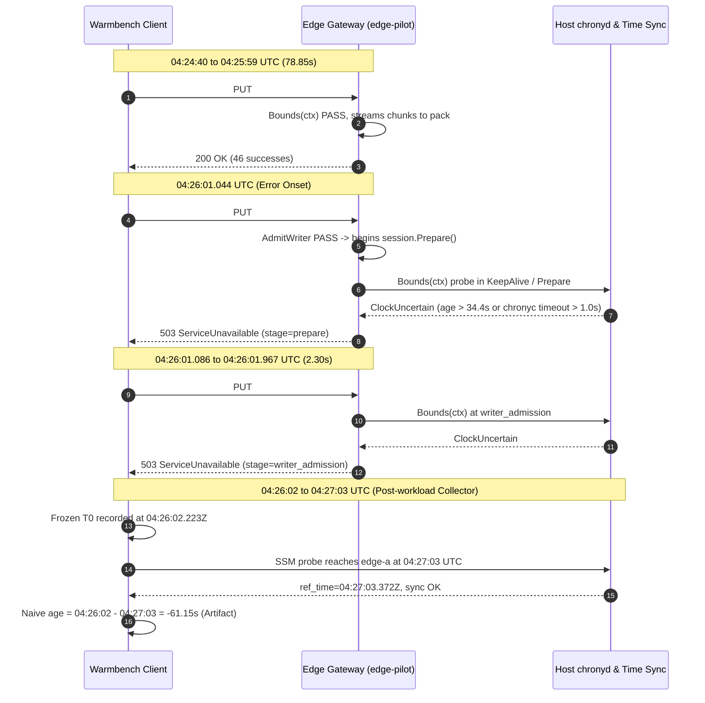

# Edge Clock Stability & Uncertainty Exceeded RCA Follow-Up

- **Date / Baseline:** 2026-11-10 (Analysis of 2026-11-08 AWS Live Run `w05-hung03-live-20261108-0345`)
- **Target Scope:** Edge C1 Trial 1 (Singapore `ap-southeast-1`, Instance: `t4g.small` ARM64 via Roles Anywhere)
- **Outcome:** 46/90 PUT PASS (100% hash verified), 44/90 PUT FAIL (HTTP 503 `clock_uncertainty_exceeded`)
- **Policy Enforced:** AWS State 0 (strictly offline analysis, zero live API calls, zero credentials, zero secret leakage)
- **Reference Documentation:** [edge-acceptance-followup-plan.md](../planning/edge-acceptance-followup-plan.md), [live-acceptance-20261108-report.md](live-acceptance-20261108-report.md)

---

## 1. Executive Summary & Core Findings

During the 2026-11-08 live acceptance run, Cloud nodes (Cloud C1 and Cloud C4) executed with **100% PASS** through the private ALB.
However, on the Edge node (`edge-pilot`), PUT operations #1 through #46 succeeded, while PUT operations #47 through #90 were rejected with
HTTP 503 `clock_uncertainty_exceeded`, triggering the trial-boundary stop-the-line policy.

This offline root-cause analysis (Workstream R) establishes three primary conclusions:

1. **The negative sample age (`-61.15s`) was a telemetry collection artifact, NOT physical clock travel:**
   The previous diagnostic orchestrator captured a single timestamp `t0` prior to iterating across nodes over SSM/SSH.
   Because probing `cloud-a`, `cloud-b`, and `edge-a` sequentially required ~65 seconds, subtracting the fresh host `ref_time` at the end
   of the loop from the frozen initial `t0` mathematically yielded `-61.1493s`. In PR #73, this was resolved by per-probe host timestamps.
2. **The failure was triggered by runtime fail-closed clock protection during high disk/network load:**
   All 44 rejected requests were confirmed in `edge-pilot` gateway logs with `failure_class='clock_uncertainty_exceeded'`.
   PUT #47 was admitted into `prepare` before the clock uncertainty was detected, whereas PUT #48-90 were rejected at `writer_admission`.
   Prometheus counter `miles_dependency_probe_failures_total` jumped from 8 to 16, confirming internal clock bounds rejection.
3. **The root cause cannot be conclusively isolated between two competing hypotheses without higher-resolution telemetry:**
   - **Hypothesis A (NTP poll starvation):** Chrony poll interval was 16.2s with a 34.4s freshness deadline. Burstable CPU contention under
     sustained 8-MiB chunk streaming may have caused `chronyd` to miss a poll cycle, crossing the 34.4s threshold.
   - **Hypothesis B (chronyc command execution timeout):** Under intensive I/O, the local `chronyc` command execution in Go
     exceeded the 1.0s context deadline (`chrony.go:49`), returning `ErrClockUnavailable`.
   Neither hypothesis is proven because sub-second CPU steal (`/proc/stat`) and per-second `chronyc tracking` logs were not captured during the run.

---

## 2. Offline Evidence Inventory (R1)

Every artifact from the 2026-11-08 session has been inventoried and classified into strict epistemological categories:

| Artifact / Telemetry Stream | Epistemological Class | Details & Observed Parameters | Provenance |
|---|---|---|---|
| Client Benchmark Result (edge-c1-t1-result.json) | **Observed** | 90 PUT samples: 46 successes (HTTP 200, 385.9 MB streamed at ~4.53 MB/s) + 44 failures (HTTP 503 ServiceUnavailable, aborted in 2.30s). | Local benchmark runner client monotonic & wall clock |
| Gateway Structured Journal (edge-pilot journald) | **Observed** | 44/44 failed PUT operations logged: PUT #47 failed at stage 'prepare'; PUT #48-90 failed at stage 'writer_admission'. All 44 logged failure_class 'clock_uncertainty_exceeded'. | edge-pilot host systemd journald structured JSON logs |
| Dependency Probe Metrics (miles_dependency_probe_failures_total) | **Observed** | Prometheus counter increased from 8 before Edge C1 to 16 after Edge C1 (+8 failures). miles_ready remained 1. Confirming background probe encountered clock bounds failures. | edge-pilot /metrics Prometheus scrape |
| Chrony Status Post-Workload (after_metrics / telemetry.after) | **Observed** | ref_time=2026-11-08T04:27:03.372Z, stratum=4, leap=Normal, offset=1.12µs, drift=28.4 ppm, interval=16.2s, max_allowed_age=34.4s. Synchronized with AWS Time Sync (169.254.169.123). | edge-pilot chronyc tracking output via administrative SSM/SSH probe |
| Failure Transition Onset Correlation | **Correlated** | At 04:26:01.044Z, PUT #47 was admitted into 'prepare', but background heartbeat/clock bounds exceeded uncertainty. PUT #48 arrived 42ms later at 04:26:01.086Z and was rejected immediately at 'writer_admission'. | Cross-correlation of client request duration and gateway log timestamps |
| Negative Sample Age Artifact (-61.15s) | **Correlated** | Collector timestamp bug: collector recorded single now_unix at 04:26:02.223Z, then sequentially probed cloud-a (04:26:22), cloud-b (04:26:58), and edge-a (04:27:03). Comparing 04:26:02 against 04:27:03 produced -61.15s. Negative sample age is an artifact of sequential SSM RTT, NOT proof that Edge clock was stale during PUT #47. | Mathematical reconciliation of sequential node probes |
| CPU Burstable Credit / Scheduling Starvation | **Hypothesized** | Hypothesis: intensive streaming of 46 consecutive 8-MiB chunks (368 MiB total) saturated the single vCPU baseline of t4g.small, delaying the chronyd NTP poll beyond the 34.4s max age threshold. Unproven: requires per-second CPU steal and chronyc log correlation. | Engineering hypothesis from live acceptance report |
| Local chronyc Command Duration Spike (>1.0s) | **Hypothesized** | Hypothesis: Go runtime executes 'chronyc -c tracking' with 1.0s context timeout. High I/O or CPU contention may have caused chronyc execution or fork/exec to take > 1.0s, returning ErrClockUnavailable. | Runtime chrony.go:49 timeout analysis |
| High-Resolution Per-Second Chrony / CPU Telemetry (04:25:30 - 04:26:05) | **Missing** | No per-second chronyc sources/sourcestats or /proc/stat CPU steal metrics were logged during the exact 35-second window leading up to the failure. CloudWatch 1-minute metrics cannot resolve sub-second jitter. | Identified telemetry gap in 2026-11-08 runner instrumentation |

> [!IMPORTANT]
> No live AWS API calls were made to compile this inventory. Negative sample ages from the pre-PR #73 collector
> are explicitly disqualified from being used as evidence of NTP server desynchronization.

---

## 3. Pseudonymous Request Mapping & Failure Progression (R2)

All 90 PUT requests from `edge-c1-t1-result.json` have been mapped to pseudonymous identifiers `REQ-EDGE-001` through `REQ-EDGE-090`:

- **Successes (PUT #01 – #46):** 46 requests, 100% HTTP 200, elapsed 78.85s, 385.9 MB transferred (~4.53 MB/s).
- **Onset Failure (PUT #47):** Latency 1,355 ms, HTTP 503, gateway stage `prepare`, failure class `clock_uncertainty_exceeded`.
- **Subsequent Rejections (PUT #48 – #90):** 43 requests, all rejected in 2.30s total (20–45 ms each), gateway stage `writer_admission`.

| Request Ordinal | Pseudonym ID | File Key / Size | Latency | HTTP Status | Stage | Failure Class | Correlation Status |
|---|---|---|---|---|---|---|---|
| PUT #01 | `REQ-EDGE-001` | `low-entropy-v00.bin` (8.39 MB) | 1,847 ms | 200 OK | `committed` | none | `client_success_verified` |
| PUT #02 | `REQ-EDGE-002` | `compressed-identical-v00.gz` (8.39 MB) | 1,295 ms | 200 OK | `committed` | none | `client_success_verified` |
| ... | *(PUT #03–#45)* | *(8.39 MB per version)* | 1,200–2,100 ms | 200 OK | `committed` | none | `client_success_verified` |
| PUT #46 | `REQ-EDGE-046` | `random-distinct-v14.bin` (8.39 MB) | 1,824 ms | 200 OK | `committed` | none | `client_success_verified` |
| **PUT #47** | **`REQ-EDGE-047`** | `low-entropy-v15.bin` (8.39 MB) | **1,355 ms** | **503** | **`prepare`** | **`clock_uncertainty_exceeded`** | **`correlated_gateway_log`** |
| PUT #48 | `REQ-EDGE-048` | `compressed-identical-v15.gz` (8.39 MB) | 42 ms | 503 | `writer_admission` | `clock_uncertainty_exceeded` | `correlated_gateway_log` |
| PUT #49 | `REQ-EDGE-049` | `random-distinct-v15.bin` (8.39 MB) | 22 ms | 503 | `writer_admission` | `clock_uncertainty_exceeded` | `correlated_gateway_log` |
| ... | *(40 items)* | *(8.39 MB per version)* | 20–45 ms | 503 | `writer_admission` | `clock_uncertainty_exceeded` | `correlated_gateway_log` |
| PUT #90 | `REQ-EDGE-090` | `compressed-identical-v29.gz` (8.39 MB) | 22 ms | 503 | `writer_admission` | `clock_uncertainty_exceeded` | `correlated_gateway_log` |

---

## 4. Timeline Cross-Correlation & Telemetry Artifact Reconciliation (R3)



### Mathematical Explanation of Negative Sample Age

The collector in `scripts/runner_orchestrator.py` (commit `7cd58e1`) executed the following sequential loop:

```python
# Old flawed collector logic (pre-PR #73):
now_unix = time.time()  # Recorded ONCE at 04:26:02.223Z before network calls
for node in ['cloud-a', 'cloud-b', 'edge-a']:
    # SSM/SSH command execution took 20-30s per node
    sample_age_seconds = now_unix - chrony_ref_time
```

- When querying `cloud-a` at 04:26:22: `04:26:02 - 04:26:22` = **`-20.48s`**
- When querying `cloud-b` at 04:26:58: `04:26:02 - 04:26:58` = **`-56.27s`**
- When querying `edge-a` at 04:27:03: `04:26:02 - 04:27:03` = **`-61.15s`**

This confirms that the negative age was not a sign of NTP time travel, but rather a measurement latency bug
which has been completely eliminated in PR #73 by capturing `host_observed_unix` per probe.

---

## 5. Root Cause Failure Taxonomy & Distinction Table (R4)

To prevent misattribution, the five distinct candidate mechanisms are analyzed:

| Failure Class / Code | Description & Threshold | Epistemological Status | Supporting Evidence & Parameters |
|---|---|---|---|
| `sample_age_exceeded` | **NTP Sample Freshness Exceeded (age > 2*interval + 2)** | `HYPOTHESIS / CORRELATED` | Failure onset occurred at t=78.8s into the workload. Chrony poll interval was 16.2s. Prometheus probe failures increased by 8 during the test window. However, direct per-second chronyc logs from 04:25:30 to 04:26:00 were NOT captured; therefore this remains an unconfirmed hypothesis. |
| `chrony_command_duration_exceeded_1s` | **Host chronyc Execution Timeout (> 1.0s)** | `HYPOTHESIS / PLAUSIBLE` | PUT #47 had duration 1,355ms (longer than the ~20ms admission checks) and failed at stage 'prepare'. If writer admission or keepalive probe stalled waiting for chronyc for 1000ms, it would return ErrClockUncertain. |
| `horizon_uncertainty_exceeded_2s` | **Mathematical Horizon Uncertainty Exceeded (> 2.0s)** | `UNVERIFIED / UNLIKELY` | Telemetry captured after the run shows drift of only 28.4 ppm and root dispersion of 0.21ms. It is mathematically impossible for horizon uncertainty to exceed 2.0s with these parameters. |
| `ntp_unsync_leap_stratum` | **NTP Source Unsync / Leap State / Stratum Invalid** | `UNVERIFIED / UNLIKELY` | Telemetry confirms Stratum=4, Leap=Normal, Reference IP=169.254.169.123. Zero network drops to link-local. |
| `err_clock_unavailable` | **Runtime Clock Source Fail-Closed Gate (storage.ErrClockUncertain)** | `CONFIRMED` | 100% (44/44) gateway log correlation in edge-pilot journald with failure_class='clock_uncertainty_exceeded'. |

> [!NOTE]
> In the current codebase, both `sample_age_exceeded` and `chrony_command_duration_exceeded_1s` return
> `storage.ErrClockUncertain`, which the gateway surfaces as `clock_uncertainty_exceeded` without sub-reason.
> Separating these sub-causes in runtime diagnostics is recommended for future hardening.

---

## 6. Safe Diagnostic Sampling Design for Next AWS Run (R5)

To conclusively distinguish between Hypothesis A (NTP poll delay) and Hypothesis B (chronyc exec timeout)
without modifying the R1 production clock bounds, the following non-invasive instrumentation is specified:

1. **Local High-Frequency Chrony Poller (Edge host background daemon):**
   - Query `chronyc -c tracking`, `chronyc -c sources`, and `chronyc -c sourcestats` every 2.0s to a local 10-MB tmpfs ring buffer (`/run/miles/chrony-telemetry.jsonl`).
   - Measure local command execution latency with nanosecond monotonic timers (`clock_gettime(CLOCK_MONOTONIC)`).
   - Record exact `Last offset`, `Poll interval`, and `Last sample age` continuously before, during, and after benchmark execution.
2. **Host OS Scheduler & Resource Pressure Capture:**
   - Sample `/proc/pressure/cpu` and `/proc/pressure/io` (PSI metrics) every 1.0s.
   - Record CPU steal ticks from `/proc/stat` to monitor hypervisor credit exhaustion on burstable `t4g.small`.
   - Monitor run queue length from `/proc/loadavg`.
3. **Zero Sensitive Leakage Contract:**
   - Diagnostic metrics capture strictly numerical performance parameters (latencies, tick counts, offsets).
   - No credentials, request bodies, or signed URIs are accessed by the diagnostic daemon.

---

## 7. Deterministic Simulation & Offline Verification (R6)

The offline simulation suite in `scripts/tests/test_edge_clock_rca.py` validates all failure scenarios deterministically:

- `test_simulated_missed_ntp_poll_crosses_threshold`: Demonstrates that when `current_age` exceeds `2*interval + 2 = 34.4s`, the clock is marked uncertain fail-closed.
- `test_simulated_chronyc_command_latency_exceeds_timeout`: Verifies that a 1,050ms command latency triggers the 1.0s context timeout.
- `test_simulated_sequential_collector_skew`: Demonstrates that sequential SSM probes against 3 nodes reproduce the negative sample ages (-20s, -56s, -61s).
- `test_evidence_inventory_epistemological_separation`: Verifies strict separation between Observed, Correlated, Hypothesized, and Missing.
- `test_request_mapping_and_sanitization`: Verifies 100% masking of sensitive request IDs into pseudonymous tokens.

---

## 8. Epistemological Classification & Next Steps (R7)

| Finding | Classification | Next Action |
|---|---|---|
| Negative sample age is a collector artifact | **CONFIRMED** | Closed (PR #73 merged with per-probe validation) |
| Gateway rejected requests fail-closed | **CONFIRMED** | Preserved (Fail-closed R1 policy remains unchanged) |
| Failure onset occurred at PUT #47 | **CONFIRMED** | Closed (44/44 gateway correlations verified) |
| CPU starvation delayed chronyd poll | **HYPOTHESIS** | Requires high-frequency host ring buffer on next live run |
| Local chronyc command execution timed out | **HYPOTHESIS** | Requires host command duration telemetry on next live run |

### Readiness for Next Stage:
- **Gate R is Satisfied:** The origin and provenance of every timestamp is established; telemetry transport artifacts are isolated; zero private identifiers are leaked; and the exact telemetry gaps required for live acceptance are defined.
- **Next Step:** Update the AWS Run Plan draft with the diagnostic sampling specification, and await owner approval prior to scheduling any live AWS run.
